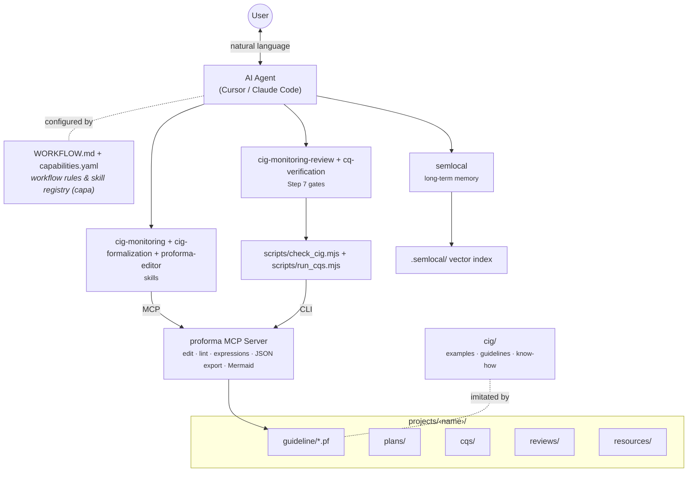

# Agentic CIG Monitoring Development Kit

Build computer-interpretable clinical guidelines (CIGs) with AI assistance in Cursor or Claude Code. You install the required tools, put your guideline sources in the right place, and tell the agent what you want. The agent handles scope, proposals, PROforma formalization, and checks.

**Primary use case — CIG monitoring:** this kit formalizes a clinical guideline as an **executable PROforma guideline** (a PROforma 1.9 `.pf` file, the format Deontics Composer and PROforma engines run). It focuses on monitoring completion of therapy recommendations (Action Enactment goals) and monitoring desired/undesired effects of therapy (State Achievement goals). For CIG tasks the agent follows the **`cig-monitoring`** skill, reads guidelines from the shared `cig/guidelines/` library, and builds a PROforma Top-Level Plan (Enquiry → Decision → Therapy Plan → Monitoring Plan). See `cig/know-how/README.md` for the domain know-how and `cig/examples/obesity-glp1-monitoring.pf` for a worked example.

## Architecture



## What you need to do

1. **Install prerequisites** (below).
2. **Run `capa install`** once in the project root after cloning.
3. **Add your sources**: put guideline PDFs in `cig/guidelines/` (shared) or `projects/<project_dir>/resources/` (one project). To continue an existing CIG, put its `.pf` at `projects/<project_dir>/guideline/<name>.pf`.
4. **Chat with the agent**—describe your goal and approve proposals. It will build the guideline, keep it lint-clean, and run the checks for you.

## Prerequisites

Install these before starting:

| Requirement             | Purpose                                                                                                                                          |
| ----------------------- | ------------------------------------------------------------------------------------------------------------------------------------------------ |
| **Node.js** (v18+)      | Runs the capa CLI, the [proforma](https://www.npmjs.com/package/proforma-mcp) MCP server (via `npx`) and the kit's gate scripts. [Install Node.js](https://nodejs.org/). |
| **semlocal**            | Local semantic memory. Install with `npm install -g semlocal`. Index stored in `.semlocal/`. [semlocal](https://github.com/Minitour/semlocal) |
| **capa**                | Syncs the agent’s skills and tools from this project. [CAPA](https://capa.infragate.ai/). After cloning, run `capa install` in the project root. |

## Setup

1. Clone this repository and open it with your agent of choice
2. Run `capa install` and ensure your agent has access to the capa MCP server.
3. Add any relevant files you have to `projects/<project_dir>/resources`.

## How a CIG is built

1. **Scope and CQs**: the agent agrees with you on the population, therapy and the competency questions (CQs) the CIG must answer.
2. **Extraction**: therapy recommendations, goals, monitoring, ADEs and the data each condition depends on, with citations.
3. **Proposal**: `projects/<project_dir>/plans/PROPOSAL-<timestamp>.md`, an executable spec with canonical task names, data items, conditions written as PROforma expressions, and a `cig-actions` list. Nothing is built until you approve it.
4. **Formalization**: the `cig-formalizer` subagent builds `projects/<project_dir>/guideline/<name>.pf` from the approved proposal with the proforma tools. It keeps the file lint-clean and draws a Mermaid diagram of it.
5. **Blocking review**: `scripts/check_cig.mjs` (structure, metaprops contract, executable preconditions, approved action set, regressions) plus the reviewer's source-fidelity judgment, and `scripts/run_cqs.mjs` (one query per CQ). The build is done only when both pass with zero FAILs.

You can run the gates yourself on the worked example:

```bash
node scripts/check_cig.mjs cig/examples/obesity-glp1-monitoring.pf
node scripts/run_cqs.mjs cig/examples/obesity-glp1-monitoring.pf cig/examples/obesity-glp1-monitoring.cqs.mjs
npx -y proforma-mcp@0.2.0 mermaid --file cig/examples/obesity-glp1-monitoring.pf --mode drilldown
```

The scripts find the `proforma` CLI automatically (`PROFORMA_BIN`, a global `npm install -g proforma-mcp`, a `proforma` binary on PATH, or a private install of the pinned version).

## Migrating an OWL CIG

Earlier versions of the kit produced an OWL ABox on the PROforma meta-ontology. `scripts/owl2pf.mjs` converts such a file once. It reads OWL functional syntax or RDF/XML, writes a lint-checked `.pf`, and lists every free-text condition that still needs to be written as an expression:

```bash
node scripts/owl2pf.mjs old/ontology.owl --native --out projects/<project_dir>/guideline/<name>.pf
```

## Project layout (reference)

```
agentic-cig-monitoring-development-kit/
├── capabilities.yaml   # Agent skills and tools (managed by capa)
├── .workflow/WORKFLOW.md  # Agent instructions (for the agent, not you)
├── cig/                # Shared CIG reference material (reusable across projects)
│   ├── examples/       # Worked PROforma CIGs (.pf), their diagrams (.mmd) and CQ queries (.cqs.mjs)
│   ├── guidelines/     # Shared clinical guideline library
│   └── know-how/       # CIG monitoring domain know-how
├── projects/           # One directory per CIG project (not tracked by git)
│   └── <project_dir>/  # e.g. obesity-glp1-monitoring
│       ├── guideline/  # <name>.pf, <name>.mmd, baseline/ snapshots
│       ├── plans/      # Proposals made by the agent
│       ├── cqs/        # cq-queries.mjs
│       ├── reviews/    # Step 7 reports
│       └── resources/  # Resources to give to the agent (PDFs, CSVs, etc.)
├── scripts/            # check_cig.mjs, run_cqs.mjs, owl2pf.mjs
└── skills/             # Agent skills (cig-monitoring, cig-formalization, proforma-editor, cig-monitoring-review, cq-verification)
```
