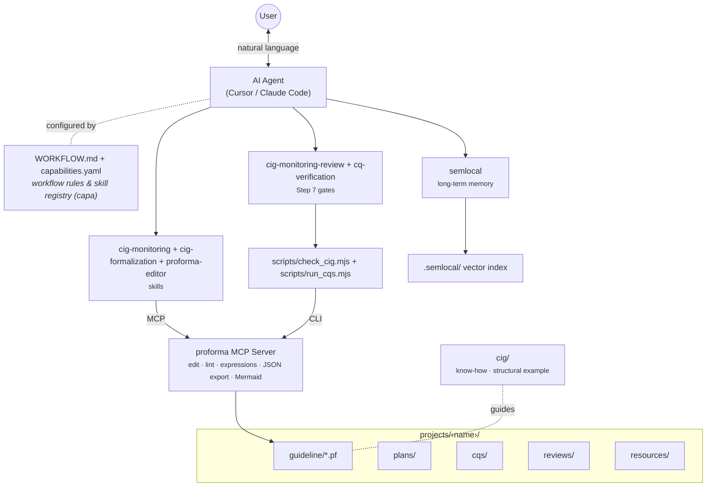

# Agentic CIG Monitoring Development Kit

Build computer-interpretable clinical guidelines (CIGs) with AI assistance in Cursor or Claude Code. You install the required tools, put your guideline sources in the right place, and tell the agent what you want. The agent handles scope, proposals, PROforma formalization, and checks.

**Primary use case — CIG monitoring:** this kit formalizes a clinical guideline as an **executable PROforma guideline** (a PROforma 1.9 `.pf` file, the format Deontics Composer and PROforma engines run). It focuses on monitoring completion of therapy recommendations (Action Enactment goals) and monitoring desired/undesired effects of therapy (State Achievement goals). For CIG tasks the agent follows the **`cig-monitoring`** skill, reads the guidelines you put in `projects/<project_dir>/resources/`, and builds a PROforma Top-Level Plan (Enquiry → Decision → Therapy Plan → Monitoring Plan). See `cig/know-how/README.md` for the domain know-how and `cig/examples/ici-irae-monitoring.pf` for a worked example of the structure (its clinical content, immune checkpoint inhibitor toxicity, is not a template for which monitors to model).

## Architecture



## What you need to do

1. **Install prerequisites** (below).
2. **Run `capa install`** once in the project root after cloning.
3. **Add your sources**: put the guideline PDFs or text for the CIG in `projects/<project_dir>/resources/` (or name the files in chat). The agent uses only these as the primary guidelines; it does not search other projects or the web for them unless you ask. To continue an existing CIG, put its `.pf` at `projects/<project_dir>/guideline/<name>.pf`.
4. **Chat with the agent**—describe your goal and approve proposals. It will build the guideline, keep it lint-clean, and run the checks for you.

## Prerequisites

Install these before starting:

| Requirement             | Purpose                                                                                                                                          |
| ----------------------- | ------------------------------------------------------------------------------------------------------------------------------------------------ |
| **Node.js** (v18+)      | Runs the capa CLI, the [proforma](https://www.npmjs.com/package/proforma-mcp) MCP server (via `npx`) and the kit's gate scripts. [Install Node.js](https://nodejs.org/). |
| **semlocal**            | Local semantic memory. Install with `npm install -g semlocal`. Index stored in `.semlocal/`. [semlocal](https://github.com/Minitour/semlocal) |
| **Access to Minitour/proforma** | The `proforma` skill (authoring guidance and the HTML viewer) is installed from that repository, which is private for now. Run `capa auth github.com` once with an account that can read it before `capa install`. |
| **capa**                | Syncs the agent’s skills and tools from this project. [CAPA](https://capa.infragate.ai/). After cloning, run `capa install` in the project root. |

## Setup

1. Clone this repository and open it with your agent of choice
2. Run `capa install` and ensure your agent has access to the capa MCP server.
3. Add any relevant files you have to `projects/<project_dir>/resources`.

## How a CIG is built

1. **Scope and CQs**: the agent agrees with you on the population, therapy and the competency questions (CQs) the CIG must answer.
2. **Extraction**: therapy recommendations, goals, monitoring, ADEs and the data each condition depends on, each with its citation and the verbatim passage it comes from.
3. **Proposal**: `projects/<project_dir>/plans/PROPOSAL-<timestamp>.md`, an executable spec with canonical task names, data items, conditions written as PROforma expressions, and a `cig-actions` list. Nothing is built until you approve it.
4. **Formalization**: the `cig-formalizer` subagent builds `projects/<project_dir>/guideline/<name>.pf` from the approved proposal with the proforma tools. Every task uses Composer's native task properties first (caption, description, procedure, precondition, Ontology coding; see [`TaskProperties.md`](skills/cig-monitoring/references/TaskProperties.md)); a monitoring action's order is an HL7 FHIR `ServiceRequest` (`ServiceRequest.*` metaprops, repeated in the goal's noun phrase and stated in the native `procedure`), and each cited source carries a short verbatim `quote`. A coding pass then sets Composer's Ontology coding (`ontology.coding=SNOMED:<id>`) on actions and data items with the `snomed_search` tool (EBI OLS4, SNOMED CT only). The task contract is [`skills/cig-monitoring/references/MetapropsSyntax.md`](skills/cig-monitoring/references/MetapropsSyntax.md). The formalizer keeps the file lint-clean and draws a Mermaid diagram of it.
5. **Blocking review**: `scripts/check_cig.mjs` (structure, the native-field and metaprops contract, the `ServiceRequest` order agreeing across its keys, the goal's noun phrase and `procedure`, quoted citations, ontology coding format, executable preconditions, approved action set, regressions, and the coding-only freeze) plus the reviewer's source- and quote-fidelity judgment, and `scripts/run_cqs.mjs` (one query per CQ). The build is done only when both pass with zero FAILs.

Each build also produces `guideline/<name>.html` with the **proforma** skill's `scripts/build_report.mjs`: a self-contained viewer (one HTML file, nothing fetched) laid out like a guideline editor: task tree, plan canvas (stored task positions, scheduling arrows, decision branches; pan, zoom, double-click a plan to open it), properties panel, and data, decision, lint and source views. Open [`cig/examples/ici-irae-monitoring.html`](cig/examples/ici-irae-monitoring.html) to see it.

You can run the gates yourself on the worked example (see [`cig/examples/README.md`](cig/examples/README.md)):

```bash
node scripts/check_cig.mjs cig/examples/ici-irae-monitoring.pf
node scripts/run_cqs.mjs cig/examples/ici-irae-monitoring.pf cig/examples/ici-irae-monitoring.cqs.mjs
node .claude/skills/proforma/scripts/build_report.mjs cig/examples/ici-irae-monitoring.pf   # path as installed by capa for Claude Code
```

The scripts find the `proforma` CLI automatically (`PROFORMA_BIN`, a global `npm install -g proforma-mcp`, a `proforma` binary on PATH, or a private install of the pinned version).

## Migrating a guideline built on an older contract

`scripts/migrate_metaprops.mjs` brings a guideline's monitoring actions onto the current task contract in place, through the proforma CLI. A guideline that held the order in the intermediate `order.code` / `order.timing` / `order.patient_instruction` / `order.performer_instruction` keys (which the gate now FAILs) gets the `ServiceRequest.*` block back, with `ServiceRequest.intent=order`. For every monitoring action it also rewrites `goal.noun_phrase` as the `ServiceRequest` string, and fills an empty native `procedure` and `description`, so a guideline that already uses `ServiceRequest.*` (the older contract) gets its native fields too. Every other key is kept. Source quotes and Ontology coding are not generated; add the quotes from the sources and run the coding pass.

```bash
node scripts/migrate_metaprops.mjs projects/<project_dir>/guideline/<name>.pf [--dry-run]
```

## Migrating an OWL CIG

Earlier versions of the kit produced an OWL ABox on the PROforma meta-ontology. `scripts/owl2pf.mjs` converts such a file once. It reads OWL functional syntax or RDF/XML, writes a lint-checked `.pf`, and lists every free-text condition that still needs to be written as an expression:

```bash
node scripts/owl2pf.mjs old/ontology.owl --native --out projects/<project_dir>/guideline/<name>.pf
```

## Project layout (reference)

```
agentic-cig-monitoring-development-kit/
├── capabilities.yaml   # Agent skills and tools (managed by capa)
├── .workflow/WORKFLOW.md  # Agent instructions (for the agent, not you)
├── cig/                # Shared CIG reference material (reusable across projects)
│   ├── examples/       # Structural example CIG (.pf), viewer (.html), diagram (.mmd), CQ queries (.cqs.mjs) and build record; see examples/README.md
│   └── know-how/       # CIG monitoring domain know-how
├── projects/           # One directory per CIG project (not tracked by git)
│   └── <project_dir>/  # e.g. ici-irae-monitoring
│       ├── guideline/  # <name>.pf, <name>.html viewer, <name>.mmd, baseline/ snapshots
│       ├── plans/      # Proposals made by the agent
│       ├── cqs/        # cq-queries.mjs
│       ├── reviews/    # Step 7 reports
│       └── resources/  # Resources to give to the agent (PDFs, CSVs, etc.)
├── scripts/            # check_cig.mjs, run_cqs.mjs, migrate_metaprops.mjs, owl2pf.mjs
└── skills/             # Agent skills (cig-monitoring, cig-formalization, proforma-editor, cig-monitoring-review, cq-verification)
```
