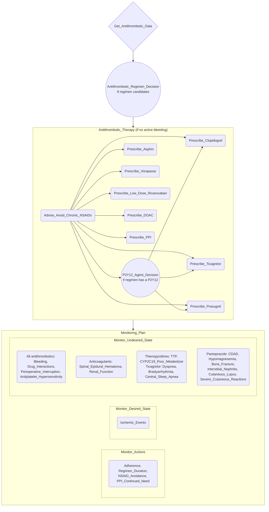

# Proposal: antiplatelet and oral anticoagulant therapy with monitoring in chronic coronary disease (2023 AHA/ACC CCD guideline §4.3.1)

This proposal is the executable spec for Step 6. Section 6 fixes every task name, and the `cig-actions` block is the action set the build must equal. **The monitoring-action field values (ServiceRequest block, provenance keys, sources and quotes), the data items, the decision arguments, the preconditions and the therapy-action procedures are those in `EXTRACTION-20261029.md` §3–§6, adopted verbatim as part of this proposal.** The formalizer transcribes them into the Java-properties metaprops form (`skills/cig-monitoring/references/MetapropsSyntax.md`). Every `goal.noun_phrase` repeats the five ServiceRequest fields with identical values. All 103 quotes in the extraction were checked word-for-word against the files in `resources/`. Every condition was type-checked with `check-expression` against a probe file.

## 1. Scope

- **Population / condition / therapy:** adults with chronic coronary disease (CCD), treated with antiplatelet therapy, oral anticoagulants, or both, to prevent cardiovascular events. The drugs are aspirin, clopidogrel, ticagrelor, prasugrel, vorapaxar, low-dose rivaroxaban and the DOACs (apixaban, rivaroxaban, edoxaban, dabigatran). Pantoprazole is the gastroprotective PPI.
- **Sources:**
  - **Guideline:** 2023 AHA/ACC/ACCP/ASPC/NLA/PCNA CCD guideline, **§4.3.1 only** (pages e50–e55): Recs 1–16, the Synopsis, Figure 9 and the supportive text.
  - **Package inserts:** the 11 FDA labels in `resources/`. Every Boxed Warning, contraindication and Warnings & Precautions section is accounted for in extraction §2.
  - **Not used:** case reports and mechanism-of-action harms (not opted in).
- **Design pattern in scope:** the full top-level plan, as you chose:
  - an Enquiry;
  - the regimen Decision;
  - the Therapy plan, which holds a P2Y12-agent Decision;
  - the Monitoring plan, with all three parallel sub-plans.
- **Out of scope:**
  - DOAC agent selection and its eligibility (AF management, prosthetic valves, antiphospholipid syndrome, hepatic impairment), which §4.3.1 defers to other guidance.
  - The parts of the CCD guideline outside §4.3.1 (beta blockers, lipids, BP, revascularization).
  - Pregnancy.
  - Acute (ACS-phase) antithrombotic management.

## 2. Competency Questions

- **CQ1** Which patient data does the guideline collect to choose an antithrombotic regimen for a patient with CCD?
- **CQ2** Which antithrombotic regimen does the guideline recommend for a given patient profile? The profile covers oral-anticoagulant need, recent PCI, ACS or CABG, previous MI, and bleeding and thrombotic risk. Which options are excluded as harmful or of no benefit?
- **CQ3** Which adverse drug effects are monitored for each antithrombotic drug and for the PPI, with which test or instrument and how often?
- **CQ4** Which monitoring actions track the desired outcome (fewer ischemic events and MACE) and the renal function that anticoagulant dosing depends on?
- **CQ5** What triggers urgent or event-driven assessment? (Bleeding, ischemic symptoms, neuraxial procedures, surgery, TTP, regimen step-down points.)
- **CQ6** How does the guideline monitor avoidance of harmful co-medication? (Chronic NSAIDs, omeprazole or esomeprazole with clopidogrel, aspirin over 100 mg with ticagrelor, CYP3A and P-gp interactions.)
- **CQ7** When is a PPI prescribed, and how are its continued need and its long-term harms monitored?
- **CQ8** Which monitoring actions trace to each therapy action?
- **CQ9** Which monitoring actions apply only to patients on a specific drug or in a sub-population, and what precondition gates them?

## 3. PROforma Structure

- **Root plan `ccd_antithrombotic_monitoring`.**
  - Goal `treat`: "chronic coronary disease in adults, antiplatelet and oral anticoagulant therapy to prevent cardiovascular events with monitoring of adherence, ischemic events and adverse drug effects".
  - Four components in sequence:
  1. `Get_Antithrombotic_Data` (enquiry): the 14 data items of extraction §4.
  2. `Antithrombotic_Regimen_Decision` (decision, single choice), after `Get_Antithrombotic_Data`.
     - Nine candidates follow the Figure 9 pathways and Recs 1–16: `Aspirin_Monotherapy`, `Clopidogrel_Monotherapy`, `DAPT`, `Short_DAPT_then_P2Y12_Monotherapy`, `Extended_DAPT`, `Aspirin_plus_Vorapaxar`, `Aspirin_plus_Low_Dose_Rivaroxaban`, `DOAC_plus_Antiplatelet`, `DOAC_Monotherapy`.
     - The arguments, including the Rec 7 *against* and the Rec 8 *excluding* arguments, are in extraction §5.
     - Recommendation: the default `netsupport() > 0`. More than one candidate can be recommended, e.g. the 2a/2b add-on options for a stable post-MI patient. The clinician commits one.
  3. `Antithrombotic_Therapy` (plan), after `Antithrombotic_Regimen_Decision`, with precondition `active_pathological_bleeding = false`. It contains:
     - `Advise_Avoid_Chronic_NSAIDs`: no precondition, so it always completes.
     - `P2Y12_Agent_Decision` (decision, single choice: `Clopidogrel` / `Ticagrelor` / `Prasugrel`), after `Advise_Avoid_Chronic_NSAIDs`. Its precondition is that the regimen contains a P2Y12 inhibitor (PPI_SET in extraction §3).
     - `Prescribe_Clopidogrel`, `Prescribe_Ticagrelor`, `Prescribe_Prasugrel`, each after **both** `Advise_Avoid_Chronic_NSAIDs` and `P2Y12_Agent_Decision`.
       - The double antecedent matters. In PROforma a task whose antecedents were **all** discarded is itself discarded.
       - On the `Clopidogrel_Monotherapy` path `P2Y12_Agent_Decision` is discarded. `Prescribe_Clopidogrel` must still run, because the NSAID advice always completes.
     - `Prescribe_Aspirin`, `Prescribe_Vorapaxar`, `Prescribe_Low_Dose_Rivaroxaban`, `Prescribe_DOAC`, `Prescribe_PPI`, each after `Advise_Avoid_Chronic_NSAIDs`.
     - Every drug action carries its precondition from extraction §5.
  4. `Monitoring_Plan` (plan), after `Antithrombotic_Therapy`. Three parallel sub-plans:
     - `Monitor_Actions`: 4 action-completion monitors.
     - `Monitor_Desired_State`: 1 desired-outcome monitor.
     - `Monitor_Undesired_State`: 17 ADE monitors.

## 4. Plan Diagram



## 5. Data Items

All are asked by `Get_Antithrombotic_Data`. The captions, sources and verbatim quotes are in extraction §4.

| Name | Type | Unit / values | Source | Used by |
|---|---|---|---|---|
| `requires_oral_anticoagulation` | boolean | true/false | G Rec 1, 11–15 | regimen arguments; P2Y12 arguments |
| `pci_within_12_months` | boolean | true/false | G Rec 2, 11; Fig 9 | regimen arguments; prasugrel argument |
| `des_implanted` | boolean | true/false | G Rec 3 | `Arg_Short_DAPT` |
| `acs_within_12_months` | boolean | true/false | G Rec 7; Fig 9 | regimen arguments; P2Y12 arguments |
| `cabg_within_12_months` | boolean | true/false | G Rec 6 | `Arg_DAPT_CABG`, `Arg_DAPT_No_Benefit` |
| `previous_mi` | boolean | true/false | G Rec 4, 5 | extended DAPT, vorapaxar, ticagrelor arguments |
| `prior_stroke_or_tia` | boolean | true/false | G Rec 5, 8, 9 | vorapaxar and prasugrel arguments |
| `prior_ich` | boolean | true/false | G Rec 5, 8, 9; TIC §4.1 | vorapaxar, prasugrel, ticagrelor arguments |
| `high_bleeding_risk` | boolean | true/false (validated score or judgment) | G Synopsis; Rec 3, 4, 12, 15 | regimen arguments |
| `high_thrombotic_risk` | boolean | true/false | G Rec 12, 15; text 15 | `Arg_Low_Dose_Rivaroxaban` |
| `aspirin_intolerance` | boolean | true/false | G text 1; ASA, ASA-ER §4 | aspirin and clopidogrel monotherapy arguments |
| `active_pathological_bleeding` | boolean | true/false | every label §4; G text 9 | `Antithrombotic_Therapy` precondition |
| `age_years` | integer | years | PRA Boxed Warning | `Arg_Prasugrel_Age` |
| `on_digoxin_or_diuretic` | boolean | true/false | PAN §5.8 | `Monitor_PPI_Hypomagnesemia` precondition |

The baseline values that no condition reads are listed in the Enquiry description only: hemoglobin, platelets, creatinine/CrCl, weight, magnesium, the CYP2C19 genotype if known, and the medication list.

**Decisions:** see extraction §5 for every candidate, argument name, support and condition.
- Argument captions carry the class of recommendation and level of evidence (e.g. `[1, A]`).
- Argument metaprops carry the `source` + `quote` of the Rec they implement. The quotes are the Rec quotes in extraction §1.
- The P2Y12 agent rule is **assistant-proposed** (Q2).

## 6. Tasks

| Canonical name | Kind | Parent plan | After | Goal | Precondition | monitoring_stance |
|---|---|---|---|---|---|---|
| `Get_Antithrombotic_Data` | enquiry | root | – | – | – | – |
| `Antithrombotic_Regimen_Decision` | decision | root | Get_Antithrombotic_Data | – | – | – |
| `Antithrombotic_Therapy` | plan | root | Antithrombotic_Regimen_Decision | – | `active_pathological_bleeding = false` | – |
| `Advise_Avoid_Chronic_NSAIDs` | action | Antithrombotic_Therapy | – | avoid: increased cardiovascular and bleeding complications from chronic NSAID use | – | – |
| `P2Y12_Agent_Decision` | decision | Antithrombotic_Therapy | Advise_Avoid_Chronic_NSAIDs | – | PPI_SET | – |
| `Prescribe_Aspirin` | action | Antithrombotic_Therapy | Advise_Avoid_Chronic_NSAIDs | achieve: reduction of atherosclerotic events and MACE | ext. §5 | – |
| `Prescribe_Clopidogrel` | action | Antithrombotic_Therapy | Advise_Avoid_Chronic_NSAIDs, P2Y12_Agent_Decision | achieve: reduction of MACE and stent-related events after PCI, or of atherosclerotic events when aspirin is not tolerated | ext. §5 | – |
| `Prescribe_Ticagrelor` | action | Antithrombotic_Therapy | Advise_Avoid_Chronic_NSAIDs, P2Y12_Agent_Decision | achieve: reduction of cardiovascular death, MI or stroke after MI | `result_of(P2Y12_Agent_Decision) = Ticagrelor` | – |
| `Prescribe_Prasugrel` | action | Antithrombotic_Therapy | Advise_Avoid_Chronic_NSAIDs, P2Y12_Agent_Decision | achieve: reduction of thrombotic cardiovascular events after ACS treated with PCI | `result_of(P2Y12_Agent_Decision) = Prasugrel` | – |
| `Prescribe_Vorapaxar` | action | Antithrombotic_Therapy | Advise_Avoid_Chronic_NSAIDs | achieve: reduction of MACE after MI | `result_of(Antithrombotic_Regimen_Decision) = Aspirin_plus_Vorapaxar` | – |
| `Prescribe_Low_Dose_Rivaroxaban` | action | Antithrombotic_Therapy | Advise_Avoid_Chronic_NSAIDs | achieve: long-term reduction of MACE in high ischemic risk | `result_of(Antithrombotic_Regimen_Decision) = Aspirin_plus_Low_Dose_Rivaroxaban` | – |
| `Prescribe_DOAC` | action | Antithrombotic_Therapy | Advise_Avoid_Chronic_NSAIDs | achieve: prevention of thromboembolism for the anticoagulant indication with the lowest bleeding risk alongside or after antiplatelet therapy | ext. §5 | – |
| `Prescribe_PPI` | action | Antithrombotic_Therapy | Advise_Avoid_Chronic_NSAIDs | avoid: gastrointestinal bleeding during DAPT or antiplatelet plus anticoagulant therapy | PPI_SET | – |
| `Monitoring_Plan` | plan | root | Antithrombotic_Therapy | – | – | – |
| `Monitor_Actions` | plan | Monitoring_Plan | – | – | – | – |
| `Monitor_Desired_State` | plan | Monitoring_Plan | – | – | – | – |
| `Monitor_Undesired_State` | plan | Monitoring_Plan | – | – | – | – |
| `Monitor_Antithrombotic_Adherence` | action | Monitor_Actions | – | order (ext. §3.1) | – | proposed_by_assistant |
| `Monitor_Regimen_Duration` | action | Monitor_Actions | – | order (§3.2) | – | proposed_by_assistant |
| `Monitor_NSAID_Avoidance` | action | Monitor_Actions | – | order (§3.3) | – | proposed_by_assistant |
| `Monitor_PPI_Continued_Need` | action | Monitor_Actions | – | order (§3.4) | PPI_SET | proposed_by_assistant |
| `Monitor_Ischemic_Events` | action | Monitor_Desired_State | – | order (§3.5) | – | proposed_by_assistant |
| `Monitor_Bleeding` | action | Monitor_Undesired_State | – | order (§3.6) | – | recommended |
| `Monitor_Drug_Interactions` | action | Monitor_Undesired_State | – | order (§3.7) | – | recommended |
| `Monitor_Spinal_Epidural_Hematoma` | action | Monitor_Undesired_State | – | order (§3.8) | ANTICOAG_SET | recommended |
| `Monitor_Perioperative_Interruption` | action | Monitor_Undesired_State | – | order (§3.9) | every regimen except `Aspirin_Monotherapy` (rev 3) | recommended |
| `Monitor_Renal_Function` | action | Monitor_Undesired_State | – | order (§3.10) | ANTICOAG_SET | recommended |
| `Monitor_TTP` | action | Monitor_Undesired_State | – | order (§3.11) | clopidogrel or prasugrel (§3.11) | symptom_triggered_only |
| `Monitor_CYP2C19_Poor_Metabolizer` | action | Monitor_Undesired_State | – | order (§3.12) | clopidogrel (§3.12) | symptom_triggered_only |
| `Monitor_Antiplatelet_Hypersensitivity` | action | Monitor_Undesired_State | – | order (§3.13) | – | symptom_triggered_only |
| `Monitor_Ticagrelor_Dyspnea` | action | Monitor_Undesired_State | – | order (§3.14) | `result_of(P2Y12_Agent_Decision) = Ticagrelor` | symptom_triggered_only |
| `Monitor_Ticagrelor_Bradyarrhythmia` | action | Monitor_Undesired_State | – | order (§3.15) | `result_of(P2Y12_Agent_Decision) = Ticagrelor` | proposed_by_assistant |
| `Monitor_Ticagrelor_Central_Sleep_Apnea` | action | Monitor_Undesired_State | – | order (§3.16) | `result_of(P2Y12_Agent_Decision) = Ticagrelor` | symptom_triggered_only |
| `Monitor_PPI_CDAD` | action | Monitor_Undesired_State | – | order (§3.17) | PPI_SET | symptom_triggered_only |
| `Monitor_PPI_Hypomagnesemia` | action | Monitor_Undesired_State | – | order (§3.18) | §3.18 (reads `on_digoxin_or_diuretic`) | recommended |
| `Monitor_PPI_Bone_Fracture` | action | Monitor_Undesired_State | – | order (§3.19) | `result_of(Antithrombotic_Regimen_Decision) = Extended_DAPT` | proposed_by_assistant |
| `Monitor_PPI_Interstitial_Nephritis` | action | Monitor_Undesired_State | – | order (§3.20) | PPI_SET | symptom_triggered_only |
| `Monitor_PPI_Cutaneous_Lupus` | action | Monitor_Undesired_State | – | order (§3.21) | PPI_SET | symptom_triggered_only |
| `Monitor_PPI_Severe_Cutaneous_Reactions` | action | Monitor_Undesired_State | – | order (§3.22) | PPI_SET | symptom_triggered_only |

How the monitors are scoped and traced:
- **Traceability.** Every monitor's `monitored_target` names the therapy action(s) it traces to (extraction §3).
- **Drug-specific monitors.** These are gated by a precondition over the decision results and keep `applies_when=all_patients_on_therapy`. Here the "therapy" is the traced drug action; the gate reports a WARN for this, not a FAIL.
- **Sub-population monitor.** `Monitor_PPI_Hypomagnesemia` is the only monitor whose applicability is narrower than its drug. It reads the Enquiry item `on_digoxin_or_diuretic`.
- **Captions.** Each monitor has one caption, a one-line summary of what it monitors (e.g. "Monitor for bleeding (symptom review, Hb/Hct on suspicion)").

```cig-actions
Advise_Avoid_Chronic_NSAIDs
Prescribe_Aspirin
Prescribe_Clopidogrel
Prescribe_Ticagrelor
Prescribe_Prasugrel
Prescribe_Vorapaxar
Prescribe_Low_Dose_Rivaroxaban
Prescribe_DOAC
Prescribe_PPI
Monitor_Antithrombotic_Adherence
Monitor_Regimen_Duration
Monitor_NSAID_Avoidance
Monitor_PPI_Continued_Need
Monitor_Ischemic_Events
Monitor_Bleeding
Monitor_Drug_Interactions
Monitor_Spinal_Epidural_Hematoma
Monitor_Perioperative_Interruption
Monitor_Renal_Function
Monitor_TTP
Monitor_CYP2C19_Poor_Metabolizer
Monitor_Antiplatelet_Hypersensitivity
Monitor_Ticagrelor_Dyspnea
Monitor_Ticagrelor_Bradyarrhythmia
Monitor_Ticagrelor_Central_Sleep_Apnea
Monitor_PPI_CDAD
Monitor_PPI_Hypomagnesemia
Monitor_PPI_Bone_Fracture
Monitor_PPI_Interstitial_Nephritis
Monitor_PPI_Cutaneous_Lupus
Monitor_PPI_Severe_Cutaneous_Reactions
```

## 7. Terminology Reuse (SNOMED CT, found with `snomed_search`)

Set as `ontology.coding=SNOMED:<id>` and `ontology.label` exactly as below. Decision candidates and arguments stay uncoded (structural options).

| Element | SNOMED id | ontology.label | Note |
|---|---|---|---|
| `Advise_Avoid_Chronic_NSAIDs` | 372665008 | Non-steroidal anti-inflammatory agent (substance) | substance class avoided |
| `Prescribe_Aspirin` | 387458008 | Aspirin (substance) | |
| `Prescribe_Clopidogrel` | 386952008 | Clopidogrel (substance) | |
| `Prescribe_Ticagrelor` | 698805004 | Ticagrelor (substance) | |
| `Prescribe_Prasugrel` | 443129001 | Prasugrel (substance) | |
| `Prescribe_Vorapaxar` | 708718003 | Vorapaxar (substance) | |
| `Prescribe_Low_Dose_Rivaroxaban` | 442031002 | Rivaroxaban (substance) | |
| `Prescribe_DOAC` | 182764009 | Anticoagulant therapy (procedure) | broader than DOAC (no DOAC concept returned) |
| `Prescribe_PPI` | 395821003 | Pantoprazole (substance) | |
| `Monitor_Antithrombotic_Adherence` | 410122002 | Assessment of compliance with medication regimen (procedure) | |
| `Monitor_Regimen_Duration` | 182836005 | Review of medication (procedure) | |
| `Monitor_NSAID_Avoidance` | 430193006 | Medication reconciliation (procedure) | |
| `Monitor_PPI_Continued_Need` | 182836005 | Review of medication (procedure) | shares the code with `Monitor_Regimen_Duration` |
| `Monitor_Ischemic_Events` | 405617006 | Cardiovascular event (event) | broader than MI, covers stroke |
| `Monitor_Bleeding` | 131148009 | Bleeding (finding) | |
| `Monitor_Drug_Interactions` | 79899007 | Drug interaction (finding) | |
| `Monitor_Spinal_Epidural_Hematoma` | 703861005 | Spinal epidural hematoma (disorder) | |
| `Monitor_Perioperative_Interruption` | 110265006 | Postoperative hemorrhage (disorder) | covers the postoperative part |
| `Monitor_Renal_Function` | 442407001 | Estimation of creatinine clearance by Cockcroft-Gault formula (procedure) | the method the DOAC labels use |
| `Monitor_TTP` | 78129009 | Thrombotic thrombocytopenic purpura (disorder) | |
| `Monitor_CYP2C19_Poor_Metabolizer` | 738786005 | Cytochrome P450 family 2 subfamily C member 19 poor metabolizer (finding) | |
| `Monitor_Antiplatelet_Hypersensitivity` | 416098002 | Allergy to drug (finding) | |
| `Monitor_Ticagrelor_Dyspnea` | 267036007 | Dyspnea (finding) | |
| `Monitor_Ticagrelor_Bradyarrhythmia` | 421869004 | Bradyarrhythmia (disorder) | |
| `Monitor_Ticagrelor_Central_Sleep_Apnea` | 27405005 | Central sleep apnea syndrome (disorder) | |
| `Monitor_PPI_CDAD` | 186431008 | Infection caused by Clostridioides difficile (disorder) | |
| `Monitor_PPI_Hypomagnesemia` | 190855004 | Hypomagnesemia (disorder) | |
| `Monitor_PPI_Bone_Fracture` | 443165006 | Osteoporotic fracture of bone (disorder) | |
| `Monitor_PPI_Interstitial_Nephritis` | 28637003 | Acute tubulointerstitial nephritis (disorder) | |
| `Monitor_PPI_Cutaneous_Lupus` | 7119001 | Cutaneous lupus erythematosus (disorder) | |
| `Monitor_PPI_Severe_Cutaneous_Reactions` | 768946000 | Stevens-Johnson syndrome, toxic epidermal necrolysis spectrum (disorder) | DRESS and AGEP not covered by the concept |
| `requires_oral_anticoagulation` | 711150003 | Long-term current use of anticoagulant (situation) | current use, not indication |
| `pci_within_12_months` | 405741001 | History of percutaneous coronary intervention (situation) | the 12-month window is in the data-item logic |
| `des_implanted` | 705637003 | Drug-eluting coronary artery stent (physical object) | |
| `acs_within_12_months` | 394659003 | Acute coronary syndrome (disorder) | |
| `cabg_within_12_months` | 232717009 | Coronary artery bypass grafting (procedure) | |
| `previous_mi` | 1755008 | Old myocardial infarction (disorder) | |
| `prior_stroke_or_tia` | 275526006 | History of cerebrovascular accident (situation) | TIA (161511000) is a separate concept, noted in the description |
| `prior_ich` | 16864911000119103 | History of intracranial hemorrhage (situation) | |
| `high_bleeding_risk` | 711536002 | At high risk for bleeding (finding) | |
| `high_thrombotic_risk` | 395112001 | At increased risk for cardiovascular event (finding) | nearest match |
| `aspirin_intolerance` | 293586001 | Allergy to aspirin (finding) | allergy, not intolerance |
| `active_pathological_bleeding` | 131148009 | Bleeding (finding) | shares the code with `Monitor_Bleeding` |
| `age_years` | 424144002 | Current chronological age (observable entity) | |
| `on_digoxin_or_diuretic` | – | (none looked up yet) | composite flag; leave uncoded and say so in its description |

LOINC and RxNorm are not wired into the kit; none are invented.

## 8. Open Questions

1. **Rec 6 (DAPT after CABG)** gives no duration. I used `cabg_within_12_months` (first postoperative year). I also excluded the Rec 7 "no benefit" argument when CABG was in the past year, so Rec 6 can win. Is that acceptable?
2. **P2Y12 agent rule (assistant-proposed).**
   - §4.3.1 names clopidogrel for CCD after PCI and with a DOAC (Recs 2, 11).
   - Ticagrelor comes from Rec 4's evidence (PEGASUS, 60 mg twice daily).
   - Prasugrel comes from its label indication (ACS managed with PCI), excluded after stroke, TIA or ICH (Rec 9) and argued against at age ≥75.
   - Keep this rule, or replace it with a clinician-choice decision without arguments?
3. **Several regimen candidates can be recommended at once.** A stable post-MI patient on aspirin can also match Extended DAPT, vorapaxar and low-dose rivaroxaban, all 2a/2b add-ons. The clinician commits one. Do you want priorities (e.g. Rec 1 > Rec 15 > Rec 4 > Rec 5) instead?
4. **DOAC doses: guideline vs US labels.** The guideline text (p.e54) lists edoxaban 30 mg also for weight <60 kg or P-gp inhibitors, and dabigatran 110 mg. The US labels reduce edoxaban for NVAF by CrCl 15–50 only, and have no 110 mg NVAF dose. The procedures and the renal monitor follow the **labels** and mention the guideline's trial doses. OK?
5. **One `Prescribe_DOAC` for the class.** §4.3.1 does not choose the agent. Agent-specific contraindications are excluded (§10) rather than modelled: mechanical or prosthetic valves, triple-positive APS, Child-Pugh B/C. Should I add data items and an *excluding* argument on the DOAC candidates?
6. **Proposed cadences** (§4.3.1 gives none):
   - adherence and ischemic-event review at 1, 3, 6 and 12 months, then every 6–12 months;
   - regimen step-down review at 1, 3, 6 and 12 months, then yearly;
   - renal function at baseline, then at least yearly;
   - magnesium at baseline, then yearly;
   - fracture-risk review yearly during extended DAPT.

   Accept, or change?
7. **PPI scope.** Rec 16 says "on DAPT". I also give pantoprazole during DOAC + antiplatelet therapy, which starts as triple therapy. Pantoprazole 40 mg daily for this purpose is off-label. Keep both choices?
8. **Grouping across labels.**
   - `Monitor_Bleeding` merges the bleeding sections of all eight antithrombotic labels into one symptom review.
   - `Monitor_Drug_Interactions` merges the interaction warnings into one medication reconciliation.
   - `Monitor_Antiplatelet_Hypersensitivity` merges four allergy sections.
   - This is one task per *harm*, not one per label section. The alternative is about 20 more near-identical actions. OK?
9. **DURLAZA** (aspirin ER 162.5 mg) is used only as a supplementary aspirin label. Its RAS-inhibitor renal-monitoring instruction is excluded because the CIG prescribes 81 mg immediate-release aspirin. OK?
10. **SNOMED weak fits** (§7): `Prescribe_DOAC` (broader), `high_thrombotic_risk` (near miss), `aspirin_intolerance` (allergy only), and two shared codes. Accept these, or leave the weak ones uncoded?

## 9. Sources

Each element's `source.N` + verbatim `quote.N` is in the extraction (§1 for guideline Recs and text, §3 for monitors, §4 for data items, §6 for therapy actions). The quotes that carry the CIG's main rules:

| Source | Location | Verbatim passage | Supports |
|---|---|---|---|
| 2023 AHA/ACC CCD Guideline (Virani et al., DOI 10.1161/CIR.0000000000001168) | §4.3.1 Rec 1, p.e50 | "low-dose aspirin 81 mg (75-100 mg) is recommended to reduce atherosclerotic events" | `Aspirin_Monotherapy`, `Prescribe_Aspirin`, `Monitor_Ischemic_Events` |
| same | Rec 2, p.e50 | "dual antiplatelet therapy (DAPT) consisting of aspirin and clopidogrel for 6 months post PCI followed by single antiplatelet therapy (SAPT) is indicated" | `DAPT`, `Prescribe_Clopidogrel`, `Monitor_Regimen_Duration` |
| same | Rec 3, p.e50 | "P2Y12 inhibitor monotherapy for at least 12 months is reasonable to reduce bleeding risk" | `Short_DAPT_then_P2Y12_Monotherapy` |
| same | Rec 4, p.e50 | "extended DAPT beyond 12 months for a period of up to 3 years may be reasonable to reduce MACE" | `Extended_DAPT`, `Prescribe_Ticagrelor` |
| same | Rec 5 / Rec 8, p.e50 | "vorapaxar may be added to aspirin therapy to reduce MACE" / "vorapaxar should not be added to DAPT because of increased risk of major bleeding and ICH" | `Aspirin_plus_Vorapaxar`, `Prescribe_Vorapaxar` |
| same | Rec 7, p.e50 | "the addition of clopidogrel to aspirin therapy is not useful to reduce MACE" | `Arg_DAPT_No_Benefit` |
| same | Rec 9, p.e50 | "prasugrel should not be used because of risk of significant or fatal bleeding" | `Arg_Prasugrel_Harm` |
| same | Rec 10, p.e50 | "chronic nonsteroidal anti-inflammatory drugs should not be used because of increased cardiovascular and bleeding complications" | `Advise_Avoid_Chronic_NSAIDs`, `Monitor_NSAID_Avoidance` |
| same | Rec 11, p.e50 | "DAPT for 1 to 4 weeks followed by clopidogrel alone for 6 months should be administered in addition to DOAC" | `DOAC_plus_Antiplatelet`, `Monitor_Regimen_Duration` |
| same | Rec 14, p.e50 | "DOAC monotherapy may be considered if there is no acute indication for concomitant antiplatelet therapy" | `DOAC_Monotherapy`, `Prescribe_DOAC` |
| same | Rec 15, p.e50 | "the addition of low-dose rivaroxaban 2.5 mg twice daily to aspirin 81 mg daily is reasonable for long-term reduction of risk for MACE" | `Aspirin_plus_Low_Dose_Rivaroxaban` |
| same | Rec 16, p.e50 | "In patients with CCD on DAPT, the use of a PPI can be effective in reducing gastrointestinal bleeding risk" | `Prescribe_PPI` |
| same | text 16, p.e55 | "The FDA has added a boxed warning to avoid use of omeprazole with clopidogrel as well as other potent CYP 2C19 inhibitors, including esomeprazole." | `Monitor_Drug_Interactions` |
| PLAVIX USPI 2025 | Boxed Warning | "Consider use of another platelet P2Y 12 inhibitor in patients identified as CYP2C19 poor metabolizers." | `Monitor_CYP2C19_Poor_Metabolizer` |
| XARELTO USPI 2026 | Boxed Warning (B) | "Monitor patients frequently for signs and symptoms of neurological impairment. If neurological compromise is noted, urgent treatment is necessary" | `Monitor_Spinal_Epidural_Hematoma` |
| PRADAXA Capsules USPI 2025 | §2.4 | "Assess renal function prior to initiation of treatment with PRADAXA Capsules. Periodically assess renal function as clinically indicated" | `Monitor_Renal_Function` |
| PROTONIX USPI 2026 | §5.8 | "health care professionals may consider monitoring magnesium levels prior to initiation of PPI treatment and periodically" | `Monitor_PPI_Hypomagnesemia` |

## 10. Excluded Candidates

| Candidate | Reason | Check |
|---|---|---|
| Aspirin OTC: Reye's syndrome | children/teens only; the population is adults | 1 |
| Aspirin OTC: ask-a-doctor items (HTN, kidney disease, diuretic, asthma, gout/diabetes/arthritis drugs) | OTC self-selection prompts; the CIG's aspirin is clinician-prescribed and reviewed at each visit | 1 |
| Aspirin OTC: tinnitus or hearing loss | salicylism at analgesic doses, not at 81 mg | 1 |
| Aspirin OTC and DURLAZA §5.3: pregnancy (3rd trimester); RIV §5.7 pregnancy-related hemorrhage | pregnancy is out of scope | 1 |
| DURLAZA §7: renal monitoring with RAS inhibitors | specific to DURLAZA 162.5 mg ER, which is not the recommended aspirin product (Q9) | 1 |
| DOAC hypersensitivity contraindications (RIV, API, DAB §4) | a contraindication with no monitoring instruction | 1 |
| Ticagrelor §5.5: severe hepatic impairment | a restriction before prescribing, with no monitoring instruction; hepatic status is not among §4.3.1's criteria | 1, 2 |
| Ticagrelor §5.7: HIT functional test interference | a lab-interpretation note, not an adverse effect | 1 |
| Rivaroxaban §5.5 / apixaban §8.7: hepatic impairment | as above (Q5) | 1, 2 |
| Prosthetic or mechanical heart valves, TAVR (RIV §5.8, API §5.4, EDO §5.5, DAB §4/§5.4) | DOAC eligibility, outside §4.3.1 (Q5) | 1, 2 |
| Triple-positive antiphospholipid syndrome (RIV §5.10, API §5.6, EDO §5.6, DAB §5.6) | DOAC eligibility, outside §4.3.1 (Q5) | 1, 2 |
| Acute PE (RIV §5.9, API §5.5); rivaroxaban acutely-ill VTE prophylaxis (§5.2) | not CCD indications | 1 |
| Dabigatran GI adverse reactions (dyspepsia, gastritis) | an adverse reaction, not a W&P section; GI bleeding signs are covered by `Monitor_Bleeding` | 3 |
| Pantoprazole §4: hypersensitivity, rilpivirine | contraindications with no monitoring instruction; rilpivirine is outside the medication scope | 1 |
| Pantoprazole §5.1: masking of gastric malignancy | applies to symptom response when the PPI treats GI symptoms; here it is prophylaxis | 1 |
| Pantoprazole §5.7: vitamin B12 deficiency | the label risk is beyond 3 years; here the PPI stops with DAPT, which lasts at most 3 years (Rec 4) | 1 |
| Pantoprazole §5.9: tumorigenicity | rodent finding with no human monitoring instruction | 1 |
| Pantoprazole §5.10: fundic gland polyps | no monitoring instruction; its "shortest duration" message is carried by `Monitor_PPI_Continued_Need` | 3 |
| Pantoprazole §5.11–§5.13: CgA, THC screen, methotrexate | test-interpretation notes and an interaction outside the medication scope | 1 |
| Clopidogrel §7.3 / prasugrel §7.3 / ticagrelor §7.3: opioids in ACS | acute ACS setting, outside CCD | 1 |
| Clopidogrel §7.8: repaglinide; ticagrelor §7.4: statins | §7 interactions outside the W&P; minor in this population (digoxin with ticagrelor is kept in `Monitor_Drug_Interactions` because the label gives its own monitoring instruction) | 1 |
| Body weight and creatinine clearance as data items | no condition reads them; they set doses written in the procedures and are measured by `Monitor_Renal_Function` | 1 |
| A regimen for PCI with high bleeding risk and a bare-metal stent | §4.3.1 refers bare-metal stents to the 2016 AHA/ACC DAPT guideline, so no candidate is recommended for that profile; this is stated in the regimen Decision description (rev 2) | 1 |
| A separate GI-bleeding monitor for the PPI's desired effect | the same symptoms are already covered by `Monitor_Bleeding`, which traces to `Prescribe_PPI` | 3 |
| Separate desired-outcome monitors per drug | one ischemic-event review serves every MACE goal | 3 |

## What I need from you

1. Answers to the open questions in §8, or "use your defaults". If you approve without answering, I'll keep the choices described in each question as they stand.
2. Any renames, removals or additions to the action list (the `cig-actions` block).
3. Explicit approval of this draft. **I will not start formalization (Step 6) until you approve.** You can also edit this file or the extraction file directly.

## Approval (2026-10-29)

Approved by the user with "use your defaults". The open questions in §8 are resolved as follows:

1. Rec 6: keep `cabg_within_12_months`. The Rec 7 no-benefit argument excludes CABG within the past year.
2. Keep the assistant-proposed P2Y12 agent rule (clopidogrel after PCI or with a DOAC, ticagrelor after MI, prasugrel only after ACS with PCI).
3. Keep the default `netsupport() > 0`. Several regimen candidates can be recommended at once, and the clinician commits one.
4. DOAC doses follow the US labels. The procedure mentions the guideline's trial doses.
5. Keep one class-level `Prescribe_DOAC`. Valve, APS and hepatic eligibility stay excluded (§10).
6. Keep the proposed cadences as listed.
7. Keep pantoprazole during DOAC + antiplatelet therapy, documented as off-label.
8. Keep one monitor per harm (bleeding, interactions, hypersensitivity).
9. Keep the DURLAZA RAS-inhibitor instruction excluded.
10. Keep the weak SNOMED fits as listed in §7. `on_digoxin_or_diuretic` stays uncoded.

## Revision 2 (2026-10-29): Step 7 gate fixes

The first Step 7 review (`reviews/cig-monitoring-review-20261029-172119.md`) passed the deterministic gate but failed six judgment checks. Each fix below restores the approved rule or the source. None changes the scope, the action set (`cig-actions` unchanged), the data items or the regimen candidates. The extraction file is amended in place; amended lines are marked "rev 2". **Where this section and §6 differ, this section wins.**

1. **J1, J2 (Figure 9 quotes).** Figure 9 is an image, so it can be quoted only by its literal labels joined with "...". The resource file now lists the labels verbatim and marks the bar-length reading as an interpretation.
   - `Arg_DAPT_ACS`: quote `p.e51, Figure 9 (figure labels): "Prior ACS with or without PCI ... DAPT ... DAPT for 12–36 mo"`.
   - `Arg_Aspirin_SAPT` source.2: quote `p.e51, Figure 9 (figure labels): "No PCI or >12 mo from ACS ... Aspirin"`.
2. **J3 (ticagrelor dose).** `Prescribe_Ticagrelor` is 90 mg twice daily in the first year after an ACS or MI, then 60 mg twice daily.
   - A source is added: BRILINTA §2.2, "Administer 90 mg of BRILINTA twice daily during the first year after an ACS event."
   - The caption must say 90 mg then 60 mg.
3. **J4 (P2Y12 gap).** `Arg_Clopidogrel_CCD` becomes `acs_within_12_months = false or requires_oral_anticoagulation = true or pci_within_12_months = true`, which is the approved rule ("clopidogrel after PCI or with a DOAC").
   - A fallback `for` argument, `Arg_Clopidogrel_ACS_No_Alternative`, is added: `acs_within_12_months = true and pci_within_12_months = false and (previous_mi = false or prior_ich = true)`.
   - Its caption is "[assistant-proposed fallback]", and its sources are in extraction §5.
   - With both changes, the reviewer's simulation leaves no profile without a recommended agent.
4. **J5.** `Monitor_Antiplatelet_Hypersensitivity` is gated by ANTIPLATELET_SET, i.e. every regimen except `DOAC_Monotherapy` (expression in extraction §3.13).
5. **J6.** `Monitor_PPI_Bone_Fracture` gets `applies_when` = "patients on pantoprazole for a year or longer (during extended DAPT after MI)" and the precondition `result_of(Antithrombotic_Regimen_Decision) = Extended_DAPT and previous_mi = true`.
6. **Advisories A1–A4 (adopted).**
   - `Monitor_Regimen_Duration`'s `monitored_target` adds `Prescribe_Vorapaxar` and `Prescribe_Low_Dose_Rivaroxaban`.
   - `Monitor_Drug_Interactions` adds `Prescribe_Aspirin`.
   - `Monitor_Perioperative_Interruption` adds `Prescribe_Vorapaxar`, the ZONTIVITY §17 instruction, and its source.6/quote.6.
   - `Antithrombotic_Regimen_Decision`'s description states that §4.3.1 defers bare-metal stents to the 2016 DAPT guideline (also in §10).
   - The Figure 9 interpretation in the resource file is labelled as such.

These are corrections inside the approved intent, applied after the user's instruction to build. The build is a full re-emit: snapshot the current guideline to `guideline/baseline/`, rebuild from a fresh file, then re-run the full gate.

## Revision 3 (2026-10-29): Step 7 re-review fix

The second review (`reviews/cig-monitoring-review-20261029-174332.md`) confirmed J1–J6 fixed, passed the deterministic gate, and failed one judgment check. Extraction lines are marked "rev 3". The action set, data items and candidates are unchanged.

1. **J7.** `Monitor_Perioperative_Interruption` gets the precondition NON_ASPIRIN_ONLY_SET (extraction §3.9), i.e. every regimen except `Aspirin_Monotherapy`. None of its sources gives a perioperative instruction for aspirin. `applies_when` stays `all_patients_on_therapy`, as for the other drug-gated monitors.
2. **Advisory A5 (adopted).** `Arg_Clopidogrel_ACS_No_Alternative` gets source.3/quote.3, PLAVIX §1.1: "are to be managed medically and those who are to be managed with coronary revascularization".
3. **Advisory A6 (adopted).** `Monitor_Drug_Interactions` gets source.8/quote.8, the OTC aspirin Stomach bleeding warning: "take a blood thinning (anticoagulant) or steroid drug".
