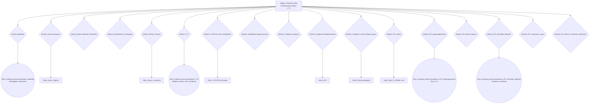

# Proposal (iteration): ADE monitoring as Enquiries with test ordering — CCD antithrombotic CIG

## Why this iteration

Mor Peleg's new know-how (email "New know-how", 30 October 2026) changes how undesired drug effects are monitored. The pattern is now in the kit: `skills/cig-monitoring/references/ADEMonitoringEnquiry.md`.

**What is changing:**
- `Monitor_Undesired_State` starts with an Action, `Display_Potential_ADEs`. Its caption lists the monitored ADEs as Markdown.
- Each ADE monitor becomes an **Enquiry with the same name**. It keeps its metaprops, caption and precondition.
- Each Enquiry collects, as typed data items, the symptoms and bedside findings that its metaprops already name. Every item is coded in SNOMED CT.
- The tests a monitor's metaprops name become a test step after the Enquiry:
  - **one test:** an Action `Order_<Test>`;
  - **two or more tests:** a Decision `Tests_Ordering_Recommendations_<ADE>`, multiple choice, one LOINC-coded candidate per test with an argument `for, true()`.
- The test step runs only when at least one collected finding is positive.

**What is unchanged:** everything else in the approved baseline (PROPOSAL-20261029-165226, Revisions 2 and 3):
- the scope, CQs, Enquiry, both Decisions and the therapy plan;
- the 4 action-completion monitors and the desired-outcome monitor, which stay Actions;
- every metaprops value, source and quote of the 17 ADE monitors.

### Step 0 carry-forward check

Every baseline element is retained.
- The 9 therapy actions and their goals, including the 2 `avoid` goals and the root `treat` goal, are retained.
- The 14 Enquiry data items, the 9 regimen and 3 P2Y12 candidates and all their arguments are retained.
- The 5 Action monitors are retained.
- The 17 ADE monitors keep their canonical names. They change kind from Action to Enquiry, and none is dropped.

So there is no `cig-excluded` block.

## 1–2. Scope and Competency Questions

These are unchanged from the baseline (CQ1–CQ9). One CQ is added:

- **CQ10** For each monitored ADE, which symptoms and bedside findings are collected (with their SNOMED CT codes)? Which tests are ordered when a finding is positive (with their LOINC codes), and under what condition?

## 3. PROforma Structure (only `Monitor_Undesired_State` changes)

```
Monitor_Undesired_State (plan)
  Display_Potential_ADEs (action, first)
  17 x Monitor_<ADE> (enquiry, after Display_Potential_ADEs, in parallel)
  10 test steps (after their Enquiry, precondition = at least one finding positive):
     6 x Order_<Test> (action)
     4 x Tests_Ordering_Recommendations_<ADE> (decision, multiple choice)
```

Each Enquiry's description now carries the order sentence (`... Order: <code>, <timing>. Patient: ... Clinician: ...`), because an Enquiry has no `procedure` attribute.

## 4. Plan Diagram (`Monitor_Undesired_State`)



## 5. New Data Items (asked by the ADE Enquiries)

Every item is taken from the monitor's own metaprops (patientInstruction, performerInstruction, trigger, instrument or occurrenceTiming in extraction §3); none is new clinical content. Booleans are "present since the last visit / at this visit". A finding asked by several Enquiries is one data item sourced by each of them. SNOMED CT codes are in §7.

| Enquiry | Data items (type) | From metaprops |
|---|---|---|
| `Monitor_Bleeding` | `unusual_bleeding_or_bruising`, `hematuria`, `blood_in_stool`, `hematemesis`, `hemoptysis`, `syncope`, `sudden_severe_headache` (boolean); `systolic_bp`, `diastolic_bp` (real, mmHg) | patientInstruction; trigger (unexplained hypotension) |
| `Monitor_Drug_Interactions` | `new_medication_started`, `on_omeprazole_or_esomeprazole`, `aspirin_dose_over_100_mg`, `on_strong_cyp3a_or_pgp_modulator`, `on_ssri_or_snri`, `on_other_anticoagulant`, `on_digoxin` (boolean) | code; performerInstruction; trigger |
| `Monitor_Spinal_Epidural_Hematoma` | `neuraxial_procedure_performed`, `back_pain`, `leg_numbness_or_tingling`, `leg_weakness`, `bowel_or_bladder_dysfunction` (boolean) | occurrenceTiming; patientInstruction |
| `Monitor_Perioperative_Interruption` | `planned_surgery_or_invasive_procedure`, `urgent_cabg_likely` (boolean) | occurrenceTiming; performerInstruction |
| `Monitor_Renal_Function` | `renal_function_check_due`, `vomiting_or_diarrhea`, `dehydration`, `new_nephrotoxic_medication`, `acute_illness` (boolean) | occurrenceTiming (baseline, then at least every 12 months); patientInstruction; trigger |
| `Monitor_TTP` | `unexplained_purpura`, `extreme_fatigue`, `jaundice`, `fever`, `confusion`, `reduced_urine_output` (boolean) | patientInstruction |
| `Monitor_CYP2C19_Poor_Metabolizer` | `cyp2c19_poor_metabolizer_known`, `ischemic_event_on_clopidogrel` (boolean) | occurrenceTiming; trigger |
| `Monitor_Antiplatelet_Hypersensitivity` | `hives`, `facial_or_throat_swelling`, `wheezing`, `widespread_rash` (boolean) | patientInstruction |
| `Monitor_Ticagrelor_Dyspnea` | `new_or_worse_dyspnea`, `intolerable_dyspnea` (boolean) | trigger; performerInstruction |
| `Monitor_Ticagrelor_Bradyarrhythmia` | `syncope` (shared), `dizziness` (boolean); `pulse_rate` (integer, /min) | patientInstruction; code (pulse check) |
| `Monitor_Ticagrelor_Central_Sleep_Apnea` | `breathing_pauses_during_sleep`, `daytime_sleepiness`, `frequent_night_waking` (boolean) | patientInstruction |
| `Monitor_PPI_CDAD` | `persistent_diarrhea`, `fever` (shared), `abdominal_pain` (boolean) | patientInstruction |
| `Monitor_PPI_Hypomagnesemia` | `magnesium_check_due`, `muscle_cramps_or_spasms`, `tremor`, `palpitations`, `seizure` (boolean) | occurrenceTiming (baseline, then every 12 months); patientInstruction |
| `Monitor_PPI_Bone_Fracture` | `new_fracture` (boolean) | patientInstruction |
| `Monitor_PPI_Interstitial_Nephritis` | `fever`, `reduced_urine_output`, `hematuria` (shared), `new_rash`, `joint_pain` (boolean) | patientInstruction |
| `Monitor_PPI_Cutaneous_Lupus` | `photosensitive_rash`, `joint_pain` (shared) (boolean) | patientInstruction |
| `Monitor_PPI_Severe_Cutaneous_Reactions` | `blistering_or_peeling_skin`, `mouth_sores`, `rash_with_fever` (boolean) | patientInstruction |

`renal_function_check_due` and `magnesium_check_due` record that the scheduled test is due (baseline, or 12 months since the last one). They exist because these two monitors are not only symptom-triggered: their labels ask for baseline and periodic testing. Including the "due" item in the test step's precondition keeps the scheduled test executable within the know-how's rule that a positive finding gates the test step (Q1).

## 6. Tasks (new or changed; everything else as in the baseline §6)

| Canonical name | Kind | After | Precondition | Coding |
|---|---|---|---|---|
| `Display_Potential_ADEs` | action (role=ade_display) | – (first) | – | – |
| 17 × `Monitor_<ADE>` (same names as the baseline) | **enquiry** (was action) | Display_Potential_ADEs | unchanged from the baseline | unchanged (SNOMED CT of the ADE) |
| `Tests_Ordering_Recommendations_Bleeding` | decision, multiple: `Hemoglobin`, `Hematocrit` | Monitor_Bleeding | `unusual_bleeding_or_bruising = true or hematuria = true or blood_in_stool = true or hematemesis = true or hemoptysis = true or syncope = true or sudden_severe_headache = true or systolic_bp < 90` | LOINC per candidate |
| `Order_Serum_Digoxin` | action (role=test_order) | Monitor_Drug_Interactions | `on_digoxin = true and result_of(P2Y12_Agent_Decision) = Ticagrelor` | LOINC |
| `Order_Serum_Creatinine` | action (role=test_order) | Monitor_Renal_Function | `renal_function_check_due = true or vomiting_or_diarrhea = true or dehydration = true or new_nephrotoxic_medication = true or acute_illness = true` | LOINC |
| `Tests_Ordering_Recommendations_TTP` | decision, multiple: `Platelet_Count`, `Blood_Smear_Schistocytes`, `LDH`, `Serum_Creatinine` | Monitor_TTP | `unexplained_purpura = true or extreme_fatigue = true or jaundice = true or fever = true or confusion = true or reduced_urine_output = true` | LOINC per candidate |
| `Order_CYP2C19_Genotype` | action (role=test_order) | Monitor_CYP2C19_Poor_Metabolizer | `ischemic_event_on_clopidogrel = true and cyp2c19_poor_metabolizer_known = false` | LOINC |
| `Order_ECG` | action (role=test_order) | Monitor_Ticagrelor_Bradyarrhythmia | `syncope = true or dizziness = true or pulse_rate < 50` | LOINC |
| `Order_Polysomnography` | action (role=test_order) | Monitor_Ticagrelor_Central_Sleep_Apnea | `breathing_pauses_during_sleep = true or daytime_sleepiness = true or frequent_night_waking = true` | LOINC |
| `Order_Stool_C_Difficile_Test` | action (role=test_order) | Monitor_PPI_CDAD | `persistent_diarrhea = true` | LOINC |
| `Tests_Ordering_Recommendations_PPI_Hypomagnesemia` | decision, multiple: `Serum_Magnesium`, `Serum_Calcium`, `Serum_Potassium` | Monitor_PPI_Hypomagnesemia | `magnesium_check_due = true or muscle_cramps_or_spasms = true or tremor = true or palpitations = true or seizure = true` | LOINC per candidate |
| `Tests_Ordering_Recommendations_PPI_Interstitial_Nephritis` | decision, multiple: `Serum_Creatinine`, `Urinalysis` | Monitor_PPI_Interstitial_Nephritis | `fever = true or reduced_urine_output = true or hematuria = true or new_rash = true or joint_pain = true` | LOINC per candidate |

Six ADE monitors name no laboratory or imaging test, so they have no test step: Spinal_Epidural_Hematoma, Perioperative_Interruption, Antiplatelet_Hypersensitivity, Ticagrelor_Dyspnea, PPI_Bone_Fracture and PPI_Cutaneous_Lupus (Q2).

Each test-decision candidate has one argument, `for, true()`, with a caption naming the test and the finding it investigates.

How each new task is filled:
- **Captions, descriptions and procedures.** Order steps: caption "Order <test>"; the description gives the ADE and the reason; the procedure is "Order <test> when <finding condition in words>." The test Decisions follow the same shape.
- **Metaprops.** Order steps carry `role=test_order`, `ordered_for=Monitor_<ADE>`, `goal.verb=order`, `goal.noun_phrase=<test>` and the LOINC coding. Decisions carry `role=test_ordering` and `ordered_for`.
- **Sources.** Each Order step and Decision carries the `source.N` + `quote.N` of its monitor's passage that names the test, taken from the extraction §3 quotes.
- **`Display_Potential_ADEs` caption**, in plan order:

```
# *Monitoring for ADEs:*  
1. Bleeding  
2. Drug interactions  
3. Spinal or epidural hematoma  
4. Perioperative bleeding and thrombosis  
5. Renal function (anticoagulant dosing)  
6. Thrombotic thrombocytopenic purpura  
7. Reduced clopidogrel effect (CYP2C19 poor metabolizer)  
8. Antiplatelet hypersensitivity  
9. Dyspnea (ticagrelor)  
10. Bradyarrhythmia (ticagrelor)  
11. Central sleep apnea (ticagrelor)  
12. C. difficile-associated diarrhea (PPI)  
13. Hypomagnesemia (PPI)  
14. Bone fracture (PPI)  
15. Acute interstitial nephritis (PPI)  
16. Cutaneous lupus erythematosus (PPI)  
17. Severe cutaneous reactions (PPI)  
```

```cig-actions
Advise_Avoid_Chronic_NSAIDs
Prescribe_Aspirin
Prescribe_Clopidogrel
Prescribe_Ticagrelor
Prescribe_Prasugrel
Prescribe_Vorapaxar
Prescribe_Low_Dose_Rivaroxaban
Prescribe_DOAC
Prescribe_PPI
Monitor_Antithrombotic_Adherence
Monitor_Regimen_Duration
Monitor_NSAID_Avoidance
Monitor_PPI_Continued_Need
Monitor_Ischemic_Events
Display_Potential_ADEs
Monitor_Bleeding
Monitor_Drug_Interactions
Monitor_Spinal_Epidural_Hematoma
Monitor_Perioperative_Interruption
Monitor_Renal_Function
Monitor_TTP
Monitor_CYP2C19_Poor_Metabolizer
Monitor_Antiplatelet_Hypersensitivity
Monitor_Ticagrelor_Dyspnea
Monitor_Ticagrelor_Bradyarrhythmia
Monitor_Ticagrelor_Central_Sleep_Apnea
Monitor_PPI_CDAD
Monitor_PPI_Hypomagnesemia
Monitor_PPI_Bone_Fracture
Monitor_PPI_Interstitial_Nephritis
Monitor_PPI_Cutaneous_Lupus
Monitor_PPI_Severe_Cutaneous_Reactions
Order_Serum_Digoxin
Order_Serum_Creatinine
Order_CYP2C19_Genotype
Order_ECG
Order_Polysomnography
Order_Stool_C_Difficile_Test
```

```cig-test-decisions
Tests_Ordering_Recommendations_Bleeding
Tests_Ordering_Recommendations_TTP
Tests_Ordering_Recommendations_PPI_Hypomagnesemia
Tests_Ordering_Recommendations_PPI_Interstitial_Nephritis
```

## 7. Terminology

The baseline §7 codes are unchanged. The new codes for the data items (SNOMED CT, `snomed_search`) and the tests (LOINC, `loinc_search`) are in the table below.

**Data items (SNOMED CT, `snomed_search`).** A note marks a broader concept or the nearest match, where SNOMED CT has no exact concept.

| Data item | SNOMED id | ontology.label | Note |
|---|---|---|---|
| `unusual_bleeding_or_bruising` | 131148009 | Bleeding (finding) | broader |
| `hematuria` | 34436003 | Blood in urine (finding) | |
| `blood_in_stool` | 74474003 | Gastrointestinal hemorrhage (disorder) | broader (red or black stools) |
| `hematemesis` | 8765009 | Hematemesis (disorder) | |
| `hemoptysis` | 66857006 | Hemoptysis (finding) | |
| `syncope` | 271594007 | Syncope (finding) | |
| `sudden_severe_headache` | 95660002 | Thunderclap headache (disorder) | |
| `systolic_bp` | 271649006 | Systolic blood pressure (observable entity) | |
| `diastolic_bp` | 271650006 | Diastolic blood pressure (observable entity) | |
| `new_medication_started` | 266712008 | New medication commenced (finding) | |
| `on_omeprazole_or_esomeprazole` | 870251000 | Proton pump inhibitor therapy (procedure) | broader (any PPI) |
| `aspirin_dose_over_100_mg` | 717854002 | Aspirin therapy (procedure) | nearest; no dose concept |
| `on_strong_cyp3a_or_pgp_modulator` | 735424007 | Cytochrome P450 inhibitor (disposition) | nearest |
| `on_ssri_or_snri` | 373225007 | Selective serotonin re-uptake inhibitor | covers SSRIs only |
| `on_other_anticoagulant` | 711150003 | Long-term current use of anticoagulant (situation) | |
| `on_digoxin` | 387461009 | Digoxin (substance) | substance |
| `neuraxial_procedure_performed` | 405650006 | Neuraxial nerve block (procedure) | |
| `back_pain` | 161891005 | Backache (finding) | |
| `leg_numbness_or_tingling` | 309537005 | Numbness of lower limb (finding) | |
| `leg_weakness` | 1137412000 | Weakness of muscle of lower limb (finding) | |
| `bowel_or_bladder_dysfunction` | 235594008 | Bowel dysfunction (disorder) | bowel part only |
| `planned_surgery_or_invasive_procedure` | 405613005 | Planned procedure (situation) | |
| `urgent_cabg_likely` | 414088005 | Emergency CABG | nearest |
| `renal_function_check_due` | 182809008 | Renal function monitoring (regime/therapy) | nearest |
| `vomiting_or_diarrhea` | 249519007 | Diarrhea and vomiting (finding) | |
| `dehydration` | 34095006 | Dehydration (disorder) | |
| `new_nephrotoxic_medication` | 266712008 | New medication commenced (finding) | broader |
| `acute_illness` | 2704003 | Acute disease (disorder) | |
| `unexplained_purpura` | 284078000 | Purpuric rash (disorder) | |
| `extreme_fatigue` | 60119000 | Exhaustion (finding) | |
| `jaundice` | 18165001 | Jaundice (finding) | |
| `fever` | 386661006 | Fever (finding) | |
| `confusion` | 286933003 | Confusional state (disorder) | |
| `reduced_urine_output` | 718403007 | Decreased urine output (finding) | |
| `cyp2c19_poor_metabolizer_known` | 738786005 | Cytochrome P450 family 2 subfamily C member 19 poor metabolizer (finding) | |
| `ischemic_event_on_clopidogrel` | 394659003 | Acute coronary syndrome (disorder) | broader |
| `hives` | 126485001 | Urticaria (disorder) | |
| `facial_or_throat_swelling` | 41291007 | Angioedema (disorder) | |
| `wheezing` | 56018004 | Wheezing (finding) | |
| `widespread_rash` | 725119006 | Generalized rash (disorder) | |
| `new_or_worse_dyspnea` | 267036007 | Dyspnea (finding) | |
| `intolerable_dyspnea` | 161941007 | Dyspnea at rest (finding) | nearest |
| `dizziness` | 404640003 | Dizziness (finding) | |
| `pulse_rate` | 78564009 | Heart rate measured at systemic artery (observable entity) | |
| `breathing_pauses_during_sleep` | 73430006 | Sleep apnea (disorder) | broader |
| `daytime_sleepiness` | 1367959007 | Excessive daytime sleepiness (finding) | |
| `frequent_night_waking` | 423052008 | Frequent night waking (finding) | |
| `persistent_diarrhea` | 236071009 | Chronic diarrhea (disorder) | nearest |
| `abdominal_pain` | 21522001 | Abdominal pain (finding) | |
| `magnesium_check_due` | 63571001 | Magnesium measurement, serum (procedure) | nearest |
| `muscle_cramps_or_spasms` | 55300003 | Cramp (finding) | |
| `tremor` | 26079004 | Tremor (finding) | |
| `palpitations` | 80313002 | Palpitations (finding) | |
| `seizure` | 91175000 | Seizure (finding) | |
| `new_fracture` | 125605004 | Fracture of bone (disorder) | |
| `new_rash` | 271807003 | Eruption of skin (disorder) | |
| `joint_pain` | 57676002 | Pain of joint (finding) | |
| `photosensitive_rash` | 69047008 | Photosensitivity caused by drug (disorder) | |
| `blistering_or_peeling_skin` | 271759003 | Bullous eruption (disorder) | |
| `mouth_sores` | 26284000 | Ulcer of mouth (disorder) | |
| `rash_with_fever` | 271807003 | Eruption of skin (disorder) | nearest; fever is a separate item |

**Tests (LOINC, `loinc_search`).**

| Test step / candidate | LOINC | ontology.label |
|---|---|---|
| `Tests_Ordering_Recommendations_Bleeding/Hemoglobin` | 718-7 | Hemoglobin [Mass/volume] in Blood |
| `Tests_Ordering_Recommendations_Bleeding/Hematocrit` | 4544-3 | Hematocrit [Volume Fraction] of Blood by Automated count |
| `Order_Serum_Digoxin` | 10535-3 | Digoxin [Mass/volume] in Serum or Plasma |
| `Order_Serum_Creatinine` | 2160-0 | Creatinine [Mass/volume] in Serum or Plasma |
| `Tests_Ordering_Recommendations_TTP/Platelet_Count` | 777-3 | Platelets [#/volume] in Blood by Automated count |
| `Tests_Ordering_Recommendations_TTP/Blood_Smear_Schistocytes` | 800-3 | Schistocytes [Presence] in Blood by Light microscopy |
| `Tests_Ordering_Recommendations_TTP/LDH` | 2532-0 | Lactate dehydrogenase [Enzymatic activity/volume] in Serum or Plasma |
| `Tests_Ordering_Recommendations_TTP/Serum_Creatinine` | 2160-0 | Creatinine [Mass/volume] in Serum or Plasma |
| `Order_CYP2C19_Genotype` | 57132-3 | CYP2C19 gene allele [Genotype] in Blood or Tissue by Molecular genetics method Nominal |
| `Order_ECG` | 34534-8 | 12 lead EKG panel |
| `Order_Polysomnography` | 28633-6 | Polysomnography (sleep) study |
| `Order_Stool_C_Difficile_Test` | 34713-8 | Clostridioides difficile toxin A+B [Presence] in Stool |
| `Tests_Ordering_Recommendations_PPI_Hypomagnesemia/Serum_Magnesium` | 19123-9 | Magnesium [Mass/volume] in Serum or Plasma |
| `Tests_Ordering_Recommendations_PPI_Hypomagnesemia/Serum_Calcium` | 17861-6 | Calcium [Mass/volume] in Serum or Plasma |
| `Tests_Ordering_Recommendations_PPI_Hypomagnesemia/Serum_Potassium` | 2823-3 | Potassium [Moles/volume] in Serum or Plasma |
| `Tests_Ordering_Recommendations_PPI_Interstitial_Nephritis/Serum_Creatinine` | 2160-0 | Creatinine [Mass/volume] in Serum or Plasma |
| `Tests_Ordering_Recommendations_PPI_Interstitial_Nephritis/Urinalysis` | 24356-8 | Urinalysis complete panel - Urine |

## 8. Open Questions

1. **"Check due" items.** The renal-function and magnesium monitors are scheduled (baseline, then yearly), not only symptom-triggered. I added `renal_function_check_due` and `magnesium_check_due` as findings, so the scheduled test passes the know-how's "at least one finding true" gate. Is that acceptable, or should these two test steps have no precondition?
2. **Monitors without a test.** Six ADE monitors have no test step, because their metaprops name no lab or imaging test. For example, the spinal-hematoma label says "treat urgently" but names no MRI. Should I add tests the sources don't name (e.g. urgent spinal MRI, DXA for fracture risk, ANA for lupus)? These would be assistant-added.
3. **Test choice for the decisions.** All candidates use `for, true()`, so every listed test is recommended and the clinician picks. For hypomagnesemia, the label says to check calcium and potassium *if magnesium is low*. Should calcium and potassium instead carry a condition, or stay `true()` as the know-how suggests?
4. **Naming.** The know-how calls the decision `Tests_Ordering_Recommendations`. PROforma names must be unique, so each is suffixed with its ADE.

## 9. Sources

The sources and quotes are unchanged from the baseline (extraction §1–§6). Order steps and test Decisions reuse their monitor's quotes.

## 10. Excluded Candidates

The baseline §10 stands. One element added and then removed within this iteration: `cyp2c19_poor_metabolizer_known`, replaced by `cyp2c19_status` (Revision 2, J2; removed by check 1 as superseded by a more precise data item). No element of the approved baseline guideline is removed.

## What I need from you

Approval of this iteration (and answers to §8, or "use your defaults"). I will not re-emit the guideline until you approve.

## Approval (2026-11-03)

Approved by the user. The §8 open questions keep the defaults: the "check due" items stay; no test is added that the sources don't name; every candidate is `for, true()`; the decision names keep the `_<ADE>` suffix; the nearest SNOMED CT concepts are used as listed in §7. The user also asked for RxNorm drug coding, now wired into the kit:

| Therapy action | rxnorm.coding | rxnorm.label |
|---|---|---|
| `Prescribe_Aspirin` | RXNORM:1191 | aspirin |
| `Prescribe_Clopidogrel` | RXNORM:32968 | clopidogrel |
| `Prescribe_Ticagrelor` | RXNORM:1116632 | ticagrelor |
| `Prescribe_Prasugrel` | RXNORM:613391 | prasugrel |
| `Prescribe_Vorapaxar` | RXNORM:1537034 | vorapaxar |
| `Prescribe_Low_Dose_Rivaroxaban` | RXNORM:1114195 | rivaroxaban |
| `Prescribe_PPI` | RXNORM:40790 | pantoprazole |

`Prescribe_DOAC` and `Advise_Avoid_Chronic_NSAIDs` are drug classes and get no RxNorm code. Each code is the ingredient (term type IN), from NLM RxNav.

## Revision 2 (2026-11-03): Step 7 review fixes

The first review of this iteration (`reviews/cig-monitoring-review-20261103-011309.md`) passed the deterministic gate but failed three judgment checks. Each fix corrects the approved content against its own intent. No task is added or removed. Where this section differs from §5–§7, this section wins.

1. **J1 (bleeding gate).** `Tests_Ordering_Recommendations_Bleeding` precondition: `unusual_bleeding_or_bruising = true or hematuria = true or blood_in_stool = true or hematemesis = true or hemoptysis = true or syncope = true or sudden_severe_headache = true or systolic_bp < 90 or diastolic_bp < 60`. Hypotension means systolic below 90 or diastolic below 60 mmHg; say so in the Decision description.
2. **J2 (CYP2C19 gate).** Replace the boolean `cyp2c19_poor_metabolizer_known` with `cyp2c19_status`:
   - text, range `"poor_metabolizer", "not_poor_metabolizer", "unknown"`;
   - caption "CYP2C19 genotype result on file?";
   - SNOMED:738786005 "Cytochrome P450 family 2 subfamily C member 19 poor metabolizer (finding)". The description says the code names the result the label acts on.

   `Order_CYP2C19_Genotype` precondition: `ischemic_event_on_clopidogrel = true and cyp2c19_status = unknown`. Its procedure reads "Order CYP2C19 genotype when an ischemic event occurs on clopidogrel and the CYP2C19 status is unknown."
3. **J3 (lupus finding code).** `photosensitive_rash` is recoded to SNOMED:90128006 "Photosensitivity (finding)".
4. **Advisory A1 (adopted).** `Tests_Ordering_Recommendations_TTP` gets source.1 = PLAVIX (clopidogrel) US Prescribing Information 2025, §5.4, with quote.1 = §5.4: "It is characterized by thrombocytopenia, microangiopathic hemolytic anemia (schistocytes [fragmented RBCs] seen on peripheral smear), neurological findings, renal dysfunction, and fever".
5. **Advisory A2 (adopted).** Add a "the code covers only …" note to the descriptions of these items:
   - `blistering_or_peeling_skin`: blistering;
   - `vomiting_or_diarrhea`: the combined finding;
   - `leg_numbness_or_tingling`: numbness;
   - `muscle_cramps_or_spasms`: cramp.
6. **Advisory A3 (not adopted).** Long DAPT after ACS and the fracture monitor stay as approved in the baseline Revision 2 (J6). This is noted for the next iteration.

**Removed baseline element (Revision 2, J2).** `cyp2c19_poor_metabolizer_known` was added earlier in this iteration and is replaced by `cyp2c19_status`, because a boolean cannot tell "known not poor" from "unknown". This is listed in §10 (removed by check 1: superseded by a more precise data item).

```cig-excluded
cyp2c19_poor_metabolizer_known
```
