# Proposal (iteration): a guideline the Deontics engine can run — CCD antithrombotic CIG

This proposal is the **complete, self-contained executable spec** for the Step 6 re-emit of `ccd_antithrombotic_monitoring.pf`. Step 6 transcribes §5 (data items) and §6 (task bundles) without reading any older proposal. Every value not marked **CHANGED** or **NEW** is copied verbatim from the current guideline (the emit of 3 Nov 2026 of PROPOSAL-20261030-191149 with its Revision 2), including every `source.N` / `quote.N`; nothing inside quotation marks was reworded.

## Why this iteration

Mor Peleg ran the CIG in the Deontics engine and sent six rules (email "Re: New know-how", 4 Nov 2026; the Deontics Runtime JSON API guide v5.0 and the Composer serialization spec agree with them). The kit's gate (`scripts/check_cig.mjs`) and `ADEMonitoringEnquiry.md` §4 already enforce them.

- **R1. No boolean.** Composer and the engine have no boolean type. Every yes/no data item becomes `type :: text` with `range :: "yes||yes","no||no"`, and every condition compares it with `= "yes"` / `= "no"`. §6.2 gives the new text of every precondition and argument.
- **R2. Mandatory only for plan-gating items.** A source with no `mandatory` line is mandatory, and the engine will not complete an Enquiry while a mandatory value is missing. Only an item that a **plan's** precondition reads stays mandatory, with a default that meets the plan precondition. Every other source is written `mandatory :: no`.
- **R3. A default on every Enquiry data item,** documented in its description ("Default <v> for running and testing; ...").
- **R4. Component caption and description = the task's.** Composer shows the component's, so every component carries the same caption and description as its task definition.
- **R5. No "check due" data items.** `renal_function_check_due` and `magnesium_check_due` are removed; a test step reads only its Enquiry's findings, and the scheduled check stays in `ServiceRequest.occurrenceTiming`.
- **R6. Suspected-ADE alert.** Each ADE Enquiry whose sources name no test gets a `suspected_<ade>` item and an `Alert_Further_Examination_<ADE>` Action that asks the clinician to examine further.

Nothing else changes: the scope, the plan structure, every task name, every goal, every candidate and argument (only their condition text, R1), every ServiceRequest value, source and quote of the 17 ADE monitors and of the other tasks.

## Step 0 — Iteration baseline and carry-forward checklist

This is an **iteration** of `projects/ccd-antiplatelet-monitoring/` (same project, same guideline name, same canonical names). Baseline loaded: the approved `PROPOSAL-20261030-191149.md` (with Revision 2; it builds on the approved `PROPOSAL-20261029-165226.md` with Revisions 2 and 3), the current guideline read as data (`proforma export` / `outline`, proforma-mcp 0.3.1), and the extraction. The checklist below enumerates every baseline element and its fate. **Retained** = unchanged; **refined** = same element, changed only as stated; **excluded** = removed, listed in §10 and `cig-excluded`.

| # | Baseline element | Kind | Status in this proposal | Change |
|---|---|---|---|---|
| 1 | `ccd_antithrombotic_monitoring` goal `treat` | root plan + goal | retained | goal.verb=treat and goal.noun_phrase unchanged |
| 2 | `Get_Antithrombotic_Data` | enquiry in ccd_antithrombotic_monitoring | refined | every source `mandatory :: no` except `active_pathological_bleeding`, which stays mandatory (R2); component caption + description = the task's (R4) |
| 3 | `Antithrombotic_Regimen_Decision` | decision in ccd_antithrombotic_monitoring | refined | argument conditions rewritten to yes/no text (R1); component caption + description = the task's (R4) |
| 4 | `Antithrombotic_Regimen_Decision/Aspirin_Monotherapy` | candidate | refined | arguments Arg_Aspirin_SAPT: conditions in yes/no text (R1) |
| 5 | `Antithrombotic_Regimen_Decision/Clopidogrel_Monotherapy` | candidate | refined | arguments Arg_Clopidogrel_SAPT: conditions in yes/no text (R1) |
| 6 | `Antithrombotic_Regimen_Decision/DAPT` | candidate | refined | arguments Arg_DAPT_PCI, Arg_DAPT_ACS, Arg_DAPT_CABG, Arg_DAPT_No_Benefit: conditions in yes/no text (R1) |
| 7 | `Antithrombotic_Regimen_Decision/Short_DAPT_then_P2Y12_Monotherapy` | candidate | refined | arguments Arg_Short_DAPT: conditions in yes/no text (R1) |
| 8 | `Antithrombotic_Regimen_Decision/Extended_DAPT` | candidate | refined | arguments Arg_Extended_DAPT: conditions in yes/no text (R1) |
| 9 | `Antithrombotic_Regimen_Decision/Aspirin_plus_Vorapaxar` | candidate | refined | arguments Arg_Vorapaxar, Arg_Vorapaxar_Harm: conditions in yes/no text (R1) |
| 10 | `Antithrombotic_Regimen_Decision/Aspirin_plus_Low_Dose_Rivaroxaban` | candidate | refined | arguments Arg_Low_Dose_Rivaroxaban: conditions in yes/no text (R1) |
| 11 | `Antithrombotic_Regimen_Decision/DOAC_plus_Antiplatelet` | candidate | refined | arguments Arg_DOAC_PCI: conditions in yes/no text (R1) |
| 12 | `Antithrombotic_Regimen_Decision/DOAC_Monotherapy` | candidate | refined | arguments Arg_DOAC_Alone: conditions in yes/no text (R1) |
| 13 | `Antithrombotic_Therapy` | plan in ccd_antithrombotic_monitoring | refined | precondition rewritten to yes/no text (R1); component caption + description = the task's (R4) |
| 14 | `Advise_Avoid_Chronic_NSAIDs` (goal avoid) | action in Antithrombotic_Therapy | retained | component caption + description = the task's (R4) |
| 15 | `P2Y12_Agent_Decision` | decision in Antithrombotic_Therapy | refined | argument conditions rewritten to yes/no text (R1); component caption + description = the task's (R4) |
| 16 | `P2Y12_Agent_Decision/Clopidogrel` | candidate | refined | arguments Arg_Clopidogrel_CCD, Arg_Clopidogrel_ACS_No_Alternative: conditions in yes/no text (R1) |
| 17 | `P2Y12_Agent_Decision/Ticagrelor` | candidate | refined | arguments Arg_Ticagrelor_Post_MI, Arg_Ticagrelor_With_OAC, Arg_Ticagrelor_ICH: conditions in yes/no text (R1) |
| 18 | `P2Y12_Agent_Decision/Prasugrel` | candidate | refined | arguments Arg_Prasugrel_ACS_PCI, Arg_Prasugrel_Age, Arg_Prasugrel_With_OAC, Arg_Prasugrel_Harm: conditions in yes/no text (R1) |
| 19 | `Prescribe_Aspirin` (goal achieve) | action in Antithrombotic_Therapy | retained | component caption + description = the task's (R4) |
| 20 | `Prescribe_Clopidogrel` (goal achieve) | action in Antithrombotic_Therapy | retained | component caption + description = the task's (R4) |
| 21 | `Prescribe_Ticagrelor` (goal achieve) | action in Antithrombotic_Therapy | retained | component caption + description = the task's (R4) |
| 22 | `Prescribe_Prasugrel` (goal achieve) | action in Antithrombotic_Therapy | retained | component caption + description = the task's (R4) |
| 23 | `Prescribe_Vorapaxar` (goal achieve) | action in Antithrombotic_Therapy | retained | component caption + description = the task's (R4) |
| 24 | `Prescribe_Low_Dose_Rivaroxaban` (goal achieve) | action in Antithrombotic_Therapy | retained | component caption + description = the task's (R4) |
| 25 | `Prescribe_DOAC` (goal achieve) | action in Antithrombotic_Therapy | retained | component caption + description = the task's (R4) |
| 26 | `Prescribe_PPI` (goal avoid) | action in Antithrombotic_Therapy | retained | component caption + description = the task's (R4) |
| 27 | `Monitoring_Plan` | plan in ccd_antithrombotic_monitoring | retained | component caption + description = the task's (R4) |
| 28 | `Monitor_Actions` | plan in Monitoring_Plan | retained | component caption + description = the task's (R4) |
| 29 | `Monitor_Antithrombotic_Adherence` (goal order) | action in Monitor_Actions | retained | component caption + description = the task's (R4) |
| 30 | `Monitor_Regimen_Duration` (goal order) | action in Monitor_Actions | retained | component caption + description = the task's (R4) |
| 31 | `Monitor_NSAID_Avoidance` (goal order) | action in Monitor_Actions | retained | component caption + description = the task's (R4) |
| 32 | `Monitor_PPI_Continued_Need` (goal order) | action in Monitor_Actions | retained | component caption + description = the task's (R4) |
| 33 | `Monitor_Desired_State` | plan in Monitoring_Plan | retained | component caption + description = the task's (R4) |
| 34 | `Monitor_Ischemic_Events` (goal order) | action in Monitor_Desired_State | retained | component caption + description = the task's (R4) |
| 35 | `Monitor_Undesired_State` | plan in Monitoring_Plan | retained | component caption + description = the task's (R4) |
| 36 | `Display_Potential_ADEs` (goal order) | action in Monitor_Undesired_State | retained | component caption + description = the task's (R4) |
| 37 | `Monitor_Bleeding` (goal order) | enquiry in Monitor_Undesired_State | refined | every source `mandatory :: no` (R2); component caption + description = the task's (R4) |
| 38 | `Tests_Ordering_Recommendations_Bleeding` | decision in Monitor_Undesired_State | refined | precondition rewritten to yes/no text (R1); component caption + description = the task's (R4) |
| 39 | `Tests_Ordering_Recommendations_Bleeding/Hemoglobin` | candidate | retained | arguments Arg_Order_Hemoglobin: unchanged |
| 40 | `Tests_Ordering_Recommendations_Bleeding/Hematocrit` | candidate | retained | arguments Arg_Order_Hematocrit: unchanged |
| 41 | `Monitor_Drug_Interactions` (goal order) | enquiry in Monitor_Undesired_State | refined | every source `mandatory :: no` (R2); component caption + description = the task's (R4) |
| 42 | `Order_Serum_Digoxin` (goal order) | action in Monitor_Undesired_State | refined | precondition rewritten to yes/no text (R1); component caption + description = the task's (R4) |
| 43 | `Monitor_Spinal_Epidural_Hematoma` (goal order) | enquiry in Monitor_Undesired_State | refined | precondition rewritten to yes/no text (R1); every source `mandatory :: no` (R2); asks for the new `suspected_spinal_epidural_hematoma` (R6); component caption + description = the task's (R4) |
| 44 | `Monitor_Perioperative_Interruption` (goal order) | enquiry in Monitor_Undesired_State | refined | precondition rewritten to yes/no text (R1); every source `mandatory :: no` (R2); asks for the new `suspected_perioperative_interruption` (R6); component caption + description = the task's (R4) |
| 45 | `Monitor_Renal_Function` (goal order) | enquiry in Monitor_Undesired_State | refined | every source `mandatory :: no` (R2); source `renal_function_check_due` removed (R5); component caption + description = the task's (R4) |
| 46 | `Order_Serum_Creatinine` (goal order) | action in Monitor_Undesired_State | refined | precondition rewritten to read findings only (R5) and yes/no text (R1); procedure rewritten without the check-due item (R5); component caption + description = the task's (R4) |
| 47 | `Monitor_TTP` (goal order) | enquiry in Monitor_Undesired_State | refined | every source `mandatory :: no` (R2); component caption + description = the task's (R4) |
| 48 | `Tests_Ordering_Recommendations_TTP` | decision in Monitor_Undesired_State | refined | precondition rewritten to yes/no text (R1); component caption + description = the task's (R4) |
| 49 | `Tests_Ordering_Recommendations_TTP/Platelet_Count` | candidate | retained | arguments Arg_Order_Platelet_Count: unchanged |
| 50 | `Tests_Ordering_Recommendations_TTP/Blood_Smear_Schistocytes` | candidate | retained | arguments Arg_Order_Blood_Smear_Schistocytes: unchanged |
| 51 | `Tests_Ordering_Recommendations_TTP/LDH` | candidate | retained | arguments Arg_Order_LDH: unchanged |
| 52 | `Tests_Ordering_Recommendations_TTP/Serum_Creatinine` | candidate | retained | arguments Arg_Order_Serum_Creatinine: unchanged |
| 53 | `Monitor_CYP2C19_Poor_Metabolizer` (goal order) | enquiry in Monitor_Undesired_State | refined | every source `mandatory :: no` (R2); component caption + description = the task's (R4) |
| 54 | `Order_CYP2C19_Genotype` (goal order) | action in Monitor_Undesired_State | refined | precondition rewritten to yes/no text (R1); component caption + description = the task's (R4) |
| 55 | `Monitor_Antiplatelet_Hypersensitivity` (goal order) | enquiry in Monitor_Undesired_State | refined | precondition rewritten to yes/no text (R1); every source `mandatory :: no` (R2); asks for the new `suspected_antiplatelet_hypersensitivity` (R6); component caption + description = the task's (R4) |
| 56 | `Monitor_Ticagrelor_Dyspnea` (goal order) | enquiry in Monitor_Undesired_State | refined | precondition rewritten to yes/no text (R1); every source `mandatory :: no` (R2); asks for the new `suspected_ticagrelor_dyspnea` (R6); component caption + description = the task's (R4) |
| 57 | `Monitor_Ticagrelor_Bradyarrhythmia` (goal order) | enquiry in Monitor_Undesired_State | refined | every source `mandatory :: no` (R2); component caption + description = the task's (R4) |
| 58 | `Order_ECG` (goal order) | action in Monitor_Undesired_State | refined | precondition rewritten to yes/no text (R1); component caption + description = the task's (R4) |
| 59 | `Monitor_Ticagrelor_Central_Sleep_Apnea` (goal order) | enquiry in Monitor_Undesired_State | refined | every source `mandatory :: no` (R2); component caption + description = the task's (R4) |
| 60 | `Order_Polysomnography` (goal order) | action in Monitor_Undesired_State | refined | precondition rewritten to yes/no text (R1); component caption + description = the task's (R4) |
| 61 | `Monitor_PPI_CDAD` (goal order) | enquiry in Monitor_Undesired_State | refined | every source `mandatory :: no` (R2); component caption + description = the task's (R4) |
| 62 | `Order_Stool_C_Difficile_Test` (goal order) | action in Monitor_Undesired_State | refined | precondition rewritten to yes/no text (R1); component caption + description = the task's (R4) |
| 63 | `Monitor_PPI_Hypomagnesemia` (goal order) | enquiry in Monitor_Undesired_State | refined | precondition rewritten to yes/no text (R1); every source `mandatory :: no` (R2); source `magnesium_check_due` removed (R5); component caption + description = the task's (R4) |
| 64 | `Tests_Ordering_Recommendations_PPI_Hypomagnesemia` | decision in Monitor_Undesired_State | refined | precondition rewritten to read findings only (R5) and yes/no text (R1); description rewritten without the check-due item (R5); an argument caption rewritten without the check-due item (R5); component caption + description = the task's (R4) |
| 65 | `Tests_Ordering_Recommendations_PPI_Hypomagnesemia/Serum_Magnesium` | candidate | refined | arguments Arg_Order_Serum_Magnesium: unchanged; caption without the check-due item (R5) |
| 66 | `Tests_Ordering_Recommendations_PPI_Hypomagnesemia/Serum_Calcium` | candidate | retained | arguments Arg_Order_Serum_Calcium: unchanged |
| 67 | `Tests_Ordering_Recommendations_PPI_Hypomagnesemia/Serum_Potassium` | candidate | retained | arguments Arg_Order_Serum_Potassium: unchanged |
| 68 | `Monitor_PPI_Bone_Fracture` (goal order) | enquiry in Monitor_Undesired_State | refined | precondition rewritten to yes/no text (R1); every source `mandatory :: no` (R2); asks for the new `suspected_ppi_bone_fracture` (R6); component caption + description = the task's (R4) |
| 69 | `Monitor_PPI_Interstitial_Nephritis` (goal order) | enquiry in Monitor_Undesired_State | refined | every source `mandatory :: no` (R2); component caption + description = the task's (R4) |
| 70 | `Tests_Ordering_Recommendations_PPI_Interstitial_Nephritis` | decision in Monitor_Undesired_State | refined | precondition rewritten to yes/no text (R1); component caption + description = the task's (R4) |
| 71 | `Tests_Ordering_Recommendations_PPI_Interstitial_Nephritis/Serum_Creatinine` | candidate | retained | arguments Arg_Order_Serum_Creatinine: unchanged |
| 72 | `Tests_Ordering_Recommendations_PPI_Interstitial_Nephritis/Urinalysis` | candidate | retained | arguments Arg_Order_Urinalysis: unchanged |
| 73 | `Monitor_PPI_Cutaneous_Lupus` (goal order) | enquiry in Monitor_Undesired_State | refined | precondition rewritten to yes/no text (R1); every source `mandatory :: no` (R2); asks for the new `suspected_ppi_cutaneous_lupus` (R6); component caption + description = the task's (R4) |
| 74 | `Monitor_PPI_Severe_Cutaneous_Reactions` (goal order) | enquiry in Monitor_Undesired_State | refined | precondition rewritten to yes/no text (R1); every source `mandatory :: no` (R2); asks for the new `suspected_ppi_severe_cutaneous_reactions` (R6); component caption + description = the task's (R4) |
| 75 | `requires_oral_anticoagulation` | data item | refined | boolean → text, range "yes\|\|yes","no\|\|no" (R1); default "no" (R3); source `mandatory :: no` (R2) |
| 76 | `pci_within_12_months` | data item | refined | boolean → text, range "yes\|\|yes","no\|\|no" (R1); default "no" (R3); source `mandatory :: no` (R2) |
| 77 | `des_implanted` | data item | refined | boolean → text, range "yes\|\|yes","no\|\|no" (R1); default "no" (R3); source `mandatory :: no` (R2) |
| 78 | `acs_within_12_months` | data item | refined | boolean → text, range "yes\|\|yes","no\|\|no" (R1); default "no" (R3); source `mandatory :: no` (R2) |
| 79 | `cabg_within_12_months` | data item | refined | boolean → text, range "yes\|\|yes","no\|\|no" (R1); default "no" (R3); source `mandatory :: no` (R2) |
| 80 | `previous_mi` | data item | refined | boolean → text, range "yes\|\|yes","no\|\|no" (R1); default "no" (R3); source `mandatory :: no` (R2) |
| 81 | `prior_stroke_or_tia` | data item | refined | boolean → text, range "yes\|\|yes","no\|\|no" (R1); default "no" (R3); source `mandatory :: no` (R2) |
| 82 | `prior_ich` | data item | refined | boolean → text, range "yes\|\|yes","no\|\|no" (R1); default "no" (R3); source `mandatory :: no` (R2) |
| 83 | `high_bleeding_risk` | data item | refined | boolean → text, range "yes\|\|yes","no\|\|no" (R1); default "no" (R3); source `mandatory :: no` (R2) |
| 84 | `high_thrombotic_risk` | data item | refined | boolean → text, range "yes\|\|yes","no\|\|no" (R1); default "no" (R3); source `mandatory :: no` (R2) |
| 85 | `aspirin_intolerance` | data item | refined | boolean → text, range "yes\|\|yes","no\|\|no" (R1); default "no" (R3); source `mandatory :: no` (R2) |
| 86 | `active_pathological_bleeding` | data item | refined | boolean → text, range "yes\|\|yes","no\|\|no" (R1); default "no" (R3); mandatory source (plan-gating, R2) |
| 87 | `age_years` | data item | refined | default 65 (R3); source `mandatory :: no` (R2) |
| 88 | `on_digoxin_or_diuretic` | data item | refined | boolean → text, range "yes\|\|yes","no\|\|no" (R1); default "no" (R3); source `mandatory :: no` (R2) |
| 89 | `unusual_bleeding_or_bruising` | data item | refined | boolean → text, range "yes\|\|yes","no\|\|no" (R1); default "no" (R3); source `mandatory :: no` (R2) |
| 90 | `hematuria` | data item | refined | boolean → text, range "yes\|\|yes","no\|\|no" (R1); default "no" (R3); source `mandatory :: no` (R2) |
| 91 | `blood_in_stool` | data item | refined | boolean → text, range "yes\|\|yes","no\|\|no" (R1); default "no" (R3); source `mandatory :: no` (R2) |
| 92 | `hematemesis` | data item | refined | boolean → text, range "yes\|\|yes","no\|\|no" (R1); default "no" (R3); source `mandatory :: no` (R2) |
| 93 | `hemoptysis` | data item | refined | boolean → text, range "yes\|\|yes","no\|\|no" (R1); default "no" (R3); source `mandatory :: no` (R2) |
| 94 | `syncope` | data item | refined | boolean → text, range "yes\|\|yes","no\|\|no" (R1); default "no" (R3); source `mandatory :: no` (R2) |
| 95 | `sudden_severe_headache` | data item | refined | boolean → text, range "yes\|\|yes","no\|\|no" (R1); default "no" (R3); source `mandatory :: no` (R2) |
| 96 | `systolic_bp` | data item | refined | default 120 (R3); source `mandatory :: no` (R2) |
| 97 | `diastolic_bp` | data item | refined | default 80 (R3); source `mandatory :: no` (R2) |
| 98 | `new_medication_started` | data item | refined | boolean → text, range "yes\|\|yes","no\|\|no" (R1); default "no" (R3); source `mandatory :: no` (R2) |
| 99 | `on_omeprazole_or_esomeprazole` | data item | refined | boolean → text, range "yes\|\|yes","no\|\|no" (R1); default "no" (R3); source `mandatory :: no` (R2) |
| 100 | `aspirin_dose_over_100_mg` | data item | refined | boolean → text, range "yes\|\|yes","no\|\|no" (R1); default "no" (R3); source `mandatory :: no` (R2) |
| 101 | `on_strong_cyp3a_or_pgp_modulator` | data item | refined | boolean → text, range "yes\|\|yes","no\|\|no" (R1); default "no" (R3); source `mandatory :: no` (R2) |
| 102 | `on_ssri_or_snri` | data item | refined | boolean → text, range "yes\|\|yes","no\|\|no" (R1); default "no" (R3); source `mandatory :: no` (R2) |
| 103 | `on_other_anticoagulant` | data item | refined | boolean → text, range "yes\|\|yes","no\|\|no" (R1); default "no" (R3); source `mandatory :: no` (R2) |
| 104 | `on_digoxin` | data item | refined | boolean → text, range "yes\|\|yes","no\|\|no" (R1); default "no" (R3); source `mandatory :: no` (R2) |
| 105 | `neuraxial_procedure_performed` | data item | refined | boolean → text, range "yes\|\|yes","no\|\|no" (R1); default "no" (R3); source `mandatory :: no` (R2) |
| 106 | `back_pain` | data item | refined | boolean → text, range "yes\|\|yes","no\|\|no" (R1); default "no" (R3); source `mandatory :: no` (R2) |
| 107 | `leg_numbness_or_tingling` | data item | refined | boolean → text, range "yes\|\|yes","no\|\|no" (R1); default "no" (R3); source `mandatory :: no` (R2) |
| 108 | `leg_weakness` | data item | refined | boolean → text, range "yes\|\|yes","no\|\|no" (R1); default "no" (R3); source `mandatory :: no` (R2) |
| 109 | `bowel_or_bladder_dysfunction` | data item | refined | boolean → text, range "yes\|\|yes","no\|\|no" (R1); default "no" (R3); source `mandatory :: no` (R2) |
| 110 | `planned_surgery_or_invasive_procedure` | data item | refined | boolean → text, range "yes\|\|yes","no\|\|no" (R1); default "no" (R3); source `mandatory :: no` (R2) |
| 111 | `urgent_cabg_likely` | data item | refined | boolean → text, range "yes\|\|yes","no\|\|no" (R1); default "no" (R3); source `mandatory :: no` (R2) |
| 112 | `renal_function_check_due` | data item | **excluded** | removed at Mor Peleg's request (R5); see §10 and `cig-excluded` |
| 113 | `vomiting_or_diarrhea` | data item | refined | boolean → text, range "yes\|\|yes","no\|\|no" (R1); default "no" (R3); source `mandatory :: no` (R2) |
| 114 | `dehydration` | data item | refined | boolean → text, range "yes\|\|yes","no\|\|no" (R1); default "no" (R3); source `mandatory :: no` (R2) |
| 115 | `new_nephrotoxic_medication` | data item | refined | boolean → text, range "yes\|\|yes","no\|\|no" (R1); default "no" (R3); source `mandatory :: no` (R2) |
| 116 | `acute_illness` | data item | refined | boolean → text, range "yes\|\|yes","no\|\|no" (R1); default "no" (R3); source `mandatory :: no` (R2) |
| 117 | `unexplained_purpura` | data item | refined | boolean → text, range "yes\|\|yes","no\|\|no" (R1); default "no" (R3); source `mandatory :: no` (R2) |
| 118 | `extreme_fatigue` | data item | refined | boolean → text, range "yes\|\|yes","no\|\|no" (R1); default "no" (R3); source `mandatory :: no` (R2) |
| 119 | `jaundice` | data item | refined | boolean → text, range "yes\|\|yes","no\|\|no" (R1); default "no" (R3); source `mandatory :: no` (R2) |
| 120 | `fever` | data item | refined | boolean → text, range "yes\|\|yes","no\|\|no" (R1); default "no" (R3); source `mandatory :: no` (R2) |
| 121 | `confusion` | data item | refined | boolean → text, range "yes\|\|yes","no\|\|no" (R1); default "no" (R3); source `mandatory :: no` (R2) |
| 122 | `reduced_urine_output` | data item | refined | boolean → text, range "yes\|\|yes","no\|\|no" (R1); default "no" (R3); source `mandatory :: no` (R2) |
| 123 | `cyp2c19_status` | data item | refined | range written in Composer's "value\|\|caption" form, values unchanged; default "unknown" (R3); source `mandatory :: no` (R2) |
| 124 | `ischemic_event_on_clopidogrel` | data item | refined | boolean → text, range "yes\|\|yes","no\|\|no" (R1); default "no" (R3); source `mandatory :: no` (R2) |
| 125 | `hives` | data item | refined | boolean → text, range "yes\|\|yes","no\|\|no" (R1); default "no" (R3); source `mandatory :: no` (R2) |
| 126 | `facial_or_throat_swelling` | data item | refined | boolean → text, range "yes\|\|yes","no\|\|no" (R1); default "no" (R3); source `mandatory :: no` (R2) |
| 127 | `wheezing` | data item | refined | boolean → text, range "yes\|\|yes","no\|\|no" (R1); default "no" (R3); source `mandatory :: no` (R2) |
| 128 | `widespread_rash` | data item | refined | boolean → text, range "yes\|\|yes","no\|\|no" (R1); default "no" (R3); source `mandatory :: no` (R2) |
| 129 | `new_or_worse_dyspnea` | data item | refined | boolean → text, range "yes\|\|yes","no\|\|no" (R1); default "no" (R3); source `mandatory :: no` (R2) |
| 130 | `intolerable_dyspnea` | data item | refined | boolean → text, range "yes\|\|yes","no\|\|no" (R1); default "no" (R3); source `mandatory :: no` (R2) |
| 131 | `dizziness` | data item | refined | boolean → text, range "yes\|\|yes","no\|\|no" (R1); default "no" (R3); source `mandatory :: no` (R2) |
| 132 | `pulse_rate` | data item | refined | default 70 (R3); source `mandatory :: no` (R2) |
| 133 | `breathing_pauses_during_sleep` | data item | refined | boolean → text, range "yes\|\|yes","no\|\|no" (R1); default "no" (R3); source `mandatory :: no` (R2) |
| 134 | `daytime_sleepiness` | data item | refined | boolean → text, range "yes\|\|yes","no\|\|no" (R1); default "no" (R3); source `mandatory :: no` (R2) |
| 135 | `frequent_night_waking` | data item | refined | boolean → text, range "yes\|\|yes","no\|\|no" (R1); default "no" (R3); source `mandatory :: no` (R2) |
| 136 | `persistent_diarrhea` | data item | refined | boolean → text, range "yes\|\|yes","no\|\|no" (R1); default "no" (R3); source `mandatory :: no` (R2) |
| 137 | `abdominal_pain` | data item | refined | boolean → text, range "yes\|\|yes","no\|\|no" (R1); default "no" (R3); source `mandatory :: no` (R2) |
| 138 | `magnesium_check_due` | data item | **excluded** | removed at Mor Peleg's request (R5); see §10 and `cig-excluded` |
| 139 | `muscle_cramps_or_spasms` | data item | refined | boolean → text, range "yes\|\|yes","no\|\|no" (R1); default "no" (R3); source `mandatory :: no` (R2) |
| 140 | `tremor` | data item | refined | boolean → text, range "yes\|\|yes","no\|\|no" (R1); default "no" (R3); source `mandatory :: no` (R2) |
| 141 | `palpitations` | data item | refined | boolean → text, range "yes\|\|yes","no\|\|no" (R1); default "no" (R3); source `mandatory :: no` (R2) |
| 142 | `seizure` | data item | refined | boolean → text, range "yes\|\|yes","no\|\|no" (R1); default "no" (R3); source `mandatory :: no` (R2) |
| 143 | `new_fracture` | data item | refined | boolean → text, range "yes\|\|yes","no\|\|no" (R1); default "no" (R3); source `mandatory :: no` (R2) |
| 144 | `new_rash` | data item | refined | boolean → text, range "yes\|\|yes","no\|\|no" (R1); default "no" (R3); source `mandatory :: no` (R2) |
| 145 | `joint_pain` | data item | refined | boolean → text, range "yes\|\|yes","no\|\|no" (R1); default "no" (R3); source `mandatory :: no` (R2) |
| 146 | `photosensitive_rash` | data item | refined | boolean → text, range "yes\|\|yes","no\|\|no" (R1); default "no" (R3); source `mandatory :: no` (R2) |
| 147 | `blistering_or_peeling_skin` | data item | refined | boolean → text, range "yes\|\|yes","no\|\|no" (R1); default "no" (R3); source `mandatory :: no` (R2) |
| 148 | `mouth_sores` | data item | refined | boolean → text, range "yes\|\|yes","no\|\|no" (R1); default "no" (R3); source `mandatory :: no` (R2) |
| 149 | `rash_with_fever` | data item | refined | boolean → text, range "yes\|\|yes","no\|\|no" (R1); default "no" (R3); source `mandatory :: no` (R2) |

Every baseline element is retained or refined except the two `*_check_due` items, which Mor Peleg asked to remove (§10). Both `avoid` goals (`Advise_Avoid_Chronic_NSAIDs`, `Prescribe_PPI`) and the root `treat` goal are retained with the same verbs and noun phrases. The new elements are the 7 `suspected_<ade>` data items and the 7 `Alert_Further_Examination_<ADE>` Actions (R6).

## 1. Scope

Unchanged from the baseline.

- **Population / condition / therapy:** adults with chronic coronary disease (CCD), treated with antiplatelet therapy, oral anticoagulants, or both, to prevent cardiovascular events. The drugs are aspirin, clopidogrel, ticagrelor, prasugrel, vorapaxar, low-dose rivaroxaban and the DOACs (apixaban, rivaroxaban, edoxaban, dabigatran). Pantoprazole is the gastroprotective PPI.
- **Sources:**
  - **Guideline:** 2023 AHA/ACC/ACCP/ASPC/NLA/PCNA CCD guideline (Virani et al., DOI 10.1161/CIR.0000000000001168), **§4.3.1 only** (pages e50–e55): Recs 1–16, the Synopsis, Figure 9 and the supportive text (`resources/2023-aha-acc-ccd-section-4.3.1.md`, from the PDF in `resources/`).
  - **Package inserts:** the 11 FDA labels in `resources/` (aspirin OTC low dose, DURLAZA, PLAVIX, EFFIENT, BRILINTA, ZONTIVITY, XARELTO, ELIQUIS, SAVAYSA, PRADAXA, PROTONIX).
  - **Know-how:** Mor Peleg's ADE Enquiry know-how (30 Oct 2026) and runnable-guideline rules (4 Nov 2026).
  - **Not used:** case reports and mechanism-of-action harms (not opted in).
- **Design pattern in scope:** the full top-level plan: the Enquiry `Get_Antithrombotic_Data`; the regimen Decision; the Therapy plan with the P2Y12-agent Decision; the Monitoring plan with its three parallel sub-plans, ADE monitors as Enquiries with a test step or a suspected-ADE alert.
- **Out of scope:** DOAC agent selection and its eligibility (AF management, prosthetic valves, antiphospholipid syndrome, hepatic impairment), which §4.3.1 defers to other guidance; the parts of the CCD guideline outside §4.3.1; pregnancy; acute (ACS-phase) antithrombotic management; any test the sources do not name (e.g. spinal MRI, DXA, ANA).
- **Project / guideline:** `ccd-antiplatelet-monitoring` / `ccd_antithrombotic_monitoring`.

## 2. Competency Questions

CQ1–CQ10 are unchanged in wording (R1 changes how yes/no data are typed, not what the questions ask). CQ11 and CQ12 are new.

- **CQ1** Which patient data does the guideline collect to choose an antithrombotic regimen for a patient with CCD?
- **CQ2** Which antithrombotic regimen does the guideline recommend for a given patient profile (OAC need, recent PCI, ACS or CABG, previous MI, bleeding and thrombotic risk), and which options are excluded as harmful or of no benefit?
- **CQ3** Which adverse drug effects are monitored for each antithrombotic drug and for the PPI, with which test or instrument and how often?
- **CQ4** Which monitoring actions track the desired outcome (fewer ischemic events and MACE) and the renal function that anticoagulant dosing depends on?
- **CQ5** What triggers urgent or event-driven assessment (bleeding, ischemic symptoms, neuraxial procedures, surgery, TTP, regimen step-down points)?
- **CQ6** How does the guideline monitor avoidance of harmful co-medication (chronic NSAIDs, omeprazole or esomeprazole with clopidogrel, aspirin over 100 mg with ticagrelor, CYP3A and P-gp interactions)?
- **CQ7** When is a PPI prescribed, and how are its continued need and its long-term harms monitored?
- **CQ8** Which monitoring actions trace to each therapy action?
- **CQ9** Which monitoring actions apply only to patients on a specific drug or in a sub-population, and what precondition gates them?
- **CQ10** For each monitored ADE, which symptoms and bedside findings are collected (with SNOMED CT codes), and which tests are ordered when a finding is positive (with LOINC codes) under what condition?
- **CQ11 (new)** For each ADE whose sources name no test, which data item flags a suspicion and which action alerts the clinician to examine further?
- **CQ12 (new)** Which data items are mandatory, and does each have a default that lets the guideline proceed?

Note for Step 7: `cqs/cq-queries.mjs` still expects `boolean` types (e.g. CQ1's type map, CQ9's `on_digoxin_or_diuretic` check, CQ2's `= true` pattern) and has no CQ11/CQ12. The `cig-cq-verifier` must update those queries to the yes/no text form and add CQ11 and CQ12 before running them; the questions themselves are as above.

## 3. PROforma Structure

Unchanged except for the 7 alert Actions in `Monitor_Undesired_State`.

```
ccd_antithrombotic_monitoring (root plan, goal treat; no precondition)
  Get_Antithrombotic_Data (enquiry; 14 baseline data items)
  Antithrombotic_Regimen_Decision (decision, single choice, 9 candidates)      after Get_Antithrombotic_Data
  Antithrombotic_Therapy (plan; precondition active_pathological_bleeding = "no")   after Antithrombotic_Regimen_Decision
    Advise_Avoid_Chronic_NSAIDs (action, avoid)
    P2Y12_Agent_Decision (decision, single choice, 3 candidates)              after Advise_Avoid_Chronic_NSAIDs
    Prescribe_Clopidogrel | Prescribe_Ticagrelor | Prescribe_Prasugrel         after Advise_Avoid_Chronic_NSAIDs AND P2Y12_Agent_Decision
    Prescribe_Aspirin | Prescribe_Vorapaxar | Prescribe_Low_Dose_Rivaroxaban | Prescribe_DOAC | Prescribe_PPI (avoid)   after Advise_Avoid_Chronic_NSAIDs
  Monitoring_Plan (plan)                                                        after Antithrombotic_Therapy
    Monitor_Actions (plan): 4 action-completion monitors (Actions), in parallel
    Monitor_Desired_State (plan): Monitor_Ischemic_Events (Action)
    Monitor_Undesired_State (plan)
      Display_Potential_ADEs (action, first)
      17 x Monitor_<ADE> (enquiry)                                              after Display_Potential_ADEs, in parallel
      10 test steps (6 Order_<Test> actions, 4 Tests_Ordering_Recommendations_<ADE> decisions)   after their Enquiry
      7 x Alert_Further_Examination_<ADE> (action, NEW)                         after their Enquiry
```

The only plan with a precondition is `Antithrombotic_Therapy`; the root, `Monitoring_Plan`, `Monitor_Actions`, `Monitor_Desired_State` and `Monitor_Undesired_State` have none. So the only plan-gating data item (R2) is **`active_pathological_bleeding`**.

### Step 6 emit rules for this iteration (in addition to CLAUDE.md Step 6)

1. **Fresh file.** Snapshot the current `.pf` to `guideline/baseline/ccd_antithrombotic_monitoring-<YYYYMMDD-HHmmss>.pf`, delete it, `create_guideline`, rebuild top-down from §5 and §6 of this proposal.
2. **R1.** No `type :: boolean` anywhere. Yes/no items: `add_data_item(type: "text", range: '"yes||yes","no||no"', default_value: '"no"')`. Every precondition and argument is the exact text in §6.2; type-check each with `check_expression` and read its `references` (a leftover `x = true` silently becomes the text literal `'true'` against a text item, so never emit one).
3. **R2.** `add_source(..., mandatory: false)` for every source, except `Get_Antithrombotic_Data` → `active_pathological_bleeding`, which is mandatory (omit `mandatory` / leave the default `true`).
4. **R3.** Set `default_value` on every data item exactly as in §5 (strings quoted, numbers bare). The description text in §5 already states the default.
5. **R4.** Every component carries its task's `caption` and `description`: after setting them on the definition, set the same two strings on `<parent>/component:<task>` (the root plan has no component). Multi-line captions (`Display_Potential_ADEs`) keep their line breaks on both; call the proforma binary directly, not through `npx.cmd`, which drops text after the first newline.
6. **R5.** Do not create `renal_function_check_due` or `magnesium_check_due`.
7. **R6.** Create each `suspected_<ade>` item and `Alert_Further_Examination_<ADE>` Action as in §5 and §6.3 (metaprops in one call; component coding = the Enquiry's SNOMED CT concept).
8. **Metaprops and codings** are the §6 blocks verbatim (Java properties, one call per element). Task codings go on the component (`<plan>/component:<task>`), data item and candidate codings in their own metaprops, RxNorm on the therapy task definitions.
9. Finish as in CLAUDE.md Step 6 (format, lint 0 errors, `to_mermaid`, Composer project export, HTML report) and run `node scripts/check_cig.mjs ... --proposal <this file> --baseline <the snapshot>`.

## 4. Plan Diagram

```mermaid
flowchart TD
    E{"Get_Antithrombotic_Data"} --> D(("Antithrombotic_Regimen_Decision<br/>9 regimen candidates"))
    D --> T
    subgraph T["Antithrombotic_Therapy (active_pathological_bleeding = no)"]
        N("Advise_Avoid_Chronic_NSAIDs") --> P(("P2Y12_Agent_Decision"))
        N --> C("Prescribe_Clopidogrel")
        N --> TI("Prescribe_Ticagrelor")
        N --> PR("Prescribe_Prasugrel")
        P --> C
        P --> TI
        P --> PR
        N --> A("Prescribe_Aspirin")
        N --> V("Prescribe_Vorapaxar")
        N --> R("Prescribe_Low_Dose_Rivaroxaban")
        N --> DO("Prescribe_DOAC")
        N --> PP("Prescribe_PPI")
    end
    T --> M
    subgraph M["Monitoring_Plan"]
        subgraph MA["Monitor_Actions"]
            MA1("Monitor_Antithrombotic_Adherence, Monitor_Regimen_Duration,<br/>Monitor_NSAID_Avoidance, Monitor_PPI_Continued_Need")
        end
        subgraph MD["Monitor_Desired_State"]
            MD1("Monitor_Ischemic_Events")
        end
        subgraph MU["Monitor_Undesired_State"]
            DPA("Display_Potential_ADEs")
            DPA --> MonitorBleeding{"Monitor_Bleeding"}
            MonitorBleeding --> TestsOrderingRecommendationsBleeding(("Tests_Ordering_Recommendations_Bleeding<br/>Hemoglobin, Hematocrit"))
            DPA --> MonitorDrugInteractions{"Monitor_Drug_Interactions"}
            MonitorDrugInteractions --> OrderSerumDigoxin["Order_Serum_Digoxin"]
            DPA --> MonitorSpinalEpiduralHematoma{"Monitor_Spinal_Epidural_Hematoma"}
            MonitorSpinalEpiduralHematoma --> AlertFurtherExaminationSpinalEpiduralHematoma["Alert_Further_Examination_Spinal_Epidural_Hematoma<br/>if suspected_spinal_epidural_hematoma = yes"]
            DPA --> MonitorPerioperativeInterruption{"Monitor_Perioperative_Interruption"}
            MonitorPerioperativeInterruption --> AlertFurtherExaminationPerioperativeInterruption["Alert_Further_Examination_Perioperative_Interruption<br/>if suspected_perioperative_interruption = yes"]
            DPA --> MonitorRenalFunction{"Monitor_Renal_Function"}
            MonitorRenalFunction --> OrderSerumCreatinine["Order_Serum_Creatinine"]
            DPA --> MonitorTTP{"Monitor_TTP"}
            MonitorTTP --> TestsOrderingRecommendationsTTP(("Tests_Ordering_Recommendations_TTP<br/>Platelet_Count, Blood_Smear_Schistocytes, LDH, Serum_Creatinine"))
            DPA --> MonitorCYP2C19PoorMetabolizer{"Monitor_CYP2C19_Poor_Metabolizer"}
            MonitorCYP2C19PoorMetabolizer --> OrderCYP2C19Genotype["Order_CYP2C19_Genotype"]
            DPA --> MonitorAntiplateletHypersensitivity{"Monitor_Antiplatelet_Hypersensitivity"}
            MonitorAntiplateletHypersensitivity --> AlertFurtherExaminationAntiplateletHypersensitivity["Alert_Further_Examination_Antiplatelet_Hypersensitivity<br/>if suspected_antiplatelet_hypersensitivity = yes"]
            DPA --> MonitorTicagrelorDyspnea{"Monitor_Ticagrelor_Dyspnea"}
            MonitorTicagrelorDyspnea --> AlertFurtherExaminationTicagrelorDyspnea["Alert_Further_Examination_Ticagrelor_Dyspnea<br/>if suspected_ticagrelor_dyspnea = yes"]
            DPA --> MonitorTicagrelorBradyarrhythmia{"Monitor_Ticagrelor_Bradyarrhythmia"}
            MonitorTicagrelorBradyarrhythmia --> OrderECG["Order_ECG"]
            DPA --> MonitorTicagrelorCentralSleepApnea{"Monitor_Ticagrelor_Central_Sleep_Apnea"}
            MonitorTicagrelorCentralSleepApnea --> OrderPolysomnography["Order_Polysomnography"]
            DPA --> MonitorPPICDAD{"Monitor_PPI_CDAD"}
            MonitorPPICDAD --> OrderStoolCDifficileTest["Order_Stool_C_Difficile_Test"]
            DPA --> MonitorPPIHypomagnesemia{"Monitor_PPI_Hypomagnesemia"}
            MonitorPPIHypomagnesemia --> TestsOrderingRecommendationsPPIHypomagnesemia(("Tests_Ordering_Recommendations_PPI_Hypomagnesemia<br/>Serum_Magnesium, Serum_Calcium, Serum_Potassium"))
            DPA --> MonitorPPIBoneFracture{"Monitor_PPI_Bone_Fracture"}
            MonitorPPIBoneFracture --> AlertFurtherExaminationPPIBoneFracture["Alert_Further_Examination_PPI_Bone_Fracture<br/>if suspected_ppi_bone_fracture = yes"]
            DPA --> MonitorPPIInterstitialNephritis{"Monitor_PPI_Interstitial_Nephritis"}
            MonitorPPIInterstitialNephritis --> TestsOrderingRecommendationsPPIInterstitialNephritis(("Tests_Ordering_Recommendations_PPI_Interstitial_Nephritis<br/>Serum_Creatinine, Urinalysis"))
            DPA --> MonitorPPICutaneousLupus{"Monitor_PPI_Cutaneous_Lupus"}
            MonitorPPICutaneousLupus --> AlertFurtherExaminationPPICutaneousLupus["Alert_Further_Examination_PPI_Cutaneous_Lupus<br/>if suspected_ppi_cutaneous_lupus = yes"]
            DPA --> MonitorPPISevereCutaneousReactions{"Monitor_PPI_Severe_Cutaneous_Reactions"}
            MonitorPPISevereCutaneousReactions --> AlertFurtherExaminationPPISevereCutaneousReactions["Alert_Further_Examination_PPI_Severe_Cutaneous_Reactions<br/>if suspected_ppi_severe_cutaneous_reactions = yes"]
        end
    end
```



## 5. Data Items

80 data items (75 in the baseline, minus the 2 removed check-due items, plus 7 new `suspected_<ade>` items). Yes/no items are `text` with range `"yes||yes","no||no"` (R1). **Mandatory = yes only for `active_pathological_bleeding`** (the only item a plan precondition reads, R2); every other source is `mandatory :: no`. Every item has a default (R3).

### 5.1 Table

| Name | Type | Range | Unit | Default | Mandatory | Asked by | Source | Used by |
|---|---|---|---|---|---|---|---|---|
| `requires_oral_anticoagulation` | text | `"yes\|\|yes","no\|\|no"` | – | `"no"` | no | Get_Antithrombotic_Data | 2023 AHA/ACC CCD Guideline (Virani et al., DOI 10.1161/CIR.0000000000001168), §4.3.1 Rec 1 (p.e50) | Arg_Aspirin_SAPT, Arg_Clopidogrel_SAPT, Arg_DAPT_PCI, Arg_DAPT_ACS, Arg_DAPT_CABG, Arg_Short_DAPT, Arg_Extended_DAPT, Arg_Vorapaxar, Arg_Low_Dose_Rivaroxaban, Arg_DOAC_PCI, Arg_DOAC_Alone, Arg_Clopidogrel_CCD, Arg_Ticagrelor_With_OAC, Arg_Prasugrel_With_OAC |
| `pci_within_12_months` | text | `"yes\|\|yes","no\|\|no"` | – | `"no"` | no | Get_Antithrombotic_Data | 2023 AHA/ACC CCD Guideline (Virani et al., DOI 10.1161/CIR.0000000000001168), §4.3.1 Rec 2 (p.e50) | Arg_Aspirin_SAPT, Arg_Clopidogrel_SAPT, Arg_DAPT_PCI, Arg_DAPT_No_Benefit, Arg_Short_DAPT, Arg_Low_Dose_Rivaroxaban, Arg_DOAC_PCI, Arg_DOAC_Alone, Arg_Clopidogrel_CCD, Arg_Clopidogrel_ACS_No_Alternative, Arg_Prasugrel_ACS_PCI |
| `des_implanted` | text | `"yes\|\|yes","no\|\|no"` | – | `"no"` | no | Get_Antithrombotic_Data | 2023 AHA/ACC CCD Guideline (Virani et al., DOI 10.1161/CIR.0000000000001168), §4.3.1 Rec 3 (p.e50) | Arg_Short_DAPT |
| `acs_within_12_months` | text | `"yes\|\|yes","no\|\|no"` | – | `"no"` | no | Get_Antithrombotic_Data | 2023 AHA/ACC CCD Guideline (Virani et al., DOI 10.1161/CIR.0000000000001168), §4.3.1 Rec 7 (p.e50) | Arg_Aspirin_SAPT, Arg_Clopidogrel_SAPT, Arg_DAPT_ACS, Arg_DAPT_No_Benefit, Arg_Low_Dose_Rivaroxaban, Arg_DOAC_PCI, Arg_DOAC_Alone, Arg_Clopidogrel_CCD, Arg_Clopidogrel_ACS_No_Alternative, Arg_Prasugrel_ACS_PCI |
| `cabg_within_12_months` | text | `"yes\|\|yes","no\|\|no"` | – | `"no"` | no | Get_Antithrombotic_Data | 2023 AHA/ACC CCD Guideline (Virani et al., DOI 10.1161/CIR.0000000000001168), §4.3.1 Rec 6 (p.e50) | Arg_Aspirin_SAPT, Arg_DAPT_CABG, Arg_DAPT_No_Benefit |
| `previous_mi` | text | `"yes\|\|yes","no\|\|no"` | – | `"no"` | no | Get_Antithrombotic_Data | 2023 AHA/ACC CCD Guideline (Virani et al., DOI 10.1161/CIR.0000000000001168), §4.3.1 Rec 4 (p.e50) | Arg_Extended_DAPT, Arg_Vorapaxar, Arg_Clopidogrel_ACS_No_Alternative, Arg_Ticagrelor_Post_MI, Monitor_PPI_Bone_Fracture, Alert_Further_Examination_PPI_Bone_Fracture |
| `prior_stroke_or_tia` | text | `"yes\|\|yes","no\|\|no"` | – | `"no"` | no | Get_Antithrombotic_Data | 2023 AHA/ACC CCD Guideline (Virani et al., DOI 10.1161/CIR.0000000000001168), §4.3.1 Rec 9 (p.e50) | Arg_Vorapaxar, Arg_Vorapaxar_Harm, Arg_Prasugrel_Harm |
| `prior_ich` | text | `"yes\|\|yes","no\|\|no"` | – | `"no"` | no | Get_Antithrombotic_Data | BRILINTA (ticagrelor) US Prescribing Information 2026, §4.1 | Arg_Vorapaxar, Arg_Vorapaxar_Harm, Arg_Clopidogrel_ACS_No_Alternative, Arg_Ticagrelor_ICH, Arg_Prasugrel_Harm |
| `high_bleeding_risk` | text | `"yes\|\|yes","no\|\|no"` | – | `"no"` | no | Get_Antithrombotic_Data | 2023 AHA/ACC CCD Guideline (Virani et al., DOI 10.1161/CIR.0000000000001168), §4.3.1 Synopsis (p.e50) | Arg_DAPT_PCI, Arg_Short_DAPT, Arg_Extended_DAPT, Arg_Low_Dose_Rivaroxaban |
| `high_thrombotic_risk` | text | `"yes\|\|yes","no\|\|no"` | – | `"no"` | no | Get_Antithrombotic_Data | 2023 AHA/ACC CCD Guideline (Virani et al., DOI 10.1161/CIR.0000000000001168), §4.3.1 supportive text 15 (p.e55) | Arg_Low_Dose_Rivaroxaban |
| `aspirin_intolerance` | text | `"yes\|\|yes","no\|\|no"` | – | `"no"` | no | Get_Antithrombotic_Data | 2023 AHA/ACC CCD Guideline (Virani et al., DOI 10.1161/CIR.0000000000001168), §4.3.1 supportive text 1 (p.e51) | Arg_Aspirin_SAPT, Arg_Clopidogrel_SAPT |
| `active_pathological_bleeding` | text | `"yes\|\|yes","no\|\|no"` | – | `"no"` | yes | Get_Antithrombotic_Data | PLAVIX (clopidogrel) US Prescribing Information 2025, §4.1 | Antithrombotic_Therapy |
| `age_years` | integer | – | years | `65` | no | Get_Antithrombotic_Data | EFFIENT (prasugrel) US Prescribing Information 2022, Boxed Warning | Arg_Prasugrel_Age |
| `on_digoxin_or_diuretic` | text | `"yes\|\|yes","no\|\|no"` | – | `"no"` | no | Get_Antithrombotic_Data | PROTONIX (pantoprazole) US Prescribing Information 2026, §5.8 | Monitor_PPI_Hypomagnesemia |
| `unusual_bleeding_or_bruising` | text | `"yes\|\|yes","no\|\|no"` | – | `"no"` | no | Monitor_Bleeding | finding named in the metaprops of Monitor_Bleeding | Tests_Ordering_Recommendations_Bleeding |
| `hematuria` | text | `"yes\|\|yes","no\|\|no"` | – | `"no"` | no | Monitor_Bleeding, Monitor_PPI_Interstitial_Nephritis | finding named in the metaprops of Monitor_Bleeding, Monitor_PPI_Interstitial_Nephritis | Tests_Ordering_Recommendations_Bleeding, Tests_Ordering_Recommendations_PPI_Interstitial_Nephritis |
| `blood_in_stool` | text | `"yes\|\|yes","no\|\|no"` | – | `"no"` | no | Monitor_Bleeding | finding named in the metaprops of Monitor_Bleeding | Tests_Ordering_Recommendations_Bleeding |
| `hematemesis` | text | `"yes\|\|yes","no\|\|no"` | – | `"no"` | no | Monitor_Bleeding | finding named in the metaprops of Monitor_Bleeding | Tests_Ordering_Recommendations_Bleeding |
| `hemoptysis` | text | `"yes\|\|yes","no\|\|no"` | – | `"no"` | no | Monitor_Bleeding | finding named in the metaprops of Monitor_Bleeding | Tests_Ordering_Recommendations_Bleeding |
| `syncope` | text | `"yes\|\|yes","no\|\|no"` | – | `"no"` | no | Monitor_Bleeding, Monitor_Ticagrelor_Bradyarrhythmia | finding named in the metaprops of Monitor_Bleeding, Monitor_Ticagrelor_Bradyarrhythmia | Tests_Ordering_Recommendations_Bleeding, Order_ECG |
| `sudden_severe_headache` | text | `"yes\|\|yes","no\|\|no"` | – | `"no"` | no | Monitor_Bleeding | finding named in the metaprops of Monitor_Bleeding | Tests_Ordering_Recommendations_Bleeding |
| `systolic_bp` | real | – | mmHg | `120` | no | Monitor_Bleeding | finding named in the metaprops of Monitor_Bleeding | Tests_Ordering_Recommendations_Bleeding |
| `diastolic_bp` | real | – | mmHg | `80` | no | Monitor_Bleeding | finding named in the metaprops of Monitor_Bleeding | Tests_Ordering_Recommendations_Bleeding |
| `new_medication_started` | text | `"yes\|\|yes","no\|\|no"` | – | `"no"` | no | Monitor_Drug_Interactions | finding named in the metaprops of Monitor_Drug_Interactions | no condition reads it (finding shown to the clinician) |
| `on_omeprazole_or_esomeprazole` | text | `"yes\|\|yes","no\|\|no"` | – | `"no"` | no | Monitor_Drug_Interactions | finding named in the metaprops of Monitor_Drug_Interactions | no condition reads it (finding shown to the clinician) |
| `aspirin_dose_over_100_mg` | text | `"yes\|\|yes","no\|\|no"` | – | `"no"` | no | Monitor_Drug_Interactions | finding named in the metaprops of Monitor_Drug_Interactions | no condition reads it (finding shown to the clinician) |
| `on_strong_cyp3a_or_pgp_modulator` | text | `"yes\|\|yes","no\|\|no"` | – | `"no"` | no | Monitor_Drug_Interactions | finding named in the metaprops of Monitor_Drug_Interactions | no condition reads it (finding shown to the clinician) |
| `on_ssri_or_snri` | text | `"yes\|\|yes","no\|\|no"` | – | `"no"` | no | Monitor_Drug_Interactions | finding named in the metaprops of Monitor_Drug_Interactions | no condition reads it (finding shown to the clinician) |
| `on_other_anticoagulant` | text | `"yes\|\|yes","no\|\|no"` | – | `"no"` | no | Monitor_Drug_Interactions | finding named in the metaprops of Monitor_Drug_Interactions | no condition reads it (finding shown to the clinician) |
| `on_digoxin` | text | `"yes\|\|yes","no\|\|no"` | – | `"no"` | no | Monitor_Drug_Interactions | finding named in the metaprops of Monitor_Drug_Interactions | Order_Serum_Digoxin |
| `neuraxial_procedure_performed` | text | `"yes\|\|yes","no\|\|no"` | – | `"no"` | no | Monitor_Spinal_Epidural_Hematoma | finding named in the metaprops of Monitor_Spinal_Epidural_Hematoma | no condition reads it (finding shown to the clinician) |
| `back_pain` | text | `"yes\|\|yes","no\|\|no"` | – | `"no"` | no | Monitor_Spinal_Epidural_Hematoma | finding named in the metaprops of Monitor_Spinal_Epidural_Hematoma | no condition reads it (finding shown to the clinician) |
| `leg_numbness_or_tingling` | text | `"yes\|\|yes","no\|\|no"` | – | `"no"` | no | Monitor_Spinal_Epidural_Hematoma | finding named in the metaprops of Monitor_Spinal_Epidural_Hematoma | no condition reads it (finding shown to the clinician) |
| `leg_weakness` | text | `"yes\|\|yes","no\|\|no"` | – | `"no"` | no | Monitor_Spinal_Epidural_Hematoma | finding named in the metaprops of Monitor_Spinal_Epidural_Hematoma | no condition reads it (finding shown to the clinician) |
| `bowel_or_bladder_dysfunction` | text | `"yes\|\|yes","no\|\|no"` | – | `"no"` | no | Monitor_Spinal_Epidural_Hematoma | finding named in the metaprops of Monitor_Spinal_Epidural_Hematoma | no condition reads it (finding shown to the clinician) |
| `planned_surgery_or_invasive_procedure` | text | `"yes\|\|yes","no\|\|no"` | – | `"no"` | no | Monitor_Perioperative_Interruption | finding named in the metaprops of Monitor_Perioperative_Interruption | no condition reads it (finding shown to the clinician) |
| `urgent_cabg_likely` | text | `"yes\|\|yes","no\|\|no"` | – | `"no"` | no | Monitor_Perioperative_Interruption | finding named in the metaprops of Monitor_Perioperative_Interruption | no condition reads it (finding shown to the clinician) |
| `vomiting_or_diarrhea` | text | `"yes\|\|yes","no\|\|no"` | – | `"no"` | no | Monitor_Renal_Function | finding named in the metaprops of Monitor_Renal_Function | Order_Serum_Creatinine |
| `dehydration` | text | `"yes\|\|yes","no\|\|no"` | – | `"no"` | no | Monitor_Renal_Function | finding named in the metaprops of Monitor_Renal_Function | Order_Serum_Creatinine |
| `new_nephrotoxic_medication` | text | `"yes\|\|yes","no\|\|no"` | – | `"no"` | no | Monitor_Renal_Function | finding named in the metaprops of Monitor_Renal_Function | Order_Serum_Creatinine |
| `acute_illness` | text | `"yes\|\|yes","no\|\|no"` | – | `"no"` | no | Monitor_Renal_Function | finding named in the metaprops of Monitor_Renal_Function | Order_Serum_Creatinine |
| `unexplained_purpura` | text | `"yes\|\|yes","no\|\|no"` | – | `"no"` | no | Monitor_TTP | finding named in the metaprops of Monitor_TTP | Tests_Ordering_Recommendations_TTP |
| `extreme_fatigue` | text | `"yes\|\|yes","no\|\|no"` | – | `"no"` | no | Monitor_TTP | finding named in the metaprops of Monitor_TTP | Tests_Ordering_Recommendations_TTP |
| `jaundice` | text | `"yes\|\|yes","no\|\|no"` | – | `"no"` | no | Monitor_TTP | finding named in the metaprops of Monitor_TTP | Tests_Ordering_Recommendations_TTP |
| `fever` | text | `"yes\|\|yes","no\|\|no"` | – | `"no"` | no | Monitor_TTP, Monitor_PPI_CDAD, Monitor_PPI_Interstitial_Nephritis | finding named in the metaprops of Monitor_TTP, Monitor_PPI_CDAD, Monitor_PPI_Interstitial_Nephritis | Tests_Ordering_Recommendations_TTP, Tests_Ordering_Recommendations_PPI_Interstitial_Nephritis |
| `confusion` | text | `"yes\|\|yes","no\|\|no"` | – | `"no"` | no | Monitor_TTP | finding named in the metaprops of Monitor_TTP | Tests_Ordering_Recommendations_TTP |
| `reduced_urine_output` | text | `"yes\|\|yes","no\|\|no"` | – | `"no"` | no | Monitor_TTP, Monitor_PPI_Interstitial_Nephritis | finding named in the metaprops of Monitor_TTP, Monitor_PPI_Interstitial_Nephritis | Tests_Ordering_Recommendations_TTP, Tests_Ordering_Recommendations_PPI_Interstitial_Nephritis |
| `cyp2c19_status` | text | `"poor_metabolizer\|\|poor_metabolizer","not_poor_metabolizer\|\|not_poor_metabolizer","unknown\|\|unknown"` | – | `"unknown"` | no | Monitor_CYP2C19_Poor_Metabolizer | finding named in the metaprops of Monitor_CYP2C19_Poor_Metabolizer | Order_CYP2C19_Genotype |
| `ischemic_event_on_clopidogrel` | text | `"yes\|\|yes","no\|\|no"` | – | `"no"` | no | Monitor_CYP2C19_Poor_Metabolizer | finding named in the metaprops of Monitor_CYP2C19_Poor_Metabolizer | Order_CYP2C19_Genotype |
| `hives` | text | `"yes\|\|yes","no\|\|no"` | – | `"no"` | no | Monitor_Antiplatelet_Hypersensitivity | finding named in the metaprops of Monitor_Antiplatelet_Hypersensitivity | no condition reads it (finding shown to the clinician) |
| `facial_or_throat_swelling` | text | `"yes\|\|yes","no\|\|no"` | – | `"no"` | no | Monitor_Antiplatelet_Hypersensitivity | finding named in the metaprops of Monitor_Antiplatelet_Hypersensitivity | no condition reads it (finding shown to the clinician) |
| `wheezing` | text | `"yes\|\|yes","no\|\|no"` | – | `"no"` | no | Monitor_Antiplatelet_Hypersensitivity | finding named in the metaprops of Monitor_Antiplatelet_Hypersensitivity | no condition reads it (finding shown to the clinician) |
| `widespread_rash` | text | `"yes\|\|yes","no\|\|no"` | – | `"no"` | no | Monitor_Antiplatelet_Hypersensitivity | finding named in the metaprops of Monitor_Antiplatelet_Hypersensitivity | no condition reads it (finding shown to the clinician) |
| `new_or_worse_dyspnea` | text | `"yes\|\|yes","no\|\|no"` | – | `"no"` | no | Monitor_Ticagrelor_Dyspnea | finding named in the metaprops of Monitor_Ticagrelor_Dyspnea | no condition reads it (finding shown to the clinician) |
| `intolerable_dyspnea` | text | `"yes\|\|yes","no\|\|no"` | – | `"no"` | no | Monitor_Ticagrelor_Dyspnea | finding named in the metaprops of Monitor_Ticagrelor_Dyspnea | no condition reads it (finding shown to the clinician) |
| `dizziness` | text | `"yes\|\|yes","no\|\|no"` | – | `"no"` | no | Monitor_Ticagrelor_Bradyarrhythmia | finding named in the metaprops of Monitor_Ticagrelor_Bradyarrhythmia | Order_ECG |
| `pulse_rate` | integer | – | /min | `70` | no | Monitor_Ticagrelor_Bradyarrhythmia | finding named in the metaprops of Monitor_Ticagrelor_Bradyarrhythmia | Order_ECG |
| `breathing_pauses_during_sleep` | text | `"yes\|\|yes","no\|\|no"` | – | `"no"` | no | Monitor_Ticagrelor_Central_Sleep_Apnea | finding named in the metaprops of Monitor_Ticagrelor_Central_Sleep_Apnea | Order_Polysomnography |
| `daytime_sleepiness` | text | `"yes\|\|yes","no\|\|no"` | – | `"no"` | no | Monitor_Ticagrelor_Central_Sleep_Apnea | finding named in the metaprops of Monitor_Ticagrelor_Central_Sleep_Apnea | Order_Polysomnography |
| `frequent_night_waking` | text | `"yes\|\|yes","no\|\|no"` | – | `"no"` | no | Monitor_Ticagrelor_Central_Sleep_Apnea | finding named in the metaprops of Monitor_Ticagrelor_Central_Sleep_Apnea | Order_Polysomnography |
| `persistent_diarrhea` | text | `"yes\|\|yes","no\|\|no"` | – | `"no"` | no | Monitor_PPI_CDAD | finding named in the metaprops of Monitor_PPI_CDAD | Order_Stool_C_Difficile_Test |
| `abdominal_pain` | text | `"yes\|\|yes","no\|\|no"` | – | `"no"` | no | Monitor_PPI_CDAD | finding named in the metaprops of Monitor_PPI_CDAD | no condition reads it (finding shown to the clinician) |
| `muscle_cramps_or_spasms` | text | `"yes\|\|yes","no\|\|no"` | – | `"no"` | no | Monitor_PPI_Hypomagnesemia | finding named in the metaprops of Monitor_PPI_Hypomagnesemia | Tests_Ordering_Recommendations_PPI_Hypomagnesemia |
| `tremor` | text | `"yes\|\|yes","no\|\|no"` | – | `"no"` | no | Monitor_PPI_Hypomagnesemia | finding named in the metaprops of Monitor_PPI_Hypomagnesemia | Tests_Ordering_Recommendations_PPI_Hypomagnesemia |
| `palpitations` | text | `"yes\|\|yes","no\|\|no"` | – | `"no"` | no | Monitor_PPI_Hypomagnesemia | finding named in the metaprops of Monitor_PPI_Hypomagnesemia | Tests_Ordering_Recommendations_PPI_Hypomagnesemia |
| `seizure` | text | `"yes\|\|yes","no\|\|no"` | – | `"no"` | no | Monitor_PPI_Hypomagnesemia | finding named in the metaprops of Monitor_PPI_Hypomagnesemia | Tests_Ordering_Recommendations_PPI_Hypomagnesemia |
| `new_fracture` | text | `"yes\|\|yes","no\|\|no"` | – | `"no"` | no | Monitor_PPI_Bone_Fracture | finding named in the metaprops of Monitor_PPI_Bone_Fracture | no condition reads it (finding shown to the clinician) |
| `new_rash` | text | `"yes\|\|yes","no\|\|no"` | – | `"no"` | no | Monitor_PPI_Interstitial_Nephritis | finding named in the metaprops of Monitor_PPI_Interstitial_Nephritis | Tests_Ordering_Recommendations_PPI_Interstitial_Nephritis |
| `joint_pain` | text | `"yes\|\|yes","no\|\|no"` | – | `"no"` | no | Monitor_PPI_Interstitial_Nephritis, Monitor_PPI_Cutaneous_Lupus | finding named in the metaprops of Monitor_PPI_Interstitial_Nephritis, Monitor_PPI_Cutaneous_Lupus | Tests_Ordering_Recommendations_PPI_Interstitial_Nephritis |
| `photosensitive_rash` | text | `"yes\|\|yes","no\|\|no"` | – | `"no"` | no | Monitor_PPI_Cutaneous_Lupus | finding named in the metaprops of Monitor_PPI_Cutaneous_Lupus | no condition reads it (finding shown to the clinician) |
| `blistering_or_peeling_skin` | text | `"yes\|\|yes","no\|\|no"` | – | `"no"` | no | Monitor_PPI_Severe_Cutaneous_Reactions | finding named in the metaprops of Monitor_PPI_Severe_Cutaneous_Reactions | no condition reads it (finding shown to the clinician) |
| `mouth_sores` | text | `"yes\|\|yes","no\|\|no"` | – | `"no"` | no | Monitor_PPI_Severe_Cutaneous_Reactions | finding named in the metaprops of Monitor_PPI_Severe_Cutaneous_Reactions | no condition reads it (finding shown to the clinician) |
| `rash_with_fever` | text | `"yes\|\|yes","no\|\|no"` | – | `"no"` | no | Monitor_PPI_Severe_Cutaneous_Reactions | finding named in the metaprops of Monitor_PPI_Severe_Cutaneous_Reactions | no condition reads it (finding shown to the clinician) |
| `suspected_spinal_epidural_hematoma` **NEW** | text | `"yes\|\|yes","no\|\|no"` | – | `"no"` | no | Monitor_Spinal_Epidural_Hematoma | Mor Peleg know-how, 4 Nov 2026 (R6); no document source | Alert_Further_Examination_Spinal_Epidural_Hematoma |
| `suspected_perioperative_interruption` **NEW** | text | `"yes\|\|yes","no\|\|no"` | – | `"no"` | no | Monitor_Perioperative_Interruption | Mor Peleg know-how, 4 Nov 2026 (R6); no document source | Alert_Further_Examination_Perioperative_Interruption |
| `suspected_antiplatelet_hypersensitivity` **NEW** | text | `"yes\|\|yes","no\|\|no"` | – | `"no"` | no | Monitor_Antiplatelet_Hypersensitivity | Mor Peleg know-how, 4 Nov 2026 (R6); no document source | Alert_Further_Examination_Antiplatelet_Hypersensitivity |
| `suspected_ticagrelor_dyspnea` **NEW** | text | `"yes\|\|yes","no\|\|no"` | – | `"no"` | no | Monitor_Ticagrelor_Dyspnea | Mor Peleg know-how, 4 Nov 2026 (R6); no document source | Alert_Further_Examination_Ticagrelor_Dyspnea |
| `suspected_ppi_bone_fracture` **NEW** | text | `"yes\|\|yes","no\|\|no"` | – | `"no"` | no | Monitor_PPI_Bone_Fracture | Mor Peleg know-how, 4 Nov 2026 (R6); no document source | Alert_Further_Examination_PPI_Bone_Fracture |
| `suspected_ppi_cutaneous_lupus` **NEW** | text | `"yes\|\|yes","no\|\|no"` | – | `"no"` | no | Monitor_PPI_Cutaneous_Lupus | Mor Peleg know-how, 4 Nov 2026 (R6); no document source | Alert_Further_Examination_PPI_Cutaneous_Lupus |
| `suspected_ppi_severe_cutaneous_reactions` **NEW** | text | `"yes\|\|yes","no\|\|no"` | – | `"no"` | no | Monitor_PPI_Severe_Cutaneous_Reactions | Mor Peleg know-how, 4 Nov 2026 (R6); no document source | Alert_Further_Examination_PPI_Severe_Cutaneous_Reactions |

### 5.2 Default path (checked by hand and by script)

With the baseline defaults (every yes/no item `"no"`, `age_years` 65) the guideline runs along this main path, a typical CCD patient without recent PCI, ACS or CABG, without an anticoagulant indication and tolerating aspirin:

| Candidate of `Antithrombotic_Regimen_Decision` | Arguments under the defaults | Net support | Recommended |
|---|---|---|---|
| `Aspirin_Monotherapy` | Arg_Aspirin_SAPT (for) true | 1 | **yes** |
| `Clopidogrel_Monotherapy` | Arg_Clopidogrel_SAPT (for) false | 0 | no |
| `DAPT` | Arg_DAPT_PCI (for) false; Arg_DAPT_ACS (for) false; Arg_DAPT_CABG (for) false; Arg_DAPT_No_Benefit (against) true | -1 | no |
| `Short_DAPT_then_P2Y12_Monotherapy` | Arg_Short_DAPT (for) false | 0 | no |
| `Extended_DAPT` | Arg_Extended_DAPT (for) false | 0 | no |
| `Aspirin_plus_Vorapaxar` | Arg_Vorapaxar (for) false; Arg_Vorapaxar_Harm (excluding) false | 0 | no |
| `Aspirin_plus_Low_Dose_Rivaroxaban` | Arg_Low_Dose_Rivaroxaban (for) false | 0 | no |
| `DOAC_plus_Antiplatelet` | Arg_DOAC_PCI (for) false | 0 | no |
| `DOAC_Monotherapy` | Arg_DOAC_Alone (for) false | 0 | no |

- Only **`Aspirin_Monotherapy`** is recommended (`Arg_Aspirin_SAPT`: `requires_oral_anticoagulation = "no" and pci_within_12_months = "no" and acs_within_12_months = "no" and cabg_within_12_months = "no" and aspirin_intolerance = "no"` is true; `Arg_DAPT_No_Benefit` (against) is true, so DAPT is at -1; every other candidate has no true argument).
- `Antithrombotic_Therapy` is entered: `active_pathological_bleeding = "no"` holds with its default. In it, `P2Y12_Agent_Decision` is discarded (the regimen has no P2Y12 inhibitor), and `Advise_Avoid_Chronic_NSAIDs` and `Prescribe_Aspirin` run.
- Preconditions true under the defaults: `Prescribe_Aspirin`, `Antithrombotic_Therapy`, `Monitor_Antiplatelet_Hypersensitivity`. All three monitoring sub-plans run; in `Monitor_Undesired_State`, `Display_Potential_ADEs`, the ungated Enquiries (`Monitor_Bleeding`, `Monitor_Drug_Interactions`) and `Monitor_Antiplatelet_Hypersensitivity` run; no test step and no alert fires (every finding `"no"`, systolic 120, diastolic 80 mmHg, pulse 70/min, `cyp2c19_status` `"unknown"` with no ischemic event).
- The check was done by evaluating every rewritten expression against the defaults with a script, and by hand for the regimen arguments; it also confirmed that each R1 rewrite gives the same truth value as the old boolean expression on 300 random patient profiles (0 mismatches over the 67 baseline expressions that R1 alone rewrites or keeps; the two R5 gates intentionally differ).

### 5.3 Data item bundles (transcribe verbatim)

Each block gives `type`, `range`, `unit`, `default_value`, `caption`, `description` (with the R3 default sentence, **CHANGED**) and the item's own `metaprops` (ontology coding, and source + quote where the item was modelled from a passage). `asked_by` lists the Enquiries that source it, with the `mandatory` flag.

#### `requires_oral_anticoagulation`

```text
type: text
range: "yes||yes","no||no"
default_value: "no"
caption: Does the patient have an indication for long-term oral anticoagulation (e.g. atrial fibrillation)?
description: Indication for long-term oral anticoagulation (e.g. atrial fibrillation). Separates the regimens without an oral anticoagulant (Recs 1-10, 15) from those with a DOAC (Recs 11-14). The SNOMED CT concept records current use of an anticoagulant, not the indication. Default "no" for running and testing: with the other baseline defaults it leads Antithrombotic_Regimen_Decision to Aspirin_Monotherapy; the clinician records the actual answer.
asked_by: Get_Antithrombotic_Data (mandatory: no)
```

```properties
ontology.coding=SCT:711150003 [Long-term current use of anticoagulant (situation)]
quote=p.e50, Rec 1: "In patients with CCD and no indication for oral anticoagulant therapy, low-dose aspirin 81 mg (75-100 mg) is recommended"
source=2023 AHA/ACC CCD Guideline (Virani et al., DOI 10.1161/CIR.0000000000001168), §4.3.1 Rec 1 (p.e50)
```

#### `pci_within_12_months`

```text
type: text
range: "yes||yes","no||no"
default_value: "no"
caption: PCI within the past 12 months?
description: Percutaneous coronary intervention within the past 12 months; the PCI-related DAPT and DOAC-plus-antiplatelet pathways of Figure 9 apply in this window. The 12-month window is held in the data-item logic; the SNOMED CT concept records a history of PCI. Default "no" for running and testing: with the other baseline defaults it leads Antithrombotic_Regimen_Decision to Aspirin_Monotherapy; the clinician records the actual answer.
asked_by: Get_Antithrombotic_Data (mandatory: no)
```

```properties
ontology.coding=SCT:405741001 [History of percutaneous coronary intervention (situation)]
quote=p.e50, Rec 2: "In patients with CCD treated with PCI, dual antiplatelet therapy (DAPT) consisting of aspirin and clopidogrel for 6 months post PCI"
source=2023 AHA/ACC CCD Guideline (Virani et al., DOI 10.1161/CIR.0000000000001168), §4.3.1 Rec 2 (p.e50)
```

#### `des_implanted`

```text
type: text
range: "yes||yes","no||no"
default_value: "no"
caption: Was a drug-eluting stent implanted at that PCI?
description: A drug-eluting stent was implanted at the recent PCI; required for the short-DAPT then P2Y12-monotherapy option of Rec 3. Default "no" for running and testing: with the other baseline defaults it leads Antithrombotic_Regimen_Decision to Aspirin_Monotherapy; the clinician records the actual answer.
asked_by: Get_Antithrombotic_Data (mandatory: no)
```

```properties
ontology.coding=SCT:705637003 [Drug-eluting coronary artery stent (physical object)]
quote=p.e50, Rec 3: "In select patients with CCD treated with PCI and a drug-eluting stent (DES) who have completed a 1- to 3-month course of DAPT"
source=2023 AHA/ACC CCD Guideline (Virani et al., DOI 10.1161/CIR.0000000000001168), §4.3.1 Rec 3 (p.e50)
```

#### `acs_within_12_months`

```text
type: text
range: "yes||yes","no||no"
default_value: "no"
caption: Acute coronary syndrome within the past 12 months?
description: Acute coronary syndrome within the past 12 months; recent ACS is an indication for DAPT (Figure 9) and an acute indication for antiplatelet therapy alongside a DOAC (Rec 14). Default "no" for running and testing: with the other baseline defaults it leads Antithrombotic_Regimen_Decision to Aspirin_Monotherapy; the clinician records the actual answer.
asked_by: Get_Antithrombotic_Data (mandatory: no)
```

```properties
ontology.coding=SCT:394659003 [Acute coronary syndrome (disorder)]
quote=p.e50, Rec 7: "In patients with CCD without recent ACS or a PCI-related indication for DAPT"
source=2023 AHA/ACC CCD Guideline (Virani et al., DOI 10.1161/CIR.0000000000001168), §4.3.1 Rec 7 (p.e50)
```

#### `cabg_within_12_months`

```text
type: text
range: "yes||yes","no||no"
default_value: "no"
caption: CABG within the past 12 months?
description: Coronary artery bypass grafting within the past 12 months. Rec 6 gives no DAPT duration after CABG; the first postoperative year is used (approved open question 1). Default "no" for running and testing: with the other baseline defaults it leads Antithrombotic_Regimen_Decision to Aspirin_Monotherapy; the clinician records the actual answer.
asked_by: Get_Antithrombotic_Data (mandatory: no)
```

```properties
ontology.coding=SCT:232717009 [Coronary artery bypass grafting (procedure)]
quote=p.e50, Rec 6: "the use of DAPT after CABG may be useful to reduce the incidence of saphenous vein graft occlusion"
source=2023 AHA/ACC CCD Guideline (Virani et al., DOI 10.1161/CIR.0000000000001168), §4.3.1 Rec 6 (p.e50)
```

#### `previous_mi`

```text
type: text
range: "yes||yes","no||no"
default_value: "no"
caption: History of myocardial infarction?
description: History of myocardial infarction; the population of extended DAPT (Rec 4), vorapaxar (Rec 5) and ticagrelor 60 mg (PEGASUS). Default "no" for running and testing: with the other baseline defaults it leads Antithrombotic_Regimen_Decision to Aspirin_Monotherapy; the clinician records the actual answer.
asked_by: Get_Antithrombotic_Data (mandatory: no)
```

```properties
ontology.coding=SCT:1755008 [Old myocardial infarction (disorder)]
quote=p.e50, Rec 4: "In patients with CCD who have had a previous MI and are at low bleeding risk"
source=2023 AHA/ACC CCD Guideline (Virani et al., DOI 10.1161/CIR.0000000000001168), §4.3.1 Rec 4 (p.e50)
```

#### `prior_stroke_or_tia`

```text
type: text
range: "yes||yes","no||no"
default_value: "no"
caption: History of ischemic stroke or TIA?
description: History of ischemic stroke or transient ischemic attack; excludes vorapaxar (Rec 8) and prasugrel (Rec 9). The SNOMED CT concept covers cerebrovascular accident; TIA is a separate concept (161511000) not coded here. Default "no" for running and testing: with the other baseline defaults it leads Antithrombotic_Regimen_Decision to Aspirin_Monotherapy; the clinician records the actual answer.
asked_by: Get_Antithrombotic_Data (mandatory: no)
```

```properties
ontology.coding=SCT:275526006 [History of cerebrovascular accident (situation)]
quote=p.e50, Rec 9: "In patients with CCD and previous stroke, TIA, or ICH, prasugrel should not be used"
source=2023 AHA/ACC CCD Guideline (Virani et al., DOI 10.1161/CIR.0000000000001168), §4.3.1 Rec 9 (p.e50)
```

#### `prior_ich`

```text
type: text
range: "yes||yes","no||no"
default_value: "no"
caption: History of intracranial hemorrhage?
description: History of intracranial hemorrhage; excludes vorapaxar (Rec 8), prasugrel (Rec 9) and ticagrelor (BRILINTA §4.1). Default "no" for running and testing: with the other baseline defaults it leads Antithrombotic_Regimen_Decision to Aspirin_Monotherapy; the clinician records the actual answer.
asked_by: Get_Antithrombotic_Data (mandatory: no)
```

```properties
ontology.coding=SCT:16864911000119103 [History of intracranial hemorrhage (situation)]
quote=§4.1: "BRILINTA is contraindicated in patients with a history of intracranial hemorrhage (ICH) because of a high risk of recurrent ICH in this population"
source=BRILINTA (ticagrelor) US Prescribing Information 2026, §4.1
```

#### `high_bleeding_risk`

```text
type: text
range: "yes||yes","no||no"
default_value: "no"
caption: High bleeding risk (validated score such as PRECISE-DAPT, DAPT or PARIS, or clinical judgment)?
description: High bleeding risk, assessed with a validated score (PRECISE-DAPT, DAPT or PARIS) or clinical judgment; steers the choice and duration of antiplatelet therapy (Synopsis; Recs 3, 4, 12, 15). Default "no" for running and testing: with the other baseline defaults it leads Antithrombotic_Regimen_Decision to Aspirin_Monotherapy; the clinician records the actual answer.
asked_by: Get_Antithrombotic_Data (mandatory: no)
```

```properties
ontology.coding=SCT:711536002 [At high risk for bleeding (finding)]
quote=p.e50, Synopsis: "The use of validated risk scores to address bleeding risk can be useful in choice and duration of antiplatelet therapy."
source=2023 AHA/ACC CCD Guideline (Virani et al., DOI 10.1161/CIR.0000000000001168), §4.3.1 Synopsis (p.e50)
```

#### `high_thrombotic_risk`

```text
type: text
range: "yes||yes","no||no"
default_value: "no"
caption: High risk of recurrent ischemic events (e.g. multivessel CAD with diabetes, recurrent MI, PAD, HF or CKD, or complex PCI)?
description: High risk of recurrent ischemic events (the COMPASS definition: multivessel CAD with diabetes requiring medication, recurrent MI, PAD, HF or CKD; or complex PCI features). The SNOMED CT concept is the nearest match (increased risk for cardiovascular event). Default "no" for running and testing: with the other baseline defaults it leads Antithrombotic_Regimen_Decision to Aspirin_Monotherapy; the clinician records the actual answer.
asked_by: Get_Antithrombotic_Data (mandatory: no)
```

```properties
ontology.coding=SCT:395112001 [At increased risk for cardiovascular event (finding)]
quote=p.e55, text 15: "multivessel CAD and at least one of the following: diabetes requiring medication, recurrent MI, peripheral artery disease, HF, or CKD"
source=2023 AHA/ACC CCD Guideline (Virani et al., DOI 10.1161/CIR.0000000000001168), §4.3.1 supportive text 15 (p.e55)
```

#### `aspirin_intolerance`

```text
type: text
range: "yes||yes","no||no"
default_value: "no"
caption: Aspirin allergy or intolerance (incl. NSAID hypersensitivity or the asthma-rhinitis-nasal polyps syndrome)?
description: Aspirin allergy or intolerance, including NSAID hypersensitivity and the asthma-rhinitis-nasal polyps syndrome; selects clopidogrel monotherapy instead of aspirin. The SNOMED CT concept covers aspirin allergy only, not intolerance. Default "no" for running and testing: with the other baseline defaults it leads Antithrombotic_Regimen_Decision to Aspirin_Monotherapy; the clinician records the actual answer.
asked_by: Get_Antithrombotic_Data (mandatory: no)
```

```properties
ontology.coding=SCT:293586001 [Allergy to aspirin (finding)]
quote=p.e51, text 1: "As an alternative to low-dose aspirin, clopidogrel may be used in individuals who cannot tolerate aspirin therapy"
source=2023 AHA/ACC CCD Guideline (Virani et al., DOI 10.1161/CIR.0000000000001168), §4.3.1 supportive text 1 (p.e51)
```

#### `active_pathological_bleeding`

```text
type: text
range: "yes||yes","no||no"
default_value: "no"
caption: Active pathological bleeding (e.g. peptic ulcer, intracranial hemorrhage)?
description: Active pathological bleeding such as a peptic ulcer or intracranial hemorrhage; every antithrombotic label contraindicates it, so it gates the whole therapy plan. Shares its SNOMED CT concept with Monitor_Bleeding. Default "no" for running and testing, so that the precondition of Antithrombotic_Therapy is met and the therapy plan is entered. This source is mandatory because it gates a plan: the clinician must confirm the value, because a default can hide an answer that was never asked.
asked_by: Get_Antithrombotic_Data (mandatory: yes)
```

```properties
ontology.coding=SCT:131148009 [Bleeding (finding)]
quote=§4.1: "Plavix is contraindicated in patients with active pathological bleeding such as peptic ulcer or intracranial hemorrhage."
source=PLAVIX (clopidogrel) US Prescribing Information 2025, §4.1
```

#### `age_years`

```text
type: integer
unit: years
default_value: 65
caption: Age
description: Age in years; prasugrel is generally not recommended at 75 years or older (EFFIENT Boxed Warning). Default 65 for running and testing: a typical adult with CCD, below the prasugrel age threshold of 75 years; the clinician records the actual value.
asked_by: Get_Antithrombotic_Data (mandatory: no)
```

```properties
ontology.coding=SCT:424144002 [Current chronological age (observable entity)]
quote=Boxed Warning: "In patients ≥75 years of age, Effient is generally not recommended, because of the increased risk of fatal and intracranial bleeding and uncertain benefit"
source=EFFIENT (prasugrel) US Prescribing Information 2022, Boxed Warning
```

#### `on_digoxin_or_diuretic`

```text
type: text
range: "yes||yes","no||no"
default_value: "no"
caption: Taking digoxin or a diuretic?
description: Taking digoxin or a diuretic (drugs that may cause hypomagnesemia); widens magnesium monitoring on pantoprazole to the short-DAPT regimen (PROTONIX §5.8). A composite flag with no single SNOMED CT concept, so it is left uncoded. Default "no" for running and testing: with the other baseline defaults it leads Antithrombotic_Regimen_Decision to Aspirin_Monotherapy; the clinician records the actual answer.
asked_by: Get_Antithrombotic_Data (mandatory: no)
```

```properties
quote=§5.8: "For patients expected to be on prolonged treatment or who take PPIs with medications such as digoxin or drugs that may cause hypomagnesemia (e.g., diuretics)"
source=PROTONIX (pantoprazole) US Prescribing Information 2026, §5.8
```

#### `unusual_bleeding_or_bruising`

```text
type: text
range: "yes||yes","no||no"
default_value: "no"
caption: Unusual, prolonged or excessive bleeding or bruising since the last visit?
description: Unusual, prolonged or excessive bleeding or bruising reported by the patient. Asked by Monitor_Bleeding. The SNOMED CT concept is broader (any bleeding). Default "no" for running and testing (finding absent); the clinician records the actual answer.
asked_by: Monitor_Bleeding (mandatory: no)
```

```properties
ontology.coding=SCT:131148009 [Bleeding (finding)]
```

#### `hematuria`

```text
type: text
range: "yes||yes","no||no"
default_value: "no"
caption: Blood in the urine since the last visit?
description: Blood in the urine reported by the patient. Asked by Monitor_Bleeding and Monitor_PPI_Interstitial_Nephritis. Default "no" for running and testing (finding absent); the clinician records the actual answer.
asked_by: Monitor_Bleeding (mandatory: no), Monitor_PPI_Interstitial_Nephritis (mandatory: no)
```

```properties
ontology.coding=SCT:34436003 [Blood in urine (finding)]
```

#### `blood_in_stool`

```text
type: text
range: "yes||yes","no||no"
default_value: "no"
caption: Red or black tarry stools since the last visit?
description: Red or black tarry stools reported by the patient, a sign of gastrointestinal bleeding. Asked by Monitor_Bleeding. The SNOMED CT concept is broader (gastrointestinal hemorrhage, of which red or black stools are a sign). Default "no" for running and testing (finding absent); the clinician records the actual answer.
asked_by: Monitor_Bleeding (mandatory: no)
```

```properties
ontology.coding=SCT:74474003 [Gastrointestinal hemorrhage (disorder)]
```

#### `hematemesis`

```text
type: text
range: "yes||yes","no||no"
default_value: "no"
caption: Vomiting blood or coffee-ground material since the last visit?
description: Vomiting of blood or coffee-ground material reported by the patient. Asked by Monitor_Bleeding. Default "no" for running and testing (finding absent); the clinician records the actual answer.
asked_by: Monitor_Bleeding (mandatory: no)
```

```properties
ontology.coding=SCT:8765009 [Hematemesis (disorder)]
```

#### `hemoptysis`

```text
type: text
range: "yes||yes","no||no"
default_value: "no"
caption: Coughing up blood since the last visit?
description: Coughing up blood reported by the patient. Asked by Monitor_Bleeding. Default "no" for running and testing (finding absent); the clinician records the actual answer.
asked_by: Monitor_Bleeding (mandatory: no)
```

```properties
ontology.coding=SCT:66857006 [Hemoptysis (finding)]
```

#### `syncope`

```text
type: text
range: "yes||yes","no||no"
default_value: "no"
caption: Fainting since the last visit?
description: Fainting (syncope) reported by the patient. Asked by Monitor_Bleeding and Monitor_Ticagrelor_Bradyarrhythmia. Default "no" for running and testing (finding absent); the clinician records the actual answer.
asked_by: Monitor_Bleeding (mandatory: no), Monitor_Ticagrelor_Bradyarrhythmia (mandatory: no)
```

```properties
ontology.coding=SCT:271594007 [Syncope (finding)]
```

#### `sudden_severe_headache`

```text
type: text
range: "yes||yes","no||no"
default_value: "no"
caption: Sudden severe headache since the last visit?
description: Sudden severe headache reported by the patient, a possible sign of intracranial bleeding. Asked by Monitor_Bleeding. Default "no" for running and testing (finding absent); the clinician records the actual answer.
asked_by: Monitor_Bleeding (mandatory: no)
```

```properties
ontology.coding=SCT:95660002 [Thunderclap headache (disorder)]
```

#### `systolic_bp`

```text
type: real
unit: mmHg
default_value: 120
caption: Systolic blood pressure at this visit (mmHg)
description: Systolic blood pressure measured at the visit; a low value (below 90 mmHg) is unexplained hypotension that may signal bleeding. Asked by Monitor_Bleeding. Default 120 mmHg for running and testing: a normal value that does not trigger Tests_Ordering_Recommendations_Bleeding (systolic below 90); the clinician records the actual value.
asked_by: Monitor_Bleeding (mandatory: no)
```

```properties
ontology.coding=SCT:271649006 [Systolic blood pressure (observable entity)]
```

#### `diastolic_bp`

```text
type: real
unit: mmHg
default_value: 80
caption: Diastolic blood pressure at this visit (mmHg)
description: Diastolic blood pressure measured at the visit, recorded with the systolic value. Asked by Monitor_Bleeding. Default 80 mmHg for running and testing: a normal value that does not trigger Tests_Ordering_Recommendations_Bleeding (diastolic below 60); the clinician records the actual value.
asked_by: Monitor_Bleeding (mandatory: no)
```

```properties
ontology.coding=SCT:271650006 [Diastolic blood pressure (observable entity)]
```

#### `new_medication_started`

```text
type: text
range: "yes||yes","no||no"
default_value: "no"
caption: Has a new medicine been started since the last visit?
description: A new prescription, over-the-counter medicine or herbal product started since the last visit. Asked by Monitor_Drug_Interactions. Default "no" for running and testing (finding absent); the clinician records the actual answer.
asked_by: Monitor_Drug_Interactions (mandatory: no)
```

```properties
ontology.coding=SCT:266712008 [New medication commenced (finding)]
```

#### `on_omeprazole_or_esomeprazole`

```text
type: text
range: "yes||yes","no||no"
default_value: "no"
caption: Taking omeprazole or esomeprazole?
description: Current use of omeprazole or esomeprazole, which reduce the antiplatelet effect of clopidogrel. Asked by Monitor_Drug_Interactions. The SNOMED CT concept is broader (any PPI therapy). Default "no" for running and testing (finding absent); the clinician records the actual answer.
asked_by: Monitor_Drug_Interactions (mandatory: no)
```

```properties
ontology.coding=SCT:870251000 [Proton pump inhibitor therapy (procedure)]
```

#### `aspirin_dose_over_100_mg`

```text
type: text
range: "yes||yes","no||no"
default_value: "no"
caption: Taking more than 100 mg of aspirin a day?
description: A daily aspirin dose above 100 mg, which reduces the effect of ticagrelor. Asked by Monitor_Drug_Interactions. The SNOMED CT concept is the nearest match (aspirin therapy); there is no dose concept. Default "no" for running and testing (finding absent); the clinician records the actual answer.
asked_by: Monitor_Drug_Interactions (mandatory: no)
```

```properties
ontology.coding=SCT:717854002 [Aspirin therapy (procedure)]
```

#### `on_strong_cyp3a_or_pgp_modulator`

```text
type: text
range: "yes||yes","no||no"
default_value: "no"
caption: Taking a strong CYP3A or P-gp inhibitor or inducer?
description: Current use of a strong CYP3A or P-gp inhibitor or inducer, which changes exposure to ticagrelor, vorapaxar and the DOACs. Asked by Monitor_Drug_Interactions. The SNOMED CT concept is the nearest match (cytochrome P450 inhibitor). Default "no" for running and testing (finding absent); the clinician records the actual answer.
asked_by: Monitor_Drug_Interactions (mandatory: no)
```

```properties
ontology.coding=SCT:735424007 [Cytochrome P450 inhibitor (disposition)]
```

#### `on_ssri_or_snri`

```text
type: text
range: "yes||yes","no||no"
default_value: "no"
caption: Taking an SSRI or SNRI?
description: Current use of a selective serotonin or serotonin-norepinephrine re-uptake inhibitor, which adds bleeding risk. Asked by Monitor_Drug_Interactions. The SNOMED CT concept covers SSRIs only. Default "no" for running and testing (finding absent); the clinician records the actual answer.
asked_by: Monitor_Drug_Interactions (mandatory: no)
```

```properties
ontology.coding=SCT:373225007 [Selective serotonin re-uptake inhibitor]
```

#### `on_other_anticoagulant`

```text
type: text
range: "yes||yes","no||no"
default_value: "no"
caption: Taking another anticoagulant?
description: Current use of another anticoagulant, which adds bleeding risk. Asked by Monitor_Drug_Interactions. Default "no" for running and testing (finding absent); the clinician records the actual answer.
asked_by: Monitor_Drug_Interactions (mandatory: no)
```

```properties
ontology.coding=SCT:711150003 [Long-term current use of anticoagulant (situation)]
```

#### `on_digoxin`

```text
type: text
range: "yes||yes","no||no"
default_value: "no"
caption: Taking digoxin?
description: Current use of digoxin, whose level is monitored when ticagrelor is started or changed. Asked by Monitor_Drug_Interactions. The SNOMED CT concept is the substance. Default "no" for running and testing (finding absent); the clinician records the actual answer.
asked_by: Monitor_Drug_Interactions (mandatory: no)
```

```properties
ontology.coding=SCT:387461009 [Digoxin (substance)]
```

#### `neuraxial_procedure_performed`

```text
type: text
range: "yes||yes","no||no"
default_value: "no"
caption: Has neuraxial anesthesia or a spinal puncture been performed during anticoagulant therapy?
description: Neuraxial anesthesia or spinal puncture performed during anticoagulant therapy, the event that triggers frequent neurological checks. Asked by Monitor_Spinal_Epidural_Hematoma. Default "no" for running and testing (finding absent); the clinician records the actual answer.
asked_by: Monitor_Spinal_Epidural_Hematoma (mandatory: no)
```

```properties
ontology.coding=SCT:405650006 [Neuraxial nerve block (procedure)]
```

#### `back_pain`

```text
type: text
range: "yes||yes","no||no"
default_value: "no"
caption: Back pain after the epidural or spinal procedure?
description: Back pain after a neuraxial procedure. Asked by Monitor_Spinal_Epidural_Hematoma. Default "no" for running and testing (finding absent); the clinician records the actual answer.
asked_by: Monitor_Spinal_Epidural_Hematoma (mandatory: no)
```

```properties
ontology.coding=SCT:161891005 [Backache (finding)]
```

#### `leg_numbness_or_tingling`

```text
type: text
range: "yes||yes","no||no"
default_value: "no"
caption: Numbness or tingling of the legs after the epidural or spinal procedure?
description: Numbness or tingling of the legs after a neuraxial procedure. Asked by Monitor_Spinal_Epidural_Hematoma. The SNOMED CT concept covers only numbness, not tingling. Default "no" for running and testing (finding absent); the clinician records the actual answer.
asked_by: Monitor_Spinal_Epidural_Hematoma (mandatory: no)
```

```properties
ontology.coding=SCT:309537005 [Numbness of lower limb (finding)]
```

#### `leg_weakness`

```text
type: text
range: "yes||yes","no||no"
default_value: "no"
caption: Weakness of the legs after the epidural or spinal procedure?
description: Weakness of the legs after a neuraxial procedure. Asked by Monitor_Spinal_Epidural_Hematoma. Default "no" for running and testing (finding absent); the clinician records the actual answer.
asked_by: Monitor_Spinal_Epidural_Hematoma (mandatory: no)
```

```properties
ontology.coding=SCT:1137412000 [Weakness of muscle of lower limb (finding)]
```

#### `bowel_or_bladder_dysfunction`

```text
type: text
range: "yes||yes","no||no"
default_value: "no"
caption: Bowel or bladder problems after the epidural or spinal procedure?
description: Bowel or bladder dysfunction after a neuraxial procedure. Asked by Monitor_Spinal_Epidural_Hematoma. The SNOMED CT concept covers the bowel part only. Default "no" for running and testing (finding absent); the clinician records the actual answer.
asked_by: Monitor_Spinal_Epidural_Hematoma (mandatory: no)
```

```properties
ontology.coding=SCT:235594008 [Bowel dysfunction (disorder)]
```

#### `planned_surgery_or_invasive_procedure`

```text
type: text
range: "yes||yes","no||no"
default_value: "no"
caption: Is surgery, CABG or an invasive or dental procedure planned?
description: A planned surgery, CABG or invasive or dental procedure, the event that triggers the perioperative antithrombotic plan. Asked by Monitor_Perioperative_Interruption. Default "no" for running and testing (finding absent); the clinician records the actual answer.
asked_by: Monitor_Perioperative_Interruption (mandatory: no)
```

```properties
ontology.coding=SCT:405613005 [Planned procedure (situation)]
```

#### `urgent_cabg_likely`

```text
type: text
range: "yes||yes","no||no"
default_value: "no"
caption: Is urgent CABG likely?
description: Urgent CABG is likely, in which case prasugrel or ticagrelor should not be started. Asked by Monitor_Perioperative_Interruption. The SNOMED CT concept is the nearest match (emergency CABG). Default "no" for running and testing (finding absent); the clinician records the actual answer.
asked_by: Monitor_Perioperative_Interruption (mandatory: no)
```

```properties
ontology.coding=SCT:414088005 [Emergency CABG]
```

#### `vomiting_or_diarrhea`

```text
type: text
range: "yes||yes","no||no"
default_value: "no"
caption: Vomiting or diarrhea since the last visit?
description: Vomiting or diarrhea reported by the patient, which may reduce renal function. Asked by Monitor_Renal_Function. The SNOMED CT concept covers only the combined finding of diarrhea and vomiting, not either one alone. Default "no" for running and testing (finding absent); the clinician records the actual answer.
asked_by: Monitor_Renal_Function (mandatory: no)
```

```properties
ontology.coding=SCT:249519007 [Diarrhea and vomiting (finding)]
```

#### `dehydration`

```text
type: text
range: "yes||yes","no||no"
default_value: "no"
caption: Is the patient dehydrated?
description: Dehydration, which may reduce renal function. Asked by Monitor_Renal_Function. Default "no" for running and testing (finding absent); the clinician records the actual answer.
asked_by: Monitor_Renal_Function (mandatory: no)
```

```properties
ontology.coding=SCT:34095006 [Dehydration (disorder)]
```

#### `new_nephrotoxic_medication`

```text
type: text
range: "yes||yes","no||no"
default_value: "no"
caption: Has a new medicine that can affect the kidneys been started?
description: A new nephrotoxic medicine started since the last visit. Asked by Monitor_Renal_Function. The SNOMED CT concept is broader (any new medication). Default "no" for running and testing (finding absent); the clinician records the actual answer.
asked_by: Monitor_Renal_Function (mandatory: no)
```

```properties
ontology.coding=SCT:266712008 [New medication commenced (finding)]
```

#### `acute_illness`

```text
type: text
range: "yes||yes","no||no"
default_value: "no"
caption: Acute illness since the last visit?
description: An acute illness, during which renal function may decline. Asked by Monitor_Renal_Function. Default "no" for running and testing (finding absent); the clinician records the actual answer.
asked_by: Monitor_Renal_Function (mandatory: no)
```

```properties
ontology.coding=SCT:2704003 [Acute disease (disorder)]
```

#### `unexplained_purpura`

```text
type: text
range: "yes||yes","no||no"
default_value: "no"
caption: Unexplained purple skin spots?
description: Unexplained purple skin spots (purpura) reported by the patient. Asked by Monitor_TTP. Default "no" for running and testing (finding absent); the clinician records the actual answer.
asked_by: Monitor_TTP (mandatory: no)
```

```properties
ontology.coding=SCT:284078000 [Purpuric rash (disorder)]
```

#### `extreme_fatigue`

```text
type: text
range: "yes||yes","no||no"
default_value: "no"
caption: Extreme tiredness?
description: Extreme tiredness reported by the patient. Asked by Monitor_TTP. Default "no" for running and testing (finding absent); the clinician records the actual answer.
asked_by: Monitor_TTP (mandatory: no)
```

```properties
ontology.coding=SCT:60119000 [Exhaustion (finding)]
```

#### `jaundice`

```text
type: text
range: "yes||yes","no||no"
default_value: "no"
caption: Yellow skin or eyes?
description: Yellow skin or eyes (jaundice). Asked by Monitor_TTP. Default "no" for running and testing (finding absent); the clinician records the actual answer.
asked_by: Monitor_TTP (mandatory: no)
```

```properties
ontology.coding=SCT:18165001 [Jaundice (finding)]
```

#### `fever`

```text
type: text
range: "yes||yes","no||no"
default_value: "no"
caption: Fever since the last visit?
description: Fever reported by the patient or measured at the visit. Asked by Monitor_TTP, Monitor_PPI_CDAD and Monitor_PPI_Interstitial_Nephritis. Default "no" for running and testing (finding absent); the clinician records the actual answer.
asked_by: Monitor_TTP (mandatory: no), Monitor_PPI_CDAD (mandatory: no), Monitor_PPI_Interstitial_Nephritis (mandatory: no)
```

```properties
ontology.coding=SCT:386661006 [Fever (finding)]
```

#### `confusion`

```text
type: text
range: "yes||yes","no||no"
default_value: "no"
caption: New confusion?
description: New confusion reported by the patient or a carer. Asked by Monitor_TTP. Default "no" for running and testing (finding absent); the clinician records the actual answer.
asked_by: Monitor_TTP (mandatory: no)
```

```properties
ontology.coding=SCT:286933003 [Confusional state (disorder)]
```

#### `reduced_urine_output`

```text
type: text
range: "yes||yes","no||no"
default_value: "no"
caption: Passing less urine than usual?
description: Reduced urine output reported by the patient. Asked by Monitor_TTP and Monitor_PPI_Interstitial_Nephritis. Default "no" for running and testing (finding absent); the clinician records the actual answer.
asked_by: Monitor_TTP (mandatory: no), Monitor_PPI_Interstitial_Nephritis (mandatory: no)
```

```properties
ontology.coding=SCT:718403007 [Decreased urine output (finding)]
```

#### `cyp2c19_status`

```text
type: text
range: "poor_metabolizer||poor_metabolizer","not_poor_metabolizer||not_poor_metabolizer","unknown||unknown"
default_value: "unknown"
caption: CYP2C19 genotype result on file?
description: The CYP2C19 genotype result on file: poor metabolizer, not a poor metabolizer, or unknown (no result). Asked by Monitor_CYP2C19_Poor_Metabolizer. The SNOMED CT concept names the result the clopidogrel label acts on (CYP2C19 poor metabolizer). Default "unknown" for running and testing (no result on file); with ischemic_event_on_clopidogrel at its default "no", Order_CYP2C19_Genotype does not run. The clinician records the actual result.
asked_by: Monitor_CYP2C19_Poor_Metabolizer (mandatory: no)
```

```properties
ontology.coding=SCT:738786005 [Cytochrome P450 family 2 subfamily C member 19 poor metabolizer (finding)]
```

#### `ischemic_event_on_clopidogrel`

```text
type: text
range: "yes||yes","no||no"
default_value: "no"
caption: Ischemic event (new chest pain, MI or stroke symptoms) while on clopidogrel?
description: An ischemic event while on clopidogrel, which prompts CYP2C19 testing. Asked by Monitor_CYP2C19_Poor_Metabolizer. The SNOMED CT concept is broader (acute coronary syndrome) and does not cover stroke. Default "no" for running and testing (finding absent); the clinician records the actual answer.
asked_by: Monitor_CYP2C19_Poor_Metabolizer (mandatory: no)
```

```properties
ontology.coding=SCT:394659003 [Acute coronary syndrome (disorder)]
```

#### `hives`

```text
type: text
range: "yes||yes","no||no"
default_value: "no"
caption: Hives?
description: Hives (urticaria) after starting or switching an antiplatelet. Asked by Monitor_Antiplatelet_Hypersensitivity. Default "no" for running and testing (finding absent); the clinician records the actual answer.
asked_by: Monitor_Antiplatelet_Hypersensitivity (mandatory: no)
```

```properties
ontology.coding=SCT:126485001 [Urticaria (disorder)]
```

#### `facial_or_throat_swelling`

```text
type: text
range: "yes||yes","no||no"
default_value: "no"
caption: Swelling of the face, lips or throat?
description: Swelling of the face, lips or throat (angioedema). Asked by Monitor_Antiplatelet_Hypersensitivity. Default "no" for running and testing (finding absent); the clinician records the actual answer.
asked_by: Monitor_Antiplatelet_Hypersensitivity (mandatory: no)
```

```properties
ontology.coding=SCT:41291007 [Angioedema (disorder)]
```

#### `wheezing`

```text
type: text
range: "yes||yes","no||no"
default_value: "no"
caption: Wheezing?
description: Wheezing, a sign of bronchospasm. Asked by Monitor_Antiplatelet_Hypersensitivity. Default "no" for running and testing (finding absent); the clinician records the actual answer.
asked_by: Monitor_Antiplatelet_Hypersensitivity (mandatory: no)
```

```properties
ontology.coding=SCT:56018004 [Wheezing (finding)]
```

#### `widespread_rash`

```text
type: text
range: "yes||yes","no||no"
default_value: "no"
caption: Widespread rash?
description: A widespread rash after starting or switching an antiplatelet. Asked by Monitor_Antiplatelet_Hypersensitivity. Default "no" for running and testing (finding absent); the clinician records the actual answer.
asked_by: Monitor_Antiplatelet_Hypersensitivity (mandatory: no)
```

```properties
ontology.coding=SCT:725119006 [Generalized rash (disorder)]
```

#### `new_or_worse_dyspnea`

```text
type: text
range: "yes||yes","no||no"
default_value: "no"
caption: New, prolonged or worse shortness of breath?
description: New, prolonged or worsened shortness of breath. Asked by Monitor_Ticagrelor_Dyspnea. Default "no" for running and testing (finding absent); the clinician records the actual answer.
asked_by: Monitor_Ticagrelor_Dyspnea (mandatory: no)
```

```properties
ontology.coding=SCT:267036007 [Dyspnea (finding)]
```

#### `intolerable_dyspnea`

```text
type: text
range: "yes||yes","no||no"
default_value: "no"
caption: Is the shortness of breath intolerable?
description: Shortness of breath the patient finds intolerable, which warrants switching antiplatelet agent. Asked by Monitor_Ticagrelor_Dyspnea. The SNOMED CT concept is the nearest match (dyspnea at rest). Default "no" for running and testing (finding absent); the clinician records the actual answer.
asked_by: Monitor_Ticagrelor_Dyspnea (mandatory: no)
```

```properties
ontology.coding=SCT:161941007 [Dyspnea at rest (finding)]
```

#### `dizziness`

```text
type: text
range: "yes||yes","no||no"
default_value: "no"
caption: Dizziness or light-headedness since the last visit?
description: Dizziness or light-headedness reported by the patient. Asked by Monitor_Ticagrelor_Bradyarrhythmia. Default "no" for running and testing (finding absent); the clinician records the actual answer.
asked_by: Monitor_Ticagrelor_Bradyarrhythmia (mandatory: no)
```

```properties
ontology.coding=SCT:404640003 [Dizziness (finding)]
```

#### `pulse_rate`

```text
type: integer
unit: /min
default_value: 70
caption: Pulse rate at this visit (/min)
description: Pulse rate measured at the visit; a slow pulse (below 50/min) prompts an ECG. Asked by Monitor_Ticagrelor_Bradyarrhythmia. Default 70 /min for running and testing: a normal value that does not trigger Order_ECG (pulse below 50); the clinician records the actual value.
asked_by: Monitor_Ticagrelor_Bradyarrhythmia (mandatory: no)
```

```properties
ontology.coding=SCT:78564009 [Heart rate measured at systemic artery (observable entity)]
```

#### `breathing_pauses_during_sleep`

```text
type: text
range: "yes||yes","no||no"
default_value: "no"
caption: Pauses in breathing or irregular breathing during sleep (noticed by the patient or partner)?
description: Pauses in breathing or irregular breathing during sleep, noticed by the patient or bed partner. Asked by Monitor_Ticagrelor_Central_Sleep_Apnea. The SNOMED CT concept is broader (sleep apnea). Default "no" for running and testing (finding absent); the clinician records the actual answer.
asked_by: Monitor_Ticagrelor_Central_Sleep_Apnea (mandatory: no)
```

```properties
ontology.coding=SCT:73430006 [Sleep apnea (disorder)]
```

#### `daytime_sleepiness`

```text
type: text
range: "yes||yes","no||no"
default_value: "no"
caption: Daytime sleepiness?
description: New daytime sleepiness. Asked by Monitor_Ticagrelor_Central_Sleep_Apnea. Default "no" for running and testing (finding absent); the clinician records the actual answer.
asked_by: Monitor_Ticagrelor_Central_Sleep_Apnea (mandatory: no)
```

```properties
ontology.coding=SCT:1367959007 [Excessive daytime sleepiness (finding)]
```

#### `frequent_night_waking`

```text
type: text
range: "yes||yes","no||no"
default_value: "no"
caption: Frequent waking at night?
description: Frequent waking at night. Asked by Monitor_Ticagrelor_Central_Sleep_Apnea. Default "no" for running and testing (finding absent); the clinician records the actual answer.
asked_by: Monitor_Ticagrelor_Central_Sleep_Apnea (mandatory: no)
```

```properties
ontology.coding=SCT:423052008 [Frequent night waking (finding)]
```

#### `persistent_diarrhea`

```text
type: text
range: "yes||yes","no||no"
default_value: "no"
caption: Diarrhea that does not improve?
description: Diarrhea that does not improve. Asked by Monitor_PPI_CDAD. The SNOMED CT concept is the nearest match (chronic diarrhea). Default "no" for running and testing (finding absent); the clinician records the actual answer.
asked_by: Monitor_PPI_CDAD (mandatory: no)
```

```properties
ontology.coding=SCT:236071009 [Chronic diarrhea (disorder)]
```

#### `abdominal_pain`

```text
type: text
range: "yes||yes","no||no"
default_value: "no"
caption: Abdominal pain?
description: Abdominal pain reported by the patient. Asked by Monitor_PPI_CDAD. Default "no" for running and testing (finding absent); the clinician records the actual answer.
asked_by: Monitor_PPI_CDAD (mandatory: no)
```

```properties
ontology.coding=SCT:21522001 [Abdominal pain (finding)]
```

#### `muscle_cramps_or_spasms`

```text
type: text
range: "yes||yes","no||no"
default_value: "no"
caption: Muscle cramps or spasms?
description: Muscle cramps or spasms reported by the patient. Asked by Monitor_PPI_Hypomagnesemia. The SNOMED CT concept covers only cramp, not spasms. Default "no" for running and testing (finding absent); the clinician records the actual answer.
asked_by: Monitor_PPI_Hypomagnesemia (mandatory: no)
```

```properties
ontology.coding=SCT:55300003 [Cramp (finding)]
```

#### `tremor`

```text
type: text
range: "yes||yes","no||no"
default_value: "no"
caption: Tremor?
description: Tremor reported by the patient or seen at the visit. Asked by Monitor_PPI_Hypomagnesemia. Default "no" for running and testing (finding absent); the clinician records the actual answer.
asked_by: Monitor_PPI_Hypomagnesemia (mandatory: no)
```

```properties
ontology.coding=SCT:26079004 [Tremor (finding)]
```

#### `palpitations`

```text
type: text
range: "yes||yes","no||no"
default_value: "no"
caption: Palpitations or an irregular heartbeat?
description: Palpitations or an irregular heartbeat reported by the patient. Asked by Monitor_PPI_Hypomagnesemia. Default "no" for running and testing (finding absent); the clinician records the actual answer.
asked_by: Monitor_PPI_Hypomagnesemia (mandatory: no)
```

```properties
ontology.coding=SCT:80313002 [Palpitations (finding)]
```

#### `seizure`

```text
type: text
range: "yes||yes","no||no"
default_value: "no"
caption: Seizure since the last visit?
description: A seizure since the last visit. Asked by Monitor_PPI_Hypomagnesemia. Default "no" for running and testing (finding absent); the clinician records the actual answer.
asked_by: Monitor_PPI_Hypomagnesemia (mandatory: no)
```

```properties
ontology.coding=SCT:91175000 [Seizure (finding)]
```

#### `new_fracture`

```text
type: text
range: "yes||yes","no||no"
default_value: "no"
caption: Any fracture since the last visit (especially hip, wrist or spine)?
description: A fracture since the last visit, especially of the hip, wrist or spine. Asked by Monitor_PPI_Bone_Fracture. Default "no" for running and testing (finding absent); the clinician records the actual answer.
asked_by: Monitor_PPI_Bone_Fracture (mandatory: no)
```

```properties
ontology.coding=SCT:125605004 [Fracture of bone (disorder)]
```

#### `new_rash`

```text
type: text
range: "yes||yes","no||no"
default_value: "no"
caption: New rash?
description: A new rash reported by the patient. Asked by Monitor_PPI_Interstitial_Nephritis. Default "no" for running and testing (finding absent); the clinician records the actual answer.
asked_by: Monitor_PPI_Interstitial_Nephritis (mandatory: no)
```

```properties
ontology.coding=SCT:271807003 [Eruption of skin (disorder)]
```

#### `joint_pain`

```text
type: text
range: "yes||yes","no||no"
default_value: "no"
caption: New joint pain?
description: New joint pain reported by the patient. Asked by Monitor_PPI_Interstitial_Nephritis and Monitor_PPI_Cutaneous_Lupus. Default "no" for running and testing (finding absent); the clinician records the actual answer.
asked_by: Monitor_PPI_Interstitial_Nephritis (mandatory: no), Monitor_PPI_Cutaneous_Lupus (mandatory: no)
```

```properties
ontology.coding=SCT:57676002 [Pain of joint (finding)]
```

#### `photosensitive_rash`

```text
type: text
range: "yes||yes","no||no"
default_value: "no"
caption: New or worsening rash on sun-exposed skin?
description: A new or worsening rash on sun-exposed skin. Asked by Monitor_PPI_Cutaneous_Lupus. Default "no" for running and testing (finding absent); the clinician records the actual answer.
asked_by: Monitor_PPI_Cutaneous_Lupus (mandatory: no)
```

```properties
ontology.coding=SCT:90128006 [Photosensitivity (finding)]
```

#### `blistering_or_peeling_skin`

```text
type: text
range: "yes||yes","no||no"
default_value: "no"
caption: Blistering or peeling skin?
description: Blistering or peeling skin. Asked by Monitor_PPI_Severe_Cutaneous_Reactions. The SNOMED CT concept covers only blistering (bullous eruption), not peeling skin. Default "no" for running and testing (finding absent); the clinician records the actual answer.
asked_by: Monitor_PPI_Severe_Cutaneous_Reactions (mandatory: no)
```

```properties
ontology.coding=SCT:271759003 [Bullous eruption (disorder)]
```

#### `mouth_sores`

```text
type: text
range: "yes||yes","no||no"
default_value: "no"
caption: Mouth sores?
description: Sores in the mouth. Asked by Monitor_PPI_Severe_Cutaneous_Reactions. Default "no" for running and testing (finding absent); the clinician records the actual answer.
asked_by: Monitor_PPI_Severe_Cutaneous_Reactions (mandatory: no)
```

```properties
ontology.coding=SCT:26284000 [Ulcer of mouth (disorder)]
```

#### `rash_with_fever`

```text
type: text
range: "yes||yes","no||no"
default_value: "no"
caption: Rash with fever?
description: A rash accompanied by fever. Asked by Monitor_PPI_Severe_Cutaneous_Reactions. The SNOMED CT concept is the nearest match (skin eruption); fever is a separate item. Default "no" for running and testing (finding absent); the clinician records the actual answer.
asked_by: Monitor_PPI_Severe_Cutaneous_Reactions (mandatory: no)
```

```properties
ontology.coding=SCT:271807003 [Eruption of skin (disorder)]
```

#### `suspected_spinal_epidural_hematoma` — NEW (R6)

```text
type: text
range: "yes||yes","no||no"
default_value: "no"
caption: Is a spinal or epidural hematoma suspected?
description: Records the clinician's judgment, from the findings Monitor_Spinal_Epidural_Hematoma collects, that spinal or epidural hematoma is suspected. Read by the precondition of Alert_Further_Examination_Spinal_Epidural_Hematoma. The SNOMED CT concept is the one Monitor_Spinal_Epidural_Hematoma is coded with. Default "no" for running and testing; the clinician sets "yes" when spinal or epidural hematoma is suspected.
asked_by: Monitor_Spinal_Epidural_Hematoma (mandatory: no)
```

```properties
ontology.coding=SCT:703861005 [Spinal epidural hematoma (disorder)]
```

#### `suspected_perioperative_interruption` — NEW (R6)

```text
type: text
range: "yes||yes","no||no"
default_value: "no"
caption: Is perioperative bleeding or thrombosis suspected?
description: Records the clinician's judgment, from the findings Monitor_Perioperative_Interruption collects, that perioperative bleeding or thrombosis is suspected. Read by the precondition of Alert_Further_Examination_Perioperative_Interruption. The SNOMED CT concept is the one Monitor_Perioperative_Interruption is coded with (it names the bleeding half of the suspicion). Default "no" for running and testing; the clinician sets "yes" when perioperative bleeding or thrombosis is suspected.
asked_by: Monitor_Perioperative_Interruption (mandatory: no)
```

```properties
ontology.coding=SCT:110265006 [Postoperative hemorrhage (disorder)]
```

#### `suspected_antiplatelet_hypersensitivity` — NEW (R6)

```text
type: text
range: "yes||yes","no||no"
default_value: "no"
caption: Is an antiplatelet hypersensitivity reaction suspected?
description: Records the clinician's judgment, from the findings Monitor_Antiplatelet_Hypersensitivity collects, that an antiplatelet hypersensitivity reaction is suspected. Read by the precondition of Alert_Further_Examination_Antiplatelet_Hypersensitivity. The SNOMED CT concept is the one Monitor_Antiplatelet_Hypersensitivity is coded with. Default "no" for running and testing; the clinician sets "yes" when an antiplatelet hypersensitivity reaction is suspected.
asked_by: Monitor_Antiplatelet_Hypersensitivity (mandatory: no)
```

```properties
ontology.coding=SCT:416098002 [Allergy to drug (finding)]
```

#### `suspected_ticagrelor_dyspnea` — NEW (R6)

```text
type: text
range: "yes||yes","no||no"
default_value: "no"
caption: Is ticagrelor-related dyspnea suspected?
description: Records the clinician's judgment, from the findings Monitor_Ticagrelor_Dyspnea collects, that ticagrelor-related dyspnea is suspected. Read by the precondition of Alert_Further_Examination_Ticagrelor_Dyspnea. The SNOMED CT concept is the one Monitor_Ticagrelor_Dyspnea is coded with. Default "no" for running and testing; the clinician sets "yes" when ticagrelor-related dyspnea is suspected.
asked_by: Monitor_Ticagrelor_Dyspnea (mandatory: no)
```

```properties
ontology.coding=SCT:267036007 [Dyspnea (finding)]
```

#### `suspected_ppi_bone_fracture` — NEW (R6)

```text
type: text
range: "yes||yes","no||no"
default_value: "no"
caption: Is an osteoporosis-related bone fracture suspected?
description: Records the clinician's judgment, from the findings Monitor_PPI_Bone_Fracture collects, that an osteoporosis-related bone fracture is suspected. Read by the precondition of Alert_Further_Examination_PPI_Bone_Fracture. The SNOMED CT concept is the one Monitor_PPI_Bone_Fracture is coded with. Default "no" for running and testing; the clinician sets "yes" when an osteoporosis-related bone fracture is suspected.
asked_by: Monitor_PPI_Bone_Fracture (mandatory: no)
```

```properties
ontology.coding=SCT:443165006 [Osteoporotic fracture of bone (disorder)]
```

#### `suspected_ppi_cutaneous_lupus` — NEW (R6)

```text
type: text
range: "yes||yes","no||no"
default_value: "no"
caption: Is cutaneous or systemic lupus erythematosus suspected?
description: Records the clinician's judgment, from the findings Monitor_PPI_Cutaneous_Lupus collects, that cutaneous or systemic lupus erythematosus is suspected. Read by the precondition of Alert_Further_Examination_PPI_Cutaneous_Lupus. The SNOMED CT concept is the one Monitor_PPI_Cutaneous_Lupus is coded with. Default "no" for running and testing; the clinician sets "yes" when cutaneous or systemic lupus erythematosus is suspected.
asked_by: Monitor_PPI_Cutaneous_Lupus (mandatory: no)
```

```properties
ontology.coding=SCT:7119001 [Cutaneous lupus erythematosus (disorder)]
```

#### `suspected_ppi_severe_cutaneous_reactions` — NEW (R6)

```text
type: text
range: "yes||yes","no||no"
default_value: "no"
caption: Is a severe cutaneous adverse reaction suspected?
description: Records the clinician's judgment, from the findings Monitor_PPI_Severe_Cutaneous_Reactions collects, that a severe cutaneous adverse reaction is suspected. Read by the precondition of Alert_Further_Examination_PPI_Severe_Cutaneous_Reactions. The SNOMED CT concept is the one Monitor_PPI_Severe_Cutaneous_Reactions is coded with. Default "no" for running and testing; the clinician sets "yes" when a severe cutaneous adverse reaction is suspected.
asked_by: Monitor_PPI_Severe_Cutaneous_Reactions (mandatory: no)
```

```properties
ontology.coding=SCT:768946000 [Stevens-Johnson syndrome, toxic epidermal necrolysis spectrum (disorder)]
```

## 6. Tasks

### 6.1 Task table (authoritative names)

| Canonical name | Kind | Parent plan | After | Goal | Precondition | monitoring_stance |
|---|---|---|---|---|---|---|
| `Get_Antithrombotic_Data` | enquiry | ccd_antithrombotic_monitoring | – | – | – | – |
| `Antithrombotic_Regimen_Decision` | decision | ccd_antithrombotic_monitoring | Get_Antithrombotic_Data | – | – | – |
| `Antithrombotic_Therapy` | plan | ccd_antithrombotic_monitoring | Antithrombotic_Regimen_Decision | – | `active_pathological_bleeding = "no"` | – |
| `Advise_Avoid_Chronic_NSAIDs` | action | Antithrombotic_Therapy | – | avoid: increased cardiovascular and bleeding complications from chronic NSAID use | – | – |
| `P2Y12_Agent_Decision` | decision | Antithrombotic_Therapy | Advise_Avoid_Chronic_NSAIDs | – | see §6.2 (15 tokens) | – |
| `Prescribe_Aspirin` | action | Antithrombotic_Therapy | Advise_Avoid_Chronic_NSAIDs | achieve: reduction of atherosclerotic events and MACE | see §6.2 (27 tokens) | – |
| `Prescribe_Clopidogrel` | action | Antithrombotic_Therapy | Advise_Avoid_Chronic_NSAIDs, P2Y12_Agent_Decision | achieve: reduction of MACE and stent-related events after PCI, or of atherosclerotic events when aspirin is not tolerated | see §6.2 (7 tokens) | – |
| `Prescribe_Ticagrelor` | action | Antithrombotic_Therapy | Advise_Avoid_Chronic_NSAIDs, P2Y12_Agent_Decision | achieve: reduction of cardiovascular death, MI or stroke after MI | `result_of(P2Y12_Agent_Decision) = Ticagrelor` | – |
| `Prescribe_Prasugrel` | action | Antithrombotic_Therapy | Advise_Avoid_Chronic_NSAIDs, P2Y12_Agent_Decision | achieve: reduction of thrombotic cardiovascular events after ACS treated with PCI | `result_of(P2Y12_Agent_Decision) = Prasugrel` | – |
| `Prescribe_Vorapaxar` | action | Antithrombotic_Therapy | Advise_Avoid_Chronic_NSAIDs | achieve: reduction of MACE after MI | `result_of(Antithrombotic_Regimen_Decision) = Aspirin_plus_Vorapaxar` | – |
| `Prescribe_Low_Dose_Rivaroxaban` | action | Antithrombotic_Therapy | Advise_Avoid_Chronic_NSAIDs | achieve: long-term reduction of MACE in high ischemic risk | `result_of(Antithrombotic_Regimen_Decision) = Aspirin_plus_Low_Dose_Rivaroxaban` | – |
| `Prescribe_DOAC` | action | Antithrombotic_Therapy | Advise_Avoid_Chronic_NSAIDs | achieve: prevention of thromboembolism for the anticoagulant indication with the lowest bleeding risk alongside or after antiplatelet therapy | see §6.2 (7 tokens) | – |
| `Prescribe_PPI` | action | Antithrombotic_Therapy | Advise_Avoid_Chronic_NSAIDs | avoid: gastrointestinal bleeding during DAPT or antiplatelet plus anticoagulant therapy | see §6.2 (15 tokens) | – |
| `Monitoring_Plan` | plan | ccd_antithrombotic_monitoring | Antithrombotic_Therapy | – | – | – |
| `Monitor_Actions` | plan | Monitoring_Plan | – | – | – | – |
| `Monitor_Antithrombotic_Adherence` | action | Monitor_Actions | – | order: ServiceRequest (code: antithrombotic adherence review (each prescribed antiplatelet or anticoagulant taken daily as prescribed, with no unplanned interruption)) | – | proposed_by_assistant |
| `Monitor_Regimen_Duration` | action | Monitor_Actions | – | order: ServiceRequest (code: antithrombotic regimen duration and step-down review against Figure 9, with bleeding and ischemic risk reassessment by a validated score (PRECISE-DAPT, DAPT or PARIS)) | – | proposed_by_assistant |
| `Monitor_NSAID_Avoidance` | action | Monitor_Actions | – | order: ServiceRequest (code: chronic NSAID use check (prescription and over-the-counter, including ibuprofen, naproxen, diclofenac and coxibs)) | – | proposed_by_assistant |
| `Monitor_PPI_Continued_Need` | action | Monitor_Actions | – | order: ServiceRequest (code: review of continued pantoprazole need during combined antithrombotic therapy) | see §6.2 (15 tokens) | proposed_by_assistant |
| `Monitor_Desired_State` | plan | Monitoring_Plan | – | – | – | – |
| `Monitor_Ischemic_Events` | action | Monitor_Desired_State | – | order: ServiceRequest (code: ischemic event review (angina or equivalent symptoms, myocardial infarction, stroke or TIA, stent thrombosis, unplanned revascularization)) | – | proposed_by_assistant |
| `Monitor_Undesired_State` | plan | Monitoring_Plan | – | – | – | – |
| `Display_Potential_ADEs` | action (role=ade_display) | Monitor_Undesired_State | – | order: display of the potential adverse drug effects monitored for this therapy | – | – |
| `Monitor_Bleeding` | enquiry | Monitor_Undesired_State | Display_Potential_ADEs | order: ServiceRequest (code: bleeding symptom review with hemoglobin and hematocrit on suspected blood loss) | – | recommended |
| `Tests_Ordering_Recommendations_Bleeding` | decision (role=test_ordering) | Monitor_Undesired_State | Monitor_Bleeding | – | see §6.2 (35 tokens) | – |
| `Monitor_Drug_Interactions` | enquiry | Monitor_Undesired_State | Display_Potential_ADEs | order: ServiceRequest (code: interacting medication review (PPI choice with clopidogrel, aspirin dose with ticagrelor, CYP3A and P-gp inhibitors or inducers, other anticoagulants, SSRIs and SNRIs)) | – | recommended |
| `Order_Serum_Digoxin` | action (role=test_order) | Monitor_Undesired_State | Monitor_Drug_Interactions | order: serum digoxin level | `on_digoxin = "yes" and result_of(P2Y12_Agent_Decision) = Ticagrelor` | – |
| `Monitor_Spinal_Epidural_Hematoma` | enquiry | Monitor_Undesired_State | Display_Potential_ADEs | order: ServiceRequest (code: neurological checks for spinal or epidural hematoma around neuraxial anesthesia or spinal puncture) | – | recommended |
| `Alert_Further_Examination_Spinal_Epidural_Hematoma` **NEW** | action (role=ade_alert) | Monitor_Undesired_State | Monitor_Spinal_Epidural_Hematoma | order: ServiceRequest (code: further clinical examination for suspected spinal or epidural hematoma) | see §6.2 (15 tokens) | symptom_triggered_only |
| `Monitor_Perioperative_Interruption` | enquiry | Monitor_Undesired_State | Display_Potential_ADEs | order: ServiceRequest (code: perioperative antithrombotic plan before surgery or invasive procedures) | – | recommended |
| `Alert_Further_Examination_Perioperative_Interruption` **NEW** | action (role=ade_alert) | Monitor_Undesired_State | Monitor_Perioperative_Interruption | order: ServiceRequest (code: further clinical examination for suspected perioperative bleeding or thrombosis) | see §6.2 (35 tokens) | symptom_triggered_only |
| `Monitor_Renal_Function` | enquiry | Monitor_Undesired_State | Display_Potential_ADEs | order: ServiceRequest (code: serum creatinine with Cockcroft-Gault creatinine clearance for anticoagulant dose and eligibility) | see §6.2 (11 tokens) | recommended |
| `Order_Serum_Creatinine` | action (role=test_order) | Monitor_Undesired_State | Monitor_Renal_Function | order: serum creatinine for Cockcroft-Gault creatinine clearance | see §6.2 (15 tokens) | – |
| `Monitor_TTP` | enquiry | Monitor_Undesired_State | Display_Potential_ADEs | order: ServiceRequest (code: thrombotic thrombocytopenic purpura symptom review with triggered platelet count, blood smear for schistocytes, LDH and serum creatinine) | see §6.2 (11 tokens) | symptom_triggered_only |
| `Tests_Ordering_Recommendations_TTP` | decision (role=test_ordering) | Monitor_Undesired_State | Monitor_TTP | – | see §6.2 (23 tokens) | – |
| `Monitor_CYP2C19_Poor_Metabolizer` | enquiry | Monitor_Undesired_State | Display_Potential_ADEs | order: ServiceRequest (code: CYP2C19 poor-metabolizer status review for clopidogrel response) | see §6.2 (7 tokens) | symptom_triggered_only |
| `Order_CYP2C19_Genotype` | action (role=test_order) | Monitor_Undesired_State | Monitor_CYP2C19_Poor_Metabolizer | order: CYP2C19 genotype | `ischemic_event_on_clopidogrel = "yes" and cyp2c19_status = "unknown"` | – |
| `Monitor_Antiplatelet_Hypersensitivity` | enquiry | Monitor_Undesired_State | Display_Potential_ADEs | order: ServiceRequest (code: antiplatelet hypersensitivity reaction review (hives, angioedema, bronchospasm, rash, hematologic reaction)) | – | symptom_triggered_only |
| `Alert_Further_Examination_Antiplatelet_Hypersensitivity` **NEW** | action (role=ade_alert) | Monitor_Undesired_State | Monitor_Antiplatelet_Hypersensitivity | order: ServiceRequest (code: further clinical examination for suspected antiplatelet hypersensitivity reaction) | see §6.2 (35 tokens) | symptom_triggered_only |
| `Monitor_Ticagrelor_Dyspnea` | enquiry | Monitor_Undesired_State | Display_Potential_ADEs | order: ServiceRequest (code: dyspnea review on ticagrelor) | – | symptom_triggered_only |
| `Alert_Further_Examination_Ticagrelor_Dyspnea` **NEW** | action (role=ade_alert) | Monitor_Undesired_State | Monitor_Ticagrelor_Dyspnea | order: ServiceRequest (code: further clinical examination for suspected ticagrelor-related dyspnea) | `result_of(P2Y12_Agent_Decision) = Ticagrelor and suspected_ticagrelor_dyspnea = "yes"` | symptom_triggered_only |
| `Monitor_Ticagrelor_Bradyarrhythmia` | enquiry | Monitor_Undesired_State | Display_Potential_ADEs | order: ServiceRequest (code: pulse check with ECG on symptoms of bradyarrhythmia on ticagrelor) | `result_of(P2Y12_Agent_Decision) = Ticagrelor` | proposed_by_assistant |
| `Order_ECG` | action (role=test_order) | Monitor_Undesired_State | Monitor_Ticagrelor_Bradyarrhythmia | order: 12-lead ECG | `syncope = "yes" or dizziness = "yes" or pulse_rate < 50` | – |
| `Monitor_Ticagrelor_Central_Sleep_Apnea` | enquiry | Monitor_Undesired_State | Display_Potential_ADEs | order: ServiceRequest (code: central sleep apnea symptom review on ticagrelor) | `result_of(P2Y12_Agent_Decision) = Ticagrelor` | symptom_triggered_only |
| `Order_Polysomnography` | action (role=test_order) | Monitor_Undesired_State | Monitor_Ticagrelor_Central_Sleep_Apnea | order: polysomnography (sleep study) | see §6.2 (11 tokens) | – |
| `Monitor_PPI_CDAD` | enquiry | Monitor_Undesired_State | Display_Potential_ADEs | order: ServiceRequest (code: Clostridioides difficile-associated diarrhea symptom review with triggered stool C. difficile testing) | see §6.2 (15 tokens) | symptom_triggered_only |
| `Order_Stool_C_Difficile_Test` | action (role=test_order) | Monitor_Undesired_State | Monitor_PPI_CDAD | order: stool C. difficile toxin test | `persistent_diarrhea = "yes"` | – |
| `Monitor_PPI_Hypomagnesemia` | enquiry | Monitor_Undesired_State | Display_Potential_ADEs | order: ServiceRequest (code: serum magnesium) | see §6.2 (19 tokens) | recommended |
| `Tests_Ordering_Recommendations_PPI_Hypomagnesemia` | decision (role=test_ordering) | Monitor_Undesired_State | Monitor_PPI_Hypomagnesemia | – | see §6.2 (15 tokens) | – |
| `Monitor_PPI_Bone_Fracture` | enquiry | Monitor_Undesired_State | Display_Potential_ADEs | order: ServiceRequest (code: fracture history and osteoporosis risk review during long-term pantoprazole) | – | proposed_by_assistant |
| `Alert_Further_Examination_PPI_Bone_Fracture` **NEW** | action (role=ade_alert) | Monitor_Undesired_State | Monitor_PPI_Bone_Fracture | order: ServiceRequest (code: further clinical examination for suspected osteoporosis-related bone fracture) | see §6.2 (11 tokens) | symptom_triggered_only |
| `Monitor_PPI_Interstitial_Nephritis` | enquiry | Monitor_Undesired_State | Display_Potential_ADEs | order: ServiceRequest (code: acute tubulointerstitial nephritis symptom review with triggered serum creatinine and urinalysis) | see §6.2 (15 tokens) | symptom_triggered_only |
| `Tests_Ordering_Recommendations_PPI_Interstitial_Nephritis` | decision (role=test_ordering) | Monitor_Undesired_State | Monitor_PPI_Interstitial_Nephritis | – | see §6.2 (19 tokens) | – |
| `Monitor_PPI_Cutaneous_Lupus` | enquiry | Monitor_Undesired_State | Display_Potential_ADEs | order: ServiceRequest (code: cutaneous or systemic lupus erythematosus symptom review) | – | symptom_triggered_only |
| `Alert_Further_Examination_PPI_Cutaneous_Lupus` **NEW** | action (role=ade_alert) | Monitor_Undesired_State | Monitor_PPI_Cutaneous_Lupus | order: ServiceRequest (code: further clinical examination for suspected cutaneous or systemic lupus erythematosus) | see §6.2 (19 tokens) | symptom_triggered_only |
| `Monitor_PPI_Severe_Cutaneous_Reactions` | enquiry | Monitor_Undesired_State | Display_Potential_ADEs | order: ServiceRequest (code: severe cutaneous adverse reaction symptom review (SJS, TEN, DRESS, AGEP)) | – | symptom_triggered_only |
| `Alert_Further_Examination_PPI_Severe_Cutaneous_Reactions` **NEW** | action (role=ade_alert) | Monitor_Undesired_State | Monitor_PPI_Severe_Cutaneous_Reactions | order: ServiceRequest (code: further clinical examination for suspected severe cutaneous adverse reaction) | see §6.2 (19 tokens) | symptom_triggered_only |

**Per-ADE summary (Monitor_Undesired_State).**

| ADE Enquiry | Findings asked (data items) | Follow-up step | Step precondition |
|---|---|---|---|
| `Monitor_Bleeding` | `blood_in_stool`, `diastolic_bp`, `hematemesis`, `hematuria`, `hemoptysis`, `sudden_severe_headache`, `syncope`, `systolic_bp`, `unusual_bleeding_or_bruising` | `Tests_Ordering_Recommendations_Bleeding` (Hemoglobin, Hematocrit) | `unusual_bleeding_or_bruising = "yes" or hematuria = "yes" or blood_in_stool = "yes" or hematemesis = "yes" or hemoptysis = "yes" or syncope = "yes" or sudden_severe_headache = "yes" or systolic_bp < 90 or diastolic_bp < 60` |
| `Monitor_Drug_Interactions` | `aspirin_dose_over_100_mg`, `new_medication_started`, `on_digoxin`, `on_omeprazole_or_esomeprazole`, `on_other_anticoagulant`, `on_ssri_or_snri`, `on_strong_cyp3a_or_pgp_modulator` | `Order_Serum_Digoxin` | `on_digoxin = "yes" and result_of(P2Y12_Agent_Decision) = Ticagrelor` |
| `Monitor_Spinal_Epidural_Hematoma` | `back_pain`, `bowel_or_bladder_dysfunction`, `leg_numbness_or_tingling`, `leg_weakness`, `neuraxial_procedure_performed`, `suspected_spinal_epidural_hematoma` | `suspected_spinal_epidural_hematoma` + `Alert_Further_Examination_Spinal_Epidural_Hematoma` (NEW) | `(result_of(Antithrombotic_Regimen_Decision) = Aspirin_plus_Low_Dose_Rivaroxaban or result_of(Antithrombotic_Regimen_Decision) = DOAC_plus_Antiplatelet or result_of(Antithrombotic_Regimen_Decision) = DOAC_Monotherapy) and suspected_spinal_epidural_hematoma = "yes"` |
| `Monitor_Perioperative_Interruption` | `planned_surgery_or_invasive_procedure`, `urgent_cabg_likely`, `suspected_perioperative_interruption` | `suspected_perioperative_interruption` + `Alert_Further_Examination_Perioperative_Interruption` (NEW) | `(result_of(Antithrombotic_Regimen_Decision) = Clopidogrel_Monotherapy or result_of(Antithrombotic_Regimen_Decision) = DAPT or result_of(Antithrombotic_Regimen_Decision) = Short_DAPT_then_P2Y12_Monotherapy or result_of(Antithrombotic_Regimen_Decision) = Extended_DAPT or result_of(Antithrombotic_Regimen_Decision) = Aspirin_plus_Vorapaxar or result_of(Antithrombotic_Regimen_Decision) = Aspirin_plus_Low_Dose_Rivaroxaban or result_of(Antithrombotic_Regimen_Decision) = DOAC_plus_Antiplatelet or result_of(Antithrombotic_Regimen_Decision) = DOAC_Monotherapy) and suspected_perioperative_interruption = "yes"` |
| `Monitor_Renal_Function` | `acute_illness`, `dehydration`, `new_nephrotoxic_medication`, `vomiting_or_diarrhea` | `Order_Serum_Creatinine` | `vomiting_or_diarrhea = "yes" or dehydration = "yes" or new_nephrotoxic_medication = "yes" or acute_illness = "yes"` |
| `Monitor_TTP` | `confusion`, `extreme_fatigue`, `fever`, `jaundice`, `reduced_urine_output`, `unexplained_purpura` | `Tests_Ordering_Recommendations_TTP` (Platelet_Count, Blood_Smear_Schistocytes, LDH, Serum_Creatinine) | `unexplained_purpura = "yes" or extreme_fatigue = "yes" or jaundice = "yes" or fever = "yes" or confusion = "yes" or reduced_urine_output = "yes"` |
| `Monitor_CYP2C19_Poor_Metabolizer` | `cyp2c19_status`, `ischemic_event_on_clopidogrel` | `Order_CYP2C19_Genotype` | `ischemic_event_on_clopidogrel = "yes" and cyp2c19_status = "unknown"` |
| `Monitor_Antiplatelet_Hypersensitivity` | `facial_or_throat_swelling`, `hives`, `wheezing`, `widespread_rash`, `suspected_antiplatelet_hypersensitivity` | `suspected_antiplatelet_hypersensitivity` + `Alert_Further_Examination_Antiplatelet_Hypersensitivity` (NEW) | `(result_of(Antithrombotic_Regimen_Decision) = Aspirin_Monotherapy or result_of(Antithrombotic_Regimen_Decision) = Clopidogrel_Monotherapy or result_of(Antithrombotic_Regimen_Decision) = DAPT or result_of(Antithrombotic_Regimen_Decision) = Short_DAPT_then_P2Y12_Monotherapy or result_of(Antithrombotic_Regimen_Decision) = Extended_DAPT or result_of(Antithrombotic_Regimen_Decision) = Aspirin_plus_Vorapaxar or result_of(Antithrombotic_Regimen_Decision) = Aspirin_plus_Low_Dose_Rivaroxaban or result_of(Antithrombotic_Regimen_Decision) = DOAC_plus_Antiplatelet) and suspected_antiplatelet_hypersensitivity = "yes"` |
| `Monitor_Ticagrelor_Dyspnea` | `intolerable_dyspnea`, `new_or_worse_dyspnea`, `suspected_ticagrelor_dyspnea` | `suspected_ticagrelor_dyspnea` + `Alert_Further_Examination_Ticagrelor_Dyspnea` (NEW) | `result_of(P2Y12_Agent_Decision) = Ticagrelor and suspected_ticagrelor_dyspnea = "yes"` |
| `Monitor_Ticagrelor_Bradyarrhythmia` | `dizziness`, `pulse_rate`, `syncope` | `Order_ECG` | `syncope = "yes" or dizziness = "yes" or pulse_rate < 50` |
| `Monitor_Ticagrelor_Central_Sleep_Apnea` | `breathing_pauses_during_sleep`, `daytime_sleepiness`, `frequent_night_waking` | `Order_Polysomnography` | `breathing_pauses_during_sleep = "yes" or daytime_sleepiness = "yes" or frequent_night_waking = "yes"` |
| `Monitor_PPI_CDAD` | `abdominal_pain`, `fever`, `persistent_diarrhea` | `Order_Stool_C_Difficile_Test` | `persistent_diarrhea = "yes"` |
| `Monitor_PPI_Hypomagnesemia` | `muscle_cramps_or_spasms`, `palpitations`, `seizure`, `tremor` | `Tests_Ordering_Recommendations_PPI_Hypomagnesemia` (Serum_Magnesium, Serum_Calcium, Serum_Potassium) | `muscle_cramps_or_spasms = "yes" or tremor = "yes" or palpitations = "yes" or seizure = "yes"` |
| `Monitor_PPI_Bone_Fracture` | `new_fracture`, `suspected_ppi_bone_fracture` | `suspected_ppi_bone_fracture` + `Alert_Further_Examination_PPI_Bone_Fracture` (NEW) | `(result_of(Antithrombotic_Regimen_Decision) = Extended_DAPT and previous_mi = "yes") and suspected_ppi_bone_fracture = "yes"` |
| `Monitor_PPI_Interstitial_Nephritis` | `fever`, `hematuria`, `joint_pain`, `new_rash`, `reduced_urine_output` | `Tests_Ordering_Recommendations_PPI_Interstitial_Nephritis` (Serum_Creatinine, Urinalysis) | `fever = "yes" or reduced_urine_output = "yes" or hematuria = "yes" or new_rash = "yes" or joint_pain = "yes"` |
| `Monitor_PPI_Cutaneous_Lupus` | `joint_pain`, `photosensitive_rash`, `suspected_ppi_cutaneous_lupus` | `suspected_ppi_cutaneous_lupus` + `Alert_Further_Examination_PPI_Cutaneous_Lupus` (NEW) | `(result_of(Antithrombotic_Regimen_Decision) = DAPT or result_of(Antithrombotic_Regimen_Decision) = Short_DAPT_then_P2Y12_Monotherapy or result_of(Antithrombotic_Regimen_Decision) = Extended_DAPT or result_of(Antithrombotic_Regimen_Decision) = DOAC_plus_Antiplatelet) and suspected_ppi_cutaneous_lupus = "yes"` |
| `Monitor_PPI_Severe_Cutaneous_Reactions` | `blistering_or_peeling_skin`, `mouth_sores`, `rash_with_fever`, `suspected_ppi_severe_cutaneous_reactions` | `suspected_ppi_severe_cutaneous_reactions` + `Alert_Further_Examination_PPI_Severe_Cutaneous_Reactions` (NEW) | `(result_of(Antithrombotic_Regimen_Decision) = DAPT or result_of(Antithrombotic_Regimen_Decision) = Short_DAPT_then_P2Y12_Monotherapy or result_of(Antithrombotic_Regimen_Decision) = Extended_DAPT or result_of(Antithrombotic_Regimen_Decision) = DOAC_plus_Antiplatelet) and suspected_ppi_severe_cutaneous_reactions = "yes"` |

### 6.2 Every precondition and decision argument (exact new text)

Every expression in the guideline, old and new. R1 rewrites are a pure token change (`x = true` → `x = "yes"`, `x = false` → `x = "no"`; there is no `not(x)` in the baseline); `cyp2c19_status = unknown` (a bare word, already read as the text literal `"unknown"`) is written quoted. Each new expression was type-checked with `proforma check-expression` (0.3.1) against a scratch copy of the guideline with the new types: all `truth_value`, no diagnostics, every name resolves to a data item, a decision, or a candidate literal. Arguments with `true()` are unchanged.

| Owner | Kind | Baseline expression | New expression | Change |
|---|---|---|---|---|
| `Antithrombotic_Regimen_Decision/Aspirin_Monotherapy/Arg_Aspirin_SAPT` | argument (for) | `requires_oral_anticoagulation = false and pci_within_12_months = false and acs_within_12_months = false and cabg_within_12_months = false and aspirin_intolerance = false` | `requires_oral_anticoagulation = "no" and pci_within_12_months = "no" and acs_within_12_months = "no" and cabg_within_12_months = "no" and aspirin_intolerance = "no"` | CHANGED (R1) |
| `Antithrombotic_Regimen_Decision/Clopidogrel_Monotherapy/Arg_Clopidogrel_SAPT` | argument (for) | `requires_oral_anticoagulation = false and pci_within_12_months = false and acs_within_12_months = false and aspirin_intolerance = true` | `requires_oral_anticoagulation = "no" and pci_within_12_months = "no" and acs_within_12_months = "no" and aspirin_intolerance = "yes"` | CHANGED (R1) |
| `Antithrombotic_Regimen_Decision/DAPT/Arg_DAPT_PCI` | argument (for) | `requires_oral_anticoagulation = false and pci_within_12_months = true and high_bleeding_risk = false` | `requires_oral_anticoagulation = "no" and pci_within_12_months = "yes" and high_bleeding_risk = "no"` | CHANGED (R1) |
| `Antithrombotic_Regimen_Decision/DAPT/Arg_DAPT_ACS` | argument (for) | `requires_oral_anticoagulation = false and acs_within_12_months = true` | `requires_oral_anticoagulation = "no" and acs_within_12_months = "yes"` | CHANGED (R1) |
| `Antithrombotic_Regimen_Decision/DAPT/Arg_DAPT_CABG` | argument (for) | `requires_oral_anticoagulation = false and cabg_within_12_months = true` | `requires_oral_anticoagulation = "no" and cabg_within_12_months = "yes"` | CHANGED (R1) |
| `Antithrombotic_Regimen_Decision/DAPT/Arg_DAPT_No_Benefit` | argument (against) | `pci_within_12_months = false and acs_within_12_months = false and cabg_within_12_months = false` | `pci_within_12_months = "no" and acs_within_12_months = "no" and cabg_within_12_months = "no"` | CHANGED (R1) |
| `Antithrombotic_Regimen_Decision/Short_DAPT_then_P2Y12_Monotherapy/Arg_Short_DAPT` | argument (for) | `requires_oral_anticoagulation = false and pci_within_12_months = true and des_implanted = true and high_bleeding_risk = true` | `requires_oral_anticoagulation = "no" and pci_within_12_months = "yes" and des_implanted = "yes" and high_bleeding_risk = "yes"` | CHANGED (R1) |
| `Antithrombotic_Regimen_Decision/Extended_DAPT/Arg_Extended_DAPT` | argument (for) | `requires_oral_anticoagulation = false and previous_mi = true and high_bleeding_risk = false` | `requires_oral_anticoagulation = "no" and previous_mi = "yes" and high_bleeding_risk = "no"` | CHANGED (R1) |
| `Antithrombotic_Regimen_Decision/Aspirin_plus_Vorapaxar/Arg_Vorapaxar` | argument (for) | `requires_oral_anticoagulation = false and previous_mi = true and prior_stroke_or_tia = false and prior_ich = false` | `requires_oral_anticoagulation = "no" and previous_mi = "yes" and prior_stroke_or_tia = "no" and prior_ich = "no"` | CHANGED (R1) |
| `Antithrombotic_Regimen_Decision/Aspirin_plus_Vorapaxar/Arg_Vorapaxar_Harm` | argument (excluding) | `prior_stroke_or_tia = true or prior_ich = true` | `prior_stroke_or_tia = "yes" or prior_ich = "yes"` | CHANGED (R1) |
| `Antithrombotic_Regimen_Decision/Aspirin_plus_Low_Dose_Rivaroxaban/Arg_Low_Dose_Rivaroxaban` | argument (for) | `requires_oral_anticoagulation = false and pci_within_12_months = false and acs_within_12_months = false and high_thrombotic_risk = true and high_bleeding_risk = false` | `requires_oral_anticoagulation = "no" and pci_within_12_months = "no" and acs_within_12_months = "no" and high_thrombotic_risk = "yes" and high_bleeding_risk = "no"` | CHANGED (R1) |
| `Antithrombotic_Regimen_Decision/DOAC_plus_Antiplatelet/Arg_DOAC_PCI` | argument (for) | `requires_oral_anticoagulation = true and (pci_within_12_months = true or acs_within_12_months = true)` | `requires_oral_anticoagulation = "yes" and (pci_within_12_months = "yes" or acs_within_12_months = "yes")` | CHANGED (R1) |
| `Antithrombotic_Regimen_Decision/DOAC_Monotherapy/Arg_DOAC_Alone` | argument (for) | `requires_oral_anticoagulation = true and pci_within_12_months = false and acs_within_12_months = false` | `requires_oral_anticoagulation = "yes" and pci_within_12_months = "no" and acs_within_12_months = "no"` | CHANGED (R1) |
| `P2Y12_Agent_Decision` | decision precondition | `result_of(Antithrombotic_Regimen_Decision) = DAPT or result_of(Antithrombotic_Regimen_Decision) = Short_DAPT_then_P2Y12_Monotherapy or result_of(Antithrombotic_Regimen_Decision) = Extended_DAPT or result_of(Antithrombotic_Regimen_Decision) = DOAC_plus_Antiplatelet` | `result_of(Antithrombotic_Regimen_Decision) = DAPT or result_of(Antithrombotic_Regimen_Decision) = Short_DAPT_then_P2Y12_Monotherapy or result_of(Antithrombotic_Regimen_Decision) = Extended_DAPT or result_of(Antithrombotic_Regimen_Decision) = DOAC_plus_Antiplatelet` | unchanged |
| `P2Y12_Agent_Decision/Clopidogrel/Arg_Clopidogrel_CCD` | argument (for) | `acs_within_12_months = false or requires_oral_anticoagulation = true or pci_within_12_months = true` | `acs_within_12_months = "no" or requires_oral_anticoagulation = "yes" or pci_within_12_months = "yes"` | CHANGED (R1) |
| `P2Y12_Agent_Decision/Clopidogrel/Arg_Clopidogrel_ACS_No_Alternative` | argument (for) | `acs_within_12_months = true and pci_within_12_months = false and (previous_mi = false or prior_ich = true)` | `acs_within_12_months = "yes" and pci_within_12_months = "no" and (previous_mi = "no" or prior_ich = "yes")` | CHANGED (R1) |
| `P2Y12_Agent_Decision/Ticagrelor/Arg_Ticagrelor_Post_MI` | argument (for) | `previous_mi = true` | `previous_mi = "yes"` | CHANGED (R1) |
| `P2Y12_Agent_Decision/Ticagrelor/Arg_Ticagrelor_With_OAC` | argument (against) | `requires_oral_anticoagulation = true` | `requires_oral_anticoagulation = "yes"` | CHANGED (R1) |
| `P2Y12_Agent_Decision/Ticagrelor/Arg_Ticagrelor_ICH` | argument (excluding) | `prior_ich = true` | `prior_ich = "yes"` | CHANGED (R1) |
| `P2Y12_Agent_Decision/Prasugrel/Arg_Prasugrel_ACS_PCI` | argument (for) | `acs_within_12_months = true and pci_within_12_months = true` | `acs_within_12_months = "yes" and pci_within_12_months = "yes"` | CHANGED (R1) |
| `P2Y12_Agent_Decision/Prasugrel/Arg_Prasugrel_Age` | argument (against) | `age_years >= 75` | `age_years >= 75` | unchanged |
| `P2Y12_Agent_Decision/Prasugrel/Arg_Prasugrel_With_OAC` | argument (against) | `requires_oral_anticoagulation = true` | `requires_oral_anticoagulation = "yes"` | CHANGED (R1) |
| `P2Y12_Agent_Decision/Prasugrel/Arg_Prasugrel_Harm` | argument (excluding) | `prior_stroke_or_tia = true or prior_ich = true` | `prior_stroke_or_tia = "yes" or prior_ich = "yes"` | CHANGED (R1) |
| `Prescribe_Aspirin` | action precondition | `result_of(Antithrombotic_Regimen_Decision) = Aspirin_Monotherapy or result_of(Antithrombotic_Regimen_Decision) = DAPT or result_of(Antithrombotic_Regimen_Decision) = Short_DAPT_then_P2Y12_Monotherapy or result_of(Antithrombotic_Regimen_Decision) = Extended_DAPT or result_of(Antithrombotic_Regimen_Decision) = Aspirin_plus_Vorapaxar or result_of(Antithrombotic_Regimen_Decision) = Aspirin_plus_Low_Dose_Rivaroxaban or result_of(Antithrombotic_Regimen_Decision) = DOAC_plus_Antiplatelet` | `result_of(Antithrombotic_Regimen_Decision) = Aspirin_Monotherapy or result_of(Antithrombotic_Regimen_Decision) = DAPT or result_of(Antithrombotic_Regimen_Decision) = Short_DAPT_then_P2Y12_Monotherapy or result_of(Antithrombotic_Regimen_Decision) = Extended_DAPT or result_of(Antithrombotic_Regimen_Decision) = Aspirin_plus_Vorapaxar or result_of(Antithrombotic_Regimen_Decision) = Aspirin_plus_Low_Dose_Rivaroxaban or result_of(Antithrombotic_Regimen_Decision) = DOAC_plus_Antiplatelet` | unchanged |
| `Prescribe_Clopidogrel` | action precondition | `result_of(Antithrombotic_Regimen_Decision) = Clopidogrel_Monotherapy or result_of(P2Y12_Agent_Decision) = Clopidogrel` | `result_of(Antithrombotic_Regimen_Decision) = Clopidogrel_Monotherapy or result_of(P2Y12_Agent_Decision) = Clopidogrel` | unchanged |
| `Prescribe_Ticagrelor` | action precondition | `result_of(P2Y12_Agent_Decision) = Ticagrelor` | `result_of(P2Y12_Agent_Decision) = Ticagrelor` | unchanged |
| `Prescribe_Prasugrel` | action precondition | `result_of(P2Y12_Agent_Decision) = Prasugrel` | `result_of(P2Y12_Agent_Decision) = Prasugrel` | unchanged |
| `Prescribe_Vorapaxar` | action precondition | `result_of(Antithrombotic_Regimen_Decision) = Aspirin_plus_Vorapaxar` | `result_of(Antithrombotic_Regimen_Decision) = Aspirin_plus_Vorapaxar` | unchanged |
| `Prescribe_Low_Dose_Rivaroxaban` | action precondition | `result_of(Antithrombotic_Regimen_Decision) = Aspirin_plus_Low_Dose_Rivaroxaban` | `result_of(Antithrombotic_Regimen_Decision) = Aspirin_plus_Low_Dose_Rivaroxaban` | unchanged |
| `Prescribe_DOAC` | action precondition | `result_of(Antithrombotic_Regimen_Decision) = DOAC_plus_Antiplatelet or result_of(Antithrombotic_Regimen_Decision) = DOAC_Monotherapy` | `result_of(Antithrombotic_Regimen_Decision) = DOAC_plus_Antiplatelet or result_of(Antithrombotic_Regimen_Decision) = DOAC_Monotherapy` | unchanged |
| `Prescribe_PPI` | action precondition | `result_of(Antithrombotic_Regimen_Decision) = DAPT or result_of(Antithrombotic_Regimen_Decision) = Short_DAPT_then_P2Y12_Monotherapy or result_of(Antithrombotic_Regimen_Decision) = Extended_DAPT or result_of(Antithrombotic_Regimen_Decision) = DOAC_plus_Antiplatelet` | `result_of(Antithrombotic_Regimen_Decision) = DAPT or result_of(Antithrombotic_Regimen_Decision) = Short_DAPT_then_P2Y12_Monotherapy or result_of(Antithrombotic_Regimen_Decision) = Extended_DAPT or result_of(Antithrombotic_Regimen_Decision) = DOAC_plus_Antiplatelet` | unchanged |
| `Antithrombotic_Therapy` | plan precondition | `active_pathological_bleeding = false` | `active_pathological_bleeding = "no"` | CHANGED (R1) |
| `Monitor_PPI_Continued_Need` | action precondition | `result_of(Antithrombotic_Regimen_Decision) = DAPT or result_of(Antithrombotic_Regimen_Decision) = Short_DAPT_then_P2Y12_Monotherapy or result_of(Antithrombotic_Regimen_Decision) = Extended_DAPT or result_of(Antithrombotic_Regimen_Decision) = DOAC_plus_Antiplatelet` | `result_of(Antithrombotic_Regimen_Decision) = DAPT or result_of(Antithrombotic_Regimen_Decision) = Short_DAPT_then_P2Y12_Monotherapy or result_of(Antithrombotic_Regimen_Decision) = Extended_DAPT or result_of(Antithrombotic_Regimen_Decision) = DOAC_plus_Antiplatelet` | unchanged |
| `Tests_Ordering_Recommendations_Bleeding` | decision precondition | `unusual_bleeding_or_bruising = true or hematuria = true or blood_in_stool = true or hematemesis = true or hemoptysis = true or syncope = true or sudden_severe_headache = true or systolic_bp < 90 or diastolic_bp < 60` | `unusual_bleeding_or_bruising = "yes" or hematuria = "yes" or blood_in_stool = "yes" or hematemesis = "yes" or hemoptysis = "yes" or syncope = "yes" or sudden_severe_headache = "yes" or systolic_bp < 90 or diastolic_bp < 60` | CHANGED (R1) |
| `Tests_Ordering_Recommendations_Bleeding/Hemoglobin/Arg_Order_Hemoglobin` | argument (for) | `true()` | `true()` | unchanged |
| `Tests_Ordering_Recommendations_Bleeding/Hematocrit/Arg_Order_Hematocrit` | argument (for) | `true()` | `true()` | unchanged |
| `Order_Serum_Digoxin` | action precondition | `on_digoxin = true and result_of(P2Y12_Agent_Decision) = Ticagrelor` | `on_digoxin = "yes" and result_of(P2Y12_Agent_Decision) = Ticagrelor` | CHANGED (R1) |
| `Monitor_Spinal_Epidural_Hematoma` | enquiry precondition | `result_of(Antithrombotic_Regimen_Decision) = Aspirin_plus_Low_Dose_Rivaroxaban or result_of(Antithrombotic_Regimen_Decision) = DOAC_plus_Antiplatelet or result_of(Antithrombotic_Regimen_Decision) = DOAC_Monotherapy` | `result_of(Antithrombotic_Regimen_Decision) = Aspirin_plus_Low_Dose_Rivaroxaban or result_of(Antithrombotic_Regimen_Decision) = DOAC_plus_Antiplatelet or result_of(Antithrombotic_Regimen_Decision) = DOAC_Monotherapy` | unchanged |
| `Monitor_Perioperative_Interruption` | enquiry precondition | `result_of(Antithrombotic_Regimen_Decision) = Clopidogrel_Monotherapy or result_of(Antithrombotic_Regimen_Decision) = DAPT or result_of(Antithrombotic_Regimen_Decision) = Short_DAPT_then_P2Y12_Monotherapy or result_of(Antithrombotic_Regimen_Decision) = Extended_DAPT or result_of(Antithrombotic_Regimen_Decision) = Aspirin_plus_Vorapaxar or result_of(Antithrombotic_Regimen_Decision) = Aspirin_plus_Low_Dose_Rivaroxaban or result_of(Antithrombotic_Regimen_Decision) = DOAC_plus_Antiplatelet or result_of(Antithrombotic_Regimen_Decision) = DOAC_Monotherapy` | `result_of(Antithrombotic_Regimen_Decision) = Clopidogrel_Monotherapy or result_of(Antithrombotic_Regimen_Decision) = DAPT or result_of(Antithrombotic_Regimen_Decision) = Short_DAPT_then_P2Y12_Monotherapy or result_of(Antithrombotic_Regimen_Decision) = Extended_DAPT or result_of(Antithrombotic_Regimen_Decision) = Aspirin_plus_Vorapaxar or result_of(Antithrombotic_Regimen_Decision) = Aspirin_plus_Low_Dose_Rivaroxaban or result_of(Antithrombotic_Regimen_Decision) = DOAC_plus_Antiplatelet or result_of(Antithrombotic_Regimen_Decision) = DOAC_Monotherapy` | unchanged |
| `Monitor_Renal_Function` | enquiry precondition | `result_of(Antithrombotic_Regimen_Decision) = Aspirin_plus_Low_Dose_Rivaroxaban or result_of(Antithrombotic_Regimen_Decision) = DOAC_plus_Antiplatelet or result_of(Antithrombotic_Regimen_Decision) = DOAC_Monotherapy` | `result_of(Antithrombotic_Regimen_Decision) = Aspirin_plus_Low_Dose_Rivaroxaban or result_of(Antithrombotic_Regimen_Decision) = DOAC_plus_Antiplatelet or result_of(Antithrombotic_Regimen_Decision) = DOAC_Monotherapy` | unchanged |
| `Order_Serum_Creatinine` | action precondition | `renal_function_check_due = true or vomiting_or_diarrhea = true or dehydration = true or new_nephrotoxic_medication = true or acute_illness = true` | `vomiting_or_diarrhea = "yes" or dehydration = "yes" or new_nephrotoxic_medication = "yes" or acute_illness = "yes"` | CHANGED (R5 + R1) |
| `Monitor_TTP` | enquiry precondition | `result_of(Antithrombotic_Regimen_Decision) = Clopidogrel_Monotherapy or result_of(P2Y12_Agent_Decision) = Clopidogrel or result_of(P2Y12_Agent_Decision) = Prasugrel` | `result_of(Antithrombotic_Regimen_Decision) = Clopidogrel_Monotherapy or result_of(P2Y12_Agent_Decision) = Clopidogrel or result_of(P2Y12_Agent_Decision) = Prasugrel` | unchanged |
| `Tests_Ordering_Recommendations_TTP` | decision precondition | `unexplained_purpura = true or extreme_fatigue = true or jaundice = true or fever = true or confusion = true or reduced_urine_output = true` | `unexplained_purpura = "yes" or extreme_fatigue = "yes" or jaundice = "yes" or fever = "yes" or confusion = "yes" or reduced_urine_output = "yes"` | CHANGED (R1) |
| `Tests_Ordering_Recommendations_TTP/Platelet_Count/Arg_Order_Platelet_Count` | argument (for) | `true()` | `true()` | unchanged |
| `Tests_Ordering_Recommendations_TTP/Blood_Smear_Schistocytes/Arg_Order_Blood_Smear_Schistocytes` | argument (for) | `true()` | `true()` | unchanged |
| `Tests_Ordering_Recommendations_TTP/LDH/Arg_Order_LDH` | argument (for) | `true()` | `true()` | unchanged |
| `Tests_Ordering_Recommendations_TTP/Serum_Creatinine/Arg_Order_Serum_Creatinine` | argument (for) | `true()` | `true()` | unchanged |
| `Monitor_CYP2C19_Poor_Metabolizer` | enquiry precondition | `result_of(Antithrombotic_Regimen_Decision) = Clopidogrel_Monotherapy or result_of(P2Y12_Agent_Decision) = Clopidogrel` | `result_of(Antithrombotic_Regimen_Decision) = Clopidogrel_Monotherapy or result_of(P2Y12_Agent_Decision) = Clopidogrel` | unchanged |
| `Order_CYP2C19_Genotype` | action precondition | `ischemic_event_on_clopidogrel = true and cyp2c19_status = unknown` | `ischemic_event_on_clopidogrel = "yes" and cyp2c19_status = "unknown"` | CHANGED (R1) |
| `Monitor_Antiplatelet_Hypersensitivity` | enquiry precondition | `result_of(Antithrombotic_Regimen_Decision) = Aspirin_Monotherapy or result_of(Antithrombotic_Regimen_Decision) = Clopidogrel_Monotherapy or result_of(Antithrombotic_Regimen_Decision) = DAPT or result_of(Antithrombotic_Regimen_Decision) = Short_DAPT_then_P2Y12_Monotherapy or result_of(Antithrombotic_Regimen_Decision) = Extended_DAPT or result_of(Antithrombotic_Regimen_Decision) = Aspirin_plus_Vorapaxar or result_of(Antithrombotic_Regimen_Decision) = Aspirin_plus_Low_Dose_Rivaroxaban or result_of(Antithrombotic_Regimen_Decision) = DOAC_plus_Antiplatelet` | `result_of(Antithrombotic_Regimen_Decision) = Aspirin_Monotherapy or result_of(Antithrombotic_Regimen_Decision) = Clopidogrel_Monotherapy or result_of(Antithrombotic_Regimen_Decision) = DAPT or result_of(Antithrombotic_Regimen_Decision) = Short_DAPT_then_P2Y12_Monotherapy or result_of(Antithrombotic_Regimen_Decision) = Extended_DAPT or result_of(Antithrombotic_Regimen_Decision) = Aspirin_plus_Vorapaxar or result_of(Antithrombotic_Regimen_Decision) = Aspirin_plus_Low_Dose_Rivaroxaban or result_of(Antithrombotic_Regimen_Decision) = DOAC_plus_Antiplatelet` | unchanged |
| `Monitor_Ticagrelor_Dyspnea` | enquiry precondition | `result_of(P2Y12_Agent_Decision) = Ticagrelor` | `result_of(P2Y12_Agent_Decision) = Ticagrelor` | unchanged |
| `Monitor_Ticagrelor_Bradyarrhythmia` | enquiry precondition | `result_of(P2Y12_Agent_Decision) = Ticagrelor` | `result_of(P2Y12_Agent_Decision) = Ticagrelor` | unchanged |
| `Order_ECG` | action precondition | `syncope = true or dizziness = true or pulse_rate < 50` | `syncope = "yes" or dizziness = "yes" or pulse_rate < 50` | CHANGED (R1) |
| `Monitor_Ticagrelor_Central_Sleep_Apnea` | enquiry precondition | `result_of(P2Y12_Agent_Decision) = Ticagrelor` | `result_of(P2Y12_Agent_Decision) = Ticagrelor` | unchanged |
| `Order_Polysomnography` | action precondition | `breathing_pauses_during_sleep = true or daytime_sleepiness = true or frequent_night_waking = true` | `breathing_pauses_during_sleep = "yes" or daytime_sleepiness = "yes" or frequent_night_waking = "yes"` | CHANGED (R1) |
| `Monitor_PPI_CDAD` | enquiry precondition | `result_of(Antithrombotic_Regimen_Decision) = DAPT or result_of(Antithrombotic_Regimen_Decision) = Short_DAPT_then_P2Y12_Monotherapy or result_of(Antithrombotic_Regimen_Decision) = Extended_DAPT or result_of(Antithrombotic_Regimen_Decision) = DOAC_plus_Antiplatelet` | `result_of(Antithrombotic_Regimen_Decision) = DAPT or result_of(Antithrombotic_Regimen_Decision) = Short_DAPT_then_P2Y12_Monotherapy or result_of(Antithrombotic_Regimen_Decision) = Extended_DAPT or result_of(Antithrombotic_Regimen_Decision) = DOAC_plus_Antiplatelet` | unchanged |
| `Order_Stool_C_Difficile_Test` | action precondition | `persistent_diarrhea = true` | `persistent_diarrhea = "yes"` | CHANGED (R1) |
| `Monitor_PPI_Hypomagnesemia` | enquiry precondition | `(result_of(Antithrombotic_Regimen_Decision) = DAPT or result_of(Antithrombotic_Regimen_Decision) = Extended_DAPT or result_of(Antithrombotic_Regimen_Decision) = DOAC_plus_Antiplatelet) or (result_of(Antithrombotic_Regimen_Decision) = Short_DAPT_then_P2Y12_Monotherapy and on_digoxin_or_diuretic = true)` | `(result_of(Antithrombotic_Regimen_Decision) = DAPT or result_of(Antithrombotic_Regimen_Decision) = Extended_DAPT or result_of(Antithrombotic_Regimen_Decision) = DOAC_plus_Antiplatelet) or (result_of(Antithrombotic_Regimen_Decision) = Short_DAPT_then_P2Y12_Monotherapy and on_digoxin_or_diuretic = "yes")` | CHANGED (R1) |
| `Tests_Ordering_Recommendations_PPI_Hypomagnesemia` | decision precondition | `magnesium_check_due = true or muscle_cramps_or_spasms = true or tremor = true or palpitations = true or seizure = true` | `muscle_cramps_or_spasms = "yes" or tremor = "yes" or palpitations = "yes" or seizure = "yes"` | CHANGED (R5 + R1) |
| `Tests_Ordering_Recommendations_PPI_Hypomagnesemia/Serum_Magnesium/Arg_Order_Serum_Magnesium` | argument (for) | `true()` | `true()` | unchanged |
| `Tests_Ordering_Recommendations_PPI_Hypomagnesemia/Serum_Calcium/Arg_Order_Serum_Calcium` | argument (for) | `true()` | `true()` | unchanged |
| `Tests_Ordering_Recommendations_PPI_Hypomagnesemia/Serum_Potassium/Arg_Order_Serum_Potassium` | argument (for) | `true()` | `true()` | unchanged |
| `Monitor_PPI_Bone_Fracture` | enquiry precondition | `result_of(Antithrombotic_Regimen_Decision) = Extended_DAPT and previous_mi = true` | `result_of(Antithrombotic_Regimen_Decision) = Extended_DAPT and previous_mi = "yes"` | CHANGED (R1) |
| `Monitor_PPI_Interstitial_Nephritis` | enquiry precondition | `result_of(Antithrombotic_Regimen_Decision) = DAPT or result_of(Antithrombotic_Regimen_Decision) = Short_DAPT_then_P2Y12_Monotherapy or result_of(Antithrombotic_Regimen_Decision) = Extended_DAPT or result_of(Antithrombotic_Regimen_Decision) = DOAC_plus_Antiplatelet` | `result_of(Antithrombotic_Regimen_Decision) = DAPT or result_of(Antithrombotic_Regimen_Decision) = Short_DAPT_then_P2Y12_Monotherapy or result_of(Antithrombotic_Regimen_Decision) = Extended_DAPT or result_of(Antithrombotic_Regimen_Decision) = DOAC_plus_Antiplatelet` | unchanged |
| `Tests_Ordering_Recommendations_PPI_Interstitial_Nephritis` | decision precondition | `fever = true or reduced_urine_output = true or hematuria = true or new_rash = true or joint_pain = true` | `fever = "yes" or reduced_urine_output = "yes" or hematuria = "yes" or new_rash = "yes" or joint_pain = "yes"` | CHANGED (R1) |
| `Tests_Ordering_Recommendations_PPI_Interstitial_Nephritis/Serum_Creatinine/Arg_Order_Serum_Creatinine` | argument (for) | `true()` | `true()` | unchanged |
| `Tests_Ordering_Recommendations_PPI_Interstitial_Nephritis/Urinalysis/Arg_Order_Urinalysis` | argument (for) | `true()` | `true()` | unchanged |
| `Monitor_PPI_Cutaneous_Lupus` | enquiry precondition | `result_of(Antithrombotic_Regimen_Decision) = DAPT or result_of(Antithrombotic_Regimen_Decision) = Short_DAPT_then_P2Y12_Monotherapy or result_of(Antithrombotic_Regimen_Decision) = Extended_DAPT or result_of(Antithrombotic_Regimen_Decision) = DOAC_plus_Antiplatelet` | `result_of(Antithrombotic_Regimen_Decision) = DAPT or result_of(Antithrombotic_Regimen_Decision) = Short_DAPT_then_P2Y12_Monotherapy or result_of(Antithrombotic_Regimen_Decision) = Extended_DAPT or result_of(Antithrombotic_Regimen_Decision) = DOAC_plus_Antiplatelet` | unchanged |
| `Monitor_PPI_Severe_Cutaneous_Reactions` | enquiry precondition | `result_of(Antithrombotic_Regimen_Decision) = DAPT or result_of(Antithrombotic_Regimen_Decision) = Short_DAPT_then_P2Y12_Monotherapy or result_of(Antithrombotic_Regimen_Decision) = Extended_DAPT or result_of(Antithrombotic_Regimen_Decision) = DOAC_plus_Antiplatelet` | `result_of(Antithrombotic_Regimen_Decision) = DAPT or result_of(Antithrombotic_Regimen_Decision) = Short_DAPT_then_P2Y12_Monotherapy or result_of(Antithrombotic_Regimen_Decision) = Extended_DAPT or result_of(Antithrombotic_Regimen_Decision) = DOAC_plus_Antiplatelet` | unchanged |
| `Alert_Further_Examination_Spinal_Epidural_Hematoma` | action precondition (new, R6) | – | `(result_of(Antithrombotic_Regimen_Decision) = Aspirin_plus_Low_Dose_Rivaroxaban or result_of(Antithrombotic_Regimen_Decision) = DOAC_plus_Antiplatelet or result_of(Antithrombotic_Regimen_Decision) = DOAC_Monotherapy) and suspected_spinal_epidural_hematoma = "yes"` | NEW (R6) |
| `Alert_Further_Examination_Perioperative_Interruption` | action precondition (new, R6) | – | `(result_of(Antithrombotic_Regimen_Decision) = Clopidogrel_Monotherapy or result_of(Antithrombotic_Regimen_Decision) = DAPT or result_of(Antithrombotic_Regimen_Decision) = Short_DAPT_then_P2Y12_Monotherapy or result_of(Antithrombotic_Regimen_Decision) = Extended_DAPT or result_of(Antithrombotic_Regimen_Decision) = Aspirin_plus_Vorapaxar or result_of(Antithrombotic_Regimen_Decision) = Aspirin_plus_Low_Dose_Rivaroxaban or result_of(Antithrombotic_Regimen_Decision) = DOAC_plus_Antiplatelet or result_of(Antithrombotic_Regimen_Decision) = DOAC_Monotherapy) and suspected_perioperative_interruption = "yes"` | NEW (R6) |
| `Alert_Further_Examination_Antiplatelet_Hypersensitivity` | action precondition (new, R6) | – | `(result_of(Antithrombotic_Regimen_Decision) = Aspirin_Monotherapy or result_of(Antithrombotic_Regimen_Decision) = Clopidogrel_Monotherapy or result_of(Antithrombotic_Regimen_Decision) = DAPT or result_of(Antithrombotic_Regimen_Decision) = Short_DAPT_then_P2Y12_Monotherapy or result_of(Antithrombotic_Regimen_Decision) = Extended_DAPT or result_of(Antithrombotic_Regimen_Decision) = Aspirin_plus_Vorapaxar or result_of(Antithrombotic_Regimen_Decision) = Aspirin_plus_Low_Dose_Rivaroxaban or result_of(Antithrombotic_Regimen_Decision) = DOAC_plus_Antiplatelet) and suspected_antiplatelet_hypersensitivity = "yes"` | NEW (R6) |
| `Alert_Further_Examination_Ticagrelor_Dyspnea` | action precondition (new, R6) | – | `result_of(P2Y12_Agent_Decision) = Ticagrelor and suspected_ticagrelor_dyspnea = "yes"` | NEW (R6) |
| `Alert_Further_Examination_PPI_Bone_Fracture` | action precondition (new, R6) | – | `(result_of(Antithrombotic_Regimen_Decision) = Extended_DAPT and previous_mi = "yes") and suspected_ppi_bone_fracture = "yes"` | NEW (R6) |
| `Alert_Further_Examination_PPI_Cutaneous_Lupus` | action precondition (new, R6) | – | `(result_of(Antithrombotic_Regimen_Decision) = DAPT or result_of(Antithrombotic_Regimen_Decision) = Short_DAPT_then_P2Y12_Monotherapy or result_of(Antithrombotic_Regimen_Decision) = Extended_DAPT or result_of(Antithrombotic_Regimen_Decision) = DOAC_plus_Antiplatelet) and suspected_ppi_cutaneous_lupus = "yes"` | NEW (R6) |
| `Alert_Further_Examination_PPI_Severe_Cutaneous_Reactions` | action precondition (new, R6) | – | `(result_of(Antithrombotic_Regimen_Decision) = DAPT or result_of(Antithrombotic_Regimen_Decision) = Short_DAPT_then_P2Y12_Monotherapy or result_of(Antithrombotic_Regimen_Decision) = Extended_DAPT or result_of(Antithrombotic_Regimen_Decision) = DOAC_plus_Antiplatelet) and suspected_ppi_severe_cutaneous_reactions = "yes"` | NEW (R6) |

### 6.3 Task bundles (transcribe verbatim)

One block per task in plan order. `after` is the scheduling inside the parent plan; `component.caption` / `component.description` = the task's (R4) and are not repeated; `component.metaprops` is the coding on the component. A **CHANGED** marker names the attribute that differs from the baseline guideline; everything else is the baseline value. For an Enquiry, `sources` lists its data items with the mandatory flag. For a Decision, every candidate is listed with its caption, description, metaprops, recommendation and arguments.

#### `ccd_antithrombotic_monitoring` (root plan)

```text
kind: plan
caption: CCD Antithrombotic Therapy and Monitoring (2023 AHA/ACC CCD Guideline §4.3.1)
description: (none in the baseline; the root plan has no component, so R4 does not apply)
precondition: (none)
```

```properties
goal.noun_phrase=chronic coronary disease in adults, antiplatelet and oral anticoagulant therapy to prevent cardiovascular events with monitoring of adherence, ischemic events and adverse drug effects
goal.verb=treat
```

#### `Get_Antithrombotic_Data` (enquiry)

```text
kind: enquiry
parent: ccd_antithrombotic_monitoring
after: (none; first / parallel)
caption: Collect the patient data for antithrombotic regimen selection
description: Collects the patient data that the regimen and P2Y12-agent decisions, the therapy-plan gate and the population-scoped monitors read (§4.3.1 Recs 1-16, Figure 9 and the label contraindications). Also collected for the clinician at baseline (no condition reads them): hemoglobin, platelet count, serum creatinine and Cockcroft-Gault creatinine clearance, body weight, serum magnesium, the CYP2C19 genotype if known, and the current medication list. Body weight and creatinine clearance set the doses written in the procedures.
component.metaprops: (none)
sources: acs_within_12_months (mandatory: no), active_pathological_bleeding (mandatory: yes), age_years (mandatory: no), aspirin_intolerance (mandatory: no), cabg_within_12_months (mandatory: no), des_implanted (mandatory: no), high_bleeding_risk (mandatory: no), high_thrombotic_risk (mandatory: no), on_digoxin_or_diuretic (mandatory: no), pci_within_12_months (mandatory: no), previous_mi (mandatory: no), prior_ich (mandatory: no), prior_stroke_or_tia (mandatory: no), requires_oral_anticoagulation (mandatory: no)
CHANGED: sources mandatory flags (R2)
```

#### `Antithrombotic_Regimen_Decision` (decision)

```text
kind: decision
parent: ccd_antithrombotic_monitoring
after: Get_Antithrombotic_Data
caption: Choose the antithrombotic regimen
description: Chooses the antithrombotic regimen for a patient with CCD along the Figure 9 pathways and §4.3.1 Recs 1-16. Single choice with the default recommendation netsupport() > 0: several candidates can be recommended at once (for example the 2a/2b add-on options after MI) and the clinician commits one. Section 4.3.1 defers bare-metal stents to the 2016 AHA/ACC DAPT guideline, so no candidate is recommended for PCI with high bleeding risk and a bare-metal stent.
component.metaprops: (none)
```

- candidate `Aspirin_Monotherapy`: caption `Aspirin 81 mg monotherapy`; recommendation `netsupport() > 0`; description: Rec 1 and Figure 9: no indication for oral anticoagulation and no PCI, ACS or CABG in the past 12 months, with aspirin tolerated.
  - argument `Arg_Aspirin_SAPT` (for): condition `requires_oral_anticoagulation = "no" and pci_within_12_months = "no" and acs_within_12_months = "no" and cabg_within_12_months = "no" and aspirin_intolerance = "no"` **CHANGED (R1)**; caption: Rec 1 [1, A]; Figure 9: no oral anticoagulant indication, no PCI, ACS or CABG in the past 12 months, aspirin tolerated

    ```properties
    quote.1=p.e50, Rec 1: "low-dose aspirin 81 mg (75-100 mg) is recommended to reduce atherosclerotic events"
    quote.2=p.e51, Figure 9 (figure labels): "No PCI or >12 mo from ACS ... Aspirin"
    source.1=2023 AHA/ACC CCD Guideline (Virani et al., DOI 10.1161/CIR.0000000000001168), §4.3.1 Rec 1 (p.e50)
    source.2=2023 AHA/ACC CCD Guideline (Virani et al., DOI 10.1161/CIR.0000000000001168), §4.3.1 Figure 9 (p.e51)
    ```

- candidate `Clopidogrel_Monotherapy`: caption `Clopidogrel 75 mg monotherapy`; recommendation `netsupport() > 0`; description: Supportive text 1: clopidogrel as the alternative single antiplatelet when aspirin is not tolerated.
  - argument `Arg_Clopidogrel_SAPT` (for): condition `requires_oral_anticoagulation = "no" and pci_within_12_months = "no" and acs_within_12_months = "no" and aspirin_intolerance = "yes"` **CHANGED (R1)**; caption: Supportive text 1 [no COR/LOE]: aspirin not tolerated, no oral anticoagulant indication, no PCI or ACS in the past 12 months

    ```properties
    quote=p.e51, text 1: "As an alternative to low-dose aspirin, clopidogrel may be used in individuals who cannot tolerate aspirin therapy"
    source=2023 AHA/ACC CCD Guideline (Virani et al., DOI 10.1161/CIR.0000000000001168), §4.3.1 supportive text 1 (p.e51)
    ```

- candidate `DAPT`: caption `DAPT (aspirin plus a P2Y12 inhibitor)`; recommendation `netsupport() > 0`; description: Rec 2 (6 months after PCI, then single antiplatelet therapy), Figure 9 (to 12 months after ACS) and Rec 6 (after CABG). Rec 7 argues against it without recent ACS, PCI or CABG.
  - argument `Arg_DAPT_PCI` (for): condition `requires_oral_anticoagulation = "no" and pci_within_12_months = "yes" and high_bleeding_risk = "no"` **CHANGED (R1)**; caption: Rec 2 [1, A]: PCI in the past 12 months without high bleeding risk

    ```properties
    quote=p.e50, Rec 2: "dual antiplatelet therapy (DAPT) consisting of aspirin and clopidogrel for 6 months post PCI followed by single antiplatelet therapy (SAPT) is indicated"
    source=2023 AHA/ACC CCD Guideline (Virani et al., DOI 10.1161/CIR.0000000000001168), §4.3.1 Rec 2 (p.e50)
    ```
  - argument `Arg_DAPT_ACS` (for): condition `requires_oral_anticoagulation = "no" and acs_within_12_months = "yes"` **CHANGED (R1)**; caption: Figure 9 [figure pathway, no COR/LOE for the first 12 months]: ACS in the past 12 months

    ```properties
    quote=p.e51, Figure 9 (figure labels): "Prior ACS with or without PCI ... DAPT ... DAPT for 12–36 mo"
    source=2023 AHA/ACC CCD Guideline (Virani et al., DOI 10.1161/CIR.0000000000001168), §4.3.1 Figure 9 (p.e51)
    ```
  - argument `Arg_DAPT_CABG` (for): condition `requires_oral_anticoagulation = "no" and cabg_within_12_months = "yes"` **CHANGED (R1)**; caption: Rec 6 [2b, B-R]: CABG in the past 12 months

    ```properties
    quote=p.e50, Rec 6: "the use of DAPT after CABG may be useful to reduce the incidence of saphenous vein graft occlusion"
    source=2023 AHA/ACC CCD Guideline (Virani et al., DOI 10.1161/CIR.0000000000001168), §4.3.1 Rec 6 (p.e50)
    ```
  - argument `Arg_DAPT_No_Benefit` (against): condition `pci_within_12_months = "no" and acs_within_12_months = "no" and cabg_within_12_months = "no"` **CHANGED (R1)**; caption: Rec 7 [3: No benefit, A]: no PCI, ACS or CABG in the past 12 months

    ```properties
    quote=p.e50, Rec 7: "the addition of clopidogrel to aspirin therapy is not useful to reduce MACE"
    source=2023 AHA/ACC CCD Guideline (Virani et al., DOI 10.1161/CIR.0000000000001168), §4.3.1 Rec 7 (p.e50)
    ```

- candidate `Short_DAPT_then_P2Y12_Monotherapy`: caption `DAPT for 1 to 3 months, then P2Y12 inhibitor monotherapy`; recommendation `netsupport() > 0`; description: Rec 3 and Figure 9: after PCI with a drug-eluting stent at high bleeding risk, 1 to 3 months of DAPT, then P2Y12 inhibitor monotherapy for at least 12 months.
  - argument `Arg_Short_DAPT` (for): condition `requires_oral_anticoagulation = "no" and pci_within_12_months = "yes" and des_implanted = "yes" and high_bleeding_risk = "yes"` **CHANGED (R1)**; caption: Rec 3 [2a, A]: PCI with a drug-eluting stent at high bleeding risk

    ```properties
    quote=p.e50, Rec 3: "P2Y12 inhibitor monotherapy for at least 12 months is reasonable to reduce bleeding risk"
    source=2023 AHA/ACC CCD Guideline (Virani et al., DOI 10.1161/CIR.0000000000001168), §4.3.1 Rec 3 (p.e50)
    ```

- candidate `Extended_DAPT`: caption `Extended DAPT beyond 12 months (up to 3 years)`; recommendation `netsupport() > 0`; description: Rec 4: after a previous MI at low bleeding risk, DAPT beyond 12 months for up to 3 years.
  - argument `Arg_Extended_DAPT` (for): condition `requires_oral_anticoagulation = "no" and previous_mi = "yes" and high_bleeding_risk = "no"` **CHANGED (R1)**; caption: Rec 4 [2b, A]: previous MI, not at high bleeding risk

    ```properties
    quote=p.e50, Rec 4: "extended DAPT beyond 12 months for a period of up to 3 years may be reasonable to reduce MACE"
    source=2023 AHA/ACC CCD Guideline (Virani et al., DOI 10.1161/CIR.0000000000001168), §4.3.1 Rec 4 (p.e50)
    ```

- candidate `Aspirin_plus_Vorapaxar`: caption `Aspirin plus vorapaxar`; recommendation `netsupport() > 0`; description: Rec 5: vorapaxar added to aspirin after a previous MI without stroke, TIA or ICH; Rec 8 excludes it after stroke, TIA or ICH.
  - argument `Arg_Vorapaxar` (for): condition `requires_oral_anticoagulation = "no" and previous_mi = "yes" and prior_stroke_or_tia = "no" and prior_ich = "no"` **CHANGED (R1)**; caption: Rec 5 [2b, B-R]: previous MI without stroke, TIA or ICH

    ```properties
    quote=p.e50, Rec 5: "vorapaxar may be added to aspirin therapy to reduce MACE"
    source=2023 AHA/ACC CCD Guideline (Virani et al., DOI 10.1161/CIR.0000000000001168), §4.3.1 Rec 5 (p.e50)
    ```
  - argument `Arg_Vorapaxar_Harm` (excluding): condition `prior_stroke_or_tia = "yes" or prior_ich = "yes"` **CHANGED (R1)**; caption: Rec 8 [3: Harm, A]; ZONTIVITY §4.1: previous stroke, TIA or ICH

    ```properties
    quote.1=p.e50, Rec 8: "vorapaxar should not be added to DAPT because of increased risk of major bleeding and ICH"
    quote.2=§4.1: "Discontinue ZONTIVITY in patients who experience a stroke, TIA, or ICH"
    source.1=2023 AHA/ACC CCD Guideline (Virani et al., DOI 10.1161/CIR.0000000000001168), §4.3.1 Rec 8 (p.e50)
    source.2=ZONTIVITY (vorapaxar) US Prescribing Information 2022, §4.1
    ```

- candidate `Aspirin_plus_Low_Dose_Rivaroxaban`: caption `Aspirin 81 mg plus rivaroxaban 2.5 mg twice daily`; recommendation `netsupport() > 0`; description: Rec 15: high thrombotic risk with low or moderate bleeding risk, no oral anticoagulant indication and no recent PCI or ACS.
  - argument `Arg_Low_Dose_Rivaroxaban` (for): condition `requires_oral_anticoagulation = "no" and pci_within_12_months = "no" and acs_within_12_months = "no" and high_thrombotic_risk = "yes" and high_bleeding_risk = "no"` **CHANGED (R1)**; caption: Rec 15 [2a, B-R]: high thrombotic risk, not at high bleeding risk, no PCI or ACS in the past 12 months

    ```properties
    quote=p.e50, Rec 15: "the addition of low-dose rivaroxaban 2.5 mg twice daily to aspirin 81 mg daily is reasonable for long-term reduction of risk for MACE"
    source=2023 AHA/ACC CCD Guideline (Virani et al., DOI 10.1161/CIR.0000000000001168), §4.3.1 Rec 15 (p.e50)
    ```

- candidate `DOAC_plus_Antiplatelet`: caption `DOAC plus antiplatelet therapy after PCI or ACS`; recommendation `netsupport() > 0`; description: Recs 11 and 12 and Figure 9: an oral anticoagulant indication with PCI or ACS in the past 12 months; DOAC with aspirin and clopidogrel for 1 to 4 weeks (up to 1 month), then DOAC plus clopidogrel to 6 months, then DOAC alone (Rec 13). Recent ACS is an acute indication for antiplatelet therapy (Rec 14).
  - argument `Arg_DOAC_PCI` (for): condition `requires_oral_anticoagulation = "yes" and (pci_within_12_months = "yes" or acs_within_12_months = "yes")` **CHANGED (R1)**; caption: Rec 11 [1, B-R], Rec 12 [2a, B-R], Rec 14 [2b, C-LD]: oral anticoagulant indication with PCI or ACS in the past 12 months

    ```properties
    quote.1=p.e50, Rec 11: "DAPT for 1 to 4 weeks followed by clopidogrel alone for 6 months should be administered in addition to DOAC"
    quote.2=p.e50, Rec 12: "continuing aspirin in addition to clopidogrel for up to 1 month is reasonable if the patient has a high thrombotic risk and low bleeding risk"
    quote.3=p.e50, Rec 14: "DOAC monotherapy may be considered if there is no acute indication for concomitant antiplatelet therapy"
    source.1=2023 AHA/ACC CCD Guideline (Virani et al., DOI 10.1161/CIR.0000000000001168), §4.3.1 Rec 11 (p.e50)
    source.2=2023 AHA/ACC CCD Guideline (Virani et al., DOI 10.1161/CIR.0000000000001168), §4.3.1 Rec 12 (p.e50)
    source.3=2023 AHA/ACC CCD Guideline (Virani et al., DOI 10.1161/CIR.0000000000001168), §4.3.1 Rec 14 (p.e50)
    ```

- candidate `DOAC_Monotherapy`: caption `DOAC monotherapy`; recommendation `netsupport() > 0`; description: Recs 13 and 14: an oral anticoagulant indication with no PCI or ACS in the past 12 months.
  - argument `Arg_DOAC_Alone` (for): condition `requires_oral_anticoagulation = "yes" and pci_within_12_months = "no" and acs_within_12_months = "no"` **CHANGED (R1)**; caption: Rec 13 [2b, B-R], Rec 14 [2b, C-LD]: oral anticoagulant indication without PCI or ACS in the past 12 months

    ```properties
    quote.1=p.e50, Rec 13: "discontinuation of aspirin therapy with continuation of DOAC alone may be considered 1 year after PCI to reduce bleeding risk"
    quote.2=p.e50, Rec 14: "DOAC monotherapy may be considered if there is no acute indication for concomitant antiplatelet therapy"
    source.1=2023 AHA/ACC CCD Guideline (Virani et al., DOI 10.1161/CIR.0000000000001168), §4.3.1 Rec 13 (p.e50)
    source.2=2023 AHA/ACC CCD Guideline (Virani et al., DOI 10.1161/CIR.0000000000001168), §4.3.1 Rec 14 (p.e50)
    ```

#### `Antithrombotic_Therapy` (plan)

```text
kind: plan
parent: ccd_antithrombotic_monitoring
after: Antithrombotic_Regimen_Decision
caption: Antithrombotic therapy (when there is no active pathological bleeding)
description: Delivers the chosen antithrombotic regimen: NSAID-avoidance advice first, then the P2Y12-agent decision and the drug actions, each gated by the regimen it belongs to. The whole plan is skipped when there is active pathological bleeding, which every antithrombotic label contraindicates.
precondition: active_pathological_bleeding = "no"
component.metaprops: (none)
CHANGED: precondition (R1)
```

#### `Advise_Avoid_Chronic_NSAIDs` (action)

```text
kind: action
parent: Antithrombotic_Therapy
after: (none; first / parallel)
caption: Advise avoiding chronic NSAID use
description: Rec 10 [3: Harm, B-R]: in CCD, chronic NSAIDs should not be used because of increased cardiovascular and bleeding complications. Modelled as an advice step that always completes at the start of the therapy plan, so every drug action can follow it.
procedure: Advise against chronic use of NSAIDs (ibuprofen, naproxen, diclofenac, coxibs), including over-the-counter products, and review analgesic needs at each visit.
component.metaprops: ontology.coding=SCT:372665008 [Non-steroidal anti-inflammatory agent (substance)]
```

```properties
goal.noun_phrase=increased cardiovascular and bleeding complications from chronic NSAID use
goal.verb=avoid
quote.1=p.e50, Rec 10: "chronic nonsteroidal anti-inflammatory drugs should not be used because of increased cardiovascular and bleeding complications"
quote.2=p.e53, text 10: "HF risk was doubled by all nonsteroidal antiinflammatory drugs."
source.1=2023 AHA/ACC CCD Guideline (Virani et al., DOI 10.1161/CIR.0000000000001168), §4.3.1 Rec 10 (p.e50)
source.2=2023 AHA/ACC CCD Guideline (Virani et al., DOI 10.1161/CIR.0000000000001168), §4.3.1 supportive text 10 (p.e53)
```

#### `P2Y12_Agent_Decision` (decision)

```text
kind: decision
parent: Antithrombotic_Therapy
after: Advise_Avoid_Chronic_NSAIDs
caption: Choose the P2Y12 inhibitor
description: Chooses the P2Y12 inhibitor for every regimen that contains one besides clopidogrel monotherapy. Assistant-proposed rule (approved open question 2): clopidogrel after PCI or with a DOAC (Recs 2, 11), ticagrelor after MI (Rec 4 evidence, PEGASUS, 60 mg twice daily), prasugrel only after ACS treated with PCI (label indication), excluded after stroke, TIA or ICH (Rec 9) and argued against at age 75 or older. Single choice with the default recommendation netsupport() > 0.
precondition: result_of(Antithrombotic_Regimen_Decision) = DAPT or result_of(Antithrombotic_Regimen_Decision) = Short_DAPT_then_P2Y12_Monotherapy or result_of(Antithrombotic_Regimen_Decision) = Extended_DAPT or result_of(Antithrombotic_Regimen_Decision) = DOAC_plus_Antiplatelet
component.metaprops: (none)
```

- candidate `Clopidogrel`: caption `Clopidogrel 75 mg once daily`; recommendation `netsupport() > 0`; description: The P2Y12 inhibitor §4.3.1 names for CCD after PCI (Rec 2) and with a DOAC (Rec 11).
  - argument `Arg_Clopidogrel_CCD` (for): condition `acs_within_12_months = "no" or requires_oral_anticoagulation = "yes" or pci_within_12_months = "yes"` **CHANGED (R1)**; caption: Assistant-proposed from Rec 2 [1, A] and Rec 11 [1, B-R]: no ACS in the past 12 months, an oral anticoagulant indication, or PCI in the past 12 months

    ```properties
    quote.1=p.e50, Rec 2: "dual antiplatelet therapy (DAPT) consisting of aspirin and clopidogrel for 6 months post PCI followed by single antiplatelet therapy (SAPT) is indicated"
    quote.2=p.e50, Rec 11: "DAPT for 1 to 4 weeks followed by clopidogrel alone for 6 months should be administered in addition to DOAC"
    source.1=2023 AHA/ACC CCD Guideline (Virani et al., DOI 10.1161/CIR.0000000000001168), §4.3.1 Rec 2 (p.e50)
    source.2=2023 AHA/ACC CCD Guideline (Virani et al., DOI 10.1161/CIR.0000000000001168), §4.3.1 Rec 11 (p.e50)
    ```
  - argument `Arg_Clopidogrel_ACS_No_Alternative` (for): condition `acs_within_12_months = "yes" and pci_within_12_months = "no" and (previous_mi = "no" or prior_ich = "yes")` **CHANGED (R1)**; caption: [assistant-proposed fallback] Figure 9 and Rec 2 [1, A]: ACS in the past 12 months without PCI, and no previous MI or a history of ICH

    ```properties
    quote.1=p.e51, Figure 9 (figure labels): "Prior ACS with or without PCI ... DAPT"
    quote.2=p.e50, Rec 2: "dual antiplatelet therapy (DAPT) consisting of aspirin and clopidogrel"
    quote.3=§1.1: "are to be managed medically and those who are to be managed with coronary revascularization"
    source.1=2023 AHA/ACC CCD Guideline (Virani et al., DOI 10.1161/CIR.0000000000001168), §4.3.1 Figure 9 (p.e51)
    source.2=2023 AHA/ACC CCD Guideline (Virani et al., DOI 10.1161/CIR.0000000000001168), §4.3.1 Rec 2 (p.e50)
    source.3=PLAVIX (clopidogrel) US Prescribing Information 2025, §1.1
    ```

- candidate `Ticagrelor`: caption `Ticagrelor 60 mg twice daily`; recommendation `netsupport() > 0`; description: Ticagrelor after MI, from the evidence behind Rec 4 (PEGASUS, 60 mg twice daily); not with an oral anticoagulant (Rec 11) and contraindicated after ICH (BRILINTA §4.1).
  - argument `Arg_Ticagrelor_Post_MI` (for): condition `previous_mi = "yes"` **CHANGED (R1)**; caption: Assistant-proposed from Rec 4 [2b, A] (PEGASUS, ticagrelor 60 mg): previous MI

    ```properties
    quote.1=p.e50, Rec 4: "extended DAPT beyond 12 months for a period of up to 3 years may be reasonable to reduce MACE"
    quote.2=p.e52, text 4: "Treatment with ticagrelor 60 mg reduced the risk of cardiovascular death, MI, or stroke by 16% and increased the risk of major bleeding"
    source.1=2023 AHA/ACC CCD Guideline (Virani et al., DOI 10.1161/CIR.0000000000001168), §4.3.1 Rec 4 (p.e50)
    source.2=2023 AHA/ACC CCD Guideline (Virani et al., DOI 10.1161/CIR.0000000000001168), §4.3.1 supportive text 4 (p.e52)
    ```
  - argument `Arg_Ticagrelor_With_OAC` (against): condition `requires_oral_anticoagulation = "yes"` **CHANGED (R1)**; caption: Assistant-proposed from Rec 11 [1, B-R] (clopidogrel with a DOAC): oral anticoagulant indication

    ```properties
    quote=p.e50, Rec 11: "DAPT for 1 to 4 weeks followed by clopidogrel alone for 6 months should be administered in addition to DOAC"
    source=2023 AHA/ACC CCD Guideline (Virani et al., DOI 10.1161/CIR.0000000000001168), §4.3.1 Rec 11 (p.e50)
    ```
  - argument `Arg_Ticagrelor_ICH` (excluding): condition `prior_ich = "yes"` **CHANGED (R1)**; caption: BRILINTA §4.1 contraindication [label, no COR/LOE]: history of intracranial hemorrhage

    ```properties
    quote=§4.1: "BRILINTA is contraindicated in patients with a history of intracranial hemorrhage (ICH) because of a high risk of recurrent ICH in this population"
    source=BRILINTA (ticagrelor) US Prescribing Information 2026, §4.1
    ```

- candidate `Prasugrel`: caption `Prasugrel 10 mg once daily`; recommendation `netsupport() > 0`; description: Prasugrel only after ACS treated with PCI (its label indication); excluded after stroke, TIA or ICH (Rec 9, EFFIENT §4.2), argued against at age 75 or older (Boxed Warning) and with an oral anticoagulant (Rec 11).
  - argument `Arg_Prasugrel_ACS_PCI` (for): condition `acs_within_12_months = "yes" and pci_within_12_months = "yes"` **CHANGED (R1)**; caption: Assistant-proposed from the EFFIENT §1 indication [label, no COR/LOE]: ACS treated with PCI in the past 12 months

    ```properties
    quote=§1.1: "indicated to reduce the rate of thrombotic CV events (including stent thrombosis) in patients with acute coronary syndrome (ACS) who are to be managed with percutaneous coronary intervention (PCI)"
    source=EFFIENT (prasugrel) US Prescribing Information 2022, §1.1 Acute Coronary Syndrome
    ```
  - argument `Arg_Prasugrel_Age` (against): condition `age_years >= 75`; caption: EFFIENT Boxed Warning [label, no COR/LOE]: age 75 years or older

    ```properties
    quote=Boxed Warning: "In patients ≥75 years of age, Effient is generally not recommended, because of the increased risk of fatal and intracranial bleeding and uncertain benefit"
    source=EFFIENT (prasugrel) US Prescribing Information 2022, Boxed Warning
    ```
  - argument `Arg_Prasugrel_With_OAC` (against): condition `requires_oral_anticoagulation = "yes"` **CHANGED (R1)**; caption: Assistant-proposed from Rec 11 [1, B-R] (clopidogrel with a DOAC): oral anticoagulant indication

    ```properties
    quote=p.e50, Rec 11: "DAPT for 1 to 4 weeks followed by clopidogrel alone for 6 months should be administered in addition to DOAC"
    source=2023 AHA/ACC CCD Guideline (Virani et al., DOI 10.1161/CIR.0000000000001168), §4.3.1 Rec 11 (p.e50)
    ```
  - argument `Arg_Prasugrel_Harm` (excluding): condition `prior_stroke_or_tia = "yes" or prior_ich = "yes"` **CHANGED (R1)**; caption: Rec 9 [3: Harm, B-R]; EFFIENT §4.2: previous stroke, TIA or ICH

    ```properties
    quote.1=p.e50, Rec 9: "prasugrel should not be used because of risk of significant or fatal bleeding"
    quote.2=§4.2: "Effient is contraindicated in patients with a history of prior transient ischemic attack (TIA) or stroke."
    source.1=2023 AHA/ACC CCD Guideline (Virani et al., DOI 10.1161/CIR.0000000000001168), §4.3.1 Rec 9 (p.e50)
    source.2=EFFIENT (prasugrel) US Prescribing Information 2022, §4.2
    ```

#### `Prescribe_Aspirin` (action)

```text
kind: action
parent: Antithrombotic_Therapy
after: Advise_Avoid_Chronic_NSAIDs
caption: Prescribe low-dose aspirin 81 mg once daily
description: Rec 1 [1, A] recommends low-dose aspirin 81 mg (75-100 mg) to reduce atherosclerotic events in CCD without an oral anticoagulant indication. Aspirin is also part of every DAPT, vorapaxar and low-dose rivaroxaban regimen and of the short triple therapy with a DOAC after PCI (Recs 2-4, 11, 12, 15), so it is delivered for every regimen that contains it.
procedure: Aspirin 81 mg (75 to 100 mg) once daily. Long term as single antiplatelet therapy. With clopidogrel for 6 months after PCI (Rec 2), with a P2Y12 inhibitor for 12 months after ACS and up to 3 years as extended DAPT (Rec 4), stop after 1 to 3 months when P2Y12 monotherapy follows (Rec 3), and with a DOAC after PCI stop after 1 to 4 weeks (up to 1 month at high thrombotic and low bleeding risk, Rec 11 and 12). Do not exceed 100 mg daily with ticagrelor.
precondition: result_of(Antithrombotic_Regimen_Decision) = Aspirin_Monotherapy or result_of(Antithrombotic_Regimen_Decision) = DAPT or result_of(Antithrombotic_Regimen_Decision) = Short_DAPT_then_P2Y12_Monotherapy or result_of(Antithrombotic_Regimen_Decision) = Extended_DAPT or result_of(Antithrombotic_Regimen_Decision) = Aspirin_plus_Vorapaxar or result_of(Antithrombotic_Regimen_Decision) = Aspirin_plus_Low_Dose_Rivaroxaban or result_of(Antithrombotic_Regimen_Decision) = DOAC_plus_Antiplatelet
component.metaprops: ontology.coding=SCT:387458008 [Aspirin (substance)]
```

```properties
goal.noun_phrase=reduction of atherosclerotic events and MACE
goal.verb=achieve
quote.1=p.e50, Rec 1: "low-dose aspirin 81 mg (75-100 mg) is recommended to reduce atherosclerotic events"
quote.2=p.e50, Rec 12: "continuing aspirin in addition to clopidogrel for up to 1 month is reasonable if the patient has a high thrombotic risk and low bleeding risk"
rxnorm.coding=RXNORM:1191
rxnorm.label=aspirin
source.1=2023 AHA/ACC CCD Guideline (Virani et al., DOI 10.1161/CIR.0000000000001168), §4.3.1 Rec 1 (p.e50)
source.2=2023 AHA/ACC CCD Guideline (Virani et al., DOI 10.1161/CIR.0000000000001168), §4.3.1 Rec 12 (p.e50)
```

#### `Prescribe_Clopidogrel` (action)

```text
kind: action
parent: Antithrombotic_Therapy
after: Advise_Avoid_Chronic_NSAIDs, P2Y12_Agent_Decision
caption: Prescribe clopidogrel 75 mg once daily
description: Rec 2 [1, A] (DAPT with aspirin for 6 months after PCI, then single antiplatelet therapy), Rec 11 [1, B-R] (with a DOAC for 6 months after PCI) and supportive text 1 (alternative to aspirin when aspirin is not tolerated). Runs after both the NSAID advice and the P2Y12 decision, so it still runs on the clopidogrel-monotherapy path where that decision is discarded.
procedure: Clopidogrel 75 mg once daily. With aspirin for 6 months after PCI, then single antiplatelet therapy (Rec 2). With a DOAC after PCI for 6 months, then DOAC alone (Rec 11). Long term as monotherapy when aspirin is not tolerated. Avoid omeprazole and esomeprazole.
precondition: result_of(Antithrombotic_Regimen_Decision) = Clopidogrel_Monotherapy or result_of(P2Y12_Agent_Decision) = Clopidogrel
component.metaprops: ontology.coding=SCT:386952008 [Clopidogrel (substance)]
```

```properties
goal.noun_phrase=reduction of MACE and stent-related events after PCI, or of atherosclerotic events when aspirin is not tolerated
goal.verb=achieve
quote.1=p.e50, Rec 2: "dual antiplatelet therapy (DAPT) consisting of aspirin and clopidogrel for 6 months post PCI followed by single antiplatelet therapy (SAPT) is indicated"
quote.2=p.e50, Rec 11: "DAPT for 1 to 4 weeks followed by clopidogrel alone for 6 months should be administered in addition to DOAC"
quote.3=§2.2: "75 mg once daily orally without a loading dose"
quote.4=p.e51, text 1: "As an alternative to low-dose aspirin, clopidogrel may be used in individuals who cannot tolerate aspirin therapy"
rxnorm.coding=RXNORM:32968
rxnorm.label=clopidogrel
source.1=2023 AHA/ACC CCD Guideline (Virani et al., DOI 10.1161/CIR.0000000000001168), §4.3.1 Rec 2 (p.e50)
source.2=2023 AHA/ACC CCD Guideline (Virani et al., DOI 10.1161/CIR.0000000000001168), §4.3.1 Rec 11 (p.e50)
source.3=PLAVIX (clopidogrel) US Prescribing Information 2025, §2.2
source.4=2023 AHA/ACC CCD Guideline (Virani et al., DOI 10.1161/CIR.0000000000001168), §4.3.1 supportive text 1 (p.e51)
```

#### `Prescribe_Ticagrelor` (action)

```text
kind: action
parent: Antithrombotic_Therapy
after: Advise_Avoid_Chronic_NSAIDs, P2Y12_Agent_Decision
caption: Prescribe ticagrelor 90 mg twice daily in the first year after ACS or MI, then 60 mg twice daily
description: Rec 4 [2b, A] allows extended DAPT beyond 12 months after MI for up to 3 years; its evidence (PEGASUS) used ticagrelor 60 mg twice daily, which reduced cardiovascular death, MI or stroke. Chosen by the assistant-proposed P2Y12 agent rule.
procedure: Ticagrelor 90 mg twice daily during the first year after an ACS or MI, then 60 mg twice daily, with aspirin 75 to 100 mg daily, as extended DAPT more than 12 months after MI for up to 3 years (Rec 4), or as P2Y12 monotherapy after 1 to 3 months of DAPT (Rec 3) per the label dose. Not with a history of intracranial hemorrhage.
precondition: result_of(P2Y12_Agent_Decision) = Ticagrelor
component.metaprops: ontology.coding=SCT:698805004 [Ticagrelor (substance)]
```

```properties
goal.noun_phrase=reduction of cardiovascular death, MI or stroke after MI
goal.verb=achieve
quote.1=p.e50, Rec 4: "extended DAPT beyond 12 months for a period of up to 3 years may be reasonable to reduce MACE"
quote.2=p.e52, text 4: "Treatment with ticagrelor 60 mg reduced the risk of cardiovascular death, MI, or stroke by 16% and increased the risk of major bleeding"
quote.3=§2.2: "Administer 90 mg of BRILINTA twice daily during the first year after an ACS event."
quote.4=§2.2: "After one year, administer 60 mg of BRILINTA twice daily."
rxnorm.coding=RXNORM:1116632
rxnorm.label=ticagrelor
source.1=2023 AHA/ACC CCD Guideline (Virani et al., DOI 10.1161/CIR.0000000000001168), §4.3.1 Rec 4 (p.e50)
source.2=2023 AHA/ACC CCD Guideline (Virani et al., DOI 10.1161/CIR.0000000000001168), §4.3.1 supportive text 4 (p.e52)
source.3=BRILINTA (ticagrelor) US Prescribing Information 2026, §2.2
source.4=BRILINTA (ticagrelor) US Prescribing Information 2026, §2.2
```

#### `Prescribe_Prasugrel` (action)

```text
kind: action
parent: Antithrombotic_Therapy
after: Advise_Avoid_Chronic_NSAIDs, P2Y12_Agent_Decision
caption: Prescribe prasugrel 10 mg once daily after ACS treated with PCI
description: Prasugrel is indicated after ACS managed with PCI (EFFIENT label) and can serve as the P2Y12 inhibitor of DAPT or of P2Y12 monotherapy after short DAPT (Rec 3 [2a, A]); Rec 9 [3: Harm, B-R] forbids it after stroke, TIA or ICH. Chosen by the assistant-proposed P2Y12 agent rule.
procedure: Prasugrel 10 mg once daily with aspirin (5 mg once daily if body weight is below 60 kg), as part of DAPT or as P2Y12 monotherapy after 1 to 3 months of DAPT (Rec 3). Never after stroke, TIA or ICH (Rec 9), generally not at age 75 or older.
precondition: result_of(P2Y12_Agent_Decision) = Prasugrel
component.metaprops: ontology.coding=SCT:443129001 [Prasugrel (substance)]
```

```properties
goal.noun_phrase=reduction of thrombotic cardiovascular events after ACS treated with PCI
goal.verb=achieve
quote.1=p.e50, Rec 3: "P2Y12 inhibitor monotherapy for at least 12 months is reasonable to reduce bleeding risk"
quote.2=§2: "Continue at 10 mg once daily with or without food. Consider 5 mg once daily for patients <60 kg"
rxnorm.coding=RXNORM:613391
rxnorm.label=prasugrel
source.1=2023 AHA/ACC CCD Guideline (Virani et al., DOI 10.1161/CIR.0000000000001168), §4.3.1 Rec 3 (p.e50)
source.2=EFFIENT (prasugrel) US Prescribing Information 2022, §2
```

#### `Prescribe_Vorapaxar` (action)

```text
kind: action
parent: Antithrombotic_Therapy
after: Advise_Avoid_Chronic_NSAIDs
caption: Add vorapaxar 2.08 mg once daily to aspirin after MI
description: Rec 5 [2b, B-R]: after a previous MI without stroke, TIA or ICH, vorapaxar may be added to aspirin to reduce MACE; Rec 8 [3: Harm, A] forbids it after stroke, TIA or ICH.
procedure: Vorapaxar 2.08 mg (equivalent to 2.5 mg vorapaxar sulfate) once daily with aspirin, only after MI without a history of stroke, TIA or ICH, and not with an anticoagulant.
precondition: result_of(Antithrombotic_Regimen_Decision) = Aspirin_plus_Vorapaxar
component.metaprops: ontology.coding=SCT:708718003 [Vorapaxar (substance)]
```

```properties
goal.noun_phrase=reduction of MACE after MI
goal.verb=achieve
quote.1=p.e50, Rec 5: "vorapaxar may be added to aspirin therapy to reduce MACE"
quote.2=§2.1: "Take one tablet of ZONTIVITY 2.08 mg orally once daily, with or without food."
rxnorm.coding=RXNORM:1537034
rxnorm.label=vorapaxar
source.1=2023 AHA/ACC CCD Guideline (Virani et al., DOI 10.1161/CIR.0000000000001168), §4.3.1 Rec 5 (p.e50)
source.2=ZONTIVITY (vorapaxar) US Prescribing Information 2022, §2.1
```

#### `Prescribe_Low_Dose_Rivaroxaban` (action)

```text
kind: action
parent: Antithrombotic_Therapy
after: Advise_Avoid_Chronic_NSAIDs
caption: Add rivaroxaban 2.5 mg twice daily to aspirin 81 mg
description: Rec 15 [2a, B-R]: at high ischemic and low or moderate bleeding risk, adding low-dose rivaroxaban 2.5 mg twice daily to aspirin 81 mg daily is reasonable for long-term MACE reduction.
procedure: Rivaroxaban 2.5 mg twice daily with aspirin 81 mg once daily (Rec 15), long term. No creatinine-clearance dose adjustment for CAD, avoid if CrCl is below 15 mL/min.
precondition: result_of(Antithrombotic_Regimen_Decision) = Aspirin_plus_Low_Dose_Rivaroxaban
component.metaprops: ontology.coding=SCT:442031002 [Rivaroxaban (substance)]
```

```properties
goal.noun_phrase=long-term reduction of MACE in high ischemic risk
goal.verb=achieve
quote.1=p.e50, Rec 15: "the addition of low-dose rivaroxaban 2.5 mg twice daily to aspirin 81 mg daily is reasonable for long-term reduction of risk for MACE"
quote.2=§2.1: "2.5 mg orally twice daily with or without food, in combination with aspirin"
rxnorm.coding=RXNORM:1114195
rxnorm.label=rivaroxaban
source.1=2023 AHA/ACC CCD Guideline (Virani et al., DOI 10.1161/CIR.0000000000001168), §4.3.1 Rec 15 (p.e50)
source.2=XARELTO (rivaroxaban) US Prescribing Information 2026, §2.1
```

#### `Prescribe_DOAC` (action)

```text
kind: action
parent: Antithrombotic_Therapy
after: Advise_Avoid_Chronic_NSAIDs
caption: Prescribe a DOAC at its labeled dose
description: Recs 11-14: in CCD with an oral anticoagulant indication a DOAC is given with short antiplatelet therapy after PCI (Rec 11, 12), alone 1 year after PCI (Rec 13) or alone without an acute antiplatelet indication (Rec 14). One class-level action because §4.3.1 does not choose the agent; doses follow the US labels and the procedure notes the guideline's trial doses (approved open questions 4 and 5). The SNOMED CT concept (anticoagulant therapy) is broader than DOAC, since no DOAC concept was returned.
procedure: A DOAC at its labeled dose: apixaban 5 mg twice daily (2.5 mg with 2 of: age 80 or more, weight 60 kg or less, creatinine 1.5 mg/dL or more), rivaroxaban 20 mg daily (15 mg if CrCl 50 or below, 15 mg as used with a P2Y12 inhibitor after PCI), edoxaban 60 mg daily (30 mg if CrCl 15 to 50, not if above 95) or dabigatran 150 mg twice daily (75 mg if CrCl 15 to 30). After elective PCI add aspirin and clopidogrel for 1 to 4 weeks, then clopidogrel to 6 months, then DOAC alone (Rec 11 to 13). Without PCI, DOAC alone (Rec 14).
precondition: result_of(Antithrombotic_Regimen_Decision) = DOAC_plus_Antiplatelet or result_of(Antithrombotic_Regimen_Decision) = DOAC_Monotherapy
component.metaprops: ontology.coding=SCT:182764009 [Anticoagulant therapy (procedure)]
```

```properties
goal.noun_phrase=prevention of thromboembolism for the anticoagulant indication with the lowest bleeding risk alongside or after antiplatelet therapy
goal.verb=achieve
quote.1=p.e50, Rec 14: "DOAC monotherapy may be considered if there is no acute indication for concomitant antiplatelet therapy"
quote.2=p.e50, Rec 13: "discontinuation of aspirin therapy with continuation of DOAC alone may be considered 1 year after PCI to reduce bleeding risk"
quote.3=p.e54, text 11: "apixaban 5 mg twice daily or 2.5 mg twice daily in those with 2 of 3 criteria for high bleeding risk"
source.1=2023 AHA/ACC CCD Guideline (Virani et al., DOI 10.1161/CIR.0000000000001168), §4.3.1 Rec 14 (p.e50)
source.2=2023 AHA/ACC CCD Guideline (Virani et al., DOI 10.1161/CIR.0000000000001168), §4.3.1 Rec 13 (p.e50)
source.3=2023 AHA/ACC CCD Guideline (Virani et al., DOI 10.1161/CIR.0000000000001168), §4.3.1 supportive text 11 (p.e54)
```

#### `Prescribe_PPI` (action)

```text
kind: action
parent: Antithrombotic_Therapy
after: Advise_Avoid_Chronic_NSAIDs
caption: Prescribe pantoprazole 40 mg once daily for gastroprotection
description: Rec 16 [2a, B-R]: in CCD on DAPT a PPI can reduce gastrointestinal bleeding risk. Pantoprazole is the PPI because it has no clinically important interaction with clopidogrel; it is also given during DOAC plus antiplatelet therapy, which starts as triple therapy (approved open question 7, off-label for this indication).
procedure: Pantoprazole 40 mg once daily while on DAPT or an antiplatelet plus an anticoagulant (off-label for this indication, the labeled maintenance dose). Do not use omeprazole or esomeprazole with clopidogrel.
precondition: result_of(Antithrombotic_Regimen_Decision) = DAPT or result_of(Antithrombotic_Regimen_Decision) = Short_DAPT_then_P2Y12_Monotherapy or result_of(Antithrombotic_Regimen_Decision) = Extended_DAPT or result_of(Antithrombotic_Regimen_Decision) = DOAC_plus_Antiplatelet
component.metaprops: ontology.coding=SCT:395821003 [Pantoprazole (substance)]
```

```properties
goal.noun_phrase=gastrointestinal bleeding during DAPT or antiplatelet plus anticoagulant therapy
goal.verb=avoid
quote.1=p.e50, Rec 16: "In patients with CCD on DAPT, the use of a PPI can be effective in reducing gastrointestinal bleeding risk"
quote.2=§7: "Concomitant administration of pantoprazole and clopidogrel in healthy subjects had no clinically important effect on exposure to the active metabolite of clopidogrel"
rxnorm.coding=RXNORM:40790
rxnorm.label=pantoprazole
source.1=2023 AHA/ACC CCD Guideline (Virani et al., DOI 10.1161/CIR.0000000000001168), §4.3.1 Rec 16 (p.e50)
source.2=PROTONIX (pantoprazole) US Prescribing Information 2026, §7
```

#### `Monitoring_Plan` (plan)

```text
kind: plan
parent: ccd_antithrombotic_monitoring
after: Antithrombotic_Therapy
caption: Monitor antithrombotic therapy
description: Monitors completion of the antithrombotic recommendations, the desired outcome and the adverse drug effects, in three parallel sub-plans.
component.metaprops: (none)
```

#### `Monitor_Actions` (plan)

```text
kind: plan
parent: Monitoring_Plan
after: (none; first / parallel)
caption: Monitor completion of the antithrombotic recommendations
description: Action Enactment monitoring: adherence, regimen duration and step-down, NSAID avoidance and the continued need for the PPI.
component.metaprops: (none)
```

#### `Monitor_Antithrombotic_Adherence` (action)

```text
kind: action
parent: Monitor_Actions
after: (none; first / parallel)
caption: Monitor adherence to the antithrombotic regimen (visit review with refill check)
description: Monitors completion of the prescribed antithrombotic regimen (Prescribe_Aspirin, Prescribe_Clopidogrel, Prescribe_Ticagrelor, Prescribe_Prasugrel, Prescribe_Vorapaxar, Prescribe_Low_Dose_Rivaroxaban, Prescribe_DOAC). The DOAC labels warn that premature discontinuation increases thrombotic events and advise anticoagulant coverage, and the P2Y12 and vorapaxar labels tell clinicians to avoid lapses and patients not to stop without the prescriber.
procedure: Antithrombotic adherence review (each prescribed antiplatelet or anticoagulant taken daily as prescribed, with no unplanned interruption), each follow-up visit, at 1, 3, 6 and 12 months after starting or changing the regimen, then every 6 to 12 months. Patient: take each antiplatelet or anticoagulant every day as prescribed and do not stop or skip it without talking to the prescribing clinician, including before dental or other procedures. Clinician: if a lapse or unplanned stop is found, restart as soon as medically appropriate, and if an oral anticoagulant was stopped for a reason other than bleeding or completed therapy consider coverage with another anticoagulant.
component.metaprops: ontology.coding=SCT:410122002 [Assessment of compliance with medication regimen (procedure)]
```

```properties
ServiceRequest.code=antithrombotic adherence review (each prescribed antiplatelet or anticoagulant taken daily as prescribed, with no unplanned interruption)
ServiceRequest.intent=order
ServiceRequest.occurrenceTiming=each follow-up visit, at 1, 3, 6 and 12 months after starting or changing the regimen, then every 6 to 12 months
ServiceRequest.patientInstruction=take each antiplatelet or anticoagulant every day as prescribed and do not stop or skip it without talking to the prescribing clinician, including before dental or other procedures
ServiceRequest.performerInstruction=if a lapse or unplanned stop is found, restart as soon as medically appropriate, and if an oral anticoagulant was stopped for a reason other than bleeding or completed therapy consider coverage with another anticoagulant
applies_when=all_patients_on_therapy
assistant_invention=the visit cadence (aligned with the Figure 9 transition points at 1, 3, 6 and 12 months) and the adherence interview as the instrument
category=action_completion
cq=CQ5, CQ8
goal.noun_phrase=ServiceRequest.intent = order; ServiceRequest.code = antithrombotic adherence review (each prescribed antiplatelet or anticoagulant taken daily as prescribed, with no unplanned interruption); ServiceRequest.occurrenceTiming = each follow-up visit, at 1, 3, 6 and 12 months after starting or changing the regimen, then every 6 to 12 months; ServiceRequest.patientInstruction = take each antiplatelet or anticoagulant every day as prescribed and do not stop or skip it without talking to the prescribing clinician, including before dental or other procedures; ServiceRequest.performerInstruction = if a lapse or unplanned stop is found, restart as soon as medically appropriate, and if an oral anticoagulant was stopped for a reason other than bleeding or completed therapy consider coverage with another anticoagulant
goal.verb=order
guideline_status=not_specified_as_a_guideline_monitoring_task
instrument=clinician interview with pharmacy refill check
knowledge_origin=drug label warnings on premature discontinuation, operationalized as a visit check by the assistant
literature_basis=the DOAC labels warn that premature discontinuation increases thrombotic events and advise anticoagulant coverage, and the P2Y12 and vorapaxar labels tell clinicians to avoid lapses and patients not to stop without the prescriber
monitored_target=completion of the prescribed antithrombotic regimen (Prescribe_Aspirin, Prescribe_Clopidogrel, Prescribe_Ticagrelor, Prescribe_Prasugrel, Prescribe_Vorapaxar, Prescribe_Low_Dose_Rivaroxaban, Prescribe_DOAC)
monitoring_frequency_basis=proposed, tied to the regimen transition points of Figure 9 (1, 3, 6 and 12 months) and then routine CCD follow-up; the guideline and labels give no cadence
monitoring_stance=proposed_by_assistant
provenance_type=assistant_completed_from_guidelines
quote.1=Boxed Warning (A): "Premature discontinuation of any oral anticoagulant, including XARELTO, increases the risk of thrombotic events."
quote.2=§5.3: "Lapses in therapy should be avoided"
quote.3=§17: "Inform patients not to discontinue ZONTIVITY without discussing it with the prescribing physician."
source.1=XARELTO (rivaroxaban) US Prescribing Information 2026, Boxed Warning (A) and §5.1
source.2=EFFIENT (prasugrel) US Prescribing Information 2022, §5.3 Discontinuation
source.3=ZONTIVITY (vorapaxar) US Prescribing Information 2022, §17
source_kind=package_insert
trigger=an unplanned stop or missed doses of an antithrombotic
```

#### `Monitor_Regimen_Duration` (action)

```text
kind: action
parent: Monitor_Actions
after: (none; first / parallel)
caption: Review regimen duration and step-down against Figure 9 (1, 3, 6, 12 months, then yearly)
description: Monitors completion of the regimen durations chosen by Antithrombotic_Regimen_Decision and delivered by Prescribe_Aspirin, Prescribe_Clopidogrel, Prescribe_Ticagrelor, Prescribe_Prasugrel, Prescribe_Vorapaxar, Prescribe_Low_Dose_Rivaroxaban and Prescribe_DOAC. The guideline fixes the duration of each regimen (Figure 9, Recs 2, 3, 11 to 13) and says validated bleeding-risk scores help choose the duration, but gives no review schedule.
procedure: Antithrombotic regimen duration and step-down review against Figure 9, with bleeding and ischemic risk reassessment by a validated score (PRECISE-DAPT, DAPT or PARIS), at 1, 3, 6 and 12 months after PCI or ACS, then every 12 months. Patient: do not stop or add an antiplatelet or anticoagulant on your own and bring all your medicines to each review so the clinician can confirm which ones continue. Clinician: step down as planned, without an anticoagulant go from DAPT to single antiplatelet therapy at 6 months after PCI (Rec 2) or stop aspirin after 1 to 3 months for high bleeding risk with a drug-eluting stent (Rec 3), with an anticoagulant stop aspirin after 1 to 4 weeks (up to 1 month if high thrombotic and low bleeding risk, Rec 11 and 12) and clopidogrel at 6 months, consider DOAC alone 1 year after PCI (Rec 13), and reassess extended DAPT, vorapaxar and low-dose rivaroxaban every year.
component.metaprops: ontology.coding=SCT:182836005 [Review of medication (procedure)]
```

```properties
ServiceRequest.code=antithrombotic regimen duration and step-down review against Figure 9, with bleeding and ischemic risk reassessment by a validated score (PRECISE-DAPT, DAPT or PARIS)
ServiceRequest.intent=order
ServiceRequest.occurrenceTiming=at 1, 3, 6 and 12 months after PCI or ACS, then every 12 months
ServiceRequest.patientInstruction=do not stop or add an antiplatelet or anticoagulant on your own and bring all your medicines to each review so the clinician can confirm which ones continue
ServiceRequest.performerInstruction=step down as planned, without an anticoagulant go from DAPT to single antiplatelet therapy at 6 months after PCI (Rec 2) or stop aspirin after 1 to 3 months for high bleeding risk with a drug-eluting stent (Rec 3), with an anticoagulant stop aspirin after 1 to 4 weeks (up to 1 month if high thrombotic and low bleeding risk, Rec 11 and 12) and clopidogrel at 6 months, consider DOAC alone 1 year after PCI (Rec 13), and reassess extended DAPT, vorapaxar and low-dose rivaroxaban every year
applies_when=all_patients_on_therapy
assistant_invention=the review points (1, 3, 6, 12 months, then yearly) and the yearly reassessment of the 2b add-on options
category=action_completion
cq=CQ2, CQ5, CQ8
goal.noun_phrase=ServiceRequest.intent = order; ServiceRequest.code = antithrombotic regimen duration and step-down review against Figure 9, with bleeding and ischemic risk reassessment by a validated score (PRECISE-DAPT, DAPT or PARIS); ServiceRequest.occurrenceTiming = at 1, 3, 6 and 12 months after PCI or ACS, then every 12 months; ServiceRequest.patientInstruction = do not stop or add an antiplatelet or anticoagulant on your own and bring all your medicines to each review so the clinician can confirm which ones continue; ServiceRequest.performerInstruction = step down as planned, without an anticoagulant go from DAPT to single antiplatelet therapy at 6 months after PCI (Rec 2) or stop aspirin after 1 to 3 months for high bleeding risk with a drug-eluting stent (Rec 3), with an anticoagulant stop aspirin after 1 to 4 weeks (up to 1 month if high thrombotic and low bleeding risk, Rec 11 and 12) and clopidogrel at 6 months, consider DOAC alone 1 year after PCI (Rec 13), and reassess extended DAPT, vorapaxar and low-dose rivaroxaban every year
goal.verb=order
guideline_status=not_specified_as_a_guideline_monitoring_task
instrument=clinician medication review with a validated bleeding-risk score (PRECISE-DAPT, DAPT or PARIS)
knowledge_origin=guideline durations (Recs 2, 3, 11–13, Figure 9) and the Synopsis on risk scores
literature_basis=the guideline fixes the duration of each regimen (Figure 9, Recs 2, 3, 11 to 13) and says validated bleeding-risk scores help choose the duration, but gives no review schedule
monitored_target=completion of the regimen durations chosen by Antithrombotic_Regimen_Decision and delivered by Prescribe_Aspirin, Prescribe_Clopidogrel, Prescribe_Ticagrelor, Prescribe_Prasugrel, Prescribe_Vorapaxar, Prescribe_Low_Dose_Rivaroxaban and Prescribe_DOAC
monitoring_frequency_basis=the review points are the step-down times of Figure 9 (1 month, 1 to 3 months, 6 months, 12 months), then yearly
monitoring_stance=proposed_by_assistant
provenance_type=assistant_completed_from_guidelines
quote.1=p.e50, Rec 2: "dual antiplatelet therapy (DAPT) consisting of aspirin and clopidogrel for 6 months post PCI followed by single antiplatelet therapy (SAPT) is indicated"
quote.2=p.e50, Rec 11: "DAPT for 1 to 4 weeks followed by clopidogrel alone for 6 months should be administered in addition to DOAC"
quote.3=p.e50, Synopsis: "The use of validated risk scores to address bleeding risk can be useful in choice and duration of antiplatelet therapy."
source.1=2023 AHA/ACC CCD Guideline (Virani et al., DOI 10.1161/CIR.0000000000001168), §4.3.1 Rec 2 (p.e50)
source.2=2023 AHA/ACC CCD Guideline (Virani et al., DOI 10.1161/CIR.0000000000001168), §4.3.1 Rec 11 (p.e50)
source.3=2023 AHA/ACC CCD Guideline (Virani et al., DOI 10.1161/CIR.0000000000001168), §4.3.1 Synopsis (p.e50)
source_kind=clinical_guideline
trigger=a bleeding or new ischemic event prompts an earlier review
```

#### `Monitor_NSAID_Avoidance` (action)

```text
kind: action
parent: Monitor_Actions
after: (none; first / parallel)
caption: Check for chronic NSAID use at each visit
description: Monitors avoidance of chronic NSAIDs (avoid goal of Advise_Avoid_Chronic_NSAIDs). The guideline says chronic NSAIDs should not be used in CCD (3: Harm), and the antithrombotic labels add the bleeding interaction, but neither says how to check.
procedure: Chronic NSAID use check (prescription and over-the-counter, including ibuprofen, naproxen, diclofenac and coxibs), each follow-up visit and whenever a new pain medicine is started. Patient: do not take ibuprofen, naproxen, diclofenac, celecoxib or other NSAID pain relievers regularly and ask your clinician or pharmacist before taking any over-the-counter pain medicine. Clinician: if chronic NSAID use is found, advise stopping it and review the pain indication for a non-NSAID option.
component.metaprops: ontology.coding=SCT:430193006 [Medication reconciliation (procedure)]
```

```properties
ServiceRequest.code=chronic NSAID use check (prescription and over-the-counter, including ibuprofen, naproxen, diclofenac and coxibs)
ServiceRequest.intent=order
ServiceRequest.occurrenceTiming=each follow-up visit and whenever a new pain medicine is started
ServiceRequest.patientInstruction=do not take ibuprofen, naproxen, diclofenac, celecoxib or other NSAID pain relievers regularly and ask your clinician or pharmacist before taking any over-the-counter pain medicine
ServiceRequest.performerInstruction=if chronic NSAID use is found, advise stopping it and review the pain indication for a non-NSAID option
applies_when=all_patients_on_therapy
assistant_invention=the medication check at each visit
category=action_completion
cq=CQ6, CQ8
goal.noun_phrase=ServiceRequest.intent = order; ServiceRequest.code = chronic NSAID use check (prescription and over-the-counter, including ibuprofen, naproxen, diclofenac and coxibs); ServiceRequest.occurrenceTiming = each follow-up visit and whenever a new pain medicine is started; ServiceRequest.patientInstruction = do not take ibuprofen, naproxen, diclofenac, celecoxib or other NSAID pain relievers regularly and ask your clinician or pharmacist before taking any over-the-counter pain medicine; ServiceRequest.performerInstruction = if chronic NSAID use is found, advise stopping it and review the pain indication for a non-NSAID option
goal.verb=order
guideline_status=not_specified_as_a_guideline_monitoring_task
instrument=clinician medication reconciliation
knowledge_origin=guideline Rec 10 and the clopidogrel label interaction
literature_basis=the guideline says chronic NSAIDs should not be used in CCD (3: Harm), and the antithrombotic labels add the bleeding interaction, but neither says how to check
monitored_target=avoidance of chronic NSAIDs (avoid goal of Advise_Avoid_Chronic_NSAIDs)
monitoring_frequency_basis=proposed, at each routine visit because NSAIDs are often bought over the counter
monitoring_stance=proposed_by_assistant
provenance_type=assistant_completed_from_guidelines
quote.1=p.e50, Rec 10: "chronic nonsteroidal anti-inflammatory drugs should not be used because of increased cardiovascular and bleeding complications"
quote.2=§7.4: "Coadministration of Plavix and NSAIDs increases the risk of gastrointestinal bleeding."
source.1=2023 AHA/ACC CCD Guideline (Virani et al., DOI 10.1161/CIR.0000000000001168), §4.3.1 Rec 10 (p.e50)
source.2=PLAVIX (clopidogrel) US Prescribing Information 2025, §7.4 NSAIDs
source_kind=clinical_guideline_plus_package_insert
trigger=none
```

#### `Monitor_PPI_Continued_Need` (action)

```text
kind: action
parent: Monitor_Actions
after: (none; first / parallel)
caption: Review the continued need for pantoprazole at each visit and step-down
description: Monitors delivery and timely stop of gastroprotection (avoid goal of Prescribe_PPI). The guideline supports a PPI while on DAPT, and the label asks for the shortest PPI duration appropriate to the condition.
procedure: Review of continued pantoprazole need during combined antithrombotic therapy, each follow-up visit and whenever DAPT or antiplatelet plus anticoagulant therapy is stepped down. Patient: keep taking pantoprazole while you take two blood thinners and ask at each visit whether you still need it. Clinician: continue pantoprazole while the patient is on DAPT or an antiplatelet plus an anticoagulant, and when that combination ends stop it unless another indication remains, using the shortest PPI duration appropriate to the condition.
precondition: result_of(Antithrombotic_Regimen_Decision) = DAPT or result_of(Antithrombotic_Regimen_Decision) = Short_DAPT_then_P2Y12_Monotherapy or result_of(Antithrombotic_Regimen_Decision) = Extended_DAPT or result_of(Antithrombotic_Regimen_Decision) = DOAC_plus_Antiplatelet
component.metaprops: ontology.coding=SCT:182836005 [Review of medication (procedure)]
```

```properties
ServiceRequest.code=review of continued pantoprazole need during combined antithrombotic therapy
ServiceRequest.intent=order
ServiceRequest.occurrenceTiming=each follow-up visit and whenever DAPT or antiplatelet plus anticoagulant therapy is stepped down
ServiceRequest.patientInstruction=keep taking pantoprazole while you take two blood thinners and ask at each visit whether you still need it
ServiceRequest.performerInstruction=continue pantoprazole while the patient is on DAPT or an antiplatelet plus an anticoagulant, and when that combination ends stop it unless another indication remains, using the shortest PPI duration appropriate to the condition
applies_when=all_patients_on_therapy
assistant_invention=tying the stop of the PPI to the end of the combined antithrombotic therapy
category=action_completion
cq=CQ7, CQ8
goal.noun_phrase=ServiceRequest.intent = order; ServiceRequest.code = review of continued pantoprazole need during combined antithrombotic therapy; ServiceRequest.occurrenceTiming = each follow-up visit and whenever DAPT or antiplatelet plus anticoagulant therapy is stepped down; ServiceRequest.patientInstruction = keep taking pantoprazole while you take two blood thinners and ask at each visit whether you still need it; ServiceRequest.performerInstruction = continue pantoprazole while the patient is on DAPT or an antiplatelet plus an anticoagulant, and when that combination ends stop it unless another indication remains, using the shortest PPI duration appropriate to the condition
goal.verb=order
guideline_status=not_specified_as_a_guideline_monitoring_task
instrument=clinician medication review
knowledge_origin=guideline Rec 16 and the pantoprazole label
literature_basis=the guideline supports a PPI while on DAPT, and the label asks for the shortest PPI duration appropriate to the condition
monitored_target=delivery and timely stop of gastroprotection (avoid goal of Prescribe_PPI)
monitoring_frequency_basis=proposed, at each visit and at each step-down of Figure 9
monitoring_stance=proposed_by_assistant
provenance_type=assistant_completed_from_guidelines
quote.1=p.e50, Rec 16: "In patients with CCD on DAPT, the use of a PPI can be effective in reducing gastrointestinal bleeding risk"
quote.2=§5.10: "Use the shortest duration of PPI therapy appropriate to the condition being treated."
source.1=2023 AHA/ACC CCD Guideline (Virani et al., DOI 10.1161/CIR.0000000000001168), §4.3.1 Rec 16 (p.e50)
source.2=PROTONIX (pantoprazole) US Prescribing Information 2026, §5.10 Fundic Gland Polyps
source_kind=clinical_guideline_plus_package_insert
trigger=none
```

#### `Monitor_Desired_State` (plan)

```text
kind: plan
parent: Monitoring_Plan
after: (none; first / parallel)
caption: Monitor the desired outcome (absence of ischemic events)
description: State Achievement monitoring of the shared achieve goal of the antithrombotic drugs: fewer ischemic events and MACE.
component.metaprops: (none)
```

#### `Monitor_Ischemic_Events` (action)

```text
kind: action
parent: Monitor_Desired_State
after: (none; first / parallel)
caption: Monitor for ischemic events (angina, MI, stroke or TIA, stent thrombosis)
description: Monitors MACE and atherosclerotic events (achieve goals of Prescribe_Aspirin, Prescribe_Clopidogrel, Prescribe_Ticagrelor, Prescribe_Prasugrel, Prescribe_Vorapaxar, Prescribe_Low_Dose_Rivaroxaban and Prescribe_DOAC). Every antithrombotic in §4.3.1 is recommended to reduce MACE or atherosclerotic events, so the desired outcome is the absence of ischemic events, and the vorapaxar and prasugrel labels require stopping the drug if a stroke, TIA or ICH occurs.
procedure: Ischemic event review (angina or equivalent symptoms, myocardial infarction, stroke or TIA, stent thrombosis, unplanned revascularization), each follow-up visit, at 1, 3, 6 and 12 months after starting or changing the regimen, then every 6 to 12 months, with same-day assessment of new symptoms. Patient: call emergency services for chest pain or pressure at rest, sudden weakness or numbness, trouble speaking or loss of vision, and report any change in your usual angina at each visit. Clinician: assess suspected ACS or stroke urgently with ECG, troponin or neuroimaging, discontinue vorapaxar or prasugrel if a stroke, TIA or ICH occurs on it, and reassess the antithrombotic regimen after any ischemic event.
component.metaprops: ontology.coding=SCT:405617006 [Cardiovascular event (event)]
```

```properties
ServiceRequest.code=ischemic event review (angina or equivalent symptoms, myocardial infarction, stroke or TIA, stent thrombosis, unplanned revascularization)
ServiceRequest.intent=order
ServiceRequest.occurrenceTiming=each follow-up visit, at 1, 3, 6 and 12 months after starting or changing the regimen, then every 6 to 12 months, with same-day assessment of new symptoms
ServiceRequest.patientInstruction=call emergency services for chest pain or pressure at rest, sudden weakness or numbness, trouble speaking or loss of vision, and report any change in your usual angina at each visit
ServiceRequest.performerInstruction=assess suspected ACS or stroke urgently with ECG, troponin or neuroimaging, discontinue vorapaxar or prasugrel if a stroke, TIA or ICH occurs on it, and reassess the antithrombotic regimen after any ischemic event
applies_when=all_patients_on_therapy
assistant_invention=the event review at each visit, the visit cadence, and ECG, troponin or neuroimaging as triggered tests; the SNOMED CT concept Cardiovascular event (event) is broader than the monitored MI, covering stroke as well
category=desired_outcome
cq=CQ4, CQ5, CQ8
goal.noun_phrase=ServiceRequest.intent = order; ServiceRequest.code = ischemic event review (angina or equivalent symptoms, myocardial infarction, stroke or TIA, stent thrombosis, unplanned revascularization); ServiceRequest.occurrenceTiming = each follow-up visit, at 1, 3, 6 and 12 months after starting or changing the regimen, then every 6 to 12 months, with same-day assessment of new symptoms; ServiceRequest.patientInstruction = call emergency services for chest pain or pressure at rest, sudden weakness or numbness, trouble speaking or loss of vision, and report any change in your usual angina at each visit; ServiceRequest.performerInstruction = assess suspected ACS or stroke urgently with ECG, troponin or neuroimaging, discontinue vorapaxar or prasugrel if a stroke, TIA or ICH occurs on it, and reassess the antithrombotic regimen after any ischemic event
goal.verb=order
guideline_status=not_specified_as_a_guideline_monitoring_task
instrument=clinician interview with ECG, troponin or neuroimaging on suspected events
knowledge_origin=the therapy goals of the guideline, and the vorapaxar and prasugrel label stop rules
literature_basis=every antithrombotic in §4.3.1 is recommended to reduce MACE or atherosclerotic events, so the desired outcome is the absence of ischemic events, and the vorapaxar and prasugrel labels require stopping the drug if a stroke, TIA or ICH occurs
monitored_target=MACE and atherosclerotic events (achieve goals of Prescribe_Aspirin, Prescribe_Clopidogrel, Prescribe_Ticagrelor, Prescribe_Prasugrel, Prescribe_Vorapaxar, Prescribe_Low_Dose_Rivaroxaban and Prescribe_DOAC)
monitoring_frequency_basis=proposed, at the Figure 9 transition points then routine CCD follow-up; the guideline gives no cadence in §4.3.1
monitoring_stance=proposed_by_assistant
provenance_type=assistant_completed_from_guidelines
quote.1=p.e50, Rec 1: "low-dose aspirin 81 mg (75-100 mg) is recommended to reduce atherosclerotic events"
quote.2=§4.1: "Discontinue ZONTIVITY in patients who experience a stroke, TIA, or ICH"
quote.3=§4.2: "Patients who experience a stroke or TIA while on Effient generally should have therapy discontinued"
source.1=2023 AHA/ACC CCD Guideline (Virani et al., DOI 10.1161/CIR.0000000000001168), §4.3.1 Rec 1 (p.e50)
source.2=ZONTIVITY (vorapaxar) US Prescribing Information 2022, §4.1
source.3=EFFIENT (prasugrel) US Prescribing Information 2022, §4.2
source_kind=clinical_guideline_plus_package_insert
trigger=new or worsening chest pain, or stroke or TIA symptoms
```

#### `Monitor_Undesired_State` (plan)

```text
kind: plan
parent: Monitoring_Plan
after: (none; first / parallel)
caption: Monitor adverse drug effects
description: State Achievement monitoring of the adverse drug effects of the antithrombotics and of pantoprazole, from the label Boxed Warnings and Warnings and Precautions.
component.metaprops: (none)
```

#### `Display_Potential_ADEs` (action)

```text
kind: action
parent: Monitor_Undesired_State
after: (none; first / parallel)
caption: (multi-line Markdown; JSON string below, each line ends with two spaces)
description: Lists the adverse drug effects monitored in Monitor_Undesired_State; each is assessed by the Enquiry of the same name.
component.metaprops: (none)
```

```json
"# *Monitoring for ADEs:*  \n1. Bleeding  \n2. Drug interactions  \n3. Spinal or epidural hematoma  \n4. Perioperative bleeding and thrombosis  \n5. Renal function (anticoagulant dosing)  \n6. Thrombotic thrombocytopenic purpura  \n7. Reduced clopidogrel effect (CYP2C19 poor metabolizer)  \n8. Antiplatelet hypersensitivity  \n9. Dyspnea (ticagrelor)  \n10. Bradyarrhythmia (ticagrelor)  \n11. Central sleep apnea (ticagrelor)  \n12. C. difficile-associated diarrhea (PPI)  \n13. Hypomagnesemia (PPI)  \n14. Bone fracture (PPI)  \n15. Acute interstitial nephritis (PPI)  \n16. Cutaneous lupus erythematosus (PPI)  \n17. Severe cutaneous reactions (PPI)  "
```

```properties
goal.noun_phrase=display of the potential adverse drug effects monitored for this therapy
goal.verb=order
role=ade_display
```

#### `Monitor_Bleeding` (enquiry)

```text
kind: enquiry
parent: Monitor_Undesired_State
after: Display_Potential_ADEs
caption: Monitor for bleeding (symptom review, Hb/Hct on suspicion)
description: Monitors bleeding, including gastrointestinal and intracranial bleeding, as an adverse effect of Prescribe_Aspirin, Prescribe_Clopidogrel, Prescribe_Ticagrelor, Prescribe_Prasugrel, Prescribe_Vorapaxar, Prescribe_Low_Dose_Rivaroxaban and Prescribe_DOAC (and the avoid goal of Prescribe_PPI). The guideline names GI bleeding as a common side effect of DAPT, every antithrombotic label warns of serious bleeding and tells clinicians to promptly evaluate signs of blood loss, the P2Y12 labels say to manage bleeding without stopping when possible, and the DOAC labels say their effect cannot be monitored with standard coagulation tests. Order: bleeding symptom review with hemoglobin and hematocrit on suspected blood loss, each follow-up visit, with same-day evaluation of bleeding symptoms or unexplained hypotension. Patient: report any unusual, prolonged or excessive bleeding or bruising, blood in the urine, red or black tarry stools, vomiting blood or coffee-ground material, coughing up blood, fainting or a sudden severe headache, and seek emergency care for heavy bleeding. Clinician: promptly evaluate signs of blood loss with hemoglobin and hematocrit, suspect bleeding in any hypotensive patient after angiography, PCI, CABG or surgery, stop an anticoagulant for active pathological bleeding, manage antiplatelet-related bleeding without stopping the antiplatelet when possible, and do not use PT, INR, aPTT or anti-factor Xa levels to monitor a DOAC.
component.metaprops: ontology.coding=SCT:131148009 [Bleeding (finding)]
sources: blood_in_stool (mandatory: no), diastolic_bp (mandatory: no), hematemesis (mandatory: no), hematuria (mandatory: no), hemoptysis (mandatory: no), sudden_severe_headache (mandatory: no), syncope (mandatory: no), systolic_bp (mandatory: no), unusual_bleeding_or_bruising (mandatory: no)
CHANGED: sources mandatory flags (R2)
```

```properties
ServiceRequest.code=bleeding symptom review with hemoglobin and hematocrit on suspected blood loss
ServiceRequest.intent=order
ServiceRequest.occurrenceTiming=each follow-up visit, with same-day evaluation of bleeding symptoms or unexplained hypotension
ServiceRequest.patientInstruction=report any unusual, prolonged or excessive bleeding or bruising, blood in the urine, red or black tarry stools, vomiting blood or coffee-ground material, coughing up blood, fainting or a sudden severe headache, and seek emergency care for heavy bleeding
ServiceRequest.performerInstruction=promptly evaluate signs of blood loss with hemoglobin and hematocrit, suspect bleeding in any hypotensive patient after angiography, PCI, CABG or surgery, stop an anticoagulant for active pathological bleeding, manage antiplatelet-related bleeding without stopping the antiplatelet when possible, and do not use PT, INR, aPTT or anti-factor Xa levels to monitor a DOAC
applies_when=all_patients_on_therapy
assistant_invention=the symptom question at each scheduled visit (the labels state prompt evaluation of signs but no visit cadence) and hemoglobin and hematocrit as the triggered test for the antiplatelets
category=undesired_ade
cq=CQ3, CQ5, CQ8
goal.noun_phrase=ServiceRequest.intent = order; ServiceRequest.code = bleeding symptom review with hemoglobin and hematocrit on suspected blood loss; ServiceRequest.occurrenceTiming = each follow-up visit, with same-day evaluation of bleeding symptoms or unexplained hypotension; ServiceRequest.patientInstruction = report any unusual, prolonged or excessive bleeding or bruising, blood in the urine, red or black tarry stools, vomiting blood or coffee-ground material, coughing up blood, fainting or a sudden severe headache, and seek emergency care for heavy bleeding; ServiceRequest.performerInstruction = promptly evaluate signs of blood loss with hemoglobin and hematocrit, suspect bleeding in any hypotensive patient after angiography, PCI, CABG or surgery, stop an anticoagulant for active pathological bleeding, manage antiplatelet-related bleeding without stopping the antiplatelet when possible, and do not use PT, INR, aPTT or anti-factor Xa levels to monitor a DOAC
goal.verb=order
guideline_status=not_specified_as_a_guideline_monitoring_task
instrument=patient symptom report with hemoglobin and hematocrit on suspicion
knowledge_origin=guideline text 16 and every antithrombotic label's bleeding warning
literature_basis=the guideline names GI bleeding as a common side effect of DAPT, every antithrombotic label warns of serious bleeding and tells clinicians to promptly evaluate signs of blood loss, the P2Y12 labels say to manage bleeding without stopping when possible, and the DOAC labels say their effect cannot be monitored with standard coagulation tests
monitored_target=bleeding, including gastrointestinal and intracranial bleeding, as an adverse effect of Prescribe_Aspirin, Prescribe_Clopidogrel, Prescribe_Ticagrelor, Prescribe_Prasugrel, Prescribe_Vorapaxar, Prescribe_Low_Dose_Rivaroxaban and Prescribe_DOAC (and the avoid goal of Prescribe_PPI)
monitoring_frequency_basis=symptom review at every visit because bleeding is the most frequent serious ADE of every drug in the CIG, with event-driven testing as the labels direct
monitoring_stance=recommended
provenance_type=package_insert_specified
quote.1=p.e55, text 16: "Increased bleeding including gastrointestinal bleeding is a common side effect of DAPT"
quote.2=§5.2: "Promptly evaluate any signs or symptoms of blood loss and consider the need for blood replacement."
quote.3=§5.1: "Suspect bleeding in any patient who is hypotensive and has recently undergone coronary angiography, PCI, CABG, or other surgical procedures"
quote.4=Boxed Warning: "If possible, manage bleeding without discontinuing BRILINTA."
quote.5=§5.3: "The anticoagulant effect of SAVAYSA cannot be reliably monitored with standard laboratory testing."
quote.6=Stop use: "signs of stomach bleeding: feel faint vomit blood have bloody or black stool have stomach pain that does not get better"
quote.7=Boxed Warning: "Antiplatelet agents, including ZONTIVITY, increase the risk of bleeding, including ICH and fatal bleeding"
quote.8=§5.2: "P2Y12 inhibitors (thienopyridines), including Plavix, increase the risk of bleeding."
source.1=2023 AHA/ACC CCD Guideline (Virani et al., DOI 10.1161/CIR.0000000000001168), §4.3.1 supportive text 16 (p.e55)
source.2=XARELTO (rivaroxaban) US Prescribing Information 2026, §5.2 Risk of Bleeding
source.3=EFFIENT (prasugrel) US Prescribing Information 2022, §5.1 General Risk of Bleeding
source.4=BRILINTA (ticagrelor) US Prescribing Information 2026, Boxed Warning
source.5=SAVAYSA (edoxaban) US Prescribing Information 2025, §5.3 Risk of Bleeding
source.6=Low Dose Aspirin 81 mg OTC Drug Facts label 2026, Stop use
source.7=ZONTIVITY (vorapaxar) US Prescribing Information 2022, Boxed Warning
source.8=PLAVIX (clopidogrel) US Prescribing Information 2025, §5.2 General Risk of Bleeding
source_kind=clinical_guideline_plus_package_insert
trigger=bleeding symptoms, unexplained hypotension or a fall in hemoglobin
```

#### `Tests_Ordering_Recommendations_Bleeding` (decision)

```text
kind: decision
parent: Monitor_Undesired_State
after: Monitor_Bleeding
caption: Which tests to order for suspected bleeding?
description: When a bleeding symptom or unexplained hypotension (systolic blood pressure below 90 mmHg or diastolic blood pressure below 60 mmHg) is found by Monitor_Bleeding, which blood counts to order to evaluate blood loss. The monitor's performer instruction is to promptly evaluate signs of blood loss with hemoglobin and hematocrit.
precondition: unusual_bleeding_or_bruising = "yes" or hematuria = "yes" or blood_in_stool = "yes" or hematemesis = "yes" or hemoptysis = "yes" or syncope = "yes" or sudden_severe_headache = "yes" or systolic_bp < 90 or diastolic_bp < 60
choice_mode: multiple
component.metaprops: (none)
CHANGED: precondition (R1)
```

```properties
ordered_for=Monitor_Bleeding
role=test_ordering
```

- candidate `Hemoglobin`: caption `Hemoglobin`; recommendation `netsupport() > 0`
  - candidate metaprops: `ontology.coding=LNC:718-7 [Hemoglobin [Mass/volume] in Blood]`
  - argument `Arg_Order_Hemoglobin` (for): condition `true()`; caption: Hemoglobin to quantify blood loss when bleeding symptoms or hypotension are found

- candidate `Hematocrit`: caption `Hematocrit`; recommendation `netsupport() > 0`
  - candidate metaprops: `ontology.coding=LNC:4544-3 [Hematocrit [Volume Fraction] of Blood by Automated count]`
  - argument `Arg_Order_Hematocrit` (for): condition `true()`; caption: Hematocrit to quantify blood loss when bleeding symptoms or hypotension are found

#### `Monitor_Drug_Interactions` (enquiry)

```text
kind: enquiry
parent: Monitor_Undesired_State
after: Display_Potential_ADEs
caption: Review interacting medications at initiation, each visit and each new medicine
description: Monitors loss of antithrombotic effect or excess bleeding from drug interactions with Prescribe_Aspirin, Prescribe_Clopidogrel, Prescribe_Ticagrelor, Prescribe_Vorapaxar, Prescribe_Low_Dose_Rivaroxaban and Prescribe_DOAC. The guideline repeats the FDA warning against omeprazole and esomeprazole with clopidogrel, and each label names interactions to avoid (aspirin over 100 mg with ticagrelor, strong CYP3A modulators with ticagrelor and vorapaxar, combined P-gp and CYP3A modulators with rivaroxaban and apixaban, P-gp modulators with dabigatran and edoxaban) plus digoxin level monitoring with ticagrelor. Order: interacting medication review (PPI choice with clopidogrel, aspirin dose with ticagrelor, CYP3A and P-gp inhibitors or inducers, other anticoagulants, SSRIs and SNRIs), at initiation, at each follow-up visit and whenever a new medicine is started. Patient: tell every clinician and pharmacist that you take an antiplatelet or anticoagulant and check with them before starting any prescription, over-the-counter medicine or herbal product such as St. John's wort. Clinician: avoid omeprazole and esomeprazole with clopidogrel, keep aspirin at 100 mg or less daily with ticagrelor, avoid strong CYP3A inhibitors or inducers with ticagrelor and vorapaxar, avoid combined P-gp and strong CYP3A inhibitors or inducers with rivaroxaban and apixaban (or reduce the apixaban dose by 50 percent per its label), avoid P-gp inducers with dabigatran and rifampin with edoxaban, monitor digoxin levels when ticagrelor is started or changed, and weigh the added bleeding risk of SSRIs, SNRIs and other anticoagulants.
component.metaprops: ontology.coding=SCT:79899007 [Drug interaction (finding)]
sources: aspirin_dose_over_100_mg (mandatory: no), new_medication_started (mandatory: no), on_digoxin (mandatory: no), on_omeprazole_or_esomeprazole (mandatory: no), on_other_anticoagulant (mandatory: no), on_ssri_or_snri (mandatory: no), on_strong_cyp3a_or_pgp_modulator (mandatory: no)
CHANGED: sources mandatory flags (R2)
```

```properties
ServiceRequest.code=interacting medication review (PPI choice with clopidogrel, aspirin dose with ticagrelor, CYP3A and P-gp inhibitors or inducers, other anticoagulants, SSRIs and SNRIs)
ServiceRequest.intent=order
ServiceRequest.occurrenceTiming=at initiation, at each follow-up visit and whenever a new medicine is started
ServiceRequest.patientInstruction=tell every clinician and pharmacist that you take an antiplatelet or anticoagulant and check with them before starting any prescription, over-the-counter medicine or herbal product such as St. John's wort
ServiceRequest.performerInstruction=avoid omeprazole and esomeprazole with clopidogrel, keep aspirin at 100 mg or less daily with ticagrelor, avoid strong CYP3A inhibitors or inducers with ticagrelor and vorapaxar, avoid combined P-gp and strong CYP3A inhibitors or inducers with rivaroxaban and apixaban (or reduce the apixaban dose by 50 percent per its label), avoid P-gp inducers with dabigatran and rifampin with edoxaban, monitor digoxin levels when ticagrelor is started or changed, and weigh the added bleeding risk of SSRIs, SNRIs and other anticoagulants
applies_when=all_patients_on_therapy
assistant_invention=grouping the label interaction warnings into one medication-reconciliation task at each visit and at each new medicine
category=undesired_ade
cq=CQ6, CQ8
goal.noun_phrase=ServiceRequest.intent = order; ServiceRequest.code = interacting medication review (PPI choice with clopidogrel, aspirin dose with ticagrelor, CYP3A and P-gp inhibitors or inducers, other anticoagulants, SSRIs and SNRIs); ServiceRequest.occurrenceTiming = at initiation, at each follow-up visit and whenever a new medicine is started; ServiceRequest.patientInstruction = tell every clinician and pharmacist that you take an antiplatelet or anticoagulant and check with them before starting any prescription, over-the-counter medicine or herbal product such as St. John's wort; ServiceRequest.performerInstruction = avoid omeprazole and esomeprazole with clopidogrel, keep aspirin at 100 mg or less daily with ticagrelor, avoid strong CYP3A inhibitors or inducers with ticagrelor and vorapaxar, avoid combined P-gp and strong CYP3A inhibitors or inducers with rivaroxaban and apixaban (or reduce the apixaban dose by 50 percent per its label), avoid P-gp inducers with dabigatran and rifampin with edoxaban, monitor digoxin levels when ticagrelor is started or changed, and weigh the added bleeding risk of SSRIs, SNRIs and other anticoagulants
goal.verb=order
guideline_status=not_specified_as_a_guideline_monitoring_task
instrument=medication reconciliation by clinician or pharmacist
knowledge_origin=guideline text 16 and the drug labels' interaction warnings
literature_basis=the guideline repeats the FDA warning against omeprazole and esomeprazole with clopidogrel, and each label names interactions to avoid (aspirin over 100 mg with ticagrelor, strong CYP3A modulators with ticagrelor and vorapaxar, combined P-gp and CYP3A modulators with rivaroxaban and apixaban, P-gp modulators with dabigatran and edoxaban) plus digoxin level monitoring with ticagrelor
monitored_target=loss of antithrombotic effect or excess bleeding from drug interactions with Prescribe_Aspirin, Prescribe_Clopidogrel, Prescribe_Ticagrelor, Prescribe_Vorapaxar, Prescribe_Low_Dose_Rivaroxaban and Prescribe_DOAC
monitoring_frequency_basis=at initiation and whenever the medication list changes, because the risk arises from a new co-medication
monitoring_stance=recommended
provenance_type=package_insert_specified
quote.1=p.e55, text 16: "The FDA has added a boxed warning to avoid use of omeprazole with clopidogrel as well as other potent CYP 2C19 inhibitors, including esomeprazole."
quote.2=§5.1: "Avoid concomitant use of Plavix with omeprazole or esomeprazole because both significantly reduce the antiplatelet activity of Plavix"
quote.3=§17: "Advise patients daily doses of aspirin should not exceed 100 mg and to avoid taking any other medications that contain aspirin."
quote.4=§5.2: "Avoid concomitant use of ZONTIVITY with strong CYP3A inhibitors or inducers"
quote.5=§5.6: "Avoid concomitant use of XARELTO with known combined P-gp and strong CYP3A inhibitors"
quote.6=§5.5: "P-gp inhibition and impaired renal function are the major independent factors that result in increased exposure to dabigatran"
quote.7=§7.5: "monitor digoxin levels with initiation of or change in BRILINTA therapy"
quote.8=Stomach bleeding warning: "take a blood thinning (anticoagulant) or steroid drug"
source.1=2023 AHA/ACC CCD Guideline (Virani et al., DOI 10.1161/CIR.0000000000001168), §4.3.1 supportive text 16 (p.e55)
source.2=PLAVIX (clopidogrel) US Prescribing Information 2025, §5.1
source.3=BRILINTA (ticagrelor) US Prescribing Information 2026, §17
source.4=ZONTIVITY (vorapaxar) US Prescribing Information 2022, §5.2
source.5=XARELTO (rivaroxaban) US Prescribing Information 2026, §5.6
source.6=PRADAXA (dabigatran) Capsules US Prescribing Information 2025, §5.5
source.7=BRILINTA (ticagrelor) US Prescribing Information 2026, §7.5 Digoxin
source.8=Low Dose Aspirin 81 mg OTC Drug Facts label 2026, Stomach bleeding warning
source_kind=clinical_guideline_plus_package_insert
trigger=start of a new interacting medicine
```

#### `Order_Serum_Digoxin` (action)

```text
kind: action
parent: Monitor_Undesired_State
after: Monitor_Drug_Interactions
caption: Order serum digoxin level
description: Orders a serum digoxin level for Monitor_Drug_Interactions: the ticagrelor label asks to monitor digoxin levels when ticagrelor is started or changed in a patient on digoxin.
procedure: Order serum digoxin level when the patient takes digoxin and ticagrelor is the chosen P2Y12 inhibitor (at initiation of or change in ticagrelor therapy).
precondition: on_digoxin = "yes" and result_of(P2Y12_Agent_Decision) = Ticagrelor
component.metaprops: ontology.coding=LNC:10535-3 [Digoxin [Mass/volume] in Serum or Plasma]
CHANGED: precondition (R1)
```

```properties
goal.noun_phrase=serum digoxin level
goal.verb=order
ordered_for=Monitor_Drug_Interactions
quote.1=§7.5: "monitor digoxin levels with initiation of or change in BRILINTA therapy"
role=test_order
source.1=BRILINTA (ticagrelor) US Prescribing Information 2026, §7.5 Digoxin
```

#### `Monitor_Spinal_Epidural_Hematoma` (enquiry)

```text
kind: enquiry
parent: Monitor_Undesired_State
after: Display_Potential_ADEs
caption: Monitor for spinal or epidural hematoma around neuraxial procedures
description: Monitors spinal or epidural hematoma as a boxed-warning adverse effect of Prescribe_DOAC and Prescribe_Low_Dose_Rivaroxaban. Every DOAC label carries a Boxed Warning that epidural or spinal hematoma can follow neuraxial anesthesia or spinal puncture and instructs frequent neurological monitoring with urgent treatment, with drug-specific catheter timing. Order: neurological checks for spinal or epidural hematoma around neuraxial anesthesia or spinal puncture, event-triggered, frequent neurological checks whenever neuraxial anesthesia or spinal puncture is performed during anticoagulant therapy. Patient: tell the anesthetist that you take an anticoagulant, and report back pain, tingling, numbness or weakness of the legs, or bowel or bladder problems immediately after an epidural or spinal procedure. Clinician: time epidural catheter removal and the next anticoagulant dose per the drug label (for apixaban remove the catheter no earlier than 24 hours after the last dose and give the next dose no earlier than 5 hours after removal), monitor frequently for neurological impairment and treat urgently if it is found.
component.metaprops: ontology.coding=SCT:703861005 [Spinal epidural hematoma (disorder)]
sources: back_pain (mandatory: no), bowel_or_bladder_dysfunction (mandatory: no), leg_numbness_or_tingling (mandatory: no), leg_weakness (mandatory: no), neuraxial_procedure_performed (mandatory: no), suspected_spinal_epidural_hematoma (mandatory: no) NEW
CHANGED: precondition (R1); sources (+ suspected_spinal_epidural_hematoma); sources mandatory flags (R2)
```

```properties
ServiceRequest.code=neurological checks for spinal or epidural hematoma around neuraxial anesthesia or spinal puncture
ServiceRequest.intent=order
ServiceRequest.occurrenceTiming=event-triggered, frequent neurological checks whenever neuraxial anesthesia or spinal puncture is performed during anticoagulant therapy
ServiceRequest.patientInstruction=tell the anesthetist that you take an anticoagulant, and report back pain, tingling, numbness or weakness of the legs, or bowel or bladder problems immediately after an epidural or spinal procedure
ServiceRequest.performerInstruction=time epidural catheter removal and the next anticoagulant dose per the drug label (for apixaban remove the catheter no earlier than 24 hours after the last dose and give the next dose no earlier than 5 hours after removal), monitor frequently for neurological impairment and treat urgently if it is found
applies_when=all_patients_on_therapy
assistant_invention=none
category=undesired_ade
cq=CQ3, CQ5, CQ9
goal.noun_phrase=ServiceRequest.intent = order; ServiceRequest.code = neurological checks for spinal or epidural hematoma around neuraxial anesthesia or spinal puncture; ServiceRequest.occurrenceTiming = event-triggered, frequent neurological checks whenever neuraxial anesthesia or spinal puncture is performed during anticoagulant therapy; ServiceRequest.patientInstruction = tell the anesthetist that you take an anticoagulant, and report back pain, tingling, numbness or weakness of the legs, or bowel or bladder problems immediately after an epidural or spinal procedure; ServiceRequest.performerInstruction = time epidural catheter removal and the next anticoagulant dose per the drug label (for apixaban remove the catheter no earlier than 24 hours after the last dose and give the next dose no earlier than 5 hours after removal), monitor frequently for neurological impairment and treat urgently if it is found
goal.verb=order
guideline_status=not_specified_as_a_guideline_monitoring_task
instrument=clinician neurological examination
knowledge_origin=DOAC label Boxed Warnings
literature_basis=every DOAC label carries a Boxed Warning that epidural or spinal hematoma can follow neuraxial anesthesia or spinal puncture and instructs frequent neurological monitoring with urgent treatment, with drug-specific catheter timing
monitored_target=spinal or epidural hematoma as a boxed-warning adverse effect of Prescribe_DOAC and Prescribe_Low_Dose_Rivaroxaban
monitoring_frequency_basis=label-specified, frequent checks around each neuraxial procedure
monitoring_stance=recommended
provenance_type=package_insert_specified
quote.1=Boxed Warning (B): "Monitor patients frequently for signs and symptoms of neurological impairment. If neurological compromise is noted, urgent treatment is necessary"
quote.2=§5.3: "Indwelling epidural or intrathecal catheters should not be removed earlier than 24 hours after the last administration of ELIQUIS."
quote.3=§5.4: "Monitor patients frequently for signs and symptoms of neurological impairment (e.g., numbness or weakness of the legs, bowel, or bladder dysfunction)."
source.1=XARELTO (rivaroxaban) US Prescribing Information 2026, Boxed Warning (B)
source.2=ELIQUIS (apixaban) US Prescribing Information 2026, §5.3
source.3=SAVAYSA (edoxaban) US Prescribing Information 2025, §5.4
source_kind=package_insert
trigger=back pain, leg numbness or weakness, or bowel or bladder dysfunction after a neuraxial procedure
```

#### `Alert_Further_Examination_Spinal_Epidural_Hematoma` — NEW (R6)

```text
kind: action
parent: Monitor_Undesired_State
after: Monitor_Spinal_Epidural_Hematoma
caption: Alert: further examination of spinal or epidural hematoma
description: Monitors suspected spinal or epidural hematoma recorded by Monitor_Spinal_Epidural_Hematoma (spinal or epidural hematoma as a boxed-warning adverse effect of Prescribe_DOAC and Prescribe_Low_Dose_Rivaroxaban). The DOAC Boxed Warning and labels ask for frequent monitoring for signs and symptoms of neurological impairment and urgent treatment when neurological compromise is noted, and name no laboratory or imaging test. The sources name no test, so, following Mor Peleg's know-how of 4 Nov 2026, this step alerts the clinician to examine the patient further and decide on work-up instead of ordering a test.
procedure: Further clinical examination for suspected spinal or epidural hematoma, event-triggered, at the monitoring visit when spinal or epidural hematoma is suspected. Patient: attend the examination at once and report any new back pain, numbness, tingling or weakness of the legs, or bowel or bladder problems. Clinician: examine the patient for spinal or epidural hematoma and decide on further work-up, treating urgently if neurological compromise is found (the sources name no specific test, so none is ordered).
precondition: (result_of(Antithrombotic_Regimen_Decision) = Aspirin_plus_Low_Dose_Rivaroxaban or result_of(Antithrombotic_Regimen_Decision) = DOAC_plus_Antiplatelet or result_of(Antithrombotic_Regimen_Decision) = DOAC_Monotherapy) and suspected_spinal_epidural_hematoma = "yes"
component.metaprops: ontology.coding=SCT:703861005 [Spinal epidural hematoma (disorder)]
```

```properties
ServiceRequest.code=further clinical examination for suspected spinal or epidural hematoma
ServiceRequest.intent=order
ServiceRequest.occurrenceTiming=event-triggered, at the monitoring visit when spinal or epidural hematoma is suspected
ServiceRequest.patientInstruction=attend the examination at once and report any new back pain, numbness, tingling or weakness of the legs, or bowel or bladder problems
ServiceRequest.performerInstruction=examine the patient for spinal or epidural hematoma and decide on further work-up, treating urgently if neurological compromise is found (the sources name no specific test, so none is ordered)
applies_when=all_patients_on_therapy
assistant_invention=the alert step, its suspected_spinal_epidural_hematoma gate and the further-examination order, proposed from Mor Peleg's know-how of 4 Nov 2026 because the sources of Monitor_Spinal_Epidural_Hematoma name no laboratory or imaging test for spinal or epidural hematoma
category=undesired_ade
cq=CQ3, CQ5, CQ11
goal.noun_phrase=ServiceRequest.intent = order; ServiceRequest.code = further clinical examination for suspected spinal or epidural hematoma; ServiceRequest.occurrenceTiming = event-triggered, at the monitoring visit when spinal or epidural hematoma is suspected; ServiceRequest.patientInstruction = attend the examination at once and report any new back pain, numbness, tingling or weakness of the legs, or bowel or bladder problems; ServiceRequest.performerInstruction = examine the patient for spinal or epidural hematoma and decide on further work-up, treating urgently if neurological compromise is found (the sources name no specific test, so none is ordered)
goal.verb=order
guideline_status=not_specified_as_a_guideline_monitoring_task
instrument=clinician examination
knowledge_origin=Mor Peleg's know-how of 4 Nov 2026 (a suspected ADE whose sources name no test alerts the clinician to examine further), applied to the label passages of Monitor_Spinal_Epidural_Hematoma
literature_basis=the DOAC Boxed Warning and labels ask for frequent monitoring for signs and symptoms of neurological impairment and urgent treatment when neurological compromise is noted, and name no laboratory or imaging test
monitored_target=suspected spinal or epidural hematoma recorded by Monitor_Spinal_Epidural_Hematoma (spinal or epidural hematoma as a boxed-warning adverse effect of Prescribe_DOAC and Prescribe_Low_Dose_Rivaroxaban)
monitoring_frequency_basis=event-driven, each time Monitor_Spinal_Epidural_Hematoma records a suspicion
monitoring_stance=symptom_triggered_only
provenance_type=assistant_completed_from_guidelines
quote.1=Boxed Warning (B): "Monitor patients frequently for signs and symptoms of neurological impairment. If neurological compromise is noted, urgent treatment is necessary"
quote.2=§5.4: "Monitor patients frequently for signs and symptoms of neurological impairment (e.g., numbness or weakness of the legs, bowel, or bladder dysfunction)."
role=ade_alert
source.1=XARELTO (rivaroxaban) US Prescribing Information 2026, Boxed Warning (B)
source.2=SAVAYSA (edoxaban) US Prescribing Information 2025, §5.4
source_kind=package_insert
trigger=suspected_spinal_epidural_hematoma recorded as yes by Monitor_Spinal_Epidural_Hematoma
```

#### `Monitor_Perioperative_Interruption` (enquiry)

```text
kind: enquiry
parent: Monitor_Undesired_State
after: Display_Potential_ADEs
caption: Plan antithrombotic interruption before surgery or invasive procedures
description: Monitors surgical bleeding and thrombotic events around procedures for Prescribe_Clopidogrel, Prescribe_Ticagrelor, Prescribe_Prasugrel, Prescribe_Vorapaxar, Prescribe_Low_Dose_Rivaroxaban and Prescribe_DOAC. Each P2Y12 and DOAC label states how long before surgery to interrupt and to resume once hemostasis is achieved, and the prasugrel and ticagrelor labels warn against starting the drug when urgent CABG is likely. Order: perioperative antithrombotic plan before surgery or invasive procedures, event-triggered, whenever surgery, CABG or an invasive or dental procedure is planned. Patient: tell your surgeon and dentist that you take an antiplatelet or anticoagulant before any procedure, and do not stop it unless the prescribing clinician tells you how and when. Clinician: when the procedure's bleeding risk requires interruption, hold clopidogrel and ticagrelor 5 days and prasugrel at least 7 days before surgery, do not start prasugrel or ticagrelor if urgent CABG is likely, hold rivaroxaban and edoxaban at least 24 hours and apixaban 24 to 48 hours by procedural bleeding risk, hold dabigatran per its renal-function table, have the surgeon talk to the prescriber before stopping vorapaxar, and resume as soon as hemostasis is achieved.
component.metaprops: ontology.coding=SCT:110265006 [Postoperative hemorrhage (disorder)]
sources: planned_surgery_or_invasive_procedure (mandatory: no), urgent_cabg_likely (mandatory: no), suspected_perioperative_interruption (mandatory: no) NEW
CHANGED: precondition (R1); sources (+ suspected_perioperative_interruption); sources mandatory flags (R2)
```

```properties
ServiceRequest.code=perioperative antithrombotic plan before surgery or invasive procedures
ServiceRequest.intent=order
ServiceRequest.occurrenceTiming=event-triggered, whenever surgery, CABG or an invasive or dental procedure is planned
ServiceRequest.patientInstruction=tell your surgeon and dentist that you take an antiplatelet or anticoagulant before any procedure, and do not stop it unless the prescribing clinician tells you how and when
ServiceRequest.performerInstruction=when the procedure's bleeding risk requires interruption, hold clopidogrel and ticagrelor 5 days and prasugrel at least 7 days before surgery, do not start prasugrel or ticagrelor if urgent CABG is likely, hold rivaroxaban and edoxaban at least 24 hours and apixaban 24 to 48 hours by procedural bleeding risk, hold dabigatran per its renal-function table, have the surgeon talk to the prescriber before stopping vorapaxar, and resume as soon as hemostasis is achieved
applies_when=all_patients_on_therapy
assistant_invention=none
category=undesired_ade
cq=CQ3, CQ5
goal.noun_phrase=ServiceRequest.intent = order; ServiceRequest.code = perioperative antithrombotic plan before surgery or invasive procedures; ServiceRequest.occurrenceTiming = event-triggered, whenever surgery, CABG or an invasive or dental procedure is planned; ServiceRequest.patientInstruction = tell your surgeon and dentist that you take an antiplatelet or anticoagulant before any procedure, and do not stop it unless the prescribing clinician tells you how and when; ServiceRequest.performerInstruction = when the procedure's bleeding risk requires interruption, hold clopidogrel and ticagrelor 5 days and prasugrel at least 7 days before surgery, do not start prasugrel or ticagrelor if urgent CABG is likely, hold rivaroxaban and edoxaban at least 24 hours and apixaban 24 to 48 hours by procedural bleeding risk, hold dabigatran per its renal-function table, have the surgeon talk to the prescriber before stopping vorapaxar, and resume as soon as hemostasis is achieved
goal.verb=order
guideline_status=not_specified_as_a_guideline_monitoring_task
instrument=clinician review of planned procedures
knowledge_origin=label discontinuation and CABG-bleeding sections
literature_basis=each P2Y12 and DOAC label states how long before surgery to interrupt and to resume once hemostasis is achieved, and the prasugrel and ticagrelor labels warn against starting the drug when urgent CABG is likely
monitored_target=surgical bleeding and thrombotic events around procedures for Prescribe_Clopidogrel, Prescribe_Ticagrelor, Prescribe_Prasugrel, Prescribe_Vorapaxar, Prescribe_Low_Dose_Rivaroxaban and Prescribe_DOAC
monitoring_frequency_basis=event-driven at each planned procedure, as the labels describe
monitoring_stance=recommended
provenance_type=package_insert_specified
quote.1=§5.3: "When possible, interrupt therapy with Plavix for five days prior to such surgery. Resume Plavix as soon as hemostasis is achieved."
quote.2=§5.2: "If possible, Effient should be discontinued at least 7 days prior to CABG."
quote.3=§5.2: "When possible, interrupt therapy with BRILINTA for five days prior to surgery that has a major risk of bleeding."
quote.4=§2.4: "XARELTO should be stopped at least 24 hours before the procedure to reduce the risk of bleeding"
quote.5=§2.4: "ELIQUIS should be discontinued at least 48 hours prior to elective surgery or invasive procedures with a moderate or high risk of unacceptable or clinically significant bleeding"
quote.6=§17: "Tell the doctor performing any surgery or dental procedure to talk to the prescribing physician before stopping ZONTIVITY."
source.1=PLAVIX (clopidogrel) US Prescribing Information 2025, §5.3
source.2=EFFIENT (prasugrel) US Prescribing Information 2022, §5.2
source.3=BRILINTA (ticagrelor) US Prescribing Information 2026, §5.2
source.4=XARELTO (rivaroxaban) US Prescribing Information 2026, §2.4
source.5=ELIQUIS (apixaban) US Prescribing Information 2026, §2.4
source.6=ZONTIVITY (vorapaxar) US Prescribing Information 2022, §17
source_kind=package_insert
trigger=a planned surgery, CABG or invasive procedure
```

#### `Alert_Further_Examination_Perioperative_Interruption` — NEW (R6)

```text
kind: action
parent: Monitor_Undesired_State
after: Monitor_Perioperative_Interruption
caption: Alert: further examination of perioperative bleeding or thrombosis
description: Monitors suspected perioperative bleeding or thrombosis recorded by Monitor_Perioperative_Interruption (surgical bleeding and thrombotic events around procedures for Prescribe_Clopidogrel, Prescribe_Ticagrelor, Prescribe_Prasugrel, Prescribe_Vorapaxar, Prescribe_Low_Dose_Rivaroxaban and Prescribe_DOAC). The labels ask to interrupt the antiplatelet or anticoagulant before surgery and to resume it as soon as hemostasis is achieved, and name no laboratory or imaging test for perioperative bleeding or thrombosis. The sources name no test, so, following Mor Peleg's know-how of 4 Nov 2026, this step alerts the clinician to examine the patient further and decide on work-up instead of ordering a test.
procedure: Further clinical examination for suspected perioperative bleeding or thrombosis, event-triggered, at the monitoring visit when perioperative bleeding or thrombosis is suspected. Patient: attend the examination and report at once any bleeding, new chest pain, shortness of breath or stroke symptoms around the procedure. Clinician: examine the patient for perioperative bleeding or thrombosis and decide on further work-up and on holding or resuming the antithrombotic per its label (the sources name no specific test, so none is ordered).
precondition: (result_of(Antithrombotic_Regimen_Decision) = Clopidogrel_Monotherapy or result_of(Antithrombotic_Regimen_Decision) = DAPT or result_of(Antithrombotic_Regimen_Decision) = Short_DAPT_then_P2Y12_Monotherapy or result_of(Antithrombotic_Regimen_Decision) = Extended_DAPT or result_of(Antithrombotic_Regimen_Decision) = Aspirin_plus_Vorapaxar or result_of(Antithrombotic_Regimen_Decision) = Aspirin_plus_Low_Dose_Rivaroxaban or result_of(Antithrombotic_Regimen_Decision) = DOAC_plus_Antiplatelet or result_of(Antithrombotic_Regimen_Decision) = DOAC_Monotherapy) and suspected_perioperative_interruption = "yes"
component.metaprops: ontology.coding=SCT:110265006 [Postoperative hemorrhage (disorder)]
```

```properties
ServiceRequest.code=further clinical examination for suspected perioperative bleeding or thrombosis
ServiceRequest.intent=order
ServiceRequest.occurrenceTiming=event-triggered, at the monitoring visit when perioperative bleeding or thrombosis is suspected
ServiceRequest.patientInstruction=attend the examination and report at once any bleeding, new chest pain, shortness of breath or stroke symptoms around the procedure
ServiceRequest.performerInstruction=examine the patient for perioperative bleeding or thrombosis and decide on further work-up and on holding or resuming the antithrombotic per its label (the sources name no specific test, so none is ordered)
applies_when=all_patients_on_therapy
assistant_invention=the alert step, its suspected_perioperative_interruption gate and the further-examination order, proposed from Mor Peleg's know-how of 4 Nov 2026 because the sources of Monitor_Perioperative_Interruption name no laboratory or imaging test for perioperative bleeding or thrombosis
category=undesired_ade
cq=CQ3, CQ5, CQ11
goal.noun_phrase=ServiceRequest.intent = order; ServiceRequest.code = further clinical examination for suspected perioperative bleeding or thrombosis; ServiceRequest.occurrenceTiming = event-triggered, at the monitoring visit when perioperative bleeding or thrombosis is suspected; ServiceRequest.patientInstruction = attend the examination and report at once any bleeding, new chest pain, shortness of breath or stroke symptoms around the procedure; ServiceRequest.performerInstruction = examine the patient for perioperative bleeding or thrombosis and decide on further work-up and on holding or resuming the antithrombotic per its label (the sources name no specific test, so none is ordered)
goal.verb=order
guideline_status=not_specified_as_a_guideline_monitoring_task
instrument=clinician examination
knowledge_origin=Mor Peleg's know-how of 4 Nov 2026 (a suspected ADE whose sources name no test alerts the clinician to examine further), applied to the label passages of Monitor_Perioperative_Interruption
literature_basis=the labels ask to interrupt the antiplatelet or anticoagulant before surgery and to resume it as soon as hemostasis is achieved, and name no laboratory or imaging test for perioperative bleeding or thrombosis
monitored_target=suspected perioperative bleeding or thrombosis recorded by Monitor_Perioperative_Interruption (surgical bleeding and thrombotic events around procedures for Prescribe_Clopidogrel, Prescribe_Ticagrelor, Prescribe_Prasugrel, Prescribe_Vorapaxar, Prescribe_Low_Dose_Rivaroxaban and Prescribe_DOAC)
monitoring_frequency_basis=event-driven, each time Monitor_Perioperative_Interruption records a suspicion
monitoring_stance=symptom_triggered_only
provenance_type=assistant_completed_from_guidelines
quote.1=§5.3: "When possible, interrupt therapy with Plavix for five days prior to such surgery. Resume Plavix as soon as hemostasis is achieved."
quote.2=§5.2: "When possible, interrupt therapy with BRILINTA for five days prior to surgery that has a major risk of bleeding."
role=ade_alert
source.1=PLAVIX (clopidogrel) US Prescribing Information 2025, §5.3
source.2=BRILINTA (ticagrelor) US Prescribing Information 2026, §5.2
source_kind=package_insert
trigger=suspected_perioperative_interruption recorded as yes by Monitor_Perioperative_Interruption
```

#### `Monitor_Renal_Function` (enquiry)

```text
kind: enquiry
parent: Monitor_Undesired_State
after: Display_Potential_ADEs
caption: Monitor renal function (creatinine, Cockcroft-Gault CrCl) for anticoagulant dosing
description: Monitors renal function that sets anticoagulant dosing and eligibility for Prescribe_DOAC and Prescribe_Low_Dose_Rivaroxaban. The dabigatran and rivaroxaban labels instruct baseline and periodic renal assessment with dose adjustment, edoxaban must not be used above a CrCl of 95 mL/min, and every DOAC dose depends on renal function. Order: serum creatinine with Cockcroft-Gault creatinine clearance for anticoagulant dose and eligibility, baseline before starting, then at least every 12 months and sooner when renal function may decline (acute illness, dehydration, new nephrotoxic drugs). Patient: attend the kidney blood test and tell your clinician about vomiting, diarrhea, dehydration or a new medicine that can affect the kidneys. Clinician: adjust or stop the anticoagulant by creatinine clearance per its label, rivaroxaban 15 mg daily for AF if CrCl is 50 or below, dabigatran 75 mg twice daily if CrCl is 15 to 30, apixaban 2.5 mg twice daily with two of age 80 or more, weight 60 kg or less and creatinine 1.5 mg/dL or more, edoxaban 30 mg if CrCl is 15 to 50 and not at all if CrCl is above 95, and avoid rivaroxaban if CrCl is below 15.
precondition: result_of(Antithrombotic_Regimen_Decision) = Aspirin_plus_Low_Dose_Rivaroxaban or result_of(Antithrombotic_Regimen_Decision) = DOAC_plus_Antiplatelet or result_of(Antithrombotic_Regimen_Decision) = DOAC_Monotherapy
component.metaprops: ontology.coding=SCT:442407001 [Estimation of creatinine clearance by Cockcroft-Gault formula (procedure)]
sources: acute_illness (mandatory: no), dehydration (mandatory: no), new_nephrotoxic_medication (mandatory: no), vomiting_or_diarrhea (mandatory: no)
CHANGED: sources (- renal_function_check_due); sources mandatory flags (R2)
```

```properties
ServiceRequest.code=serum creatinine with Cockcroft-Gault creatinine clearance for anticoagulant dose and eligibility
ServiceRequest.intent=order
ServiceRequest.occurrenceTiming=baseline before starting, then at least every 12 months and sooner when renal function may decline (acute illness, dehydration, new nephrotoxic drugs)
ServiceRequest.patientInstruction=attend the kidney blood test and tell your clinician about vomiting, diarrhea, dehydration or a new medicine that can affect the kidneys
ServiceRequest.performerInstruction=adjust or stop the anticoagulant by creatinine clearance per its label, rivaroxaban 15 mg daily for AF if CrCl is 50 or below, dabigatran 75 mg twice daily if CrCl is 15 to 30, apixaban 2.5 mg twice daily with two of age 80 or more, weight 60 kg or less and creatinine 1.5 mg/dL or more, edoxaban 30 mg if CrCl is 15 to 50 and not at all if CrCl is above 95, and avoid rivaroxaban if CrCl is below 15
applies_when=all_patients_on_therapy
assistant_invention=the at-least-yearly cadence (the labels say periodically, as clinically indicated)
category=undesired_ade
cq=CQ3, CQ4, CQ9
goal.noun_phrase=ServiceRequest.intent = order; ServiceRequest.code = serum creatinine with Cockcroft-Gault creatinine clearance for anticoagulant dose and eligibility; ServiceRequest.occurrenceTiming = baseline before starting, then at least every 12 months and sooner when renal function may decline (acute illness, dehydration, new nephrotoxic drugs); ServiceRequest.patientInstruction = attend the kidney blood test and tell your clinician about vomiting, diarrhea, dehydration or a new medicine that can affect the kidneys; ServiceRequest.performerInstruction = adjust or stop the anticoagulant by creatinine clearance per its label, rivaroxaban 15 mg daily for AF if CrCl is 50 or below, dabigatran 75 mg twice daily if CrCl is 15 to 30, apixaban 2.5 mg twice daily with two of age 80 or more, weight 60 kg or less and creatinine 1.5 mg/dL or more, edoxaban 30 mg if CrCl is 15 to 50 and not at all if CrCl is above 95, and avoid rivaroxaban if CrCl is below 15
goal.verb=order
guideline_status=not_specified_as_a_guideline_monitoring_task
instrument=serum creatinine with Cockcroft-Gault creatinine clearance (actual body weight)
knowledge_origin=DOAC label dosing and renal sections
literature_basis=the dabigatran and rivaroxaban labels instruct baseline and periodic renal assessment with dose adjustment, edoxaban must not be used above a CrCl of 95 mL/min, and every DOAC dose depends on renal function
monitored_target=renal function that sets anticoagulant dosing and eligibility for Prescribe_DOAC and Prescribe_Low_Dose_Rivaroxaban
monitoring_frequency_basis=label-specified baseline and periodic assessment, with a proposed minimum of every 12 months
monitoring_stance=recommended
provenance_type=package_insert_specified
quote.1=§2.4: "Assess renal function prior to initiation of treatment with PRADAXA Capsules. Periodically assess renal function as clinically indicated"
quote.2=§5.4: "Periodically assess renal function as clinically indicated (i.e., more frequently in situations in which renal function may decline) and adjust therapy accordingly"
quote.3=Boxed Warning (A): "SAVAYSA should not be used in patients with CrCL > 95 mL/min."
source.1=PRADAXA (dabigatran) Capsules US Prescribing Information 2025, §2.4
source.2=XARELTO (rivaroxaban) US Prescribing Information 2026, §5.4
source.3=SAVAYSA (edoxaban) US Prescribing Information 2025, Boxed Warning (A)
source_kind=package_insert
trigger=acute illness, dehydration or acute kidney injury
```

#### `Order_Serum_Creatinine` (action)

```text
kind: action
parent: Monitor_Undesired_State
after: Monitor_Renal_Function
caption: Order serum creatinine for Cockcroft-Gault creatinine clearance
description: Orders serum creatinine, from which the Cockcroft-Gault creatinine clearance is calculated, for Monitor_Renal_Function: anticoagulant dose and eligibility depend on it, and the labels ask for baseline and periodic renal assessment, more often when renal function may decline.
procedure: Order serum creatinine for Cockcroft-Gault creatinine clearance when there is vomiting or diarrhea, dehydration, a new nephrotoxic medicine or an acute illness. The scheduled check (baseline before starting, then at least every 12 months) is part of the ServiceRequest.occurrenceTiming of Monitor_Renal_Function, not a data item.
precondition: vomiting_or_diarrhea = "yes" or dehydration = "yes" or new_nephrotoxic_medication = "yes" or acute_illness = "yes"
component.metaprops: ontology.coding=LNC:2160-0 [Creatinine [Mass/volume] in Serum or Plasma]
CHANGED: procedure (R5); precondition (R5 + R1)
```

```properties
goal.noun_phrase=serum creatinine for Cockcroft-Gault creatinine clearance
goal.verb=order
ordered_for=Monitor_Renal_Function
quote.1=§2.4: "Assess renal function prior to initiation of treatment with PRADAXA Capsules. Periodically assess renal function as clinically indicated"
role=test_order
source.1=PRADAXA (dabigatran) Capsules US Prescribing Information 2025, §2.4
```

#### `Monitor_TTP` (enquiry)

```text
kind: enquiry
parent: Monitor_Undesired_State
after: Display_Potential_ADEs
caption: Monitor for thrombotic thrombocytopenic purpura on a thienopyridine
description: Monitors thrombotic thrombocytopenic purpura as a labeled adverse effect of Prescribe_Clopidogrel and Prescribe_Prasugrel. Both thienopyridine labels warn that TTP, sometimes fatal, can follow even brief exposure and needs urgent treatment including plasmapheresis, without a routine laboratory schedule. Order: thrombotic thrombocytopenic purpura symptom review with triggered platelet count, blood smear for schistocytes, LDH and serum creatinine, symptom-triggered, with a symptom question at each follow-up visit and particular attention in the first weeks after starting. Patient: get prompt medical attention for unexplained purple skin spots, extreme tiredness, yellow skin or eyes, fever, confusion or passing little urine. Clinician: if TTP is suspected, check platelet count, a blood smear for schistocytes, LDH and serum creatinine, stop the thienopyridine and arrange urgent treatment including plasmapheresis.
precondition: result_of(Antithrombotic_Regimen_Decision) = Clopidogrel_Monotherapy or result_of(P2Y12_Agent_Decision) = Clopidogrel or result_of(P2Y12_Agent_Decision) = Prasugrel
component.metaprops: ontology.coding=SCT:78129009 [Thrombotic thrombocytopenic purpura (disorder)]
sources: confusion (mandatory: no), extreme_fatigue (mandatory: no), fever (mandatory: no), jaundice (mandatory: no), reduced_urine_output (mandatory: no), unexplained_purpura (mandatory: no)
CHANGED: sources mandatory flags (R2)
```

```properties
ServiceRequest.code=thrombotic thrombocytopenic purpura symptom review with triggered platelet count, blood smear for schistocytes, LDH and serum creatinine
ServiceRequest.intent=order
ServiceRequest.occurrenceTiming=symptom-triggered, with a symptom question at each follow-up visit and particular attention in the first weeks after starting
ServiceRequest.patientInstruction=get prompt medical attention for unexplained purple skin spots, extreme tiredness, yellow skin or eyes, fever, confusion or passing little urine
ServiceRequest.performerInstruction=if TTP is suspected, check platelet count, a blood smear for schistocytes, LDH and serum creatinine, stop the thienopyridine and arrange urgent treatment including plasmapheresis
applies_when=all_patients_on_therapy
assistant_invention=the symptom wording and LDH and creatinine in the triggered panel
category=undesired_ade
cq=CQ3, CQ5, CQ9
goal.noun_phrase=ServiceRequest.intent = order; ServiceRequest.code = thrombotic thrombocytopenic purpura symptom review with triggered platelet count, blood smear for schistocytes, LDH and serum creatinine; ServiceRequest.occurrenceTiming = symptom-triggered, with a symptom question at each follow-up visit and particular attention in the first weeks after starting; ServiceRequest.patientInstruction = get prompt medical attention for unexplained purple skin spots, extreme tiredness, yellow skin or eyes, fever, confusion or passing little urine; ServiceRequest.performerInstruction = if TTP is suspected, check platelet count, a blood smear for schistocytes, LDH and serum creatinine, stop the thienopyridine and arrange urgent treatment including plasmapheresis
goal.verb=order
guideline_status=not_specified_as_a_guideline_monitoring_task
instrument=patient symptom report with triggered platelet count, smear, LDH and creatinine
knowledge_origin=thienopyridine label warnings
literature_basis=both thienopyridine labels warn that TTP, sometimes fatal, can follow even brief exposure and needs urgent treatment including plasmapheresis, without a routine laboratory schedule
monitored_target=thrombotic thrombocytopenic purpura as a labeled adverse effect of Prescribe_Clopidogrel and Prescribe_Prasugrel
monitoring_frequency_basis=symptom-triggered because TTP is rare and acute, with attention to the first weeks of exposure
monitoring_stance=symptom_triggered_only
provenance_type=package_insert_specified
quote.1=§5.4: "TTP, sometimes fatal, has been reported following use of Plavix, sometimes after a short exposure (<2 weeks)."
quote.2=§5.4: "TTP has been reported with the use of Effient. TTP can occur after a brief exposure (<2 weeks)."
quote.3=§5.4: "TTP is a serious condition that requires urgent treatment including plasmapheresis (plasma exchange)."
source.1=PLAVIX (clopidogrel) US Prescribing Information 2025, §5.4
source.2=EFFIENT (prasugrel) US Prescribing Information 2022, §5.4
source.3=PLAVIX (clopidogrel) US Prescribing Information 2025, §5.4
source_kind=package_insert
trigger=purpura, jaundice, confusion or reduced urine output
```

#### `Tests_Ordering_Recommendations_TTP` (decision)

```text
kind: decision
parent: Monitor_Undesired_State
after: Monitor_TTP
caption: Which tests to order for suspected thrombotic thrombocytopenic purpura?
description: When a symptom of thrombotic thrombocytopenic purpura is found by Monitor_TTP, which tests to order to confirm it. The monitor's performer instruction is to check platelet count, a blood smear for schistocytes, LDH and serum creatinine.
precondition: unexplained_purpura = "yes" or extreme_fatigue = "yes" or jaundice = "yes" or fever = "yes" or confusion = "yes" or reduced_urine_output = "yes"
choice_mode: multiple
component.metaprops: (none)
CHANGED: precondition (R1)
```

```properties
ordered_for=Monitor_TTP
quote.1=§5.4: "It is characterized by thrombocytopenia, microangiopathic hemolytic anemia (schistocytes [fragmented RBCs] seen on peripheral smear), neurological findings, renal dysfunction, and fever"
role=test_ordering
source.1=PLAVIX (clopidogrel) US Prescribing Information 2025, §5.4
```

- candidate `Platelet_Count`: caption `Platelet count`; recommendation `netsupport() > 0`
  - candidate metaprops: `ontology.coding=LNC:777-3 [Platelets [#/volume] in Blood by Automated count]`
  - argument `Arg_Order_Platelet_Count` (for): condition `true()`; caption: Platelet count to look for the thrombocytopenia of TTP when its symptoms are found

- candidate `Blood_Smear_Schistocytes`: caption `Blood smear for schistocytes`; recommendation `netsupport() > 0`
  - candidate metaprops: `ontology.coding=LNC:800-3 [Schistocytes [Presence] in Blood by Light microscopy]`
  - argument `Arg_Order_Blood_Smear_Schistocytes` (for): condition `true()`; caption: Blood smear for schistocytes to look for the microangiopathic hemolysis of TTP when its symptoms are found

- candidate `LDH`: caption `LDH`; recommendation `netsupport() > 0`
  - candidate metaprops: `ontology.coding=LNC:2532-0 [Lactate dehydrogenase [Enzymatic activity/volume] in Serum or Plasma]`
  - argument `Arg_Order_LDH` (for): condition `true()`; caption: LDH to look for the hemolysis of TTP when its symptoms are found

- candidate `Serum_Creatinine`: caption `Serum creatinine`; recommendation `netsupport() > 0`
  - candidate metaprops: `ontology.coding=LNC:2160-0 [Creatinine [Mass/volume] in Serum or Plasma]`
  - argument `Arg_Order_Serum_Creatinine` (for): condition `true()`; caption: Serum creatinine to look for the renal dysfunction of TTP when its symptoms are found

#### `Monitor_CYP2C19_Poor_Metabolizer` (enquiry)

```text
kind: enquiry
parent: Monitor_Undesired_State
after: Display_Potential_ADEs
caption: Review CYP2C19 poor-metabolizer status on clopidogrel
description: Monitors diminished antiplatelet effect in CYP2C19 poor metabolizers as a boxed-warning risk of Prescribe_Clopidogrel. The clopidogrel Boxed Warning says effectiveness depends on CYP2C19 activation, that tests exist, and that another P2Y12 inhibitor should be considered in identified poor metabolizers, without mandating routine genotyping. Order: CYP2C19 poor-metabolizer status review for clopidogrel response, event-triggered, at initiation when a CYP2C19 genotype result is available and after any ischemic event on clopidogrel. Patient: tell your clinician if you have had a CYP2C19 gene test and report any new chest pain or stroke symptoms. Clinician: if the patient is a known CYP2C19 poor metabolizer, consider another P2Y12 inhibitor, and consider CYP2C19 testing after an ischemic event on clopidogrel.
precondition: result_of(Antithrombotic_Regimen_Decision) = Clopidogrel_Monotherapy or result_of(P2Y12_Agent_Decision) = Clopidogrel
component.metaprops: ontology.coding=SCT:738786005 [Cytochrome P450 family 2 subfamily C member 19 poor metabolizer (finding)]
sources: cyp2c19_status (mandatory: no), ischemic_event_on_clopidogrel (mandatory: no)
CHANGED: sources mandatory flags (R2)
```

```properties
ServiceRequest.code=CYP2C19 poor-metabolizer status review for clopidogrel response
ServiceRequest.intent=order
ServiceRequest.occurrenceTiming=event-triggered, at initiation when a CYP2C19 genotype result is available and after any ischemic event on clopidogrel
ServiceRequest.patientInstruction=tell your clinician if you have had a CYP2C19 gene test and report any new chest pain or stroke symptoms
ServiceRequest.performerInstruction=if the patient is a known CYP2C19 poor metabolizer, consider another P2Y12 inhibitor, and consider CYP2C19 testing after an ischemic event on clopidogrel
applies_when=all_patients_on_therapy
assistant_invention=testing after an ischemic event on clopidogrel as the event trigger
category=undesired_ade
cq=CQ3, CQ9
goal.noun_phrase=ServiceRequest.intent = order; ServiceRequest.code = CYP2C19 poor-metabolizer status review for clopidogrel response; ServiceRequest.occurrenceTiming = event-triggered, at initiation when a CYP2C19 genotype result is available and after any ischemic event on clopidogrel; ServiceRequest.patientInstruction = tell your clinician if you have had a CYP2C19 gene test and report any new chest pain or stroke symptoms; ServiceRequest.performerInstruction = if the patient is a known CYP2C19 poor metabolizer, consider another P2Y12 inhibitor, and consider CYP2C19 testing after an ischemic event on clopidogrel
goal.verb=order
guideline_status=not_specified_as_a_guideline_monitoring_task
instrument=CYP2C19 genotype result (when available or ordered)
knowledge_origin=clopidogrel Boxed Warning
literature_basis=the clopidogrel Boxed Warning says effectiveness depends on CYP2C19 activation, that tests exist, and that another P2Y12 inhibitor should be considered in identified poor metabolizers, without mandating routine genotyping
monitored_target=diminished antiplatelet effect in CYP2C19 poor metabolizers as a boxed-warning risk of Prescribe_Clopidogrel
monitoring_frequency_basis=event-driven, because the label does not mandate routine genotyping
monitoring_stance=symptom_triggered_only
provenance_type=package_insert_specified
quote.1=Boxed Warning: "Tests are available to identify patients who are CYP2C19 poor metabolizers."
quote.2=Boxed Warning: "Consider use of another platelet P2Y 12 inhibitor in patients identified as CYP2C19 poor metabolizers."
source.1=PLAVIX (clopidogrel) US Prescribing Information 2025, Boxed Warning
source.2=PLAVIX (clopidogrel) US Prescribing Information 2025, Boxed Warning
source_kind=package_insert
trigger=a known poor-metabolizer result or an ischemic event on clopidogrel
```

#### `Order_CYP2C19_Genotype` (action)

```text
kind: action
parent: Monitor_Undesired_State
after: Monitor_CYP2C19_Poor_Metabolizer
caption: Order CYP2C19 genotype
description: Orders CYP2C19 genotyping for Monitor_CYP2C19_Poor_Metabolizer: after an ischemic event on clopidogrel, a poor-metabolizer result would lead to another P2Y12 inhibitor (clopidogrel Boxed Warning).
procedure: Order CYP2C19 genotype when an ischemic event occurs on clopidogrel and the CYP2C19 status is unknown.
precondition: ischemic_event_on_clopidogrel = "yes" and cyp2c19_status = "unknown"
component.metaprops: ontology.coding=LNC:57132-3 [CYP2C19 gene allele [Genotype] in Blood or Tissue by Molecular genetics method Nominal]
CHANGED: precondition (R1)
```

```properties
goal.noun_phrase=CYP2C19 genotype
goal.verb=order
ordered_for=Monitor_CYP2C19_Poor_Metabolizer
quote.1=Boxed Warning: "Tests are available to identify patients who are CYP2C19 poor metabolizers."
role=test_order
source.1=PLAVIX (clopidogrel) US Prescribing Information 2025, Boxed Warning
```

#### `Monitor_Antiplatelet_Hypersensitivity` (enquiry)

```text
kind: enquiry
parent: Monitor_Undesired_State
after: Display_Potential_ADEs
caption: Monitor for antiplatelet hypersensitivity reactions
description: Monitors hypersensitivity reactions to Prescribe_Aspirin, Prescribe_Clopidogrel, Prescribe_Prasugrel and Prescribe_Ticagrelor. The aspirin label warns of severe allergic reactions and says to stop use and seek help, and the clopidogrel, prasugrel and ticagrelor labels list hypersensitivity and angioedema, with cross-reactivity between thienopyridines. Order: antiplatelet hypersensitivity reaction review (hives, angioedema, bronchospasm, rash, hematologic reaction), symptom-triggered, with an allergy question at each follow-up visit after starting or switching an antiplatelet. Patient: stop the medicine and seek medical help right away for hives, swelling of the face, lips or throat, wheezing or a widespread rash. Clinician: if a hypersensitivity reaction occurs, stop the culprit drug, treat the reaction and choose an alternative antiplatelet, noting cross-reactivity between thienopyridines (clopidogrel, prasugrel, ticlopidine).
component.metaprops: ontology.coding=SCT:416098002 [Allergy to drug (finding)]
sources: facial_or_throat_swelling (mandatory: no), hives (mandatory: no), wheezing (mandatory: no), widespread_rash (mandatory: no), suspected_antiplatelet_hypersensitivity (mandatory: no) NEW
CHANGED: precondition (R1); sources (+ suspected_antiplatelet_hypersensitivity); sources mandatory flags (R2)
```

```properties
ServiceRequest.code=antiplatelet hypersensitivity reaction review (hives, angioedema, bronchospasm, rash, hematologic reaction)
ServiceRequest.intent=order
ServiceRequest.occurrenceTiming=symptom-triggered, with an allergy question at each follow-up visit after starting or switching an antiplatelet
ServiceRequest.patientInstruction=stop the medicine and seek medical help right away for hives, swelling of the face, lips or throat, wheezing or a widespread rash
ServiceRequest.performerInstruction=if a hypersensitivity reaction occurs, stop the culprit drug, treat the reaction and choose an alternative antiplatelet, noting cross-reactivity between thienopyridines (clopidogrel, prasugrel, ticlopidine)
applies_when=all_patients_on_therapy
assistant_invention=grouping the four antiplatelet hypersensitivity warnings into one symptom-triggered task
category=undesired_ade
cq=CQ3, CQ5
goal.noun_phrase=ServiceRequest.intent = order; ServiceRequest.code = antiplatelet hypersensitivity reaction review (hives, angioedema, bronchospasm, rash, hematologic reaction); ServiceRequest.occurrenceTiming = symptom-triggered, with an allergy question at each follow-up visit after starting or switching an antiplatelet; ServiceRequest.patientInstruction = stop the medicine and seek medical help right away for hives, swelling of the face, lips or throat, wheezing or a widespread rash; ServiceRequest.performerInstruction = if a hypersensitivity reaction occurs, stop the culprit drug, treat the reaction and choose an alternative antiplatelet, noting cross-reactivity between thienopyridines (clopidogrel, prasugrel, ticlopidine)
goal.verb=order
guideline_status=not_specified_as_a_guideline_monitoring_task
instrument=patient symptom report with clinician examination
knowledge_origin=aspirin allergy alert and thienopyridine and ticagrelor hypersensitivity sections
literature_basis=the aspirin label warns of severe allergic reactions and says to stop use and seek help, and the clopidogrel, prasugrel and ticagrelor labels list hypersensitivity and angioedema, with cross-reactivity between thienopyridines
monitored_target=hypersensitivity reactions to Prescribe_Aspirin, Prescribe_Clopidogrel, Prescribe_Prasugrel and Prescribe_Ticagrelor
monitoring_frequency_basis=symptom-triggered because reactions are acute
monitoring_stance=symptom_triggered_only
provenance_type=package_insert_specified
quote.1=Allergy alert: "Aspirin may cause a severe allergic reaction, which may include: hives facial swelling shock asthma (wheezing)"
quote.2=§5.5: "Hypersensitivity including rash, angioedema or hematologic reaction has been reported in patients receiving Plavix"
quote.3=§5.5: "Hypersensitivity including angioedema has been reported in patients receiving Effient, including patients with a history of hypersensitivity reaction to other thienopyridines"
quote.4=§4.3: "BRILINTA is contraindicated in patients with hypersensitivity (e.g., angioedema) to ticagrelor or any component of the product."
source.1=Low Dose Aspirin 81 mg OTC Drug Facts label 2026, Allergy alert
source.2=PLAVIX (clopidogrel) US Prescribing Information 2025, §5.5
source.3=EFFIENT (prasugrel) US Prescribing Information 2022, §5.5
source.4=BRILINTA (ticagrelor) US Prescribing Information 2026, §4.3
source_kind=package_insert
trigger=hives, facial or throat swelling, wheezing or a widespread rash
```

#### `Alert_Further_Examination_Antiplatelet_Hypersensitivity` — NEW (R6)

```text
kind: action
parent: Monitor_Undesired_State
after: Monitor_Antiplatelet_Hypersensitivity
caption: Alert: further examination of antiplatelet hypersensitivity reaction
description: Monitors suspected antiplatelet hypersensitivity reaction recorded by Monitor_Antiplatelet_Hypersensitivity (hypersensitivity reactions to Prescribe_Aspirin, Prescribe_Clopidogrel, Prescribe_Prasugrel and Prescribe_Ticagrelor). The clopidogrel and prasugrel labels report hypersensitivity including rash, angioedema or hematologic reaction, and the labels name no laboratory or imaging test to confirm it. The sources name no test, so, following Mor Peleg's know-how of 4 Nov 2026, this step alerts the clinician to examine the patient further and decide on work-up instead of ordering a test.
procedure: Further clinical examination for suspected antiplatelet hypersensitivity reaction, event-triggered, at the monitoring visit when an antiplatelet hypersensitivity reaction is suspected. Patient: attend the examination and report any hives, swelling of the face, lips or throat, wheezing or a widespread rash. Clinician: examine the patient for an antiplatelet hypersensitivity reaction and decide on further work-up, stopping the culprit drug and choosing an alternative antiplatelet if it is confirmed (the sources name no specific test, so none is ordered).
precondition: (result_of(Antithrombotic_Regimen_Decision) = Aspirin_Monotherapy or result_of(Antithrombotic_Regimen_Decision) = Clopidogrel_Monotherapy or result_of(Antithrombotic_Regimen_Decision) = DAPT or result_of(Antithrombotic_Regimen_Decision) = Short_DAPT_then_P2Y12_Monotherapy or result_of(Antithrombotic_Regimen_Decision) = Extended_DAPT or result_of(Antithrombotic_Regimen_Decision) = Aspirin_plus_Vorapaxar or result_of(Antithrombotic_Regimen_Decision) = Aspirin_plus_Low_Dose_Rivaroxaban or result_of(Antithrombotic_Regimen_Decision) = DOAC_plus_Antiplatelet) and suspected_antiplatelet_hypersensitivity = "yes"
component.metaprops: ontology.coding=SCT:416098002 [Allergy to drug (finding)]
```

```properties
ServiceRequest.code=further clinical examination for suspected antiplatelet hypersensitivity reaction
ServiceRequest.intent=order
ServiceRequest.occurrenceTiming=event-triggered, at the monitoring visit when an antiplatelet hypersensitivity reaction is suspected
ServiceRequest.patientInstruction=attend the examination and report any hives, swelling of the face, lips or throat, wheezing or a widespread rash
ServiceRequest.performerInstruction=examine the patient for an antiplatelet hypersensitivity reaction and decide on further work-up, stopping the culprit drug and choosing an alternative antiplatelet if it is confirmed (the sources name no specific test, so none is ordered)
applies_when=all_patients_on_therapy
assistant_invention=the alert step, its suspected_antiplatelet_hypersensitivity gate and the further-examination order, proposed from Mor Peleg's know-how of 4 Nov 2026 because the sources of Monitor_Antiplatelet_Hypersensitivity name no laboratory or imaging test for antiplatelet hypersensitivity reaction
category=undesired_ade
cq=CQ3, CQ5, CQ11
goal.noun_phrase=ServiceRequest.intent = order; ServiceRequest.code = further clinical examination for suspected antiplatelet hypersensitivity reaction; ServiceRequest.occurrenceTiming = event-triggered, at the monitoring visit when an antiplatelet hypersensitivity reaction is suspected; ServiceRequest.patientInstruction = attend the examination and report any hives, swelling of the face, lips or throat, wheezing or a widespread rash; ServiceRequest.performerInstruction = examine the patient for an antiplatelet hypersensitivity reaction and decide on further work-up, stopping the culprit drug and choosing an alternative antiplatelet if it is confirmed (the sources name no specific test, so none is ordered)
goal.verb=order
guideline_status=not_specified_as_a_guideline_monitoring_task
instrument=clinician examination
knowledge_origin=Mor Peleg's know-how of 4 Nov 2026 (a suspected ADE whose sources name no test alerts the clinician to examine further), applied to the label passages of Monitor_Antiplatelet_Hypersensitivity
literature_basis=the clopidogrel and prasugrel labels report hypersensitivity including rash, angioedema or hematologic reaction, and the labels name no laboratory or imaging test to confirm it
monitored_target=suspected antiplatelet hypersensitivity reaction recorded by Monitor_Antiplatelet_Hypersensitivity (hypersensitivity reactions to Prescribe_Aspirin, Prescribe_Clopidogrel, Prescribe_Prasugrel and Prescribe_Ticagrelor)
monitoring_frequency_basis=event-driven, each time Monitor_Antiplatelet_Hypersensitivity records a suspicion
monitoring_stance=symptom_triggered_only
provenance_type=assistant_completed_from_guidelines
quote.1=§5.5: "Hypersensitivity including rash, angioedema or hematologic reaction has been reported in patients receiving Plavix"
quote.2=§5.5: "Hypersensitivity including angioedema has been reported in patients receiving Effient, including patients with a history of hypersensitivity reaction to other thienopyridines"
role=ade_alert
source.1=PLAVIX (clopidogrel) US Prescribing Information 2025, §5.5
source.2=EFFIENT (prasugrel) US Prescribing Information 2022, §5.5
source_kind=package_insert
trigger=suspected_antiplatelet_hypersensitivity recorded as yes by Monitor_Antiplatelet_Hypersensitivity
```

#### `Monitor_Ticagrelor_Dyspnea` (enquiry)

```text
kind: enquiry
parent: Monitor_Undesired_State
after: Display_Potential_ADEs
caption: Monitor for dyspnea on ticagrelor
description: Monitors dyspnea as a labeled adverse effect of Prescribe_Ticagrelor. The label says ticagrelor-related dyspnea needs no specific treatment and that intolerable dyspnea warrants switching antiplatelet agent. Order: dyspnea review on ticagrelor, symptom-triggered, with a breathlessness question at each follow-up visit. Patient: contact your clinician if you have unexpected shortness of breath, especially if it is severe. Clinician: if dyspnea is new, prolonged or worse, exclude other causes such as heart failure, continue ticagrelor without specific treatment when it is drug-related and tolerable, and switch to another antiplatelet agent if it is intolerable.
component.metaprops: ontology.coding=SCT:267036007 [Dyspnea (finding)]
sources: intolerable_dyspnea (mandatory: no), new_or_worse_dyspnea (mandatory: no), suspected_ticagrelor_dyspnea (mandatory: no) NEW
CHANGED: precondition (R1); sources (+ suspected_ticagrelor_dyspnea); sources mandatory flags (R2)
```

```properties
ServiceRequest.code=dyspnea review on ticagrelor
ServiceRequest.intent=order
ServiceRequest.occurrenceTiming=symptom-triggered, with a breathlessness question at each follow-up visit
ServiceRequest.patientInstruction=contact your clinician if you have unexpected shortness of breath, especially if it is severe
ServiceRequest.performerInstruction=if dyspnea is new, prolonged or worse, exclude other causes such as heart failure, continue ticagrelor without specific treatment when it is drug-related and tolerable, and switch to another antiplatelet agent if it is intolerable
applies_when=all_patients_on_therapy
assistant_invention=checking other causes such as heart failure
category=undesired_ade
cq=CQ3, CQ9
goal.noun_phrase=ServiceRequest.intent = order; ServiceRequest.code = dyspnea review on ticagrelor; ServiceRequest.occurrenceTiming = symptom-triggered, with a breathlessness question at each follow-up visit; ServiceRequest.patientInstruction = contact your clinician if you have unexpected shortness of breath, especially if it is severe; ServiceRequest.performerInstruction = if dyspnea is new, prolonged or worse, exclude other causes such as heart failure, continue ticagrelor without specific treatment when it is drug-related and tolerable, and switch to another antiplatelet agent if it is intolerable
goal.verb=order
guideline_status=not_specified_as_a_guideline_monitoring_task
instrument=patient symptom report
knowledge_origin=ticagrelor §5.3
literature_basis=the label says ticagrelor-related dyspnea needs no specific treatment and that intolerable dyspnea warrants switching antiplatelet agent
monitored_target=dyspnea as a labeled adverse effect of Prescribe_Ticagrelor
monitoring_frequency_basis=symptom-triggered, as the label describes
monitoring_stance=symptom_triggered_only
provenance_type=package_insert_specified
quote.1=§5.3: "If a patient develops new, prolonged, or worsened dyspnea that is determined to be related to BRILINTA, no specific treatment is required"
quote.2=§5.3: "In the case of intolerable dyspnea requiring discontinuation of BRILINTA, consider prescribing another antiplatelet agent."
source.1=BRILINTA (ticagrelor) US Prescribing Information 2026, §5.3
source.2=BRILINTA (ticagrelor) US Prescribing Information 2026, §5.3
source_kind=package_insert
trigger=new, prolonged or worsened shortness of breath
```

#### `Alert_Further_Examination_Ticagrelor_Dyspnea` — NEW (R6)

```text
kind: action
parent: Monitor_Undesired_State
after: Monitor_Ticagrelor_Dyspnea
caption: Alert: further examination of ticagrelor-related dyspnea
description: Monitors suspected ticagrelor-related dyspnea recorded by Monitor_Ticagrelor_Dyspnea (dyspnea as a labeled adverse effect of Prescribe_Ticagrelor). The ticagrelor label says new, prolonged or worsened dyspnea related to the drug needs no specific treatment and that another antiplatelet agent should be considered when it is intolerable, and names no laboratory or imaging test. The sources name no test, so, following Mor Peleg's know-how of 4 Nov 2026, this step alerts the clinician to examine the patient further and decide on work-up instead of ordering a test.
procedure: Further clinical examination for suspected ticagrelor-related dyspnea, event-triggered, at the monitoring visit when ticagrelor-related dyspnea is suspected. Patient: attend the examination and report whether the shortness of breath is getting worse or limits your daily activities. Clinician: examine the patient for ticagrelor-related dyspnea, exclude other causes such as heart failure and decide on further work-up, considering another antiplatelet agent if the dyspnea is intolerable (the sources name no specific test, so none is ordered).
precondition: result_of(P2Y12_Agent_Decision) = Ticagrelor and suspected_ticagrelor_dyspnea = "yes"
component.metaprops: ontology.coding=SCT:267036007 [Dyspnea (finding)]
```

```properties
ServiceRequest.code=further clinical examination for suspected ticagrelor-related dyspnea
ServiceRequest.intent=order
ServiceRequest.occurrenceTiming=event-triggered, at the monitoring visit when ticagrelor-related dyspnea is suspected
ServiceRequest.patientInstruction=attend the examination and report whether the shortness of breath is getting worse or limits your daily activities
ServiceRequest.performerInstruction=examine the patient for ticagrelor-related dyspnea, exclude other causes such as heart failure and decide on further work-up, considering another antiplatelet agent if the dyspnea is intolerable (the sources name no specific test, so none is ordered)
applies_when=all_patients_on_therapy
assistant_invention=the alert step, its suspected_ticagrelor_dyspnea gate and the further-examination order, proposed from Mor Peleg's know-how of 4 Nov 2026 because the sources of Monitor_Ticagrelor_Dyspnea name no laboratory or imaging test for ticagrelor-related dyspnea; excluding other causes such as heart failure is the assistant's addition, carried over from Monitor_Ticagrelor_Dyspnea, and is not in BRILINTA §5.3
category=undesired_ade
cq=CQ3, CQ5, CQ11
goal.noun_phrase=ServiceRequest.intent = order; ServiceRequest.code = further clinical examination for suspected ticagrelor-related dyspnea; ServiceRequest.occurrenceTiming = event-triggered, at the monitoring visit when ticagrelor-related dyspnea is suspected; ServiceRequest.patientInstruction = attend the examination and report whether the shortness of breath is getting worse or limits your daily activities; ServiceRequest.performerInstruction = examine the patient for ticagrelor-related dyspnea, exclude other causes such as heart failure and decide on further work-up, considering another antiplatelet agent if the dyspnea is intolerable (the sources name no specific test, so none is ordered)
goal.verb=order
guideline_status=not_specified_as_a_guideline_monitoring_task
instrument=clinician examination
knowledge_origin=Mor Peleg's know-how of 4 Nov 2026 (a suspected ADE whose sources name no test alerts the clinician to examine further), applied to the label passages of Monitor_Ticagrelor_Dyspnea
literature_basis=the ticagrelor label says new, prolonged or worsened dyspnea related to the drug needs no specific treatment and that another antiplatelet agent should be considered when it is intolerable, and names no laboratory or imaging test
monitored_target=suspected ticagrelor-related dyspnea recorded by Monitor_Ticagrelor_Dyspnea (dyspnea as a labeled adverse effect of Prescribe_Ticagrelor)
monitoring_frequency_basis=event-driven, each time Monitor_Ticagrelor_Dyspnea records a suspicion
monitoring_stance=symptom_triggered_only
provenance_type=assistant_completed_from_guidelines
quote.1=§5.3: "If a patient develops new, prolonged, or worsened dyspnea that is determined to be related to BRILINTA, no specific treatment is required"
quote.2=§5.3: "In the case of intolerable dyspnea requiring discontinuation of BRILINTA, consider prescribing another antiplatelet agent."
role=ade_alert
source.1=BRILINTA (ticagrelor) US Prescribing Information 2026, §5.3
source.2=BRILINTA (ticagrelor) US Prescribing Information 2026, §5.3
source_kind=package_insert
trigger=suspected_ticagrelor_dyspnea recorded as yes by Monitor_Ticagrelor_Dyspnea
```

#### `Monitor_Ticagrelor_Bradyarrhythmia` (enquiry)

```text
kind: enquiry
parent: Monitor_Undesired_State
after: Display_Potential_ADEs
caption: Check the pulse for bradyarrhythmia on ticagrelor (ECG on symptoms)
description: Monitors bradyarrhythmia (ventricular pauses, AV block) as a labeled adverse effect of Prescribe_Ticagrelor. The label warns that ticagrelor can cause ventricular pauses and that patients with conduction disease without a pacemaker were not studied, but states no monitoring instruction. Order: pulse check with ECG on symptoms of bradyarrhythmia on ticagrelor, each follow-up visit, with an ECG on dizziness, syncope or a slow pulse. Patient: report fainting, dizziness, light-headedness or a very slow pulse. Clinician: if bradycardia or syncope is found, obtain an ECG for ventricular pauses or AV block and reconsider ticagrelor in patients with sick sinus syndrome, second or third degree AV block or bradycardia-related syncope without a pacemaker.
precondition: result_of(P2Y12_Agent_Decision) = Ticagrelor
component.metaprops: ontology.coding=SCT:421869004 [Bradyarrhythmia (disorder)]
sources: dizziness (mandatory: no), pulse_rate (mandatory: no), syncope (mandatory: no)
CHANGED: sources mandatory flags (R2)
```

```properties
ServiceRequest.code=pulse check with ECG on symptoms of bradyarrhythmia on ticagrelor
ServiceRequest.intent=order
ServiceRequest.occurrenceTiming=each follow-up visit, with an ECG on dizziness, syncope or a slow pulse
ServiceRequest.patientInstruction=report fainting, dizziness, light-headedness or a very slow pulse
ServiceRequest.performerInstruction=if bradycardia or syncope is found, obtain an ECG for ventricular pauses or AV block and reconsider ticagrelor in patients with sick sinus syndrome, second or third degree AV block or bradycardia-related syncope without a pacemaker
applies_when=all_patients_on_therapy
assistant_invention=the pulse check at each visit and the triggered ECG
category=undesired_ade
cq=CQ3, CQ9
goal.noun_phrase=ServiceRequest.intent = order; ServiceRequest.code = pulse check with ECG on symptoms of bradyarrhythmia on ticagrelor; ServiceRequest.occurrenceTiming = each follow-up visit, with an ECG on dizziness, syncope or a slow pulse; ServiceRequest.patientInstruction = report fainting, dizziness, light-headedness or a very slow pulse; ServiceRequest.performerInstruction = if bradycardia or syncope is found, obtain an ECG for ventricular pauses or AV block and reconsider ticagrelor in patients with sick sinus syndrome, second or third degree AV block or bradycardia-related syncope without a pacemaker
goal.verb=order
guideline_status=not_specified_as_a_guideline_monitoring_task
instrument=pulse rate at the visit with ECG on symptoms
knowledge_origin=ticagrelor §5.4
literature_basis=the label warns that ticagrelor can cause ventricular pauses and that patients with conduction disease without a pacemaker were not studied, but states no monitoring instruction
monitored_target=bradyarrhythmia (ventricular pauses, AV block) as a labeled adverse effect of Prescribe_Ticagrelor
monitoring_frequency_basis=proposed, a pulse check at each routine visit is cheap and catches symptomatic bradycardia
monitoring_stance=proposed_by_assistant
provenance_type=package_insert_specified
quote.1=§5.4: "BRILINTA can cause ventricular pauses"
quote.2=§5.4: "Patients with a history of sick sinus syndrome, 2 nd or 3 rd degree AV block or bradycardia-related syncope not protected by a pacemaker were excluded from clinical studies"
source.1=BRILINTA (ticagrelor) US Prescribing Information 2026, §5.4
source.2=BRILINTA (ticagrelor) US Prescribing Information 2026, §5.4
source_kind=package_insert
trigger=syncope, dizziness or a slow pulse
```

#### `Order_ECG` (action)

```text
kind: action
parent: Monitor_Undesired_State
after: Monitor_Ticagrelor_Bradyarrhythmia
caption: Order 12-lead ECG
description: Orders a 12-lead ECG for Monitor_Ticagrelor_Bradyarrhythmia, to look for ventricular pauses or AV block when syncope, dizziness or a slow pulse is found on ticagrelor.
procedure: Order 12-lead ECG when the patient reports fainting or dizziness or the pulse rate is below 50/min.
precondition: syncope = "yes" or dizziness = "yes" or pulse_rate < 50
component.metaprops: ontology.coding=LNC:34534-8 [12 lead EKG panel]
CHANGED: precondition (R1)
```

```properties
goal.noun_phrase=12-lead ECG
goal.verb=order
ordered_for=Monitor_Ticagrelor_Bradyarrhythmia
role=test_order
```

#### `Monitor_Ticagrelor_Central_Sleep_Apnea` (enquiry)

```text
kind: enquiry
parent: Monitor_Undesired_State
after: Display_Potential_ADEs
caption: Monitor for central sleep apnea on ticagrelor
description: Monitors central sleep apnea as a labeled adverse effect of Prescribe_Ticagrelor. The label reports central sleep apnea including Cheyne-Stokes respiration and advises further assessment when it is suspected. Order: central sleep apnea symptom review on ticagrelor, symptom-triggered, with a sleep-breathing question at each follow-up visit. Patient: tell your clinician if you or your partner notice pauses in breathing during sleep, irregular breathing at night, frequent waking or daytime sleepiness. Clinician: if central sleep apnea is suspected, consider further clinical assessment such as a sleep study.
precondition: result_of(P2Y12_Agent_Decision) = Ticagrelor
component.metaprops: ontology.coding=SCT:27405005 [Central sleep apnea syndrome (disorder)]
sources: breathing_pauses_during_sleep (mandatory: no), daytime_sleepiness (mandatory: no), frequent_night_waking (mandatory: no)
CHANGED: sources mandatory flags (R2)
```

```properties
ServiceRequest.code=central sleep apnea symptom review on ticagrelor
ServiceRequest.intent=order
ServiceRequest.occurrenceTiming=symptom-triggered, with a sleep-breathing question at each follow-up visit
ServiceRequest.patientInstruction=tell your clinician if you or your partner notice pauses in breathing during sleep, irregular breathing at night, frequent waking or daytime sleepiness
ServiceRequest.performerInstruction=if central sleep apnea is suspected, consider further clinical assessment such as a sleep study
applies_when=all_patients_on_therapy
assistant_invention=the symptom wording and a sleep study as the example assessment
category=undesired_ade
cq=CQ3, CQ9
goal.noun_phrase=ServiceRequest.intent = order; ServiceRequest.code = central sleep apnea symptom review on ticagrelor; ServiceRequest.occurrenceTiming = symptom-triggered, with a sleep-breathing question at each follow-up visit; ServiceRequest.patientInstruction = tell your clinician if you or your partner notice pauses in breathing during sleep, irregular breathing at night, frequent waking or daytime sleepiness; ServiceRequest.performerInstruction = if central sleep apnea is suspected, consider further clinical assessment such as a sleep study
goal.verb=order
guideline_status=not_specified_as_a_guideline_monitoring_task
instrument=patient and bed-partner symptom report
knowledge_origin=ticagrelor §5.6
literature_basis=the label reports central sleep apnea including Cheyne-Stokes respiration and advises further assessment when it is suspected
monitored_target=central sleep apnea as a labeled adverse effect of Prescribe_Ticagrelor
monitoring_frequency_basis=symptom-triggered, as the label describes
monitoring_stance=symptom_triggered_only
provenance_type=package_insert_specified
quote.1=§5.6: "If central sleep apnea is suspected, consider further clinical assessment."
source.1=BRILINTA (ticagrelor) US Prescribing Information 2026, §5.6 Central Sleep Apnea
source_kind=package_insert
trigger=witnessed breathing pauses or new daytime sleepiness
```

#### `Order_Polysomnography` (action)

```text
kind: action
parent: Monitor_Undesired_State
after: Monitor_Ticagrelor_Central_Sleep_Apnea
caption: Order polysomnography (sleep study)
description: Orders a sleep study for Monitor_Ticagrelor_Central_Sleep_Apnea, as the further clinical assessment the ticagrelor label advises when central sleep apnea is suspected.
procedure: Order polysomnography (sleep study) when breathing pauses during sleep, daytime sleepiness or frequent night waking are reported.
precondition: breathing_pauses_during_sleep = "yes" or daytime_sleepiness = "yes" or frequent_night_waking = "yes"
component.metaprops: ontology.coding=LNC:28633-6 [Polysomnography (sleep) study]
CHANGED: precondition (R1)
```

```properties
goal.noun_phrase=polysomnography (sleep study)
goal.verb=order
ordered_for=Monitor_Ticagrelor_Central_Sleep_Apnea
role=test_order
```

#### `Monitor_PPI_CDAD` (enquiry)

```text
kind: enquiry
parent: Monitor_Undesired_State
after: Display_Potential_ADEs
caption: Monitor for C. difficile-associated diarrhea on pantoprazole
description: Monitors C. difficile-associated diarrhea as a labeled adverse effect of Prescribe_PPI. The label says PPI therapy may raise the risk of C. difficile-associated diarrhea and that the diagnosis should be considered for diarrhea that does not improve. Order: Clostridioides difficile-associated diarrhea symptom review with triggered stool C. difficile testing, symptom-triggered, with a bowel-habit question at each follow-up visit. Patient: call your clinician right away for diarrhea that does not improve, especially with fever or abdominal pain. Clinician: if diarrhea does not improve, test the stool for C. difficile, treat a confirmed infection and review whether the PPI is still needed.
precondition: result_of(Antithrombotic_Regimen_Decision) = DAPT or result_of(Antithrombotic_Regimen_Decision) = Short_DAPT_then_P2Y12_Monotherapy or result_of(Antithrombotic_Regimen_Decision) = Extended_DAPT or result_of(Antithrombotic_Regimen_Decision) = DOAC_plus_Antiplatelet
component.metaprops: ontology.coding=SCT:186431008 [Infection caused by Clostridioides difficile (disorder)]
sources: abdominal_pain (mandatory: no), fever (mandatory: no), persistent_diarrhea (mandatory: no)
CHANGED: sources mandatory flags (R2)
```

```properties
ServiceRequest.code=Clostridioides difficile-associated diarrhea symptom review with triggered stool C. difficile testing
ServiceRequest.intent=order
ServiceRequest.occurrenceTiming=symptom-triggered, with a bowel-habit question at each follow-up visit
ServiceRequest.patientInstruction=call your clinician right away for diarrhea that does not improve, especially with fever or abdominal pain
ServiceRequest.performerInstruction=if diarrhea does not improve, test the stool for C. difficile, treat a confirmed infection and review whether the PPI is still needed
applies_when=all_patients_on_therapy
assistant_invention=stool testing as the triggered test
category=undesired_ade
cq=CQ3, CQ7, CQ9
goal.noun_phrase=ServiceRequest.intent = order; ServiceRequest.code = Clostridioides difficile-associated diarrhea symptom review with triggered stool C. difficile testing; ServiceRequest.occurrenceTiming = symptom-triggered, with a bowel-habit question at each follow-up visit; ServiceRequest.patientInstruction = call your clinician right away for diarrhea that does not improve, especially with fever or abdominal pain; ServiceRequest.performerInstruction = if diarrhea does not improve, test the stool for C. difficile, treat a confirmed infection and review whether the PPI is still needed
goal.verb=order
guideline_status=not_specified_as_a_guideline_monitoring_task
instrument=patient symptom report with triggered stool C. difficile test
knowledge_origin=pantoprazole §5.3
literature_basis=the label says PPI therapy may raise the risk of C. difficile-associated diarrhea and that the diagnosis should be considered for diarrhea that does not improve
monitored_target=C. difficile-associated diarrhea as a labeled adverse effect of Prescribe_PPI
monitoring_frequency_basis=symptom-triggered, as the label describes
monitoring_stance=symptom_triggered_only
provenance_type=package_insert_specified
quote.1=§5.3: "This diagnosis should be considered for diarrhea that does not improve"
quote.2=§17: "Advise patients to immediately call their healthcare provider if they experience diarrhea that does not improve"
source.1=PROTONIX (pantoprazole) US Prescribing Information 2026, §5.3
source.2=PROTONIX (pantoprazole) US Prescribing Information 2026, §17
source_kind=package_insert
trigger=diarrhea that does not improve
```

#### `Order_Stool_C_Difficile_Test` (action)

```text
kind: action
parent: Monitor_Undesired_State
after: Monitor_PPI_CDAD
caption: Order stool C. difficile toxin test
description: Orders a stool C. difficile toxin test for Monitor_PPI_CDAD, because the pantoprazole label says C. difficile-associated diarrhea should be considered for diarrhea that does not improve.
procedure: Order stool C. difficile toxin test when diarrhea does not improve.
precondition: persistent_diarrhea = "yes"
component.metaprops: ontology.coding=LNC:34713-8 [Clostridioides difficile toxin A+B [Presence] in Stool]
CHANGED: precondition (R1)
```

```properties
goal.noun_phrase=stool C. difficile toxin test
goal.verb=order
ordered_for=Monitor_PPI_CDAD
role=test_order
```

#### `Monitor_PPI_Hypomagnesemia` (enquiry)

```text
kind: enquiry
parent: Monitor_Undesired_State
after: Display_Potential_ADEs
caption: Monitor serum magnesium on pantoprazole
description: Monitors hypomagnesemia as a labeled adverse effect of Prescribe_PPI. The label's own instruction is to consider magnesium before starting and periodically in patients on prolonged treatment or on digoxin or diuretics. Order: serum magnesium, baseline before starting pantoprazole, then every 12 months while it continues, and on symptoms. Patient: report muscle cramps, tremor, spasms, palpitations, an irregular heartbeat or seizures. Clinician: if magnesium is low, check calcium and potassium, replace magnesium and reconsider the PPI.
precondition: (result_of(Antithrombotic_Regimen_Decision) = DAPT or result_of(Antithrombotic_Regimen_Decision) = Extended_DAPT or result_of(Antithrombotic_Regimen_Decision) = DOAC_plus_Antiplatelet) or (result_of(Antithrombotic_Regimen_Decision) = Short_DAPT_then_P2Y12_Monotherapy and on_digoxin_or_diuretic = "yes")
component.metaprops: ontology.coding=SCT:190855004 [Hypomagnesemia (disorder)]
sources: muscle_cramps_or_spasms (mandatory: no), palpitations (mandatory: no), seizure (mandatory: no), tremor (mandatory: no)
CHANGED: precondition (R1); sources (- magnesium_check_due); sources mandatory flags (R2)
```

```properties
ServiceRequest.code=serum magnesium
ServiceRequest.intent=order
ServiceRequest.occurrenceTiming=baseline before starting pantoprazole, then every 12 months while it continues, and on symptoms
ServiceRequest.patientInstruction=report muscle cramps, tremor, spasms, palpitations, an irregular heartbeat or seizures
ServiceRequest.performerInstruction=if magnesium is low, check calcium and potassium, replace magnesium and reconsider the PPI
applies_when=patients on pantoprazole expected to take it for 6 months or longer (DAPT, extended DAPT or DOAC plus antiplatelet) or taking it with digoxin or a diuretic
assistant_invention=every 12 months as the periodic interval, and treating 6 months or more as prolonged
category=undesired_ade
cq=CQ3, CQ7, CQ9
goal.noun_phrase=ServiceRequest.intent = order; ServiceRequest.code = serum magnesium; ServiceRequest.occurrenceTiming = baseline before starting pantoprazole, then every 12 months while it continues, and on symptoms; ServiceRequest.patientInstruction = report muscle cramps, tremor, spasms, palpitations, an irregular heartbeat or seizures; ServiceRequest.performerInstruction = if magnesium is low, check calcium and potassium, replace magnesium and reconsider the PPI
goal.verb=order
guideline_status=not_specified_as_a_guideline_monitoring_task
instrument=serum magnesium (with calcium and potassium if low)
knowledge_origin=pantoprazole §5.8
literature_basis=the label's own instruction is to consider magnesium before starting and periodically in patients on prolonged treatment or on digoxin or diuretics
monitored_target=hypomagnesemia as a labeled adverse effect of Prescribe_PPI
monitoring_frequency_basis=label-specified baseline and periodic testing, with a proposed 12-month interval
monitoring_stance=recommended
provenance_type=package_insert_specified
quote.1=§5.8: "For patients expected to be on prolonged treatment or who take PPIs with medications such as digoxin or drugs that may cause hypomagnesemia (e.g., diuretics)"
quote.2=§5.8: "health care professionals may consider monitoring magnesium levels prior to initiation of PPI treatment and periodically"
source.1=PROTONIX (pantoprazole) US Prescribing Information 2026, §5.8
source.2=PROTONIX (pantoprazole) US Prescribing Information 2026, §5.8
source_kind=package_insert
trigger=cramps, tremor, arrhythmia or seizures
```

#### `Tests_Ordering_Recommendations_PPI_Hypomagnesemia` (decision)

```text
kind: decision
parent: Monitor_Undesired_State
after: Monitor_PPI_Hypomagnesemia
caption: Which tests to order for suspected hypomagnesemia?
description: When a symptom of hypomagnesemia is found by Monitor_PPI_Hypomagnesemia, which electrolytes to order. The label asks to consider magnesium before starting the PPI and periodically; that scheduled check is part of the monitor's ServiceRequest.occurrenceTiming (baseline before starting pantoprazole, then every 12 months while it continues), not a data item. The monitor checks calcium and potassium when magnesium is low.
precondition: muscle_cramps_or_spasms = "yes" or tremor = "yes" or palpitations = "yes" or seizure = "yes"
choice_mode: multiple
component.metaprops: (none)
CHANGED: description (R5); precondition (R5 + R1)
```

```properties
ordered_for=Monitor_PPI_Hypomagnesemia
quote.1=§5.8: "health care professionals may consider monitoring magnesium levels prior to initiation of PPI treatment and periodically"
role=test_ordering
source.1=PROTONIX (pantoprazole) US Prescribing Information 2026, §5.8
```

- candidate `Serum_Magnesium`: caption `Serum magnesium`; recommendation `netsupport() > 0`
  - candidate metaprops: `ontology.coding=LNC:19123-9 [Magnesium [Mass/volume] in Serum or Plasma]`
  - argument `Arg_Order_Serum_Magnesium` (for): condition `true()`; caption: Serum magnesium when cramps, tremor, palpitations or seizures suggest hypomagnesemia **CHANGED (R5)**

- candidate `Serum_Calcium`: caption `Serum calcium`; recommendation `netsupport() > 0`
  - candidate metaprops: `ontology.coding=LNC:17861-6 [Calcium [Mass/volume] in Serum or Plasma]`
  - argument `Arg_Order_Serum_Calcium` (for): condition `true()`; caption: Serum calcium for the hypocalcemia that can accompany hypomagnesemia

- candidate `Serum_Potassium`: caption `Serum potassium`; recommendation `netsupport() > 0`
  - candidate metaprops: `ontology.coding=LNC:2823-3 [Potassium [Moles/volume] in Serum or Plasma]`
  - argument `Arg_Order_Serum_Potassium` (for): condition `true()`; caption: Serum potassium for the hypokalemia that can accompany hypomagnesemia

#### `Monitor_PPI_Bone_Fracture` (enquiry)

```text
kind: enquiry
parent: Monitor_Undesired_State
after: Display_Potential_ADEs
caption: Review fracture and osteoporosis risk during long-term pantoprazole
description: Monitors osteoporosis-related fracture as a labeled adverse effect of long-term Prescribe_PPI. The label links long-term (a year or longer) and high-dose PPI use to hip, wrist and spine fractures and advises managing at-risk patients per osteoporosis guidelines. Order: fracture history and osteoporosis risk review during long-term pantoprazole, every 12 months while pantoprazole continues for 1 year or longer, and on any fracture. Patient: report any fracture, especially of the hip, wrist or spine. Clinician: when pantoprazole continues for a year or longer, assess osteoporosis and fracture risk per current osteoporosis guidelines and use the lowest PPI dose for the shortest duration.
component.metaprops: ontology.coding=SCT:443165006 [Osteoporotic fracture of bone (disorder)]
sources: new_fracture (mandatory: no), suspected_ppi_bone_fracture (mandatory: no) NEW
CHANGED: precondition (R1); sources (+ suspected_ppi_bone_fracture); sources mandatory flags (R2)
```

```properties
ServiceRequest.code=fracture history and osteoporosis risk review during long-term pantoprazole
ServiceRequest.intent=order
ServiceRequest.occurrenceTiming=every 12 months while pantoprazole continues for 1 year or longer, and on any fracture
ServiceRequest.patientInstruction=report any fracture, especially of the hip, wrist or spine
ServiceRequest.performerInstruction=when pantoprazole continues for a year or longer, assess osteoporosis and fracture risk per current osteoporosis guidelines and use the lowest PPI dose for the shortest duration
applies_when=patients on pantoprazole for a year or longer (during extended DAPT after MI)
assistant_invention=the yearly review and limiting it to extended DAPT, the only regimen in this CIG where the PPI runs beyond a year
category=undesired_ade
cq=CQ3, CQ7, CQ9
goal.noun_phrase=ServiceRequest.intent = order; ServiceRequest.code = fracture history and osteoporosis risk review during long-term pantoprazole; ServiceRequest.occurrenceTiming = every 12 months while pantoprazole continues for 1 year or longer, and on any fracture; ServiceRequest.patientInstruction = report any fracture, especially of the hip, wrist or spine; ServiceRequest.performerInstruction = when pantoprazole continues for a year or longer, assess osteoporosis and fracture risk per current osteoporosis guidelines and use the lowest PPI dose for the shortest duration
goal.verb=order
guideline_status=not_specified_as_a_guideline_monitoring_task
instrument=clinician review of fracture history and osteoporosis risk factors
knowledge_origin=pantoprazole §5.4
literature_basis=the label links long-term (a year or longer) and high-dose PPI use to hip, wrist and spine fractures and advises managing at-risk patients per osteoporosis guidelines
monitored_target=osteoporosis-related fracture as a labeled adverse effect of long-term Prescribe_PPI
monitoring_frequency_basis=proposed yearly review, matching the one-year threshold in the label
monitoring_stance=proposed_by_assistant
provenance_type=package_insert_specified
quote.1=§5.4: "The risk of fracture was increased in patients who received high-dose, defined as multiple daily doses, and long-term PPI therapy (a year or longer)."
quote.2=§17: "Advise patients to report any fractures, especially of the hip, wrist or spine, to their healthcare provider"
source.1=PROTONIX (pantoprazole) US Prescribing Information 2026, §5.4
source.2=PROTONIX (pantoprazole) US Prescribing Information 2026, §17
source_kind=package_insert
trigger=any new fracture
```

#### `Alert_Further_Examination_PPI_Bone_Fracture` — NEW (R6)

```text
kind: action
parent: Monitor_Undesired_State
after: Monitor_PPI_Bone_Fracture
caption: Alert: further examination of osteoporosis-related bone fracture
description: Monitors suspected osteoporosis-related bone fracture recorded by Monitor_PPI_Bone_Fracture (osteoporosis-related fracture as a labeled adverse effect of long-term Prescribe_PPI). The pantoprazole label reports an increased fracture risk with high-dose and long-term PPI therapy and asks patients to report fractures, and names no laboratory or imaging test. The sources name no test, so, following Mor Peleg's know-how of 4 Nov 2026, this step alerts the clinician to examine the patient further and decide on work-up instead of ordering a test.
procedure: Further clinical examination for suspected osteoporosis-related bone fracture, event-triggered, at the monitoring visit when an osteoporosis-related bone fracture is suspected. Patient: attend the examination and report any new bone pain or fracture, especially of the hip, wrist or spine. Clinician: examine the patient for an osteoporosis-related bone fracture and decide on further work-up per current osteoporosis guidelines (the sources name no specific test, so none is ordered).
precondition: (result_of(Antithrombotic_Regimen_Decision) = Extended_DAPT and previous_mi = "yes") and suspected_ppi_bone_fracture = "yes"
component.metaprops: ontology.coding=SCT:443165006 [Osteoporotic fracture of bone (disorder)]
```

```properties
ServiceRequest.code=further clinical examination for suspected osteoporosis-related bone fracture
ServiceRequest.intent=order
ServiceRequest.occurrenceTiming=event-triggered, at the monitoring visit when an osteoporosis-related bone fracture is suspected
ServiceRequest.patientInstruction=attend the examination and report any new bone pain or fracture, especially of the hip, wrist or spine
ServiceRequest.performerInstruction=examine the patient for an osteoporosis-related bone fracture and decide on further work-up per current osteoporosis guidelines (the sources name no specific test, so none is ordered)
applies_when=patients on pantoprazole for a year or longer (during extended DAPT after MI)
assistant_invention=the alert step, its suspected_ppi_bone_fracture gate and the further-examination order, proposed from Mor Peleg's know-how of 4 Nov 2026 because the sources of Monitor_PPI_Bone_Fracture name no laboratory or imaging test for osteoporosis-related bone fracture
category=undesired_ade
cq=CQ3, CQ5, CQ11
goal.noun_phrase=ServiceRequest.intent = order; ServiceRequest.code = further clinical examination for suspected osteoporosis-related bone fracture; ServiceRequest.occurrenceTiming = event-triggered, at the monitoring visit when an osteoporosis-related bone fracture is suspected; ServiceRequest.patientInstruction = attend the examination and report any new bone pain or fracture, especially of the hip, wrist or spine; ServiceRequest.performerInstruction = examine the patient for an osteoporosis-related bone fracture and decide on further work-up per current osteoporosis guidelines (the sources name no specific test, so none is ordered)
goal.verb=order
guideline_status=not_specified_as_a_guideline_monitoring_task
instrument=clinician examination
knowledge_origin=Mor Peleg's know-how of 4 Nov 2026 (a suspected ADE whose sources name no test alerts the clinician to examine further), applied to the label passages of Monitor_PPI_Bone_Fracture
literature_basis=the pantoprazole label reports an increased fracture risk with high-dose and long-term PPI therapy and asks patients to report fractures, and names no laboratory or imaging test
monitored_target=suspected osteoporosis-related bone fracture recorded by Monitor_PPI_Bone_Fracture (osteoporosis-related fracture as a labeled adverse effect of long-term Prescribe_PPI)
monitoring_frequency_basis=event-driven, each time Monitor_PPI_Bone_Fracture records a suspicion
monitoring_stance=symptom_triggered_only
provenance_type=assistant_completed_from_guidelines
quote.1=§5.4: "The risk of fracture was increased in patients who received high-dose, defined as multiple daily doses, and long-term PPI therapy (a year or longer)."
quote.2=§17: "Advise patients to report any fractures, especially of the hip, wrist or spine, to their healthcare provider"
role=ade_alert
source.1=PROTONIX (pantoprazole) US Prescribing Information 2026, §5.4
source.2=PROTONIX (pantoprazole) US Prescribing Information 2026, §17
source_kind=package_insert
trigger=suspected_ppi_bone_fracture recorded as yes by Monitor_PPI_Bone_Fracture
```

#### `Monitor_PPI_Interstitial_Nephritis` (enquiry)

```text
kind: enquiry
parent: Monitor_Undesired_State
after: Display_Potential_ADEs
caption: Monitor for acute tubulointerstitial nephritis on pantoprazole
description: Monitors acute tubulointerstitial nephritis as a labeled adverse effect of Prescribe_PPI. The label says acute TIN can occur at any point during PPI therapy and that the PPI should be stopped and the patient evaluated if it is suspected. Order: acute tubulointerstitial nephritis symptom review with triggered serum creatinine and urinalysis, symptom-triggered, at any time during pantoprazole therapy. Patient: call your clinician right away for fever, rash, joint pain, passing less urine or blood in the urine. Clinician: if acute tubulointerstitial nephritis is suspected, check serum creatinine and urinalysis, stop pantoprazole and evaluate.
precondition: result_of(Antithrombotic_Regimen_Decision) = DAPT or result_of(Antithrombotic_Regimen_Decision) = Short_DAPT_then_P2Y12_Monotherapy or result_of(Antithrombotic_Regimen_Decision) = Extended_DAPT or result_of(Antithrombotic_Regimen_Decision) = DOAC_plus_Antiplatelet
component.metaprops: ontology.coding=SCT:28637003 [Acute tubulointerstitial nephritis (disorder)]
sources: fever (mandatory: no), hematuria (mandatory: no), joint_pain (mandatory: no), new_rash (mandatory: no), reduced_urine_output (mandatory: no)
CHANGED: sources mandatory flags (R2)
```

```properties
ServiceRequest.code=acute tubulointerstitial nephritis symptom review with triggered serum creatinine and urinalysis
ServiceRequest.intent=order
ServiceRequest.occurrenceTiming=symptom-triggered, at any time during pantoprazole therapy
ServiceRequest.patientInstruction=call your clinician right away for fever, rash, joint pain, passing less urine or blood in the urine
ServiceRequest.performerInstruction=if acute tubulointerstitial nephritis is suspected, check serum creatinine and urinalysis, stop pantoprazole and evaluate
applies_when=all_patients_on_therapy
assistant_invention=the symptom wording and creatinine with urinalysis as the triggered tests
category=undesired_ade
cq=CQ3, CQ7, CQ9
goal.noun_phrase=ServiceRequest.intent = order; ServiceRequest.code = acute tubulointerstitial nephritis symptom review with triggered serum creatinine and urinalysis; ServiceRequest.occurrenceTiming = symptom-triggered, at any time during pantoprazole therapy; ServiceRequest.patientInstruction = call your clinician right away for fever, rash, joint pain, passing less urine or blood in the urine; ServiceRequest.performerInstruction = if acute tubulointerstitial nephritis is suspected, check serum creatinine and urinalysis, stop pantoprazole and evaluate
goal.verb=order
guideline_status=not_specified_as_a_guideline_monitoring_task
instrument=patient symptom report with triggered serum creatinine and urinalysis
knowledge_origin=pantoprazole §5.2
literature_basis=the label says acute TIN can occur at any point during PPI therapy and that the PPI should be stopped and the patient evaluated if it is suspected
monitored_target=acute tubulointerstitial nephritis as a labeled adverse effect of Prescribe_PPI
monitoring_frequency_basis=symptom-triggered, as the label describes
monitoring_stance=symptom_triggered_only
provenance_type=package_insert_specified
quote.1=§5.2: "Discontinue PROTONIX and evaluate patients with suspected acute TIN"
quote.2=§17: "Advise patients to call their healthcare provider immediately if they experience signs and/or symptoms associated with acute tubulointerstitial nephritis"
source.1=PROTONIX (pantoprazole) US Prescribing Information 2026, §5.2
source.2=PROTONIX (pantoprazole) US Prescribing Information 2026, §17
source_kind=package_insert
trigger=fever, rash, joint pain or reduced urine output
```

#### `Tests_Ordering_Recommendations_PPI_Interstitial_Nephritis` (decision)

```text
kind: decision
parent: Monitor_Undesired_State
after: Monitor_PPI_Interstitial_Nephritis
caption: Which tests to order for suspected acute tubulointerstitial nephritis?
description: When a symptom of acute tubulointerstitial nephritis is found by Monitor_PPI_Interstitial_Nephritis, which tests to order. The monitor's performer instruction is to check serum creatinine and urinalysis, stop pantoprazole and evaluate.
precondition: fever = "yes" or reduced_urine_output = "yes" or hematuria = "yes" or new_rash = "yes" or joint_pain = "yes"
choice_mode: multiple
component.metaprops: (none)
CHANGED: precondition (R1)
```

```properties
ordered_for=Monitor_PPI_Interstitial_Nephritis
role=test_ordering
```

- candidate `Serum_Creatinine`: caption `Serum creatinine`; recommendation `netsupport() > 0`
  - candidate metaprops: `ontology.coding=LNC:2160-0 [Creatinine [Mass/volume] in Serum or Plasma]`
  - argument `Arg_Order_Serum_Creatinine` (for): condition `true()`; caption: Serum creatinine to look for the kidney injury of acute tubulointerstitial nephritis when its symptoms are found

- candidate `Urinalysis`: caption `Urinalysis`; recommendation `netsupport() > 0`
  - candidate metaprops: `ontology.coding=LNC:24356-8 [Urinalysis complete panel - Urine]`
  - argument `Arg_Order_Urinalysis` (for): condition `true()`; caption: Urinalysis to look for the urinary findings of acute tubulointerstitial nephritis when its symptoms are found

#### `Monitor_PPI_Cutaneous_Lupus` (enquiry)

```text
kind: enquiry
parent: Monitor_Undesired_State
after: Display_Potential_ADEs
caption: Monitor for cutaneous or systemic lupus erythematosus on pantoprazole
description: Monitors cutaneous or systemic lupus erythematosus as a labeled adverse effect of Prescribe_PPI. The label reports new or exacerbated CLE and SLE with PPIs and says to stop the drug and refer when signs appear. Order: cutaneous or systemic lupus erythematosus symptom review, symptom-triggered, at any time during pantoprazole therapy. Patient: report a new or worsening rash on sun-exposed skin, or new joint pain. Clinician: if cutaneous or systemic lupus is suspected, stop pantoprazole and refer the patient to the appropriate specialist.
component.metaprops: ontology.coding=SCT:7119001 [Cutaneous lupus erythematosus (disorder)]
sources: joint_pain (mandatory: no), photosensitive_rash (mandatory: no), suspected_ppi_cutaneous_lupus (mandatory: no) NEW
CHANGED: precondition (R1); sources (+ suspected_ppi_cutaneous_lupus); sources mandatory flags (R2)
```

```properties
ServiceRequest.code=cutaneous or systemic lupus erythematosus symptom review
ServiceRequest.intent=order
ServiceRequest.occurrenceTiming=symptom-triggered, at any time during pantoprazole therapy
ServiceRequest.patientInstruction=report a new or worsening rash on sun-exposed skin, or new joint pain
ServiceRequest.performerInstruction=if cutaneous or systemic lupus is suspected, stop pantoprazole and refer the patient to the appropriate specialist
applies_when=all_patients_on_therapy
assistant_invention=the symptom wording
category=undesired_ade
cq=CQ3, CQ7, CQ9
goal.noun_phrase=ServiceRequest.intent = order; ServiceRequest.code = cutaneous or systemic lupus erythematosus symptom review; ServiceRequest.occurrenceTiming = symptom-triggered, at any time during pantoprazole therapy; ServiceRequest.patientInstruction = report a new or worsening rash on sun-exposed skin, or new joint pain; ServiceRequest.performerInstruction = if cutaneous or systemic lupus is suspected, stop pantoprazole and refer the patient to the appropriate specialist
goal.verb=order
guideline_status=not_specified_as_a_guideline_monitoring_task
instrument=patient symptom report with clinician examination
knowledge_origin=pantoprazole §5.6
literature_basis=the label reports new or exacerbated CLE and SLE with PPIs and says to stop the drug and refer when signs appear
monitored_target=cutaneous or systemic lupus erythematosus as a labeled adverse effect of Prescribe_PPI
monitoring_frequency_basis=symptom-triggered, as the label describes
monitoring_stance=symptom_triggered_only
provenance_type=package_insert_specified
quote.1=§5.6: "If signs or symptoms consistent with CLE or SLE are noted in patients receiving PROTONIX, discontinue the drug and refer the patient to the appropriate specialist"
source.1=PROTONIX (pantoprazole) US Prescribing Information 2026, §5.6
source_kind=package_insert
trigger=a photosensitive rash or new arthralgia
```

#### `Alert_Further_Examination_PPI_Cutaneous_Lupus` — NEW (R6)

```text
kind: action
parent: Monitor_Undesired_State
after: Monitor_PPI_Cutaneous_Lupus
caption: Alert: further examination of cutaneous or systemic lupus erythematosus
description: Monitors suspected cutaneous or systemic lupus erythematosus recorded by Monitor_PPI_Cutaneous_Lupus (cutaneous or systemic lupus erythematosus as a labeled adverse effect of Prescribe_PPI). The pantoprazole label asks to discontinue the drug and refer the patient to a specialist when signs or symptoms of CLE or SLE are noted; it mentions serological testing (e.g. ANA) only as a result that may be positive and asks for no laboratory or imaging test. So, following Mor Peleg's know-how of 4 Nov 2026, this step alerts the clinician to examine the patient further and decide on work-up instead of ordering a test.
procedure: Further clinical examination for suspected cutaneous or systemic lupus erythematosus, event-triggered, at the monitoring visit when cutaneous or systemic lupus erythematosus is suspected. Patient: attend the examination and report any new or worsening rash on sun-exposed skin or new joint pain. Clinician: examine the patient for cutaneous or systemic lupus erythematosus and decide on further work-up and specialist referral (the label asks for specialist referral and orders no test, and mentions ANA only as a result that may be positive, so none is ordered).
precondition: (result_of(Antithrombotic_Regimen_Decision) = DAPT or result_of(Antithrombotic_Regimen_Decision) = Short_DAPT_then_P2Y12_Monotherapy or result_of(Antithrombotic_Regimen_Decision) = Extended_DAPT or result_of(Antithrombotic_Regimen_Decision) = DOAC_plus_Antiplatelet) and suspected_ppi_cutaneous_lupus = "yes"
component.metaprops: ontology.coding=SCT:7119001 [Cutaneous lupus erythematosus (disorder)]
```

```properties
ServiceRequest.code=further clinical examination for suspected cutaneous or systemic lupus erythematosus
ServiceRequest.intent=order
ServiceRequest.occurrenceTiming=event-triggered, at the monitoring visit when cutaneous or systemic lupus erythematosus is suspected
ServiceRequest.patientInstruction=attend the examination and report any new or worsening rash on sun-exposed skin or new joint pain
ServiceRequest.performerInstruction=examine the patient for cutaneous or systemic lupus erythematosus and decide on further work-up and specialist referral (the label asks for specialist referral and orders no test, and mentions ANA only as a result that may be positive, so none is ordered)
applies_when=all_patients_on_therapy
assistant_invention=the alert step, its suspected_ppi_cutaneous_lupus gate and the further-examination order, proposed from Mor Peleg's know-how of 4 Nov 2026 because the sources of Monitor_PPI_Cutaneous_Lupus ask for no laboratory or imaging test for cutaneous or systemic lupus erythematosus (PROTONIX §5.6 mentions ANA only descriptively)
category=undesired_ade
cq=CQ3, CQ5, CQ11
goal.noun_phrase=ServiceRequest.intent = order; ServiceRequest.code = further clinical examination for suspected cutaneous or systemic lupus erythematosus; ServiceRequest.occurrenceTiming = event-triggered, at the monitoring visit when cutaneous or systemic lupus erythematosus is suspected; ServiceRequest.patientInstruction = attend the examination and report any new or worsening rash on sun-exposed skin or new joint pain; ServiceRequest.performerInstruction = examine the patient for cutaneous or systemic lupus erythematosus and decide on further work-up and specialist referral (the label asks for specialist referral and orders no test, and mentions ANA only as a result that may be positive, so none is ordered)
goal.verb=order
guideline_status=not_specified_as_a_guideline_monitoring_task
instrument=clinician examination
knowledge_origin=Mor Peleg's know-how of 4 Nov 2026 (a suspected ADE whose sources name no test alerts the clinician to examine further), applied to the label passages of Monitor_PPI_Cutaneous_Lupus
literature_basis=the pantoprazole label asks to discontinue the drug and refer the patient to a specialist when signs or symptoms of CLE or SLE are noted, and mentions serological testing (e.g. ANA) only as a result that may be positive, without asking for any laboratory or imaging test
monitored_target=suspected cutaneous or systemic lupus erythematosus recorded by Monitor_PPI_Cutaneous_Lupus (cutaneous or systemic lupus erythematosus as a labeled adverse effect of Prescribe_PPI)
monitoring_frequency_basis=event-driven, each time Monitor_PPI_Cutaneous_Lupus records a suspicion
monitoring_stance=symptom_triggered_only
provenance_type=assistant_completed_from_guidelines
quote.1=§5.6: "If signs or symptoms consistent with CLE or SLE are noted in patients receiving PROTONIX, discontinue the drug and refer the patient to the appropriate specialist"
role=ade_alert
source.1=PROTONIX (pantoprazole) US Prescribing Information 2026, §5.6
source_kind=package_insert
trigger=suspected_ppi_cutaneous_lupus recorded as yes by Monitor_PPI_Cutaneous_Lupus
```

#### `Monitor_PPI_Severe_Cutaneous_Reactions` (enquiry)

```text
kind: enquiry
parent: Monitor_Undesired_State
after: Display_Potential_ADEs
caption: Monitor for severe cutaneous adverse reactions on pantoprazole
description: Monitors severe cutaneous adverse reactions as a labeled adverse effect of Prescribe_PPI. The label reports severe cutaneous reactions (EM, SJS/TEN, DRESS, AGEP) and says to stop the drug at the first signs. Order: severe cutaneous adverse reaction symptom review (SJS, TEN, DRESS, AGEP), symptom-triggered, at any time during pantoprazole therapy. Patient: stop pantoprazole and call your clinician right away for blistering or peeling skin, mouth sores, or a rash with fever. Clinician: discontinue pantoprazole at the first signs of a severe cutaneous reaction or other hypersensitivity and consider further evaluation.
component.metaprops: ontology.coding=SCT:768946000 [Stevens-Johnson syndrome, toxic epidermal necrolysis spectrum (disorder)]
sources: blistering_or_peeling_skin (mandatory: no), mouth_sores (mandatory: no), rash_with_fever (mandatory: no), suspected_ppi_severe_cutaneous_reactions (mandatory: no) NEW
CHANGED: precondition (R1); sources (+ suspected_ppi_severe_cutaneous_reactions); sources mandatory flags (R2)
```

```properties
ServiceRequest.code=severe cutaneous adverse reaction symptom review (SJS, TEN, DRESS, AGEP)
ServiceRequest.intent=order
ServiceRequest.occurrenceTiming=symptom-triggered, at any time during pantoprazole therapy
ServiceRequest.patientInstruction=stop pantoprazole and call your clinician right away for blistering or peeling skin, mouth sores, or a rash with fever
ServiceRequest.performerInstruction=discontinue pantoprazole at the first signs of a severe cutaneous reaction or other hypersensitivity and consider further evaluation
applies_when=all_patients_on_therapy
assistant_invention=the symptom wording; the SNOMED CT concept covers SJS and TEN, not DRESS or AGEP
category=undesired_ade
cq=CQ3, CQ7, CQ9
goal.noun_phrase=ServiceRequest.intent = order; ServiceRequest.code = severe cutaneous adverse reaction symptom review (SJS, TEN, DRESS, AGEP); ServiceRequest.occurrenceTiming = symptom-triggered, at any time during pantoprazole therapy; ServiceRequest.patientInstruction = stop pantoprazole and call your clinician right away for blistering or peeling skin, mouth sores, or a rash with fever; ServiceRequest.performerInstruction = discontinue pantoprazole at the first signs of a severe cutaneous reaction or other hypersensitivity and consider further evaluation
goal.verb=order
guideline_status=not_specified_as_a_guideline_monitoring_task
instrument=patient symptom report with clinician examination
knowledge_origin=pantoprazole §5.5
literature_basis=the label reports severe cutaneous reactions (EM, SJS/TEN, DRESS, AGEP) and says to stop the drug at the first signs
monitored_target=severe cutaneous adverse reactions as a labeled adverse effect of Prescribe_PPI
monitoring_frequency_basis=symptom-triggered, as the label describes
monitoring_stance=symptom_triggered_only
provenance_type=package_insert_specified
quote.1=§5.5: "Discontinue PROTONIX at the first signs or symptoms of severe cutaneous adverse reactions or other signs of hypersensitivity and consider further evaluation."
source.1=PROTONIX (pantoprazole) US Prescribing Information 2026, §5.5
source_kind=package_insert
trigger=blistering, peeling skin, mucosal sores or rash with fever
```

#### `Alert_Further_Examination_PPI_Severe_Cutaneous_Reactions` — NEW (R6)

```text
kind: action
parent: Monitor_Undesired_State
after: Monitor_PPI_Severe_Cutaneous_Reactions
caption: Alert: further examination of severe cutaneous adverse reaction
description: Monitors suspected severe cutaneous adverse reaction recorded by Monitor_PPI_Severe_Cutaneous_Reactions (severe cutaneous adverse reactions as a labeled adverse effect of Prescribe_PPI). The pantoprazole label asks to discontinue it at the first signs or symptoms of a severe cutaneous adverse reaction and to consider further evaluation, and names no laboratory or imaging test. The sources name no test, so, following Mor Peleg's know-how of 4 Nov 2026, this step alerts the clinician to examine the patient further and decide on work-up instead of ordering a test.
procedure: Further clinical examination for suspected severe cutaneous adverse reaction, event-triggered, at the monitoring visit when a severe cutaneous adverse reaction is suspected. Patient: stop pantoprazole and attend the examination at once if you have blistering or peeling skin, mouth sores, or a rash with fever. Clinician: examine the patient for a severe cutaneous adverse reaction and decide on further evaluation, discontinuing pantoprazole at the first signs (the sources name no specific test, so none is ordered).
precondition: (result_of(Antithrombotic_Regimen_Decision) = DAPT or result_of(Antithrombotic_Regimen_Decision) = Short_DAPT_then_P2Y12_Monotherapy or result_of(Antithrombotic_Regimen_Decision) = Extended_DAPT or result_of(Antithrombotic_Regimen_Decision) = DOAC_plus_Antiplatelet) and suspected_ppi_severe_cutaneous_reactions = "yes"
component.metaprops: ontology.coding=SCT:768946000 [Stevens-Johnson syndrome, toxic epidermal necrolysis spectrum (disorder)]
```

```properties
ServiceRequest.code=further clinical examination for suspected severe cutaneous adverse reaction
ServiceRequest.intent=order
ServiceRequest.occurrenceTiming=event-triggered, at the monitoring visit when a severe cutaneous adverse reaction is suspected
ServiceRequest.patientInstruction=stop pantoprazole and attend the examination at once if you have blistering or peeling skin, mouth sores, or a rash with fever
ServiceRequest.performerInstruction=examine the patient for a severe cutaneous adverse reaction and decide on further evaluation, discontinuing pantoprazole at the first signs (the sources name no specific test, so none is ordered)
applies_when=all_patients_on_therapy
assistant_invention=the alert step, its suspected_ppi_severe_cutaneous_reactions gate and the further-examination order, proposed from Mor Peleg's know-how of 4 Nov 2026 because the sources of Monitor_PPI_Severe_Cutaneous_Reactions name no laboratory or imaging test for severe cutaneous adverse reaction
category=undesired_ade
cq=CQ3, CQ5, CQ11
goal.noun_phrase=ServiceRequest.intent = order; ServiceRequest.code = further clinical examination for suspected severe cutaneous adverse reaction; ServiceRequest.occurrenceTiming = event-triggered, at the monitoring visit when a severe cutaneous adverse reaction is suspected; ServiceRequest.patientInstruction = stop pantoprazole and attend the examination at once if you have blistering or peeling skin, mouth sores, or a rash with fever; ServiceRequest.performerInstruction = examine the patient for a severe cutaneous adverse reaction and decide on further evaluation, discontinuing pantoprazole at the first signs (the sources name no specific test, so none is ordered)
goal.verb=order
guideline_status=not_specified_as_a_guideline_monitoring_task
instrument=clinician examination
knowledge_origin=Mor Peleg's know-how of 4 Nov 2026 (a suspected ADE whose sources name no test alerts the clinician to examine further), applied to the label passages of Monitor_PPI_Severe_Cutaneous_Reactions
literature_basis=the pantoprazole label asks to discontinue it at the first signs or symptoms of a severe cutaneous adverse reaction and to consider further evaluation, and names no laboratory or imaging test
monitored_target=suspected severe cutaneous adverse reaction recorded by Monitor_PPI_Severe_Cutaneous_Reactions (severe cutaneous adverse reactions as a labeled adverse effect of Prescribe_PPI)
monitoring_frequency_basis=event-driven, each time Monitor_PPI_Severe_Cutaneous_Reactions records a suspicion
monitoring_stance=symptom_triggered_only
provenance_type=assistant_completed_from_guidelines
quote.1=§5.5: "Discontinue PROTONIX at the first signs or symptoms of severe cutaneous adverse reactions or other signs of hypersensitivity and consider further evaluation."
role=ade_alert
source.1=PROTONIX (pantoprazole) US Prescribing Information 2026, §5.5
source_kind=package_insert
trigger=suspected_ppi_severe_cutaneous_reactions recorded as yes by Monitor_PPI_Severe_Cutaneous_Reactions
```

### 6.4 Machine-readable sets

`cig-actions` lists every Action and every monitoring Enquiry: 45 names (the baseline's 38 plus the 7 alerts).

```cig-actions
Advise_Avoid_Chronic_NSAIDs
Prescribe_Aspirin
Prescribe_Clopidogrel
Prescribe_Ticagrelor
Prescribe_Prasugrel
Prescribe_Vorapaxar
Prescribe_Low_Dose_Rivaroxaban
Prescribe_DOAC
Prescribe_PPI
Monitor_Antithrombotic_Adherence
Monitor_Regimen_Duration
Monitor_NSAID_Avoidance
Monitor_PPI_Continued_Need
Monitor_Ischemic_Events
Display_Potential_ADEs
Monitor_Bleeding
Monitor_Drug_Interactions
Order_Serum_Digoxin
Monitor_Spinal_Epidural_Hematoma
Alert_Further_Examination_Spinal_Epidural_Hematoma
Monitor_Perioperative_Interruption
Alert_Further_Examination_Perioperative_Interruption
Monitor_Renal_Function
Order_Serum_Creatinine
Monitor_TTP
Monitor_CYP2C19_Poor_Metabolizer
Order_CYP2C19_Genotype
Monitor_Antiplatelet_Hypersensitivity
Alert_Further_Examination_Antiplatelet_Hypersensitivity
Monitor_Ticagrelor_Dyspnea
Alert_Further_Examination_Ticagrelor_Dyspnea
Monitor_Ticagrelor_Bradyarrhythmia
Order_ECG
Monitor_Ticagrelor_Central_Sleep_Apnea
Order_Polysomnography
Monitor_PPI_CDAD
Order_Stool_C_Difficile_Test
Monitor_PPI_Hypomagnesemia
Monitor_PPI_Bone_Fracture
Alert_Further_Examination_PPI_Bone_Fracture
Monitor_PPI_Interstitial_Nephritis
Monitor_PPI_Cutaneous_Lupus
Alert_Further_Examination_PPI_Cutaneous_Lupus
Monitor_PPI_Severe_Cutaneous_Reactions
Alert_Further_Examination_PPI_Severe_Cutaneous_Reactions
```

```cig-test-decisions
Tests_Ordering_Recommendations_Bleeding
Tests_Ordering_Recommendations_TTP
Tests_Ordering_Recommendations_PPI_Hypomagnesemia
Tests_Ordering_Recommendations_PPI_Interstitial_Nephritis
```

`Display_Potential_ADEs` keeps its 17-item caption: the list of ADEs (one per ADE Enquiry) does not change; the alerts are follow-up steps, not ADEs.

**Spec check.** Before approval was recorded, §5 and §6 were applied with the proforma CLI (0.3.1) and the kit's `scripts/lib/proforma.mjs` writers to a throwaway scratch copy of the current guideline (the project `.pf` was not touched), and `node scripts/check_cig.mjs <scratch copy> --proposal <this proposal> --baseline <current guideline>` reported **0 FAIL** (80 data items; 17 ADE Enquiries, 10 test steps, 7 alerts; lint 0 errors). The 14 WARNs are the baseline's drug-gated monitors that keep `applies_when=all_patients_on_therapy`, as approved earlier. Step 6 still rebuilds from a fresh file.

## 7. Terminology Reuse

All codings are copied from the current guideline (found earlier with `snomed_search`, `loinc_search` and `rxnorm_search`, Composer's `<SCT|LNC>:<code> [<caption>]` form). The 7 new `suspected_<ade>` items and the 7 alert components reuse their Enquiry's SNOMED CT concept (R6); no new lookup is needed. Notes on near matches are in the item descriptions (§5.3).

### 7.1 Task components (on `<plan>/component:<task>`)

| Task | Parent plan | ontology.coding |
|---|---|---|
| `Advise_Avoid_Chronic_NSAIDs` | Antithrombotic_Therapy | `SCT:372665008 [Non-steroidal anti-inflammatory agent (substance)]` |
| `Prescribe_Aspirin` | Antithrombotic_Therapy | `SCT:387458008 [Aspirin (substance)]` |
| `Prescribe_Clopidogrel` | Antithrombotic_Therapy | `SCT:386952008 [Clopidogrel (substance)]` |
| `Prescribe_Ticagrelor` | Antithrombotic_Therapy | `SCT:698805004 [Ticagrelor (substance)]` |
| `Prescribe_Prasugrel` | Antithrombotic_Therapy | `SCT:443129001 [Prasugrel (substance)]` |
| `Prescribe_Vorapaxar` | Antithrombotic_Therapy | `SCT:708718003 [Vorapaxar (substance)]` |
| `Prescribe_Low_Dose_Rivaroxaban` | Antithrombotic_Therapy | `SCT:442031002 [Rivaroxaban (substance)]` |
| `Prescribe_DOAC` | Antithrombotic_Therapy | `SCT:182764009 [Anticoagulant therapy (procedure)]` |
| `Prescribe_PPI` | Antithrombotic_Therapy | `SCT:395821003 [Pantoprazole (substance)]` |
| `Monitor_Antithrombotic_Adherence` | Monitor_Actions | `SCT:410122002 [Assessment of compliance with medication regimen (procedure)]` |
| `Monitor_Regimen_Duration` | Monitor_Actions | `SCT:182836005 [Review of medication (procedure)]` |
| `Monitor_NSAID_Avoidance` | Monitor_Actions | `SCT:430193006 [Medication reconciliation (procedure)]` |
| `Monitor_PPI_Continued_Need` | Monitor_Actions | `SCT:182836005 [Review of medication (procedure)]` |
| `Monitor_Ischemic_Events` | Monitor_Desired_State | `SCT:405617006 [Cardiovascular event (event)]` |
| `Monitor_Bleeding` | Monitor_Undesired_State | `SCT:131148009 [Bleeding (finding)]` |
| `Monitor_Drug_Interactions` | Monitor_Undesired_State | `SCT:79899007 [Drug interaction (finding)]` |
| `Order_Serum_Digoxin` | Monitor_Undesired_State | `LNC:10535-3 [Digoxin [Mass/volume] in Serum or Plasma]` |
| `Monitor_Spinal_Epidural_Hematoma` | Monitor_Undesired_State | `SCT:703861005 [Spinal epidural hematoma (disorder)]` |
| `Alert_Further_Examination_Spinal_Epidural_Hematoma` (NEW) | Monitor_Undesired_State | `SCT:703861005 [Spinal epidural hematoma (disorder)]` |
| `Monitor_Perioperative_Interruption` | Monitor_Undesired_State | `SCT:110265006 [Postoperative hemorrhage (disorder)]` |
| `Alert_Further_Examination_Perioperative_Interruption` (NEW) | Monitor_Undesired_State | `SCT:110265006 [Postoperative hemorrhage (disorder)]` |
| `Monitor_Renal_Function` | Monitor_Undesired_State | `SCT:442407001 [Estimation of creatinine clearance by Cockcroft-Gault formula (procedure)]` |
| `Order_Serum_Creatinine` | Monitor_Undesired_State | `LNC:2160-0 [Creatinine [Mass/volume] in Serum or Plasma]` |
| `Monitor_TTP` | Monitor_Undesired_State | `SCT:78129009 [Thrombotic thrombocytopenic purpura (disorder)]` |
| `Monitor_CYP2C19_Poor_Metabolizer` | Monitor_Undesired_State | `SCT:738786005 [Cytochrome P450 family 2 subfamily C member 19 poor metabolizer (finding)]` |
| `Order_CYP2C19_Genotype` | Monitor_Undesired_State | `LNC:57132-3 [CYP2C19 gene allele [Genotype] in Blood or Tissue by Molecular genetics method Nominal]` |
| `Monitor_Antiplatelet_Hypersensitivity` | Monitor_Undesired_State | `SCT:416098002 [Allergy to drug (finding)]` |
| `Alert_Further_Examination_Antiplatelet_Hypersensitivity` (NEW) | Monitor_Undesired_State | `SCT:416098002 [Allergy to drug (finding)]` |
| `Monitor_Ticagrelor_Dyspnea` | Monitor_Undesired_State | `SCT:267036007 [Dyspnea (finding)]` |
| `Alert_Further_Examination_Ticagrelor_Dyspnea` (NEW) | Monitor_Undesired_State | `SCT:267036007 [Dyspnea (finding)]` |
| `Monitor_Ticagrelor_Bradyarrhythmia` | Monitor_Undesired_State | `SCT:421869004 [Bradyarrhythmia (disorder)]` |
| `Order_ECG` | Monitor_Undesired_State | `LNC:34534-8 [12 lead EKG panel]` |
| `Monitor_Ticagrelor_Central_Sleep_Apnea` | Monitor_Undesired_State | `SCT:27405005 [Central sleep apnea syndrome (disorder)]` |
| `Order_Polysomnography` | Monitor_Undesired_State | `LNC:28633-6 [Polysomnography (sleep) study]` |
| `Monitor_PPI_CDAD` | Monitor_Undesired_State | `SCT:186431008 [Infection caused by Clostridioides difficile (disorder)]` |
| `Order_Stool_C_Difficile_Test` | Monitor_Undesired_State | `LNC:34713-8 [Clostridioides difficile toxin A+B [Presence] in Stool]` |
| `Monitor_PPI_Hypomagnesemia` | Monitor_Undesired_State | `SCT:190855004 [Hypomagnesemia (disorder)]` |
| `Monitor_PPI_Bone_Fracture` | Monitor_Undesired_State | `SCT:443165006 [Osteoporotic fracture of bone (disorder)]` |
| `Alert_Further_Examination_PPI_Bone_Fracture` (NEW) | Monitor_Undesired_State | `SCT:443165006 [Osteoporotic fracture of bone (disorder)]` |
| `Monitor_PPI_Interstitial_Nephritis` | Monitor_Undesired_State | `SCT:28637003 [Acute tubulointerstitial nephritis (disorder)]` |
| `Monitor_PPI_Cutaneous_Lupus` | Monitor_Undesired_State | `SCT:7119001 [Cutaneous lupus erythematosus (disorder)]` |
| `Alert_Further_Examination_PPI_Cutaneous_Lupus` (NEW) | Monitor_Undesired_State | `SCT:7119001 [Cutaneous lupus erythematosus (disorder)]` |
| `Monitor_PPI_Severe_Cutaneous_Reactions` | Monitor_Undesired_State | `SCT:768946000 [Stevens-Johnson syndrome, toxic epidermal necrolysis spectrum (disorder)]` |
| `Alert_Further_Examination_PPI_Severe_Cutaneous_Reactions` (NEW) | Monitor_Undesired_State | `SCT:768946000 [Stevens-Johnson syndrome, toxic epidermal necrolysis spectrum (disorder)]` |

Uncoded components (structural): the plans, `Get_Antithrombotic_Data`, the two Decisions, `Display_Potential_ADEs` and the 4 test-ordering Decisions (their candidates carry LOINC).

### 7.2 Data items (own metaprops)

| Data item | ontology.coding |
|---|---|
| `requires_oral_anticoagulation` | `SCT:711150003 [Long-term current use of anticoagulant (situation)]` |
| `pci_within_12_months` | `SCT:405741001 [History of percutaneous coronary intervention (situation)]` |
| `des_implanted` | `SCT:705637003 [Drug-eluting coronary artery stent (physical object)]` |
| `acs_within_12_months` | `SCT:394659003 [Acute coronary syndrome (disorder)]` |
| `cabg_within_12_months` | `SCT:232717009 [Coronary artery bypass grafting (procedure)]` |
| `previous_mi` | `SCT:1755008 [Old myocardial infarction (disorder)]` |
| `prior_stroke_or_tia` | `SCT:275526006 [History of cerebrovascular accident (situation)]` |
| `prior_ich` | `SCT:16864911000119103 [History of intracranial hemorrhage (situation)]` |
| `high_bleeding_risk` | `SCT:711536002 [At high risk for bleeding (finding)]` |
| `high_thrombotic_risk` | `SCT:395112001 [At increased risk for cardiovascular event (finding)]` |
| `aspirin_intolerance` | `SCT:293586001 [Allergy to aspirin (finding)]` |
| `active_pathological_bleeding` | `SCT:131148009 [Bleeding (finding)]` |
| `age_years` | `SCT:424144002 [Current chronological age (observable entity)]` |
| `on_digoxin_or_diuretic` | – (composite flag, uncoded as approved) |
| `unusual_bleeding_or_bruising` | `SCT:131148009 [Bleeding (finding)]` |
| `hematuria` | `SCT:34436003 [Blood in urine (finding)]` |
| `blood_in_stool` | `SCT:74474003 [Gastrointestinal hemorrhage (disorder)]` |
| `hematemesis` | `SCT:8765009 [Hematemesis (disorder)]` |
| `hemoptysis` | `SCT:66857006 [Hemoptysis (finding)]` |
| `syncope` | `SCT:271594007 [Syncope (finding)]` |
| `sudden_severe_headache` | `SCT:95660002 [Thunderclap headache (disorder)]` |
| `systolic_bp` | `SCT:271649006 [Systolic blood pressure (observable entity)]` |
| `diastolic_bp` | `SCT:271650006 [Diastolic blood pressure (observable entity)]` |
| `new_medication_started` | `SCT:266712008 [New medication commenced (finding)]` |
| `on_omeprazole_or_esomeprazole` | `SCT:870251000 [Proton pump inhibitor therapy (procedure)]` |
| `aspirin_dose_over_100_mg` | `SCT:717854002 [Aspirin therapy (procedure)]` |
| `on_strong_cyp3a_or_pgp_modulator` | `SCT:735424007 [Cytochrome P450 inhibitor (disposition)]` |
| `on_ssri_or_snri` | `SCT:373225007 [Selective serotonin re-uptake inhibitor]` |
| `on_other_anticoagulant` | `SCT:711150003 [Long-term current use of anticoagulant (situation)]` |
| `on_digoxin` | `SCT:387461009 [Digoxin (substance)]` |
| `neuraxial_procedure_performed` | `SCT:405650006 [Neuraxial nerve block (procedure)]` |
| `back_pain` | `SCT:161891005 [Backache (finding)]` |
| `leg_numbness_or_tingling` | `SCT:309537005 [Numbness of lower limb (finding)]` |
| `leg_weakness` | `SCT:1137412000 [Weakness of muscle of lower limb (finding)]` |
| `bowel_or_bladder_dysfunction` | `SCT:235594008 [Bowel dysfunction (disorder)]` |
| `planned_surgery_or_invasive_procedure` | `SCT:405613005 [Planned procedure (situation)]` |
| `urgent_cabg_likely` | `SCT:414088005 [Emergency CABG]` |
| `vomiting_or_diarrhea` | `SCT:249519007 [Diarrhea and vomiting (finding)]` |
| `dehydration` | `SCT:34095006 [Dehydration (disorder)]` |
| `new_nephrotoxic_medication` | `SCT:266712008 [New medication commenced (finding)]` |
| `acute_illness` | `SCT:2704003 [Acute disease (disorder)]` |
| `unexplained_purpura` | `SCT:284078000 [Purpuric rash (disorder)]` |
| `extreme_fatigue` | `SCT:60119000 [Exhaustion (finding)]` |
| `jaundice` | `SCT:18165001 [Jaundice (finding)]` |
| `fever` | `SCT:386661006 [Fever (finding)]` |
| `confusion` | `SCT:286933003 [Confusional state (disorder)]` |
| `reduced_urine_output` | `SCT:718403007 [Decreased urine output (finding)]` |
| `cyp2c19_status` | `SCT:738786005 [Cytochrome P450 family 2 subfamily C member 19 poor metabolizer (finding)]` |
| `ischemic_event_on_clopidogrel` | `SCT:394659003 [Acute coronary syndrome (disorder)]` |
| `hives` | `SCT:126485001 [Urticaria (disorder)]` |
| `facial_or_throat_swelling` | `SCT:41291007 [Angioedema (disorder)]` |
| `wheezing` | `SCT:56018004 [Wheezing (finding)]` |
| `widespread_rash` | `SCT:725119006 [Generalized rash (disorder)]` |
| `new_or_worse_dyspnea` | `SCT:267036007 [Dyspnea (finding)]` |
| `intolerable_dyspnea` | `SCT:161941007 [Dyspnea at rest (finding)]` |
| `dizziness` | `SCT:404640003 [Dizziness (finding)]` |
| `pulse_rate` | `SCT:78564009 [Heart rate measured at systemic artery (observable entity)]` |
| `breathing_pauses_during_sleep` | `SCT:73430006 [Sleep apnea (disorder)]` |
| `daytime_sleepiness` | `SCT:1367959007 [Excessive daytime sleepiness (finding)]` |
| `frequent_night_waking` | `SCT:423052008 [Frequent night waking (finding)]` |
| `persistent_diarrhea` | `SCT:236071009 [Chronic diarrhea (disorder)]` |
| `abdominal_pain` | `SCT:21522001 [Abdominal pain (finding)]` |
| `muscle_cramps_or_spasms` | `SCT:55300003 [Cramp (finding)]` |
| `tremor` | `SCT:26079004 [Tremor (finding)]` |
| `palpitations` | `SCT:80313002 [Palpitations (finding)]` |
| `seizure` | `SCT:91175000 [Seizure (finding)]` |
| `new_fracture` | `SCT:125605004 [Fracture of bone (disorder)]` |
| `new_rash` | `SCT:271807003 [Eruption of skin (disorder)]` |
| `joint_pain` | `SCT:57676002 [Pain of joint (finding)]` |
| `photosensitive_rash` | `SCT:90128006 [Photosensitivity (finding)]` |
| `blistering_or_peeling_skin` | `SCT:271759003 [Bullous eruption (disorder)]` |
| `mouth_sores` | `SCT:26284000 [Ulcer of mouth (disorder)]` |
| `rash_with_fever` | `SCT:271807003 [Eruption of skin (disorder)]` |
| `suspected_spinal_epidural_hematoma` | `SCT:703861005 [Spinal epidural hematoma (disorder)]` |
| `suspected_perioperative_interruption` | `SCT:110265006 [Postoperative hemorrhage (disorder)]` |
| `suspected_antiplatelet_hypersensitivity` | `SCT:416098002 [Allergy to drug (finding)]` |
| `suspected_ticagrelor_dyspnea` | `SCT:267036007 [Dyspnea (finding)]` |
| `suspected_ppi_bone_fracture` | `SCT:443165006 [Osteoporotic fracture of bone (disorder)]` |
| `suspected_ppi_cutaneous_lupus` | `SCT:7119001 [Cutaneous lupus erythematosus (disorder)]` |
| `suspected_ppi_severe_cutaneous_reactions` | `SCT:768946000 [Stevens-Johnson syndrome, toxic epidermal necrolysis spectrum (disorder)]` |

### 7.3 Test candidates (LOINC, own metaprops)

| Decision / candidate | ontology.coding |
|---|---|
| `Tests_Ordering_Recommendations_Bleeding/Hemoglobin` | `LNC:718-7 [Hemoglobin [Mass/volume] in Blood]` |
| `Tests_Ordering_Recommendations_Bleeding/Hematocrit` | `LNC:4544-3 [Hematocrit [Volume Fraction] of Blood by Automated count]` |
| `Tests_Ordering_Recommendations_TTP/Platelet_Count` | `LNC:777-3 [Platelets [#/volume] in Blood by Automated count]` |
| `Tests_Ordering_Recommendations_TTP/Blood_Smear_Schistocytes` | `LNC:800-3 [Schistocytes [Presence] in Blood by Light microscopy]` |
| `Tests_Ordering_Recommendations_TTP/LDH` | `LNC:2532-0 [Lactate dehydrogenase [Enzymatic activity/volume] in Serum or Plasma]` |
| `Tests_Ordering_Recommendations_TTP/Serum_Creatinine` | `LNC:2160-0 [Creatinine [Mass/volume] in Serum or Plasma]` |
| `Tests_Ordering_Recommendations_PPI_Hypomagnesemia/Serum_Magnesium` | `LNC:19123-9 [Magnesium [Mass/volume] in Serum or Plasma]` |
| `Tests_Ordering_Recommendations_PPI_Hypomagnesemia/Serum_Calcium` | `LNC:17861-6 [Calcium [Mass/volume] in Serum or Plasma]` |
| `Tests_Ordering_Recommendations_PPI_Hypomagnesemia/Serum_Potassium` | `LNC:2823-3 [Potassium [Moles/volume] in Serum or Plasma]` |
| `Tests_Ordering_Recommendations_PPI_Interstitial_Nephritis/Serum_Creatinine` | `LNC:2160-0 [Creatinine [Mass/volume] in Serum or Plasma]` |
| `Tests_Ordering_Recommendations_PPI_Interstitial_Nephritis/Urinalysis` | `LNC:24356-8 [Urinalysis complete panel - Urine]` |

### 7.4 RxNorm (therapy task definitions, plain metaprops)

| Therapy action | rxnorm.coding | rxnorm.label |
|---|---|---|
| `Prescribe_Aspirin` | `RXNORM:1191` | aspirin |
| `Prescribe_Clopidogrel` | `RXNORM:32968` | clopidogrel |
| `Prescribe_Ticagrelor` | `RXNORM:1116632` | ticagrelor |
| `Prescribe_Prasugrel` | `RXNORM:613391` | prasugrel |
| `Prescribe_Vorapaxar` | `RXNORM:1537034` | vorapaxar |
| `Prescribe_Low_Dose_Rivaroxaban` | `RXNORM:1114195` | rivaroxaban |
| `Prescribe_PPI` | `RXNORM:40790` | pantoprazole |

`Prescribe_DOAC` and `Advise_Avoid_Chronic_NSAIDs` are drug classes and have no RxNorm code.

## 8. Open Questions

None blocking; the user approved the decisions listed in the Approval section. Residual points, kept as stated:

1. **A default can hide an unasked answer.** `active_pathological_bleeding` defaults to `"no"` so a test run enters `Antithrombotic_Therapy`. In practice that default could let therapy proceed when the question was never asked. This is why the item stays **mandatory** (the engine will not complete `Get_Antithrombotic_Data` without a confirmed value) and why its description tells the clinician to confirm it. The same caveat applies more mildly to every other default: they are there for running and testing.
2. **Scheduled tests are no longer executable steps (R5).** The baseline renal-function check (at baseline, then at least every 12 months) and the magnesium check (baseline, then every 12 months) now live only in the `ServiceRequest.occurrenceTiming` of `Monitor_Renal_Function` and `Monitor_PPI_Hypomagnesemia` (and in their descriptions). `Order_Serum_Creatinine` and `Tests_Ordering_Recommendations_PPI_Hypomagnesemia` run only on a positive finding. This is Mor Peleg's explicit choice; a future iteration could model the schedule with a cycle or a time-based trigger.
3. **The alert precondition repeats the Enquiry's drug gate** (`(<enquiry gate>) and suspected_<ade> = "yes"`). The alert would be discarded anyway when its only antecedent is discarded; the repeated gate makes the condition explicit and safe if the scheduling changes.
4. **Perioperative alert coding.** `suspected_perioperative_interruption` and its alert reuse the Enquiry's concept `Postoperative hemorrhage (disorder)`, which covers bleeding but not thrombosis; noted in the item description.
5. **CQ queries.** `cqs/cq-queries.mjs` must be updated by the CQ verifier for the yes/no text types and for CQ11 and CQ12 (see §2).

## 9. Sources

Every citation in this proposal with its verbatim passage (105 distinct source + quote pairs). Each quote is copied character for character from the current guideline, which was checked against the files in `resources/` when it was built (extraction §1–§6, reviews of 29 Oct and 3 Nov 2026). The alert Actions reuse their Enquiry's pairs. Mor Peleg's know-how (30 Oct and 4 Nov 2026) is named in `knowledge_origin` / `assistant_invention`, not cited as a quoted source, because it is not a document in `resources/`.

| # | Source | Verbatim passage | Used by |
|---|---|---|---|
| 1 | 2023 AHA/ACC CCD Guideline (Virani et al., DOI 10.1161/CIR.0000000000001168), §4.3.1 Rec 1 (p.e50) | p.e50, Rec 1: "low-dose aspirin 81 mg (75-100 mg) is recommended to reduce atherosclerotic events" | `Arg_Aspirin_SAPT`, `Prescribe_Aspirin`, `Monitor_Ischemic_Events` |
| 2 | 2023 AHA/ACC CCD Guideline (Virani et al., DOI 10.1161/CIR.0000000000001168), §4.3.1 Figure 9 (p.e51) | p.e51, Figure 9 (figure labels): "No PCI or >12 mo from ACS ... Aspirin" | `Arg_Aspirin_SAPT` |
| 3 | 2023 AHA/ACC CCD Guideline (Virani et al., DOI 10.1161/CIR.0000000000001168), §4.3.1 supportive text 1 (p.e51) | p.e51, text 1: "As an alternative to low-dose aspirin, clopidogrel may be used in individuals who cannot tolerate aspirin therapy" | `Arg_Clopidogrel_SAPT`, `Prescribe_Clopidogrel`, `aspirin_intolerance` |
| 4 | 2023 AHA/ACC CCD Guideline (Virani et al., DOI 10.1161/CIR.0000000000001168), §4.3.1 Rec 2 (p.e50) | p.e50, Rec 2: "dual antiplatelet therapy (DAPT) consisting of aspirin and clopidogrel for 6 months post PCI followed by single antiplatelet therapy (SAPT) is indicated" | `Arg_DAPT_PCI`, `Arg_Clopidogrel_CCD`, `Prescribe_Clopidogrel`, `Monitor_Regimen_Duration` |
| 5 | 2023 AHA/ACC CCD Guideline (Virani et al., DOI 10.1161/CIR.0000000000001168), §4.3.1 Figure 9 (p.e51) | p.e51, Figure 9 (figure labels): "Prior ACS with or without PCI ... DAPT ... DAPT for 12–36 mo" | `Arg_DAPT_ACS` |
| 6 | 2023 AHA/ACC CCD Guideline (Virani et al., DOI 10.1161/CIR.0000000000001168), §4.3.1 Rec 6 (p.e50) | p.e50, Rec 6: "the use of DAPT after CABG may be useful to reduce the incidence of saphenous vein graft occlusion" | `Arg_DAPT_CABG`, `cabg_within_12_months` |
| 7 | 2023 AHA/ACC CCD Guideline (Virani et al., DOI 10.1161/CIR.0000000000001168), §4.3.1 Rec 7 (p.e50) | p.e50, Rec 7: "the addition of clopidogrel to aspirin therapy is not useful to reduce MACE" | `Arg_DAPT_No_Benefit` |
| 8 | 2023 AHA/ACC CCD Guideline (Virani et al., DOI 10.1161/CIR.0000000000001168), §4.3.1 Rec 3 (p.e50) | p.e50, Rec 3: "P2Y12 inhibitor monotherapy for at least 12 months is reasonable to reduce bleeding risk" | `Arg_Short_DAPT`, `Prescribe_Prasugrel` |
| 9 | 2023 AHA/ACC CCD Guideline (Virani et al., DOI 10.1161/CIR.0000000000001168), §4.3.1 Rec 4 (p.e50) | p.e50, Rec 4: "extended DAPT beyond 12 months for a period of up to 3 years may be reasonable to reduce MACE" | `Arg_Extended_DAPT`, `Arg_Ticagrelor_Post_MI`, `Prescribe_Ticagrelor` |
| 10 | 2023 AHA/ACC CCD Guideline (Virani et al., DOI 10.1161/CIR.0000000000001168), §4.3.1 Rec 5 (p.e50) | p.e50, Rec 5: "vorapaxar may be added to aspirin therapy to reduce MACE" | `Arg_Vorapaxar`, `Prescribe_Vorapaxar` |
| 11 | 2023 AHA/ACC CCD Guideline (Virani et al., DOI 10.1161/CIR.0000000000001168), §4.3.1 Rec 8 (p.e50) | p.e50, Rec 8: "vorapaxar should not be added to DAPT because of increased risk of major bleeding and ICH" | `Arg_Vorapaxar_Harm` |
| 12 | ZONTIVITY (vorapaxar) US Prescribing Information 2022, §4.1 | §4.1: "Discontinue ZONTIVITY in patients who experience a stroke, TIA, or ICH" | `Arg_Vorapaxar_Harm`, `Monitor_Ischemic_Events` |
| 13 | 2023 AHA/ACC CCD Guideline (Virani et al., DOI 10.1161/CIR.0000000000001168), §4.3.1 Rec 15 (p.e50) | p.e50, Rec 15: "the addition of low-dose rivaroxaban 2.5 mg twice daily to aspirin 81 mg daily is reasonable for long-term reduction of risk for MACE" | `Arg_Low_Dose_Rivaroxaban`, `Prescribe_Low_Dose_Rivaroxaban` |
| 14 | 2023 AHA/ACC CCD Guideline (Virani et al., DOI 10.1161/CIR.0000000000001168), §4.3.1 Rec 11 (p.e50) | p.e50, Rec 11: "DAPT for 1 to 4 weeks followed by clopidogrel alone for 6 months should be administered in addition to DOAC" | `Arg_DOAC_PCI`, `Arg_Clopidogrel_CCD`, `Arg_Ticagrelor_With_OAC`, `Arg_Prasugrel_With_OAC`, `Prescribe_Clopidogrel`, `Monitor_Regimen_Duration` |
| 15 | 2023 AHA/ACC CCD Guideline (Virani et al., DOI 10.1161/CIR.0000000000001168), §4.3.1 Rec 12 (p.e50) | p.e50, Rec 12: "continuing aspirin in addition to clopidogrel for up to 1 month is reasonable if the patient has a high thrombotic risk and low bleeding risk" | `Arg_DOAC_PCI`, `Prescribe_Aspirin` |
| 16 | 2023 AHA/ACC CCD Guideline (Virani et al., DOI 10.1161/CIR.0000000000001168), §4.3.1 Rec 14 (p.e50) | p.e50, Rec 14: "DOAC monotherapy may be considered if there is no acute indication for concomitant antiplatelet therapy" | `Arg_DOAC_PCI`, `Arg_DOAC_Alone`, `Prescribe_DOAC` |
| 17 | 2023 AHA/ACC CCD Guideline (Virani et al., DOI 10.1161/CIR.0000000000001168), §4.3.1 Rec 13 (p.e50) | p.e50, Rec 13: "discontinuation of aspirin therapy with continuation of DOAC alone may be considered 1 year after PCI to reduce bleeding risk" | `Arg_DOAC_Alone`, `Prescribe_DOAC` |
| 18 | 2023 AHA/ACC CCD Guideline (Virani et al., DOI 10.1161/CIR.0000000000001168), §4.3.1 Rec 10 (p.e50) | p.e50, Rec 10: "chronic nonsteroidal anti-inflammatory drugs should not be used because of increased cardiovascular and bleeding complications" | `Advise_Avoid_Chronic_NSAIDs`, `Monitor_NSAID_Avoidance` |
| 19 | 2023 AHA/ACC CCD Guideline (Virani et al., DOI 10.1161/CIR.0000000000001168), §4.3.1 supportive text 10 (p.e53) | p.e53, text 10: "HF risk was doubled by all nonsteroidal antiinflammatory drugs." | `Advise_Avoid_Chronic_NSAIDs` |
| 20 | 2023 AHA/ACC CCD Guideline (Virani et al., DOI 10.1161/CIR.0000000000001168), §4.3.1 Figure 9 (p.e51) | p.e51, Figure 9 (figure labels): "Prior ACS with or without PCI ... DAPT" | `Arg_Clopidogrel_ACS_No_Alternative` |
| 21 | 2023 AHA/ACC CCD Guideline (Virani et al., DOI 10.1161/CIR.0000000000001168), §4.3.1 Rec 2 (p.e50) | p.e50, Rec 2: "dual antiplatelet therapy (DAPT) consisting of aspirin and clopidogrel" | `Arg_Clopidogrel_ACS_No_Alternative` |
| 22 | PLAVIX (clopidogrel) US Prescribing Information 2025, §1.1 | §1.1: "are to be managed medically and those who are to be managed with coronary revascularization" | `Arg_Clopidogrel_ACS_No_Alternative` |
| 23 | 2023 AHA/ACC CCD Guideline (Virani et al., DOI 10.1161/CIR.0000000000001168), §4.3.1 supportive text 4 (p.e52) | p.e52, text 4: "Treatment with ticagrelor 60 mg reduced the risk of cardiovascular death, MI, or stroke by 16% and increased the risk of major bleeding" | `Arg_Ticagrelor_Post_MI`, `Prescribe_Ticagrelor` |
| 24 | BRILINTA (ticagrelor) US Prescribing Information 2026, §4.1 | §4.1: "BRILINTA is contraindicated in patients with a history of intracranial hemorrhage (ICH) because of a high risk of recurrent ICH in this population" | `Arg_Ticagrelor_ICH`, `prior_ich` |
| 25 | EFFIENT (prasugrel) US Prescribing Information 2022, §1.1 Acute Coronary Syndrome | §1.1: "indicated to reduce the rate of thrombotic CV events (including stent thrombosis) in patients with acute coronary syndrome (ACS) who are to be managed with percutaneous coronary intervention (PCI)" | `Arg_Prasugrel_ACS_PCI` |
| 26 | EFFIENT (prasugrel) US Prescribing Information 2022, Boxed Warning | Boxed Warning: "In patients ≥75 years of age, Effient is generally not recommended, because of the increased risk of fatal and intracranial bleeding and uncertain benefit" | `Arg_Prasugrel_Age`, `age_years` |
| 27 | 2023 AHA/ACC CCD Guideline (Virani et al., DOI 10.1161/CIR.0000000000001168), §4.3.1 Rec 9 (p.e50) | p.e50, Rec 9: "prasugrel should not be used because of risk of significant or fatal bleeding" | `Arg_Prasugrel_Harm` |
| 28 | EFFIENT (prasugrel) US Prescribing Information 2022, §4.2 | §4.2: "Effient is contraindicated in patients with a history of prior transient ischemic attack (TIA) or stroke." | `Arg_Prasugrel_Harm` |
| 29 | PLAVIX (clopidogrel) US Prescribing Information 2025, §2.2 | §2.2: "75 mg once daily orally without a loading dose" | `Prescribe_Clopidogrel` |
| 30 | BRILINTA (ticagrelor) US Prescribing Information 2026, §2.2 | §2.2: "Administer 90 mg of BRILINTA twice daily during the first year after an ACS event." | `Prescribe_Ticagrelor` |
| 31 | BRILINTA (ticagrelor) US Prescribing Information 2026, §2.2 | §2.2: "After one year, administer 60 mg of BRILINTA twice daily." | `Prescribe_Ticagrelor` |
| 32 | EFFIENT (prasugrel) US Prescribing Information 2022, §2 | §2: "Continue at 10 mg once daily with or without food. Consider 5 mg once daily for patients <60 kg" | `Prescribe_Prasugrel` |
| 33 | ZONTIVITY (vorapaxar) US Prescribing Information 2022, §2.1 | §2.1: "Take one tablet of ZONTIVITY 2.08 mg orally once daily, with or without food." | `Prescribe_Vorapaxar` |
| 34 | XARELTO (rivaroxaban) US Prescribing Information 2026, §2.1 | §2.1: "2.5 mg orally twice daily with or without food, in combination with aspirin" | `Prescribe_Low_Dose_Rivaroxaban` |
| 35 | 2023 AHA/ACC CCD Guideline (Virani et al., DOI 10.1161/CIR.0000000000001168), §4.3.1 supportive text 11 (p.e54) | p.e54, text 11: "apixaban 5 mg twice daily or 2.5 mg twice daily in those with 2 of 3 criteria for high bleeding risk" | `Prescribe_DOAC` |
| 36 | 2023 AHA/ACC CCD Guideline (Virani et al., DOI 10.1161/CIR.0000000000001168), §4.3.1 Rec 16 (p.e50) | p.e50, Rec 16: "In patients with CCD on DAPT, the use of a PPI can be effective in reducing gastrointestinal bleeding risk" | `Prescribe_PPI`, `Monitor_PPI_Continued_Need` |
| 37 | PROTONIX (pantoprazole) US Prescribing Information 2026, §7 | §7: "Concomitant administration of pantoprazole and clopidogrel in healthy subjects had no clinically important effect on exposure to the active metabolite of clopidogrel" | `Prescribe_PPI` |
| 38 | XARELTO (rivaroxaban) US Prescribing Information 2026, Boxed Warning (A) and §5.1 | Boxed Warning (A): "Premature discontinuation of any oral anticoagulant, including XARELTO, increases the risk of thrombotic events." | `Monitor_Antithrombotic_Adherence` |
| 39 | EFFIENT (prasugrel) US Prescribing Information 2022, §5.3 Discontinuation | §5.3: "Lapses in therapy should be avoided" | `Monitor_Antithrombotic_Adherence` |
| 40 | ZONTIVITY (vorapaxar) US Prescribing Information 2022, §17 | §17: "Inform patients not to discontinue ZONTIVITY without discussing it with the prescribing physician." | `Monitor_Antithrombotic_Adherence` |
| 41 | 2023 AHA/ACC CCD Guideline (Virani et al., DOI 10.1161/CIR.0000000000001168), §4.3.1 Synopsis (p.e50) | p.e50, Synopsis: "The use of validated risk scores to address bleeding risk can be useful in choice and duration of antiplatelet therapy." | `Monitor_Regimen_Duration`, `high_bleeding_risk` |
| 42 | PLAVIX (clopidogrel) US Prescribing Information 2025, §7.4 NSAIDs | §7.4: "Coadministration of Plavix and NSAIDs increases the risk of gastrointestinal bleeding." | `Monitor_NSAID_Avoidance` |
| 43 | PROTONIX (pantoprazole) US Prescribing Information 2026, §5.10 Fundic Gland Polyps | §5.10: "Use the shortest duration of PPI therapy appropriate to the condition being treated." | `Monitor_PPI_Continued_Need` |
| 44 | EFFIENT (prasugrel) US Prescribing Information 2022, §4.2 | §4.2: "Patients who experience a stroke or TIA while on Effient generally should have therapy discontinued" | `Monitor_Ischemic_Events` |
| 45 | 2023 AHA/ACC CCD Guideline (Virani et al., DOI 10.1161/CIR.0000000000001168), §4.3.1 supportive text 16 (p.e55) | p.e55, text 16: "Increased bleeding including gastrointestinal bleeding is a common side effect of DAPT" | `Monitor_Bleeding` |
| 46 | XARELTO (rivaroxaban) US Prescribing Information 2026, §5.2 Risk of Bleeding | §5.2: "Promptly evaluate any signs or symptoms of blood loss and consider the need for blood replacement." | `Monitor_Bleeding` |
| 47 | EFFIENT (prasugrel) US Prescribing Information 2022, §5.1 General Risk of Bleeding | §5.1: "Suspect bleeding in any patient who is hypotensive and has recently undergone coronary angiography, PCI, CABG, or other surgical procedures" | `Monitor_Bleeding` |
| 48 | BRILINTA (ticagrelor) US Prescribing Information 2026, Boxed Warning | Boxed Warning: "If possible, manage bleeding without discontinuing BRILINTA." | `Monitor_Bleeding` |
| 49 | SAVAYSA (edoxaban) US Prescribing Information 2025, §5.3 Risk of Bleeding | §5.3: "The anticoagulant effect of SAVAYSA cannot be reliably monitored with standard laboratory testing." | `Monitor_Bleeding` |
| 50 | Low Dose Aspirin 81 mg OTC Drug Facts label 2026, Stop use | Stop use: "signs of stomach bleeding: feel faint vomit blood have bloody or black stool have stomach pain that does not get better" | `Monitor_Bleeding` |
| 51 | ZONTIVITY (vorapaxar) US Prescribing Information 2022, Boxed Warning | Boxed Warning: "Antiplatelet agents, including ZONTIVITY, increase the risk of bleeding, including ICH and fatal bleeding" | `Monitor_Bleeding` |
| 52 | PLAVIX (clopidogrel) US Prescribing Information 2025, §5.2 General Risk of Bleeding | §5.2: "P2Y12 inhibitors (thienopyridines), including Plavix, increase the risk of bleeding." | `Monitor_Bleeding` |
| 53 | 2023 AHA/ACC CCD Guideline (Virani et al., DOI 10.1161/CIR.0000000000001168), §4.3.1 supportive text 16 (p.e55) | p.e55, text 16: "The FDA has added a boxed warning to avoid use of omeprazole with clopidogrel as well as other potent CYP 2C19 inhibitors, including esomeprazole." | `Monitor_Drug_Interactions` |
| 54 | PLAVIX (clopidogrel) US Prescribing Information 2025, §5.1 | §5.1: "Avoid concomitant use of Plavix with omeprazole or esomeprazole because both significantly reduce the antiplatelet activity of Plavix" | `Monitor_Drug_Interactions` |
| 55 | BRILINTA (ticagrelor) US Prescribing Information 2026, §17 | §17: "Advise patients daily doses of aspirin should not exceed 100 mg and to avoid taking any other medications that contain aspirin." | `Monitor_Drug_Interactions` |
| 56 | ZONTIVITY (vorapaxar) US Prescribing Information 2022, §5.2 | §5.2: "Avoid concomitant use of ZONTIVITY with strong CYP3A inhibitors or inducers" | `Monitor_Drug_Interactions` |
| 57 | XARELTO (rivaroxaban) US Prescribing Information 2026, §5.6 | §5.6: "Avoid concomitant use of XARELTO with known combined P-gp and strong CYP3A inhibitors" | `Monitor_Drug_Interactions` |
| 58 | PRADAXA (dabigatran) Capsules US Prescribing Information 2025, §5.5 | §5.5: "P-gp inhibition and impaired renal function are the major independent factors that result in increased exposure to dabigatran" | `Monitor_Drug_Interactions` |
| 59 | BRILINTA (ticagrelor) US Prescribing Information 2026, §7.5 Digoxin | §7.5: "monitor digoxin levels with initiation of or change in BRILINTA therapy" | `Monitor_Drug_Interactions`, `Order_Serum_Digoxin` |
| 60 | Low Dose Aspirin 81 mg OTC Drug Facts label 2026, Stomach bleeding warning | Stomach bleeding warning: "take a blood thinning (anticoagulant) or steroid drug" | `Monitor_Drug_Interactions` |
| 61 | XARELTO (rivaroxaban) US Prescribing Information 2026, Boxed Warning (B) | Boxed Warning (B): "Monitor patients frequently for signs and symptoms of neurological impairment. If neurological compromise is noted, urgent treatment is necessary" | `Monitor_Spinal_Epidural_Hematoma`, `Alert_Further_Examination_Spinal_Epidural_Hematoma` |
| 62 | ELIQUIS (apixaban) US Prescribing Information 2026, §5.3 | §5.3: "Indwelling epidural or intrathecal catheters should not be removed earlier than 24 hours after the last administration of ELIQUIS." | `Monitor_Spinal_Epidural_Hematoma` |
| 63 | SAVAYSA (edoxaban) US Prescribing Information 2025, §5.4 | §5.4: "Monitor patients frequently for signs and symptoms of neurological impairment (e.g., numbness or weakness of the legs, bowel, or bladder dysfunction)." | `Monitor_Spinal_Epidural_Hematoma`, `Alert_Further_Examination_Spinal_Epidural_Hematoma` |
| 64 | PLAVIX (clopidogrel) US Prescribing Information 2025, §5.3 | §5.3: "When possible, interrupt therapy with Plavix for five days prior to such surgery. Resume Plavix as soon as hemostasis is achieved." | `Monitor_Perioperative_Interruption`, `Alert_Further_Examination_Perioperative_Interruption` |
| 65 | EFFIENT (prasugrel) US Prescribing Information 2022, §5.2 | §5.2: "If possible, Effient should be discontinued at least 7 days prior to CABG." | `Monitor_Perioperative_Interruption` |
| 66 | BRILINTA (ticagrelor) US Prescribing Information 2026, §5.2 | §5.2: "When possible, interrupt therapy with BRILINTA for five days prior to surgery that has a major risk of bleeding." | `Monitor_Perioperative_Interruption`, `Alert_Further_Examination_Perioperative_Interruption` |
| 67 | XARELTO (rivaroxaban) US Prescribing Information 2026, §2.4 | §2.4: "XARELTO should be stopped at least 24 hours before the procedure to reduce the risk of bleeding" | `Monitor_Perioperative_Interruption` |
| 68 | ELIQUIS (apixaban) US Prescribing Information 2026, §2.4 | §2.4: "ELIQUIS should be discontinued at least 48 hours prior to elective surgery or invasive procedures with a moderate or high risk of unacceptable or clinically significant bleeding" | `Monitor_Perioperative_Interruption` |
| 69 | ZONTIVITY (vorapaxar) US Prescribing Information 2022, §17 | §17: "Tell the doctor performing any surgery or dental procedure to talk to the prescribing physician before stopping ZONTIVITY." | `Monitor_Perioperative_Interruption` |
| 70 | PRADAXA (dabigatran) Capsules US Prescribing Information 2025, §2.4 | §2.4: "Assess renal function prior to initiation of treatment with PRADAXA Capsules. Periodically assess renal function as clinically indicated" | `Monitor_Renal_Function`, `Order_Serum_Creatinine` |
| 71 | XARELTO (rivaroxaban) US Prescribing Information 2026, §5.4 | §5.4: "Periodically assess renal function as clinically indicated (i.e., more frequently in situations in which renal function may decline) and adjust therapy accordingly" | `Monitor_Renal_Function` |
| 72 | SAVAYSA (edoxaban) US Prescribing Information 2025, Boxed Warning (A) | Boxed Warning (A): "SAVAYSA should not be used in patients with CrCL > 95 mL/min." | `Monitor_Renal_Function` |
| 73 | PLAVIX (clopidogrel) US Prescribing Information 2025, §5.4 | §5.4: "TTP, sometimes fatal, has been reported following use of Plavix, sometimes after a short exposure (<2 weeks)." | `Monitor_TTP` |
| 74 | EFFIENT (prasugrel) US Prescribing Information 2022, §5.4 | §5.4: "TTP has been reported with the use of Effient. TTP can occur after a brief exposure (<2 weeks)." | `Monitor_TTP` |
| 75 | PLAVIX (clopidogrel) US Prescribing Information 2025, §5.4 | §5.4: "TTP is a serious condition that requires urgent treatment including plasmapheresis (plasma exchange)." | `Monitor_TTP` |
| 76 | PLAVIX (clopidogrel) US Prescribing Information 2025, §5.4 | §5.4: "It is characterized by thrombocytopenia, microangiopathic hemolytic anemia (schistocytes [fragmented RBCs] seen on peripheral smear), neurological findings, renal dysfunction, and fever" | `Tests_Ordering_Recommendations_TTP` |
| 77 | PLAVIX (clopidogrel) US Prescribing Information 2025, Boxed Warning | Boxed Warning: "Tests are available to identify patients who are CYP2C19 poor metabolizers." | `Monitor_CYP2C19_Poor_Metabolizer`, `Order_CYP2C19_Genotype` |
| 78 | PLAVIX (clopidogrel) US Prescribing Information 2025, Boxed Warning | Boxed Warning: "Consider use of another platelet P2Y 12 inhibitor in patients identified as CYP2C19 poor metabolizers." | `Monitor_CYP2C19_Poor_Metabolizer` |
| 79 | Low Dose Aspirin 81 mg OTC Drug Facts label 2026, Allergy alert | Allergy alert: "Aspirin may cause a severe allergic reaction, which may include: hives facial swelling shock asthma (wheezing)" | `Monitor_Antiplatelet_Hypersensitivity` |
| 80 | PLAVIX (clopidogrel) US Prescribing Information 2025, §5.5 | §5.5: "Hypersensitivity including rash, angioedema or hematologic reaction has been reported in patients receiving Plavix" | `Monitor_Antiplatelet_Hypersensitivity`, `Alert_Further_Examination_Antiplatelet_Hypersensitivity` |
| 81 | EFFIENT (prasugrel) US Prescribing Information 2022, §5.5 | §5.5: "Hypersensitivity including angioedema has been reported in patients receiving Effient, including patients with a history of hypersensitivity reaction to other thienopyridines" | `Monitor_Antiplatelet_Hypersensitivity`, `Alert_Further_Examination_Antiplatelet_Hypersensitivity` |
| 82 | BRILINTA (ticagrelor) US Prescribing Information 2026, §4.3 | §4.3: "BRILINTA is contraindicated in patients with hypersensitivity (e.g., angioedema) to ticagrelor or any component of the product." | `Monitor_Antiplatelet_Hypersensitivity` |
| 83 | BRILINTA (ticagrelor) US Prescribing Information 2026, §5.3 | §5.3: "If a patient develops new, prolonged, or worsened dyspnea that is determined to be related to BRILINTA, no specific treatment is required" | `Monitor_Ticagrelor_Dyspnea`, `Alert_Further_Examination_Ticagrelor_Dyspnea` |
| 84 | BRILINTA (ticagrelor) US Prescribing Information 2026, §5.3 | §5.3: "In the case of intolerable dyspnea requiring discontinuation of BRILINTA, consider prescribing another antiplatelet agent." | `Monitor_Ticagrelor_Dyspnea`, `Alert_Further_Examination_Ticagrelor_Dyspnea` |
| 85 | BRILINTA (ticagrelor) US Prescribing Information 2026, §5.4 | §5.4: "BRILINTA can cause ventricular pauses" | `Monitor_Ticagrelor_Bradyarrhythmia` |
| 86 | BRILINTA (ticagrelor) US Prescribing Information 2026, §5.4 | §5.4: "Patients with a history of sick sinus syndrome, 2 nd or 3 rd degree AV block or bradycardia-related syncope not protected by a pacemaker were excluded from clinical studies" | `Monitor_Ticagrelor_Bradyarrhythmia` |
| 87 | BRILINTA (ticagrelor) US Prescribing Information 2026, §5.6 Central Sleep Apnea | §5.6: "If central sleep apnea is suspected, consider further clinical assessment." | `Monitor_Ticagrelor_Central_Sleep_Apnea` |
| 88 | PROTONIX (pantoprazole) US Prescribing Information 2026, §5.3 | §5.3: "This diagnosis should be considered for diarrhea that does not improve" | `Monitor_PPI_CDAD` |
| 89 | PROTONIX (pantoprazole) US Prescribing Information 2026, §17 | §17: "Advise patients to immediately call their healthcare provider if they experience diarrhea that does not improve" | `Monitor_PPI_CDAD` |
| 90 | PROTONIX (pantoprazole) US Prescribing Information 2026, §5.8 | §5.8: "For patients expected to be on prolonged treatment or who take PPIs with medications such as digoxin or drugs that may cause hypomagnesemia (e.g., diuretics)" | `Monitor_PPI_Hypomagnesemia`, `on_digoxin_or_diuretic` |
| 91 | PROTONIX (pantoprazole) US Prescribing Information 2026, §5.8 | §5.8: "health care professionals may consider monitoring magnesium levels prior to initiation of PPI treatment and periodically" | `Monitor_PPI_Hypomagnesemia`, `Tests_Ordering_Recommendations_PPI_Hypomagnesemia` |
| 92 | PROTONIX (pantoprazole) US Prescribing Information 2026, §5.4 | §5.4: "The risk of fracture was increased in patients who received high-dose, defined as multiple daily doses, and long-term PPI therapy (a year or longer)." | `Monitor_PPI_Bone_Fracture`, `Alert_Further_Examination_PPI_Bone_Fracture` |
| 93 | PROTONIX (pantoprazole) US Prescribing Information 2026, §17 | §17: "Advise patients to report any fractures, especially of the hip, wrist or spine, to their healthcare provider" | `Monitor_PPI_Bone_Fracture`, `Alert_Further_Examination_PPI_Bone_Fracture` |
| 94 | PROTONIX (pantoprazole) US Prescribing Information 2026, §5.2 | §5.2: "Discontinue PROTONIX and evaluate patients with suspected acute TIN" | `Monitor_PPI_Interstitial_Nephritis` |
| 95 | PROTONIX (pantoprazole) US Prescribing Information 2026, §17 | §17: "Advise patients to call their healthcare provider immediately if they experience signs and/or symptoms associated with acute tubulointerstitial nephritis" | `Monitor_PPI_Interstitial_Nephritis` |
| 96 | PROTONIX (pantoprazole) US Prescribing Information 2026, §5.6 | §5.6: "If signs or symptoms consistent with CLE or SLE are noted in patients receiving PROTONIX, discontinue the drug and refer the patient to the appropriate specialist" | `Monitor_PPI_Cutaneous_Lupus`, `Alert_Further_Examination_PPI_Cutaneous_Lupus` |
| 97 | PROTONIX (pantoprazole) US Prescribing Information 2026, §5.5 | §5.5: "Discontinue PROTONIX at the first signs or symptoms of severe cutaneous adverse reactions or other signs of hypersensitivity and consider further evaluation." | `Monitor_PPI_Severe_Cutaneous_Reactions`, `Alert_Further_Examination_PPI_Severe_Cutaneous_Reactions` |
| 98 | 2023 AHA/ACC CCD Guideline (Virani et al., DOI 10.1161/CIR.0000000000001168), §4.3.1 Rec 1 (p.e50) | p.e50, Rec 1: "In patients with CCD and no indication for oral anticoagulant therapy, low-dose aspirin 81 mg (75-100 mg) is recommended" | `requires_oral_anticoagulation` |
| 99 | 2023 AHA/ACC CCD Guideline (Virani et al., DOI 10.1161/CIR.0000000000001168), §4.3.1 Rec 2 (p.e50) | p.e50, Rec 2: "In patients with CCD treated with PCI, dual antiplatelet therapy (DAPT) consisting of aspirin and clopidogrel for 6 months post PCI" | `pci_within_12_months` |
| 100 | 2023 AHA/ACC CCD Guideline (Virani et al., DOI 10.1161/CIR.0000000000001168), §4.3.1 Rec 3 (p.e50) | p.e50, Rec 3: "In select patients with CCD treated with PCI and a drug-eluting stent (DES) who have completed a 1- to 3-month course of DAPT" | `des_implanted` |
| 101 | 2023 AHA/ACC CCD Guideline (Virani et al., DOI 10.1161/CIR.0000000000001168), §4.3.1 Rec 7 (p.e50) | p.e50, Rec 7: "In patients with CCD without recent ACS or a PCI-related indication for DAPT" | `acs_within_12_months` |
| 102 | 2023 AHA/ACC CCD Guideline (Virani et al., DOI 10.1161/CIR.0000000000001168), §4.3.1 Rec 4 (p.e50) | p.e50, Rec 4: "In patients with CCD who have had a previous MI and are at low bleeding risk" | `previous_mi` |
| 103 | 2023 AHA/ACC CCD Guideline (Virani et al., DOI 10.1161/CIR.0000000000001168), §4.3.1 Rec 9 (p.e50) | p.e50, Rec 9: "In patients with CCD and previous stroke, TIA, or ICH, prasugrel should not be used" | `prior_stroke_or_tia` |
| 104 | 2023 AHA/ACC CCD Guideline (Virani et al., DOI 10.1161/CIR.0000000000001168), §4.3.1 supportive text 15 (p.e55) | p.e55, text 15: "multivessel CAD and at least one of the following: diabetes requiring medication, recurrent MI, peripheral artery disease, HF, or CKD" | `high_thrombotic_risk` |
| 105 | PLAVIX (clopidogrel) US Prescribing Information 2025, §4.1 | §4.1: "Plavix is contraindicated in patients with active pathological bleeding such as peptic ulcer or intracranial hemorrhage." | `active_pathological_bleeding` |

## 10. Excluded Candidates

### 10.1 Removed in this iteration

| Element | Reason | Check |
|---|---|---|
| `renal_function_check_due` (data item, and its source in `Monitor_Renal_Function`) | Removed at Mor Peleg's request, 4 Nov 2026: a scheduled check is part of the order's occurrenceTiming, not a data item. The schedule stays in `Monitor_Renal_Function`'s `ServiceRequest.occurrenceTiming` ("baseline before starting, then at least every 12 months ..."). | 5 (explicit, source-grounded removal) |
| `magnesium_check_due` (data item, and its source in `Monitor_PPI_Hypomagnesemia`) | Removed at Mor Peleg's request, 4 Nov 2026: a scheduled check is part of the order's occurrenceTiming, not a data item. The schedule stays in `Monitor_PPI_Hypomagnesemia`'s `ServiceRequest.occurrenceTiming` ("baseline before starting pantoprazole, then every 12 months while it continues, and on symptoms"). | 5 (explicit, source-grounded removal) |
| Tests the sources do not ask for for the 7 no-test ADEs (e.g. urgent spinal MRI, DXA, skin biopsy, and ANA, which PROTONIX §5.6 mentions only as a result that may be positive) | Out of scope (R6, and the baseline §8 Q2 decision): the alert asks for further examination instead. | 1 |

### 10.2 Carried over from the baseline (unchanged)

| Candidate | Reason | Check |
|---|---|---|
| `cyp2c19_poor_metabolizer_known` | superseded by `cyp2c19_status` (PROPOSAL-20261030-191149, Revision 2 J2): a yes/no item cannot tell "known not poor" from "unknown" | 1 |
| Aspirin OTC: Reye's syndrome | children/teens only; the population is adults | 1 |
| Aspirin OTC: ask-a-doctor items (HTN, kidney disease, diuretic, asthma, gout/diabetes/arthritis drugs) | OTC self-selection prompts; the CIG's aspirin is clinician-prescribed and reviewed at each visit | 1 |
| Aspirin OTC: tinnitus or hearing loss | salicylism at analgesic doses, not at 81 mg | 1 |
| Aspirin OTC and DURLAZA §5.3: pregnancy (3rd trimester); RIV §5.7 pregnancy-related hemorrhage | pregnancy is out of scope | 1 |
| DURLAZA §7: renal monitoring with RAS inhibitors | specific to DURLAZA 162.5 mg ER, which is not the recommended aspirin product | 1 |
| DOAC hypersensitivity contraindications (RIV, API, DAB §4) | a contraindication with no monitoring instruction | 1 |
| Ticagrelor §5.5: severe hepatic impairment | a restriction before prescribing, with no monitoring instruction; hepatic status is not among §4.3.1's criteria | 1, 2 |
| Ticagrelor §5.7: HIT functional test interference | a lab-interpretation note, not an adverse effect | 1 |
| Rivaroxaban §5.5 / apixaban §8.7: hepatic impairment | DOAC eligibility, outside §4.3.1 | 1, 2 |
| Prosthetic or mechanical heart valves, TAVR (RIV §5.8, API §5.4, EDO §5.5, DAB §4/§5.4) | DOAC eligibility, outside §4.3.1 | 1, 2 |
| Triple-positive antiphospholipid syndrome (RIV §5.10, API §5.6, EDO §5.6, DAB §5.6) | DOAC eligibility, outside §4.3.1 | 1, 2 |
| Acute PE (RIV §5.9, API §5.5); rivaroxaban acutely-ill VTE prophylaxis (§5.2) | not CCD indications | 1 |
| Dabigatran GI adverse reactions (dyspepsia, gastritis) | an adverse reaction, not a W&P section; GI bleeding signs are covered by `Monitor_Bleeding` | 3 |
| Pantoprazole §4: hypersensitivity, rilpivirine | contraindications with no monitoring instruction; rilpivirine is outside the medication scope | 1 |
| Pantoprazole §5.1: masking of gastric malignancy | applies to symptom response when the PPI treats GI symptoms; here it is prophylaxis | 1 |
| Pantoprazole §5.7: vitamin B12 deficiency | the label risk is beyond 3 years; here the PPI stops with DAPT, which lasts at most 3 years (Rec 4) | 1 |
| Pantoprazole §5.9: tumorigenicity | rodent finding with no human monitoring instruction | 1 |
| Pantoprazole §5.10: fundic gland polyps | no monitoring instruction; its "shortest duration" message is carried by `Monitor_PPI_Continued_Need` | 3 |
| Pantoprazole §5.11–§5.13: CgA, THC screen, methotrexate | test-interpretation notes and an interaction outside the medication scope | 1 |
| Clopidogrel §7.3 / prasugrel §7.3 / ticagrelor §7.3: opioids in ACS | acute ACS setting, outside CCD | 1 |
| Clopidogrel §7.8: repaglinide; ticagrelor §7.4: statins | §7 interactions outside the W&P; minor in this population (digoxin with ticagrelor is kept in `Monitor_Drug_Interactions`) | 1 |
| Body weight and creatinine clearance as data items | no condition reads them; they set doses written in the procedures and are measured by `Monitor_Renal_Function` | 1 |
| A regimen for PCI with high bleeding risk and a bare-metal stent | §4.3.1 refers bare-metal stents to the 2016 AHA/ACC DAPT guideline; stated in the regimen Decision description | 1 |
| A separate GI-bleeding monitor for the PPI's desired effect | the same symptoms are covered by `Monitor_Bleeding`, which traces to `Prescribe_PPI` | 3 |
| Separate desired-outcome monitors per drug | one ischemic-event review serves every MACE goal | 3 |

```cig-excluded
renal_function_check_due
magnesium_check_due
```

## Approval

**Approved by Tony Zaitoun on 2026-11-05**, with these decisions on Mor Peleg's rules of 4 Nov 2026:

1. **Mandatory = plan-gating items only.** Only `active_pathological_bleeding` (read by the precondition of `Antithrombotic_Therapy`) keeps a mandatory source; every other source is `mandatory :: no`.
2. **A `default_value` on every Enquiry data item** (baseline items and ADE findings, including the new `suspected_` items), as listed in §5.
3. **The suspected/alert step on all 7 ADE Enquiries with no test step:** `Monitor_Spinal_Epidural_Hematoma`, `Monitor_Perioperative_Interruption`, `Monitor_Antiplatelet_Hypersensitivity`, `Monitor_Ticagrelor_Dyspnea`, `Monitor_PPI_Bone_Fracture`, `Monitor_PPI_Cutaneous_Lupus`, `Monitor_PPI_Severe_Cutaneous_Reactions`.
4. **Rebuild:** a full re-emit from a fresh file (Step 6, `cig-formalizer`), then the full Step 7 gate.

Also applied as part of the approved rules: R1 (no boolean; yes/no text), R4 (component caption and description = the task's) and R5 (the two check-due items removed, test-step gates read findings only).

## Revision 2 (2026-11-06, after the first Step 7 review)

The first review (`reviews/cig-monitoring-review-20261105-235611.md`) passed `check_cig.mjs` (0 FAIL) and 12/12 CQs, and failed one judgment check. Both fixes below change wording only; no task, data item, condition or coding changes, and the approved decisions stand.

1. **FAIL-J1, `Alert_Further_Examination_PPI_Cutaneous_Lupus`.** Its texts said the pantoprazole label "names no laboratory or imaging test", but PROTONIX §5.6 mentions serological testing (e.g. ANA) as a result that may be positive. The label asks to stop the drug and refer to a specialist, and asks for no test, so the alert stays; its description, `literature_basis`, `assistant_invention` and `ServiceRequest.performerInstruction` (and with it `goal.noun_phrase` and the Clinician part of `procedure`) now say that the label asks for no test and mentions ANA only descriptively. §10.1 reworded to match.
2. **WARN-J2, `Alert_Further_Examination_Ticagrelor_Dyspnea`.** Its `assistant_invention` now discloses that "exclude other causes such as heart failure" is the assistant's addition, carried over from `Monitor_Ticagrelor_Dyspnea`, and not in BRILINTA §5.3.

Rebuild: a full re-emit from a fresh file, then the full Step 7 gate again.

## What I need from you

Nothing before Step 6: this proposal is approved. Step 6 transcribes §5 and §6 as they stand; any later change goes into a revision section of this file.
