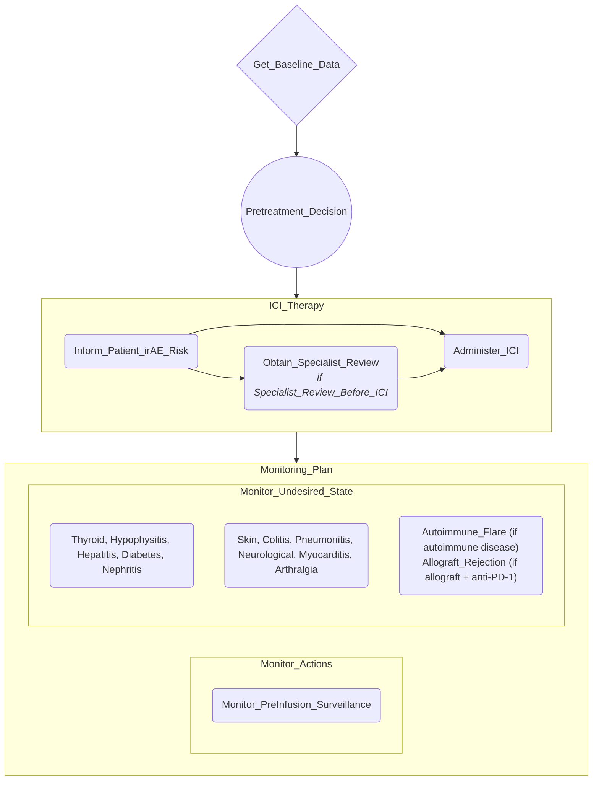

# Proposal (revision 2): ICI immune-related adverse event monitoring CIG (ESMO 2017)

**Why a revision.** The Step 7 review (`reviews/cig-monitoring-review-20261025-1200.md`) failed `Monitor_PreInfusion_Surveillance`. As approved, it required TSH/FT4 before every infusion for the whole of therapy and held the infusion until they were reviewed. That contradicts the source (TFTs "before every infusion or at least once a month (in the case of 2-weekly infusions)", iv124; Fig 5: every second cycle after 3 months for anti-PD-1/PD-L1) and `Monitor_Thyroid`. §6a below fixes it and folds in the review's non-blocking WARNs. The action set, names, structure, decision rule and every other value are unchanged from the approved proposal. The build is a full re-emit from a fresh file after snapshotting the current guideline.

This proposal is the executable spec for Step 6. Section 6 fixes every task name, and the `cig-actions` block is the action set the build must equal. **The monitoring-action field values (ServiceRequest block, provenance keys, citations) are those in `EXTRACTION-20261025.md` §3, adopted verbatim as part of this proposal.** §6a amends some of those values, and where it does, §6a wins. The formalizer transcribes them into the Java-properties metaprops form (`skills/cig-monitoring/references/MetapropsSyntax.md`). Every `goal.noun_phrase` repeats the five ServiceRequest fields with identical values.

## 1. Scope

- **Population / condition / therapy:** adults with cancer treated with immune checkpoint inhibitors (ICI: anti-CTLA4, anti-PD-1, anti-PD-L1, or anti-CTLA4 + anti-PD-1).
- **Source:** ESMO Clinical Practice Guidelines, *Management of toxicities from immunotherapy* (Haanen et al., Ann Oncol 2017;28 Suppl 4:iv119–iv142). This is the only source; case reports are out of scope.
- **Design pattern in scope:** a full top-level plan, limited to what the guideline supports:
  - baseline Enquiry;
  - pre-treatment Decision;
  - ICI therapy plan;
  - Monitoring plan with two parallel sub-plans: **Monitor Actions** (completion of the pre-infusion surveillance) and **Monitor Undesired ADEs** (irAEs).
- **Out of scope:**
  - **Monitor Desired State:** tumour-response monitoring is not covered by this guideline, so the sub-plan would be empty and is omitted (no empty placeholders).
  - **irAE treatment management:** steroid courses, re-challenge and the like, beyond what each monitor's performer instruction states.

## 2. Competency Questions

- **CQ1** Which baseline data are collected before ICI therapy starts?
- **CQ2** Which criteria decide whether ICI can start without specialist review?
- **CQ3** Which irAEs are monitored during ICI therapy, with which test and how often?
- **CQ4** Which monitoring actions apply only to a sub-population, and what condition gates them?
- **CQ5** What triggers urgent assessment for each monitored irAE?
- **CQ6** Which monitoring action checks that the planned pre-infusion surveillance is actually done?
- **CQ7** Which monitoring actions trace to the ICI therapy action?

## 3. PROforma Structure

- **Root plan `ici_irae_monitoring`.** Goal `treat`: "adult cancer treated with immune checkpoint inhibitors, with monitoring for immune-related adverse events". Four components in sequence:
  1. `Get_Baseline_Data` (enquiry).
  2. `Pretreatment_Decision` (decision, single choice), after `Get_Baseline_Data`.
  3. `ICI_Therapy` (plan), after `Pretreatment_Decision`, with precondition `result_of(Pretreatment_Decision) = Start_ICI or result_of(Pretreatment_Decision) = Specialist_Review_Before_ICI`. Inside it:
     - `Inform_Patient_irAE_Risk`;
     - `Obtain_Specialist_Review`, after `Inform_Patient_irAE_Risk`, with precondition `result_of(Pretreatment_Decision) = Specialist_Review_Before_ICI`;
     - `Administer_ICI`, after **both** `Inform_Patient_irAE_Risk` and `Obtain_Specialist_Review`.

     The double antecedent matters. In PROforma a task whose antecedents were **all** discarded is itself discarded. `Inform_Patient_irAE_Risk` always completes, so `Administer_ICI` still runs when the specialist review is skipped (discarded) on the `Start_ICI` path.
  4. `Monitoring_Plan` (plan), after `ICI_Therapy`. Two parallel sub-plans:
     - `Monitor_Actions`: `Monitor_PreInfusion_Surveillance`.
     - `Monitor_Undesired_State`: the 13 irAE monitors in §6.

## 4. Plan Diagram



## 5. Data Items

| Name | Type | Values / unit | Source (asked by) | Used by |
|---|---|---|---|---|
| `pre_existing_autoimmune_disease` | boolean | true/false | `Get_Baseline_Data` | Decision arguments; precondition of `Monitor_Autoimmune_Flare` |
| `prior_irAE_on_ICI` | boolean | true/false (irAE on a previous ICI course, either class) | `Get_Baseline_Data` | Decision arguments |
| `organ_allograft` | boolean | true/false (solid-organ allograft recipient) | `Get_Baseline_Data` | Decision arguments; precondition of `Monitor_Allograft_Rejection` |
| `ici_regimen` | text | range `anti_CTLA4`, `anti_PD1`, `anti_PDL1`, `anti_CTLA4_plus_anti_PD1` | `Get_Baseline_Data` | precondition of `Monitor_Allograft_Rejection` |

Baseline values that no condition reads (TSH/FT4, ALT/AST/bilirubin, Na/K/creatinine/urea, glucose, history, baseline imaging) are listed in the `Get_Baseline_Data` description only (resolution of Q5 below).

**Decision `Pretreatment_Decision`** (single choice, symbolic):
- `Start_ICI`: argument `for, pre_existing_autoimmune_disease = false and prior_irAE_on_ICI = false and organ_allograft = false`. Description: "start the ICI therapy plan with standard irAE monitoring".
- `Specialist_Review_Before_ICI`: argument `for, pre_existing_autoimmune_disease = true or prior_irAE_on_ICI = true or organ_allograft = true`. Description: "a risk factor for irAEs is present; discuss risk and benefit with the relevant specialist before starting".
- Recommendation: the default, `netsupport() > 0`.
- Assistant-proposed rule (the guideline names the risk groups but gives no executable criterion). Abnormal baseline TFTs are deliberately not an argument: "Baseline abnormal values do not preclude treatment" (Fig 5).

## 6. Tasks

| Canonical name | Kind | Parent plan | After | Goal | Precondition | monitoring_stance |
|---|---|---|---|---|---|---|
| `Get_Baseline_Data` | enquiry | root | – | – | – | – |
| `Pretreatment_Decision` | decision | root | Get_Baseline_Data | – | – | – |
| `ICI_Therapy` | plan | root | Pretreatment_Decision | – | see §3 | – |
| `Inform_Patient_irAE_Risk` | action | ICI_Therapy | – | avoid: delayed detection and aggravation of immune-related adverse events (patient informed of potential irAEs and told to report symptoms directly to the treating team) | – | – |
| `Obtain_Specialist_Review` | action | ICI_Therapy | Inform_Patient_irAE_Risk | avoid: unassessed risk of autoimmune-disease worsening, recurrent irAEs or allograft rejection on ICI | `result_of(Pretreatment_Decision) = Specialist_Review_Before_ICI` | – |
| `Administer_ICI` | action | ICI_Therapy | Inform_Patient_irAE_Risk, Obtain_Specialist_Review | achieve: ICI therapy (anti-CTLA4, anti-PD-1/PD-L1 or combination) delivered for an approved indication (ESMO Table 1) | – | – |
| `Monitoring_Plan` | plan | root | ICI_Therapy | – | – | – |
| `Monitor_Actions` | plan | Monitoring_Plan | – | – | – | – |
| `Monitor_Undesired_State` | plan | Monitoring_Plan | – | – | – | – |
| `Monitor_PreInfusion_Surveillance` | action | Monitor_Actions | – | order (extraction §3.1) | – | recommended |
| `Monitor_Thyroid` | action | Monitor_Undesired_State | – | order (§3.2) | – | recommended |
| `Monitor_Hypophysitis` | action | Monitor_Undesired_State | – | order (§3.3) | – | recommended |
| `Monitor_Hepatitis` | action | Monitor_Undesired_State | – | order (§3.4) | – | recommended |
| `Monitor_Diabetes` | action | Monitor_Undesired_State | – | order (§3.5) | – | recommended |
| `Monitor_Nephritis` | action | Monitor_Undesired_State | – | order (§3.6) | – | recommended |
| `Monitor_Skin` | action | Monitor_Undesired_State | – | order (§3.7) | – | symptom_triggered_only |
| `Monitor_Colitis` | action | Monitor_Undesired_State | – | order (§3.8) | – | symptom_triggered_only |
| `Monitor_Pneumonitis` | action | Monitor_Undesired_State | – | order (§3.9) | – | symptom_triggered_only |
| `Monitor_Neurological` | action | Monitor_Undesired_State | – | order (§3.10) | – | symptom_triggered_only |
| `Monitor_Myocarditis` | action | Monitor_Undesired_State | – | order (§3.11) | – | symptom_triggered_only |
| `Monitor_Arthralgia` | action | Monitor_Undesired_State | – | order (§3.12) | – | symptom_triggered_only |
| `Monitor_Autoimmune_Flare` | action | Monitor_Undesired_State | – | order (§3.13) | `pre_existing_autoimmune_disease = true` | proposed_by_assistant |
| `Monitor_Allograft_Rejection` | action | Monitor_Undesired_State | – | order (§3.14) | `organ_allograft = true and (ici_regimen = anti_PD1 or ici_regimen = anti_CTLA4_plus_anti_PD1)` | proposed_by_assistant |

Every monitor's `monitored_target` names `Administer_ICI`, the therapy action it traces to (extraction §3). Each monitor has exactly one caption: a one-line summary of what it monitors (e.g. "Monitor thyroid function (TSH, FT4)").

```cig-actions
Inform_Patient_irAE_Risk
Obtain_Specialist_Review
Administer_ICI
Monitor_PreInfusion_Surveillance
Monitor_Thyroid
Monitor_Hypophysitis
Monitor_Hepatitis
Monitor_Diabetes
Monitor_Nephritis
Monitor_Skin
Monitor_Colitis
Monitor_Pneumonitis
Monitor_Neurological
Monitor_Myocarditis
Monitor_Arthralgia
Monitor_Autoimmune_Flare
Monitor_Allograft_Rejection
```

## 6a. Amendments to the EXTRACTION §3 values (revision 2)

The values below replace the named keys exactly. Keys not listed keep the EXTRACTION §3 value, as transcribed in the first build: `;` inside ServiceRequest values written as `,`, `applies_when` written as the bare token `all_patients_on_therapy`, and "…" citations expanded. Mirror every ServiceRequest change in `goal.noun_phrase`.

**`Monitor_PreInfusion_Surveillance`** (FAIL fix):
- `ServiceRequest.code`: completion check of the pre-infusion blood tests due at each infusion: ALT, AST and bilirubin, sodium, potassium, creatinine and urea, and blood glucose at every infusion, plus TSH and FT4 when due per the regimen-specific TFT schedule of Monitor_Thyroid
- `ServiceRequest.performerInstruction`: if any test due at this infusion is missing, obtain it and review the results before administering the ICI
- `trigger`: a test due at this infusion is missing at the time of a scheduled infusion
- `monitoring_frequency_basis`: the guideline sets transaminases and bilirubin "before every cycle" and sodium, potassium, creatinine and urea "before every infusion". TFTs follow the Fig 5 regimen schedule: every cycle for anti-CTLA4-containing regimens; for anti-PD-1/PD-L1, every cycle for 3 months, then every second cycle. Glucose is aligned to the same draw (assistant-proposed)
- `literature_basis`: TFTs "before every infusion or at least once a month (in the case of 2-weekly infusions)", with the regimen schedule in Fig 5; transaminases and bilirubin "before every cycle"; sodium, potassium, creatinine and urea "before every infusion"
- `assistant_invention`: framing the tests due at each infusion as one completion audit, adding glucose to the same draw, and the obtain-before-administering rule
- add `source.4`: ESMO 2017 Haanen et al., Ann Oncol 28(Suppl 4) iv119, Figure 5 (ICPi monitoring and management: thyroid function) iv125
- `ServiceRequest.occurrenceTiming` is unchanged (before every ICI infusion, each cycle, for the duration of ICI therapy): the check runs at each infusion, but what is due varies.

**`Monitor_Hypophysitis`** (WARN):
- `ServiceRequest.performerInstruction`: if severe mass-effect symptoms (severe headache, any visual disturbance) or severe hypoadrenalism (hypotension, severe electrolyte disturbance), send pituitary axis bloods (9 am cortisol, ACTH, TSH and FT4, LH, FSH, sex hormones, IGF-1, prolactin), start i.v. methylprednisolone 1 mg/kg, withhold ICI, arrange pituitary MRI and consult endocrinology. If moderate symptoms (headache without visual disturbance, or fatigue or mood change while haemodynamically stable with no electrolyte disturbance), start oral prednisolone 0.5-1 mg/kg once daily after sending the pituitary axis bloods, withhold ICI, arrange pituitary MRI and visual field assessment, and treat as severe if there is no improvement in 48 h
- `literature_basis`: append "Hypophysitis is mainly seen with anti-CTLA4 and is very rare with anti-PD-1 and anti-PD-L1 (iv126). Fig 6 gives the severe and moderate management tiers."

**`Monitor_Skin`** (WARN):
- `monitoring_frequency_basis`: replace "No routine dermatologist full-body exam is recommended" with "The guideline makes no recommendation for routine full-body skin examination"
- `monitored_target`: correct the punctuation (one comma before "tracing to")

**`Monitor_Autoimmune_Flare`, `Monitor_Allograft_Rejection`** (CQ verification note): `cq` = CQ3, CQ4, CQ5, CQ7.

**`Inform_Patient_irAE_Risk`** (WARN): caption "Inform the patient of potential irAEs and ask them to report symptoms directly to the treating team".

**Metadata:**
- title: "ICI immune-related adverse event monitoring (ESMO 2017)"
- version: "1.0"
- author: "agentic-cig-monitoring kit"
- desc (qualitative, no counts): "PROforma CIG for monitoring immune checkpoint inhibitor therapy in adults with cancer: baseline risk assessment, a pre-treatment decision, the ICI therapy plan, and surveillance for immune-related adverse events and for completion of the pre-infusion blood tests, from the ESMO 2017 toxicity guideline."

## 7. Terminology Reuse

No terminology coding was requested for this build. The ServiceRequest codes are plain-language orders. A later coding-only patch may add `ServiceRequest.supportingInfo.labCodes` (e.g. LOINC for TSH, FT4, ALT, AST, bilirubin, creatinine, glucose) and `conditionCodes` (SNOMED CT for each irAE).

## 8. Open Questions

The extraction raised these; each has a proposed resolution. Approval of this proposal accepts the resolutions unless you change them.

1. **Pre-treatment rule (CQ2):** accept the assistant-proposed rule in §5 (any of autoimmune disease, prior irAE or allograft means specialist review).
2. **Gating:** specialist-review patients still enter `ICI_Therapy` through `Obtain_Specialist_Review`, as in §3. A "do not start" outcome is not supported by the guideline.
3. **Population monitors (CQ4):** keep `Monitor_Autoimmune_Flare` and `Monitor_Allograft_Rejection` as `proposed_by_assistant` (sub-population and risk are sourced; the monitoring is designed).
4. **Allograft and anti-PD-L1:** stay faithful. The guideline names anti-PD-1 only, so anti-PD-L1 is not included.
5. **Baseline labs:** listed in the Enquiry description only; no condition reads them (scope discipline).
6. **Each-visit symptom review** for the symptom-triggered monitors: accepted as assistant-proposed cadence. No post-treatment cap is modelled; the 1-year late-onset statement stays in `monitoring_frequency_basis`.
7. **`Monitor_Myocarditis`:** kept, with `guideline_status=not_specified_as_a_guideline_monitoring_task`. The triggered action is sourced; the symptoms are assistant-completed.
8. **Steroid-related monitoring:** excluded (irAE treatment management).
9. **Source inconsistencies:** performer steps cite the Figures, and surveillance cadence cites the narrative text. The Table 2 GI section (it copies the hepatitis wording) is not used.
10. **Supplementary Table S1:** not available; proceed without it.

## 9. Sources

- ESMO 2017: Haanen JBAG, Carbonnel F, Robert C, et al. Management of toxicities from immunotherapy: ESMO Clinical Practice Guidelines for diagnosis, treatment and follow-up. Ann Oncol 2017;28(Suppl 4):iv119–iv142. doi:10.1093/annonc/mdx225. The project copy is in `resources/`.
- Section, figure and table locations per item: see `EXTRACTION-20261025.md` §1 and §3.

## 10. Excluded Candidates

| Candidate | Check | Reason |
|---|---|---|
| Monitor_Desired_State sub-plan (tumour response) | 4 (no empty structure) | Guideline has no response-monitoring recommendation |
| Ocular toxicity monitor | 1 | No assessment or surveillance instruction (iv133) |
| Haematological toxicity monitor | 1 | No surveillance instruction; "optimal treatment ... unknown" (iv134) |
| Infusion reactions | 1 | Outside the guideline's subject (iv119) |
| Fatigue monitor | 3 | No instruction; hypothyroid cause covered by Monitor_Thyroid (iv119) |
| Pancreatitis / small-bowel enteritis monitors | 1 | Rare (mainly with combination therapy); the guideline gives no detection instruction (iv130–iv131) |
| Colitis predictive biomarkers / budesonide prophylaxis | 1 | "No routine biomarker"; prophylaxis ineffective (recorded as negative stance in Monitor_Colitis) |
| Drug-interval criterion between ICI classes | 2 | No threshold or action given (iv121) |
| Abnormal baseline TFTs as a decision argument | 2 | "do not preclude treatment" (Fig 5) |
| Baseline labs and imaging as data items | 1, 2 | No condition reads them; kept in the Enquiry description |
| Tissue biopsy | 1 | "role ... is not established"; diagnostic (iv121) |
| PJP prophylaxis, steroid side-effect monitoring | 1 | irAE-treatment management (iv122, Fig 8, Fig 14) |
| Re-challenge decisions, hypophysitis sick-day education | 1 | Post-irAE management (iv127, iv130, iv133) |
| Separate monitor for prior irAE on ICI | 3 | Organ monitors already cover it; no extra monitoring step in the guideline |

## What I need from you

1. Approve revision 2 (or change any of the §8 resolutions, the decision rule, or the action set).
2. I will not start Step 6 (building the `.pf`) until you approve. On approval the status becomes `approved`, the `cig-formalizer` builds `guideline/ici_irae_monitoring.pf`, and the Step 7 gates run.
